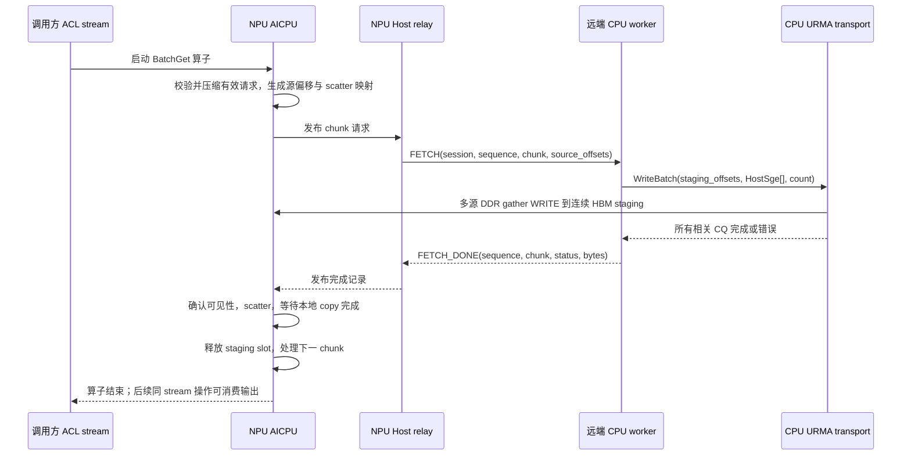

# AICPU BatchGet：CPU URMA 回推与本地 Scatter

状态：保留的完整后端设计草案。当前实现范围已收缩为独立带宽测试，见
[测试实现与运行说明](../tests/aicpu_batch_get/README.md)。本文件中的 Runtime、relay、
session 等生产化建议不属于第一版测试范围；硬件能力尚待目标机器验证。

## 1. 目标与边界

从 NPU 调用方看，这是 BatchGet：读取远端 CPU DDR 中已有的数据，写入调用方指定的 NPU 输出位置。AICPU 生成读取请求；远端 CPU worker 直接调用 `CpuUrmaTransport::WriteBatch()`，把离散 DDR 数据 gather WRITE 到 NPU 连续 staging；AICPU 随后执行本地 scatter。

不经过 `RuntimeCore::BatchPut`、`CpuUrmaAccessOperator::ExecuteBatchPut` 或 MetaManager 的 Put 事务。CPU WRITE 是 Get 的传输步骤，不改变源数据及其元数据。

参考仓库仅用于学习 AICPU 算子的构建、注册、启动和设备侧执行写法。本设计的数据面和资源模型以 KVAF 为基础。

## 2. 已有代码与需要补齐的能力

| 位置 | 当前能力 | 本设计使用方式 |
| --- | --- | --- |
| `common/include/requests.h` | BatchGetRequest、caller stream、可选同步 | 保留外部语义 |
| `access_operator/src/access_operator.cc` | NPU 参数校验、stream enqueue | 增加 BatchGet 执行后端选择 |
| `access_operator/include/cpu_urma/sgl_batch_builder.h` | 相邻远端目标合并为一个 WRITE gather group | 原样复用 |
| `access_operator/src/cpu_urma/cpu_urma_transport.cc` | 多源 SGE → 单远端 SGE、多 Jetty、CQ 等待 | CPU worker 直接调用 WriteBatch |
| `runtime/include/peer_protocol.h` | region/channel 创建与释放 | 增加 Get session 建立/关闭协议 |
| `runtime/src/runtime_service.cc` | 串行 accept/ServeConnection | 仅承担短初始化请求；热路径使用独立 worker/连接 |

现有 `WriteBatch` 使用同步完成语义：成功前等待所有 wave 的相关 CQ。`WriteSglBatch` 是旧的单本地 SGE 路径，不作为新后端的数据入口。

`remote_sgl_size` 虽然名称包含 remote，实际控制 WRITE 的本地源 SGE 数量；默认 1。新 session 显式配置大于 1 的期望值，仍由现有 transport 按设备能力裁剪。

## 3. 模块组成

建议在 DefaultAccessOperator 内增加内部 BatchGet backend：`aiv_read` 和 `aicpu_cpu_push`。选择影响 ExecuteBatchGet，不改变 BatchPut。对上层不新增 Put 调用。

新增模块职责：

1. `AicpuBatchGetBackend`：分配 session 资源、启动算子、维护执行 context 生命周期。
2. `AicpuGetMailbox`：AICPU 与本机 Host relay 的请求/完成交换，封装平台缓存与可见性操作。
3. `CpuPushGetRelay`：NPU 本机 Host 专用线程，将 mailbox 请求转发给远端 CPU，将完成记录发布回 mailbox。
4. `CpuPushGetWorker`：驻留在拥有源 DDR 的 CPU Runtime 进程内，校验源范围并调用底层 WriteBatch。
5. `KvafAicpuBatchGet`：读取 device AccessTable 和输入描述符、压缩有效请求、等待回推、执行 scatter。
6. `AicpuLocalCopyEngine`：本地 HBM → HBM copy 的平台适配，优先 AICPU 驱动 SDMA，负责提交、完成及错误处理。

第一版采用 Host relay 转发控制消息，不假设 AICPU 有 Host socket、Host C++ 对象或 liburma 的可用运行环境。数据不经过 relay，始终由 URMA 直接送入 HBM。

## 4. 端到端时序



CPU worker 不等待 NPU stream 完成；Host relay 也不能通过同步该 stream 来获取请求，否则会形成循环等待。

## 5. 保留当前 BatchGet 的地址语义

设 `B = output_block_bytes`，不是 `output_block_bytes / tokens_per_block`。当前 NPU 路径将 B 直接作为每个 token 的搬运字节数。

对于原始请求 i：

```text
active = mask[i] != 0
src_address = addresses[indices[i]] + offsets[i]
dst_address = output_base + output_indices[i] * B
entry_layout_bytes = B * tokens_per_block
```

按原始请求顺序稳定压缩得到 active_request_ids[k]，对当前 chunk 内的第 j 条：

```text
cpu_source[j] = source_region.base + source_offset[j]
remote_offset[j] = staging_slot_offset + j * B
scatter_source[j] = staging_slot_base + j * B
scatter_destination[j] = output_base + output_indices[active_request_ids[k+j]] * B
```

CPU 只接收源区域内偏移，不接收最终 output 地址；scatter 映射保留在 NPU。CPU 的源 region base 必须由 session 注册信息提供，不能把线上任意地址直接转换为指针。

校验范围与当前 NPU kernel 对齐：有效表项、非负索引/偏移、entry 内范围、CPU region 范围、输出范围、乘加溢出。mask=0 的条目不解析，其输出保持不变。全 mask=0 时立即成功，无网络请求。第一版拒绝有效请求间重复 output_indices，避免并发写同一目标；这是新后端的显式约束，不能悄悄依赖最后完成的 copy 获胜。

DeviceAccessTable 没有逐项 length 字段，不能声称已经校验每个 key 的真实长度；仍沿用 B×tokens_per_block 的现有布局契约。后续若需要变长 Get，需单独扩展 ABI。

## 6. Session 初始化与反向通道

初始化阶段完成，不能放在每个 BatchGet 或 graph replay 热路径中：

1. 绑定已有 CPU source region/session，并取得源 DDR 生命周期引用。
2. NPU 分配固定 HBM staging、描述符 workspace、状态区；通过现有 NPU provider 导出合法 HBM region 信息。
3. 建立 CPU → NPU 回写通道。CPU worker 使用 `has_external_region=true` 导入 staging 的 PeerRegion，创建独立 CpuUrmaTransport。
4. 预注册源 DDR，预分配 CPU HostSge/remote_offsets 工作数组。
5. 创建本机 mailbox、relay、远端 worker 和本地 copy engine；执行小数据回写及 scatter 验证，之后 session 才可用。

重要：当前 CpuUrmaTransport 即便使用 external_region，初始化时仍会调用 `PeerLink::CreateChannel`。只传 PeerRegion 不够。NPU 侧必须有能服务该 region 的 CreateChannel handler；可复用现有 NPU target 能力，但必须绑定到同一个 provider/context 和 session。禁止盲目复用 AIV READ 的 SQ/CQ 或 device entity。

当前 RuntimeService 串行服务连接，不能让一个长驻 FETCH 连接占住主 accept loop。短 OPEN 请求建立 session 后，热路径由独立 listener/worker 服务；同时 NPU 反向 channel 服务应独立推进，避免初始化互相等待。

CPU source region 和 NPU staging region 属于不同方向的资源，session 显式保存两个 ID。源内存可能修改/释放的问题不因复制了 AccessTable 就消失：第一版要求调用方在操作完成前不修改/释放相关 key、表和 buffer；session 持有 region 引用防止整个 region 被销毁。

## 7. 控制协议与固定 ABI

初始化协议建议新增 OPEN/CLOSE Get session；热路径定义独立、有版本和帧长的 FETCH/FETCH_DONE，具体编号在实现时统一分配。以下是字段设计，不是可直接使用的 C++ wire layout：

```text
OpenGetSession:
  source_session_id, staging_peer_region, npu_control_endpoint
  max_rows_per_chunk, staging_slot_bytes, slot_count, capabilities

FetchRequest:
  version, frame_bytes, session_id, session_epoch
  execution_sequence, chunk_index, slot_id, active_count, token_bytes
  source_offsets[active_count]

FetchDone:
  session_id, session_epoch, execution_sequence, chunk_index, slot_id
  status, completed_bytes, failed_row

Device-only ScatterPlan:
  active_request_ids[], output_base, output_indices, token_bytes
```

staging slot 起始地址由 session 和 slot_id 决定；CPU 自己计算 j*B，不允许请求指定任意远端写地址。active_count、B、帧长、总字节数都进行有界校验。第一版一个 session 一个 in-flight chunk；重复请求不重复提交，缓存最后完成结果或拒绝不匹配状态。错误完成中的字节数不用于尝试 scatter 部分数据。

mailbox 与网络协议分开：网络可显式编码固定宽度整数，mailbox 按平台 cache line 对齐。不要直接共享带 vector、指针所有权或 C++ atomic 对象布局的结构。

## 8. Mailbox 与可见性

首选方案是平台支持的 AICPU/Host 双方可访问的映射控制内存；分别保存 host VA 和 device VA，不假设数值相同。该能力需要先做硬件验证，当前 KVAF 尚无已验证的 mailbox 实现。

请求槽由 AICPU 写、Host 读；完成槽由 Host 写、AICPU 读，两者分离 cache line。生产者先写 payload，再执行平台规定的 cache clean/barrier，最后发布 sequence；消费者按 acquire/invalidate 协议读 sequence 后读取 payload。普通 volatile 不提供这些保证。

如果映射不可用，可验证独立 progress stream 上的小块 D2H/H2D 复制方案；必须使用 commit/ack 协议，保证复制期间 payload 不变，并验证设备在 AICPU 等待期间仍可推进复制。不得默认此回退方案可用，更不能把复制排在正在等待它的 caller stream 后面。初始化 capability test 失败则不启用该后端。

数据就绪必须建立完整顺序：

```text
全部数据 WR 完成
  → provider 定义的远端写入可见性保证/必要的 fence
  → CPU 发送 FETCH_DONE
  → Host 发布 mailbox 完成
  → AICPU acquire/必要的 cache 操作
  → SDMA 或本地拷贝读取 staging
```

跨 TCP 的 FETCH_DONE 本身不构成 UB/HBM 内存 fence。当前 WriteBatch 的 CQ 等待是复用起点，但必须核实当前 provider 对 WRITE completion、comp_order、RELAX_ORDER 的保证；若不满足，在 transport 完成边界补必要 fence。第一版不使用跨 Jetty 的“最后写一个远端 flag”来推断全部数据到达。

## 9. Scatter、分块与 stream

第一版：一个执行 context、一个 coordinator AICPU、一个 staging slot，chunk 串行执行。chunk_rows 受 staging 容量、描述符容量及控制帧上限共同限制；B 大于 slot 容量时明确报错。总 active rows 可以跨多个 chunk，WriteBatch 自己继续按设备限制分 WR/wave。

AICPU 优先通过本地 copy engine 发起 SDMA HBM→HBM scatter，按 engine 的长度和队列限制分批提交，等待全部本地 copy 完成后才释放 slot。不要把 Host aclrtMemcpy 接口直接放进 AICPU。若硬件上的设备侧 memcpy 可用，可作为正确性原型，但性能需与 SDMA 独立比较。

合并相邻 output row 的 copy 是后续优化；合并必须同时满足源 staging 和目标地址连续。第二阶段引入双 staging slot，让 chunk k 的 scatter 与 chunk k+1 的 CPU WRITE 重叠。

调用方仍提供 ACL stream。默认 ExecuteBatchGet 只 enqueue 算子，不阻塞 Host；算子直到 scatter 完成才结束，以保证同 stream 后继消费有序。synchronize=true 时等待并读取设备错误状态。异步返回 OK 仅代表 enqueue 成功；异步错误需通过受支持的 kernel/stream 错误传播或新增显式状态查询观察，不能将失败当作有效输出。

所有输入、输出、workspace、session 和 slot 在算子真正完成前保持有效。第一版同一 context 只支持同 stream 串行执行；不同 stream/并行 graph 需要独立 context，暂不共享槽。

graph replay 的 sequence 必须由设备执行时递增，不能使用 capture 时写死的序号。会话、workspace、mailbox、staging 地址在 replay 期间固定。AICPU kernel 的 capture/replay 支持需独立验证；未验证前仅声明支持 eager enqueue。

## 10. 状态与故障回收

```text
FREE → REQUEST_READY → CPU_WRITING → DATA_READY → SCATTERING → FREE
                         任一阶段失败 → ERROR / QUARANTINED
```

用 session_epoch + execution_sequence + chunk_index 区分结果，不能使用单个 done 布尔值。AICPU 和 Host 各自仅修改其拥有的状态字段。

超时不代表 DMA 已停止。发生超时、断连、部分提交失败或不匹配完成时，停止新的请求，隔离 slot；待 worker/URMA 队列排空或完成 teardown、设备执行结束后才能释放或复用。遵守现有 transport 在提交失败后 poisoned、需要重初始化的约束。晚到 completion 不得写入新 session 的槽。

前面 chunk 已 scatter、后面失败时，整次 BatchGet 失败，输出可能部分更新，不承诺事务性回滚。Shutdown 先拒绝新任务，再停止/收敛执行和 worker，最后销毁 copy engine、通道、注册内存及 buffers。

## 11. 拟定代码落点

| 模块 | 建议文件/目录 |
| --- | --- |
| backend 配置与选择 | `access_operator/include/access_operator.h`、`access_operator/src/access_operator.cc` |
| AICPU 参数、mailbox ABI | `access_operator/include/aicpu/` |
| AICPU backend 与 launcher | `access_operator/src/aicpu/` |
| device kernel、本地 copy 适配 | `access_operator/kernel/aicpu/` |
| CPU push worker | `runtime/src/cpu_push_get_worker.*` |
| NPU relay、session 管理 | `runtime/src/aicpu_get_relay.*` |
| 建链及控制协议 | `runtime/include/peer_protocol.h`、`peer_link.h` 及实现 |
| 可选构建 | 新增 `KVAF_ENABLE_AICPU_BATCH_GET`，独立于 AIV 开关 |

上述为建议新增模块，非当前已有 API。保持 CPU transport 的 gather builder、Jetty 分工和 CQ 逻辑，只有可见性验证发现缺口时才扩展完成接口。

## 12. 实施与验收

1. **平台验证**：最小 AICPU launch；同 stream 顺序；mailbox 双向可见；AICPU 等待时 Host progress；本地 scatter；CPU WRITE 完成后的 HBM 可见性。
2. **单 chunk 闭环**：固定源 offsets，CPU worker 调用 WriteBatch，AICPU scatter，与 CPU 期望逐字节比对。
3. **接入 BatchGet**：动态 device 表/indices/mask/output_indices，稳定压缩，多 chunk，生命周期及错误状态。
4. **性能与扩展**：双缓冲、多 context，最后验证 graph replay。

Host 测试覆盖：描述符编解码、越界/溢出、稳定压缩、staging 偏移、mask/no-op、重复输出约束、序号重放、晚到完成、超时隔离及 worker 的 mock transport 调用。现有 gather builder 测试继续适用。

硬件测试覆盖：随机离散 DDR 源与随机输出行、跨 Jetty/WR/wave、非均匀尾 chunk、连续重复调用、源数据每轮变化、丢失完成及断连、关闭时在途请求。同 stream 后继算子直接校验输出，防止仅在全局 synchronize 后正确而实际 stream 顺序错误。

性能同时比较当前 AIV READ、CPU 直接 WRITE 离散目标、CPU gather WRITE + AICPU scatter。记录端到端延迟及 validate/compact、mailbox/网络控制、URMA prepare/post/poll、scatter 各阶段；流水化后不能简单相加重叠时间。该方案多一次 HBM 读取和写入，其收益须超过请求往返与 scatter 成本，不能预先假定比 AIV 快。
