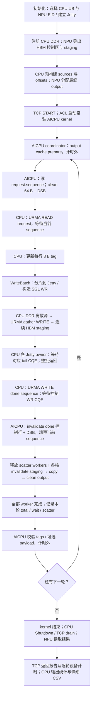
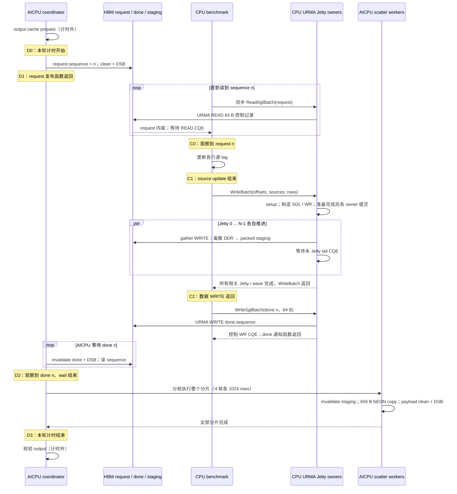

# 当前 AICPU + SGL 测试：实际流程与 staging 传输计时

基于 `2c4098705cc55edf80f85d7187a79e2d761246e0` 的普通 `scatter` 路径添加诊断。
本次只增加计时，不修改 Jetty 调度、分核方式、复制或缓存维护策略。
升级测试 ABI 到 V14，以免与历史 V12/V13 实验包混用。

## 完整流程

当前测试由 **CPU 主动发起 URMA READ/WRITE**。AICPU 发布请求并等待，
不直接调用 liburma。NPU Host 提供建链、HBM 注册导出、kernel 启动及结果回读。
TCP 用于初始化、START、drain 和最终报告；每轮请求与 done 都走 URMA/HBM 控制记录，
没有逐轮 Host relay。生产设计草案中的 relay 不属于这里的实际测试流程。



初始化的内存分配、注册、链路探测、sources/offsets 数组构建、kernel 加载、
启动，以及结束时的 Shutdown、D2H 回读、TCP 报告均不在每轮 `mean_ns` 中。

### 一轮 scatter 的时序



CPU 的 done CQE 返回与 AICPU 观察到 done **可能重叠**，图中不代表二者严格先后。
AICPU 在观察 done 后才能 scatter，但不需要等 CPU 的通知函数返回。
跨 Jetty 数据就绪仍由 `WriteBatch` 等待所有相关 CQ 后再发布 done 来保证；
本次没有用某一个 Jetty 的最后 WR 推断其他 Jetty 完成。

### 4096 × 656 B、4 核时的内存布局

```text
CPU DDR source：4096 行，每行 stride = round_up(656,64)+64 = 768 B
    logical row 4095、4094、…、0 的地址，依次填入 sources[0..4095]

已注册的 NPU HBM region：
    +0       request：64 B（AICPU 写，CPU URMA READ）
    +256     done：64 B（CPU URMA WRITE，AICPU 读）
    +512     per-range ready 区（普通 scatter 不使用）
    +4096    staging：4096 × 656 = 2,686,976 B，行间无 gap

另一个 NPU HBM allocation：最终 output
    slot 0..4095，stride = 768 B；每行只复制 656 B payload
    尾部 112 B gap/guard 保留原值

scatter worker 0 / 1 / 2 / 3：
    staging slots [0,1024) / [1024,2048) / [2048,3072) / [3072,4096)
    → 相同 slot 的 output
```

CPU 的 Jetty 分片与 AICPU 的核分片是两套分工。即使二者都配置为 4，
普通 scatter 仍先等整批传输完成，然后一起 scatter，没有分片 ready 流水线。
WRITE 的 SGL 上限受请求的 `remote-sgl-size`、硬件 local SGE 上限、消息字节上限
及远端连续性共同约束；`mean_wrs` 是最终 WR 数，不是 rows 数。
当前 transport 每 wave 最多 `8192 × jettys` 行，4096 行 / 4 Jetty 通常只有一个 wave。

## 新增打点

CPU 开关 `--profile-transfer` 默认关闭，且只接受 `scatter`。
`--profile-transfer-csv FILE` 自动启用打点，将 CPU 与设备按 sequence 匹配到同一行。
只收集正式迭代，不包括 warmup；循环内没有打印或 CSV 写盘。
CPU 使用 `steady_clock`，AICPU 使用 `cntvct_el0` 并按回读频率换算 ns。
所有 `_ns` 字段单位为纳秒；reads/polls/wrs/waves/rows 是计数。

| 字段 | 计时边界及用途 |
| --- | --- |
| `npu_wait_ns` | D0→D2，含发布 request、CPU 检测/处理、数据 WRITE、done 通知及 AICPU 检测 |
| `npu_request_publish_ns` | D0→D1，request store/clean/DSB；multi-block 还含起点协调字段 Store |
| `npu_done_wait_ns` | D1→D2，等待并观察 done，包含 CPU 供给全过程 |
| `npu_done_polls` | 本轮 ReadDone 调用次数，包含最后一次匹配读取；没有给每次轮询额外读时钟 |
| `npu_scatter_ns` | D2→D3，沿用原有整批 scatter 加调度/收尾计时 |
| `npu_total_ns` | D0→D3，等于 wait + scatter |
| `npu_cache_prepare_ns` / `npu_verify_ns` | output 冷缓存准备 / 校验，计时外；用于解释两轮之间的间隔 |
| `cpu_request_poll_ns` / `cpu_request_reads` | CPU 开始等本轮到观察当前 request 的 wall time / READ 次数；可能含上一轮 scatter、校验、下一轮 cache prepare |
| `cpu_matching_read_*` | 最后一次读到当前 request 的 READ 内部计时；不累加此前读旧 sequence 的 READ |
| `cpu_source_update_ns` | 观察 request 后到源 tag 更新完成；`verify-payload` 开启时还包含整行 payload 生成 |
| `cpu_data_write_call_ns` | CPU 完整同步 WriteBatch 调用，包括获取提交锁、包装层及传输内部 |
| `cpu_data_transport_ns` | 原有 `cpu_write_ns` 口径，提交锁内的传输整体时间，包含所有 serial waves |
| `cpu_data_plan_ns` | 超出一个 wave 时的预校验/host segment 注册；单 wave 通常为 0，常规 SGL 构造在 prepare 内 |
| `cpu_data_setup_ns` | 每 wave 的 workspace/队列 sizing 等准备 |
| `cpu_data_prepare_ns` | 构造 SGE/WR、源/目的范围校验、segment 查找、OpenMP 启动/同步，到最早 owner 开始 post |
| `cpu_data_post_ns` | 最早开始 post→最晚 post 函数返回，DMA 可以同时推进 |
| `cpu_data_poll_tail_ns` | 最晚 post 返回→最晚 owner 观察 CQ 并返回的尾部时间 |
| `cpu_data_other_ns` | transport total 减去 plan/setup/prepare/post/poll；包括 join、阶段边界、状态检查、诊断聚合等剩余开销 |
| `cpu_data_wrapper_ns` | data write call 减去 transport total，含锁等待/包装层/外层 Check 等 |
| `cpu_done_notify_call_ns` | 仅最终 64 B done 的完整 WriteSglBatch 调用；不混入数据 WRITE |
| `cpu_done_*` | done transport 内部 setup/prepare/post/poll/other 与外层 wrapper，口径同上 |
| `cpu_response_ns` | CPU 观察 request→done 通知函数返回；不含之前的 request polling |
| `cpu_gap_ns` | response 中不在 source update / data write call / done notify call 内的间隔与统计 bookkeeping |
| `cpu_data_waves` / `cpu_data_wrs` | 实际数据波次 / WR 数量，通知 WR 单独处理 |
| `cpu_cq_spread_ns` | 各 wave 活跃 Jetty 最早与最晚 CQ 观察的时间差之和，反映完成不均衡 |
| `jetty_N_*` | 该 Jetty rows/wrs、post、post 返回到 CQ 观察、全局 post 结束后的 CQ tail，以及成为最后完成者的 wave 次数 |

设备的可加分解：

```text
npu_total = npu_wait + npu_scatter
npu_wait = npu_request_publish + npu_done_wait
```

CPU 的可加分解：

```text
cpu_response = cpu_source_update + cpu_data_write_call + cpu_done_notify_call + cpu_gap
cpu_data_write_call = cpu_data_transport + cpu_data_wrapper
cpu_data_transport = plan + setup + prepare + post + poll_tail + other
```

`dispatch_ns` 与 prepare/post 重叠，因此不再作为可加项输出。
Jetty 的并行时间不能相加作为整批 wall time；多 wave 的指标则累加 serial waves。

## 如何解读 staging 的瓶颈

1. 先看 `cpu_data_write_call_ns` 和 `cpu_data_transport_ns`，确定真正的数据 WRITE
   占 `npu_wait_ns` 的多少；不要把整个 wait 当成 DDR→HBM 传输。
2. prepare 大：看 WR 数、SGL 粒度、descriptor 构造及 OpenMP 开销；setup/other 大：
   看 workspace、segment 查询、同步/join；wrapper 大：看提交锁或调用包装。
3. poll tail 大：检查各 Jetty 的 post-to-CQ、cq_spread、tail_waves，确认是所有队列
   都慢，还是某个 owner/链路经常拖尾。这里尚不能区分网络、DDR/HBM、provider 与 CPU 调度。
4. done_notify 大：64 B 控制路径也是同步 SGL 调用，其 prepare/post/poll 单独输出，
   可以确认控制 WR 的固定开销是否占主要部分。
5. CPU source_update 大：这是 benchmark 每轮更新 tag/payload 的成本，不属于 URMA 数据面。
6. 对波动看 **同 sequence 的逐轮记录**，先比较 data/notify/prepare/poll 与
   npu_wait 的变化，再看 Jetty 完成分布；汇总同时提供 mean/p50/p99。

**两端时间不能直接相加或相减得到“网络剩余耗时”。** CPU request polling 的大部分
时间可能发生在 D0 之前；CPU 通知 CQE 返回也可能发生在 D2 之后；request clean/DSB
返回前，CPU 就可能已观察到 request。即使在同一机器，也没有建立跨时钟时间戳校准。
本实现按 sequence 对应的是同轮事件和本地 duration，没有推断跨时钟的单向延迟。

`post` 是提交 API 的 CPU 时间；`poll_tail` 是 CQ **软件观察**的尾部，包含尚未完成的
DMA/链路传输、排队、provider 处理、轮询和调度等待，不能称为纯链路时间。
精确的 DDR→HBM 硬件到达时间还需要 provider/硬件时间戳或性能计数器，本次软件打点不虚构该指标。

## 运行

重新构建两端并安装 V14 kernel，安装后重启 NPU 测试进程。每次测试都重新启动 NPU server。

```bash
bash build.sh aicpu-cpu
bash build.sh aicpu-npu

# NPU；本次关注 staging，通常无需 --profile-scatter，避免额外的每核诊断扰动
bash tests/run_aicpu_get_npu.sh --install-kernel --device-id 7 --aicpu-blocks 4

# CPU；远端测试把 peer 替换为 NPU 主机地址
bash tests/run_aicpu_get_cpu.sh --peer 127.0.0.1:29991 --device-id 7 \
  --transfer-mode scatter --rows 4096 --row-bytes 656 --scatter-threads 4 \
  --remote-sgl-size 16 --jettys 4 --prepare-threads 4 \
  --warmup 5 --iterations 1000 \
  --profile-transfer-csv staging-rounds.csv --output staging-e2e.csv \
  2> staging-cpu.log
```

`staging-e2e.csv` 保持原 CSV schema；`staging-rounds.csv` 是新逐轮拆解；
`staging-cpu.log` 中 `[AICPU_TRANSFER] STAGE` 输出各字段 mean/p50/p99，
`JETTY` 输出各队列统计。SUMMARY 的 `staging_data_GBps` 使用 payload / 平均数据 transport
耗时计算，包含该调用的准备/提交/等待，不代表纯链路带宽。
只要汇总时使用 `--profile-transfer`，省略 CSV 文件参数。
单核对照将 CPU `--scatter-threads` 与 NPU `--aicpu-blocks` 同时改为 1，
保留 CPU `--jettys 4 --prepare-threads 4`，避免把 AICPU 核数与网络并行度一起改变。
如需普通 scatter 内部诊断，可在 NPU 上叠加 `--profile-scatter`，但应单独对照其开销。

计时开关会增加少量时间戳、计数与记录开销；关闭开关做同参数性能对照。
本次没有删除 output 冷缓存准备或校验，也没有改变 source 的注册与缓存状态。

主机协议测试覆盖计时分解可加性、时钟换算、预热排除、cache prepare/verify 计时外边界、
逐轮 sequence 对齐、CSV 列对齐、错误样本拒绝以及 pipeline/direct_output 与该开关的互斥：

```bash
cmake -S . -B build-host-aicpu -DBUILD_TESTING=ON
cmake --build build-host-aicpu --target kvaf_aicpu_get_protocol_test -j
ctest --test-dir build-host-aicpu -R kvaf_aicpu_get_protocol --output-on-failure
```
