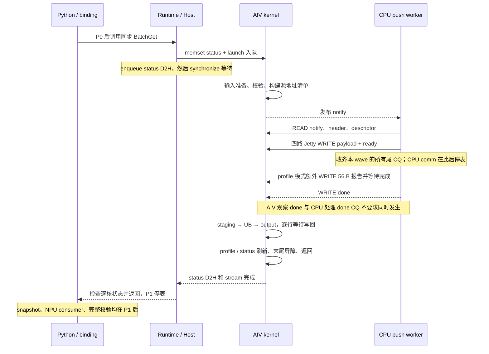

# AIV scatter BatchGet 计时审计与逐层耗时拆解

> 历史实验记录：当前已固定SIMT融合清单构建和UB双缓冲，仅保留流水算法开关。
> 下文旧对照开关不再支持；运行方式和计时口径见 [当前性能测试说明](aiv_scatter_performance.md)。

审计日期：2026-10-31。代码基线：`aiv-scatter@7a499b4`。
数据：三组各 100 条 `profiled` 样本，均为 4 个 AIV 核、1024 blocks、请求容量 8192。
前两组为 4 tokens/block、有效 token 数 4096，token 分别为 656 B 和 4096 B；
最新一组为 1 token/block、有效 token 数 1024、4096 B/token，即单次有效 payload 为 4 MiB。
本文中的实测数值均为单次同步调用的算术平均耗时；带宽为总有效字节数/总耗时，单位为十进制 GB/s。
第 2 节代码层级树和第 7 节采用最新 4 MiB 数据，第 5 节保留前两组数据的分析。

## 1. 审计结论

| 检查项 | 结论 |
| --- | --- |
| Python 单次调用起止点 | 正确包住一次同步 BatchGet，包含 binding/Runtime/Host、设备工作及状态检查；不含输入准备、BatchPut、profile snapshot 和输出校验 |
| CPU 起止点是否混入 scatter | 没有；CPU 通信窗口在回传 profile 和发布 done 之前已经结束，AIV 之后才开始 scatter |
| 是否只等第一个 Jetty 完成 | 没有；tracker 收齐本 wave 全部队列的尾 CQ 后，才返回 batch 完成 |
| CPU 带宽是否跨时钟域计算 | 没有；分子为有效 payload，分母来自 CPU `steady_clock` 的时间差，不依赖 AIV 时钟参数 |
| CPU 指标能否称为纯 DMA 带宽 | 不能；它包含提交软件、payload/ready WRITE、完成上报及 CPU 处理尾 CQ 的时间 |
| AIV scatter 是否在异步搬运刚提交后结束 | 没有；每次输出写回均等待 MTE3→S 事件，再处理下一行，finish 在 scatter 循环返回后采样 |
| `aiv_wall` 是否等于实际 kernel 执行总时长 | 不等于；它是被打点的主体跨度，未完整覆盖 kernel 开头和末尾 |
| `call_outside_aiv` 是否是纯 Host 时间 | 不是；它是推导剩余量，含未覆盖的设备收尾等，不能按比例分摊成 Python/launch/D2H 时间 |
| 现有数据能否逐层给出所有软件函数耗时 | 不能；binding/Runtime/Host 目前没有独立计时，不能从现有 CSV 还原这些子项 |

静态审计及数据核对未发现把 8192 容量当有效字节数、把多核带宽重复乘四、
跨 CPU/AIV 绝对时间戳相减、提前在首个 CQ 停表等错误。
这不等同于硬件时间戳校准：当前测量的是软件可观察的完成窗口。

## 2. 一次调用的流程与代码层级

以下耗时取自最新 100 条样本，单位为 μs。未独立打点的函数明确标注，
不会把调用总量或推导剩余量当成这些函数的独立实测耗时。

```text
计时之外：prepare()
  更新源 payload 和 indices/offsets/output_indices
  source.copy_(source_cpu)                     [测试源数据 CPU→HBM 上传，计时之外]
  output.fill_(guard)，stream.synchronize()
  BatchPut                                    [HBM→CPU 存储，为 BatchGet 准备源数据]
  prepare_access_table，access_table_view，stream.synchronize()

Python perf_counter_ns()：P0
  call(index)                                 [整次同步调用：967.332 μs，4.336 GB/s]
    NpuPythonRuntime::BatchGet()                 [binding，无独立计时]
      BatchGetImpl()
        GetNpuTensorView() × 7，布局检查，ResolveStream()
        NpuRuntime::core()                     [取得 RuntimeCore 引用]
        RuntimeCore::BatchGet()                [Runtime，无独立计时]
          表句柄、buffer、shape/layout 检查
          DefaultAccessOperator::ExecuteBatchGet()
            ScatterBatchGet::Execute()        [Host，无独立计时]
              mutex、capture 查询、Drain 上次调用、Input()、递增 sequence
              aclrtMemsetAsync(status)
              KvafScatterBatchGetLaunch()
                aclrtLaunchKernelWithHostArgs()
              Drain()
                aclrtMemcpyAsync(status D2H)  [排在 kernel 后面]
                aclrtSynchronizeStream()      [Host 等待；期间执行下方设备/CPU 流程]
                逐核检查 magic/sequence/result/phase
    返回 Python
Python perf_counter_ns()：P1

计时之外：snapshot()
  scatter_profile()，profile D2H，字典转换，字段验证及周期换算 [369.166 μs]
计时之外：check()
  后继 NPU 算子消费 output，完整 output/guard 回读校验
  release_access_table，batch_free
```

Host 等待期间的实际设备/CPU 流程如下。**这部分在 P0–P1 内，CPU→HBM WRITE 没有被排除。**
下面按照执行先后和嵌套窗口排列；CPU 服务端是独立线程，箭头表示跨端通知，不是直接 C++ 函数调用。

```text
KvafScatterBatchGetAivKernelV1()                 [实际 kernel 总时长未独立测量]
  被打点主体的跨核跨度 aiv_wall                 [796.792 μs]
    输入缓存维护、读取 miss_count               [aiv_input_wall：5.621 μs]
    Scatter()
      core 0: ValidateRows()、Source() 清单、header、Flush、PublishWord(notify)
                                                [aiv_build_notify：359.726 μs]
      各核等待 done；core 0 的 notify→done 窗口   [153.842 μs]
        notify → CPU 服务端 Worker::Run()
          Transport::ReadRequest()              [READ notify，未独立回传耗时]
          Transport::ReadDescriptor()
            READ 64 B header                    [cpu_header：3.175 μs]
            检查 header                         [未独立计时]
            READ 1024×8 B 源地址数组             [cpu_descriptor：4.217 μs]
          Transport::WriteBatch()               [cpu_write：135.782 μs，30.890 GB/s]
            PrepareWrites()/RefreshPrepared()/BeginPrepared() 等
                                                [write 其余软件合计：16.609 μs，推导值]
            首次 post 前 → 最后 payload/ready 尾 CQ 处理后
                                                [cpu_comm：119.173 μs，35.195 GB/s]
              PostPrepared() × 4 Jetty          [cpu_post：9.372 μs]
                URMA WRITE：CPU DDR 源 SGE → HBM staging；同时提交 ready WRITE
              PollPrepared()                    [cpu_cq_wait：109.801 μs]
                等待并处理所有队列尾 CQ；传输可与 post 重叠
          Transport::Complete()                 [未独立回传耗时]
            profile 模式先 WRITE 56 B 报告并等待完成
            再 WRITE done → AIV 观察到匹配 sequence
      4 核分别处理 256 token，CopyPayload(): HBM staging→UB→output
                                                [scatter_tail：277.603 μs]
                                                [max(各核 scatter 时长)：277.739 μs]
  读取 CPU 报告、profile/status 刷新、PipeBarrier、kernel 返回
                                                [未完整包含在上述 aiv_wall 内]
Host：状态 D2H 完成、同步返回、逐核状态检查，返回到 Python P1

end_to_end - aiv_wall = 170.540 μs               [推导剩余量；含软件及未覆盖的设备工作]
```

按调用时间轴，`170.540 + 5.621 + 359.726 + 153.842 + 277.603 ≈ 967.332 μs`。
CPU header/descriptor/write 是 notify→done 内的嵌套工作，不能再加到这条总和上。
CPU 三项合计为 143.173 μs，与 notify→done 的差为 10.668 μs；
这只是跨端窗口的残差，混合请求发现、header 校验、报告/done 控制面和采样边界差异，不能当作某个函数的实测值。

对应代码入口：

| 层级 | 文件/位置 |
| --- | --- |
| Python 调用计时 | `tests/python/test_aiv_scatter_perf.py:88`，`measure_pass()` |
| 准备/调用/校验 | 同文件 `prepare():239`、`call():260`、`check():265`、`snapshot():293` |
| binding | `bindings/src/npu_python_runtime.cc:455`、`:481`，`BatchGet()`/`BatchGetImpl()` |
| Runtime | `runtime/src/runtime.cc:251`，`RuntimeCore::BatchGet()` |
| 算子分发 | `access_operator/src/access_operator.cc:508`，scatter 走 sequential 分支 |
| Host 执行与等待 | `access_operator/demo/aiv_batch_get/host/scatter_batch_get.cpp:238`、`:68` |
| kernel launch API | `access_operator/demo/aiv_batch_get/host/execute_scatter_batch_get_loader.cpp:68`、`:86` |
| AIV kernel | `access_operator/demo/aiv_batch_get/kernel/execute_scatter_batch_get_aiv.asc` |
| CPU 常驻服务线程 | `runtime/src/cpu_push_get_worker.cc:32`，`Worker::Run()` |
| CPU 请求读取 | `runtime/src/cpu_push_get_transport.cc:235`、`:244`，`ReadRequest()`/`ReadDescriptor()` |
| CPU→HBM WRITE 及尾 CQ 等待 | 同文件 `WriteBatch():421`，post `:445`，poll `:450` |
| CPU 报告与 done 发布 | 同文件 `Complete():459`，报告 `:475`，done `:478` |

Host 的同步等待与 AIV/CPU 服务端工作重叠，不能把 Host wait、AIV wall、CPU comm 三者相加。
基准的 prepare 在 P0 前同步 stream，避免把本轮 BatchPut/输入上传留到被计时的 stream 中。
在其他程序中复用相同计时方法时，若 P0 前尚有同 stream 任务，等待也会被包含进去。



## 3. CPU 打点逐行检查

源码：`runtime/src/cpu_push_get_transport.cc`。
所有 CPU 时间取自 `common/include/batch_get_profile.h:28` 的 `steady_clock`。
`ns` 是存储单位，不代表计时精度、读时钟成本均为 1 ns。

### 3.1 请求控制面

| 函数 | 代码位置 | 现有字段 | 实际包含内容 |
| --- | --- | --- | --- |
| `ReadRequest()` | `:235` | 未独立回传 | READ notify 的 WR 构造/提交/CQ 等待、识别新 sequence；空闲轮询也走这里 |
| `ReadDescriptor()` 第一段 | `:250` 附近 | `cpu_header_ns` | `Transfer(READ, request, sizeof(Request))`，包含软件准备、post 和 wait |
| header 校验 | `:256` 附近 | 未独立回传 | magic、sequence、count、token_bytes、workers 检查 |
| `ReadDescriptor()` 第二段 | `:259` 附近 | `cpu_descriptor_ns` | 读取有效源地址数组；当前 4096×8=32768 B，包含 Transfer 软件和 READ 完成等待 |

`ReadDescriptor()` 每次新请求先清空 CPU profile，再采集本轮值；
报告中的 token/magic 与 sequence 绑定，因此不会有意累加上轮耗时。
这些 READ 均发生在 CPU comm 窗口之前。

### 3.2 WriteBatch 时间轴

```text
W0：WriteBatch() 的 RAII 计时开始                         :422
  PrepareWrites(count)：首次构链或查找已缓存计划           :423
  对每个 wave：
    RefreshPrepared()：更新本轮源地址、ready sequence       :430
    BeginPrepared()：tracker 预留 credits、设置 CQ context :431
    profile 计数统计                                     :433
    A[w]：读时钟；第一个 A 写入 first_post_ns              :442-443
      PostPrepared(queue 0)
      PostPrepared(queue 1)
      PostPrepared(queue 2)
      PostPrepared(queue 3)                              :444-447
    B[w]：读时钟，累计 post += B[w] - A[w]               :448-449
      PollPrepared(wave)：轮询、校验、处理所有队列的尾 CQ    :450
    C[w]：函数返回后读时钟，更新 last_cqe_ns                :452
      cq_wait += C[w] - B[w]                             :453
W1：离开 WriteBatch()，RAII 累计 write_ns
```

由此得到：

```text
cpu_write = W1 - W0
cpu_post = Σ(B[w] - A[w])
cpu_cq_wait = Σ(C[w] - B[w])
cpu_comm = 最后一个 C[w] - 第一个 A[w]
```

关键限制：

- A[w] 在调用第一个 provider post API 之前，因此含 provider 编码/SQ/doorbell 软件成本。
- DMA 可以在四路 post 尚未全部返回时已经开始。post 与 DMA 有重叠；CQ wait 只是 post 后的剩余窗口。
- C[w] 在 `PollPrepared()` 返回后采样，不是 NIC 发出 CQE 的硬件时间戳。
  它含 CPU 轮询、CQ 校验、tracker 更新、函数返回和可能的调度延迟。
- 队列尾是 ordered ready WRITE，而非单独打点的最后一条纯 payload WRITE。
  分子只统计有效 payload，时间却覆盖 payload+ready 的提交完成过程。
- 多 wave 时，CPU comm 还包括 wave 之间的地址更新、credits 准备及统计。
  这时不能写成 `cpu_comm = cpu_post + cpu_cq_wait`。
- `cpu_write - cpu_post - cpu_cq_wait` 是 WriteBatch 其余软件区间的推导合计，
  不等于单独实测的 PrepareWrites 函数耗时。

因此 `cpu_comm_gbps` 适合作为这条 CPU 推送数据面的有效完成吞吐，
不能称为排除了所有控制和软件成本的纯 DMA/链路带宽。
把分母直接改成 `cpu_cq_wait` 会漏掉 post 期间已经进行的传输，不能据此“校正”带宽。

### 3.3 是否等齐所有 Jetty

`PollPrepared()` 的 `count` 表示“完整 batch 的完成数”，不表示“任意 CQE 数”。

1. `IndexedAsyncWriteTracker::TryBegin()` 用 mask 记录本 wave 全部 queue fence。
2. `Complete()` 每处理一个 queue 尾 CQ 清掉一个 bit。
3. 仅在 mask 全部清空时，输出 `completed = batch.id`。
4. `SweepAsyncCqs()` 仅当 complete 回调的 `finished=true` 才增加 count。
5. 因此 `if (count) return OK` 在本 wave 所有 fence 收齐后才成立。

对应 `access_operator/include/cpu_urma/indexed_async_write_tracker.h:52`、`:100`。

### 3.4 Complete 与报告回传

`Complete()` 位于 CPU comm 和 WriteBatch 计时之后：

```text
构造 CPU 报告
  reserved[0] = 与 sequence 绑定的 magic
  reserved[1..6] = header / descriptor / write / comm / post / cq_wait
profile 模式：WRITE 56 B 报告，等待该控制 WRITE 完成
提交 done WRITE
等待 done CQ
返回 Worker::Run()，继续轮询下一请求
```

56 B 报告和最终 done 不计入 `cpu_comm`，但报告会延长 AIV 等待 done 的时间。
CPU 已提交 done 后，AIV 可能先观察到 done 并开始 scatter，CPU 随后才处理 done CQ。
因此整个 `Complete()` 的 CPU 耗时也不能无条件当作 AIV notify→done 的一个可加子项。

现有 inline 报告在发送 done 之前已写好，因此没有回传未来的 `done_ns`。
`PrintProfile()` 在 inline 模式直接返回；不能期待当前 CPU 日志自动提供缺失的
done、WR 数、wave 数等分解。

## 4. AIV 时间戳逐点检查

源码：`access_operator/demo/aiv_batch_get/kernel/execute_scatter_batch_get_aiv.asc`。

| 时间戳 | 位置 | 起止边界含义 |
| --- | --- | --- |
| `start_cycle` | `:129` 采样、`:134` 存储 | 在 GetBlockIdx、初始状态赋值、profile 指针判断之后；包含后续 profile 清零和输入检查 |
| `inputs_ready_cycle` | `:151` | 在输入缓存刷新和 miss_count 读取之后，尚未遍历 ValidateRows |
| `notify_cycle` | `:81` | 在 ValidateRows、Source 清单构建、descriptor/header Flush、PublishWord 返回之后 |
| `done_cycle` | `:95` | 本核轮询发现匹配 sequence 且 result=OK 后；是观察完成，不是 CPU 发出 done 的时刻 |
| `finish_cycle` | `:161` | 本核 Scatter 返回之后；在 CPU 报告读取、profile/status Flush 和末尾 PipeBarrier 之前 |

`notify_cycle` 在发布 notify 之后采样，CPU 可能已开始处理请求。
因此不能把它当成两个处理器严格对齐的共同起点。
`aiv_notify_to_done` 是发布后的可观察等待，包含控制 READ、CPU WriteBatch、报告回传、
done 可见性及 AIV 轮询等，不等于 CPU 纯数据传输时间。

### 4.1 scatter 内部包含哪些工作

```text
Scatter() 的本核请求区间
  读取 output_indices[i]
  计算 source/destination
  CopyPayload()
    每个最多 16 KiB 的子块：
      Flush(source)
      设置 GlobalTensor、L2 hint、ResetLoopModePara
      S→MTE2 set/wait
      CopyIn：GM→UB
        32 B 对齐主体 DataCopy + 等待 MTE2→S
        若有尾部：精确长度 DataCopyPad + 等待 MTE2→S
      MTE2→MTE3 set/wait
      DataCopyPad：UB→output
      MTE3→S set/wait，确认输出写回完成
  设置本核 requests/bytes 统计
返回后记录 finish_cycle
```

本次每核处理 1024 个 token。656 B 行为 640 B 主体+16 B 尾部，
每行两次输入搬运；4096 B 行没有这个尾部，只有一次输入搬运。
两者每行均有输出搬运与等待，且都包含缓存、地址和同步开销。
现有 `aiv_scatter` 没有分别测量 Flush、MTE2、MTE3、事件等待，不能给这些子项分配实测比例。

### 4.2 多核汇总与代数闭合

`tests/python/scatter_perf_common.py:88` 保留两种不同口径：

```text
aiv_body = max_i(finish_i - start_i)
aiv_scatter = max_i(finish_i - done_i)
aiv_wall = max_i(finish_i) - min_i(start_i)

input_wall = inputs_ready_0 - min_i(start_i)
build_notify = notify_0 - inputs_ready_0
notify_to_done = done_0 - notify_0
scatter_tail = max_i(finish_i) - done_0
```

后三个阶段采用 core 0 的 notify/done 作为切分边界，scatter_tail 包含其他核观察 done 的差异。
它们构成主体跨度的分段，不代表每个核都在边界时刻同时开始同一阶段。

`aiv_wall = input_wall + build_notify + notify_to_done + scatter_tail` 是由定义得到的代数恒等式。
`end_to_end = call_outside_aiv + aiv_wall` 同样是代数恒等式。
闭合可以检查字段/公式实现是否一致，不能独立证明时钟频率正确或硬件传输边界准确。

`aiv_wall` 更准确的描述是“已打点 AIV 主体的跨核跨度”，而非真实 kernel start→return。
`call_outside_aiv` 包含 earliest start 之前和 latest finish 之后的剩余开销；
部分较早完成核的收尾也可能与其他核的 scatter 重叠，不能把所有 footer 都单独加到这个剩余量里。

## 5. 两份数据按流程拆解

### 5.1 调用级不重叠主体分段（单位：μs）

| 流程阶段 | CSV 字段 | 656 B/token | 4096 B/token |
| --- | --- | ---: | ---: |
| 已打点主体之外的剩余开销，尚不能细分到软件层 | `call_outside_aiv_us` | 104.580 | 145.485 |
| 最早核入口采样至 core 0 输入准备完成 | `aiv_input_wall_us` | 5.621 | 5.873 |
| core 0 校验全部请求、构建源清单、发布 notify | `aiv_build_notify_us` | 361.501 | 422.438 |
| notify 发布后至 core 0 观察 done | `aiv_notify_to_done_us` | 140.021 | 1195.605 |
| core 0 观察 done 至最晚核完成 scatter | `aiv_scatter_tail_us` | 1272.487 | 1156.053 |
| **单次同步 BatchGet** | **`end_to_end_us`** | **1884.210** | **2925.455** |

这是一个剩余量加 AIV 主体四分段的展示，不是六个软件函数各自独立计时的结果。

### 5.2 CPU 服务流程的嵌套分解（单位：μs）

| CPU 子阶段 | 字段/来源 | 656 B/token | 4096 B/token |
| --- | --- | ---: | ---: |
| 请求头 READ（64 B，含软件） | `cpu_header_us` | 2.987 | 2.571 |
| 源地址数组 READ（两组均 32 KiB，含软件） | `cpu_descriptor_us` | 4.052 | 7.099 |
| WriteBatch 其余软件区间，推导合计 | `write - post - cq_wait` | 46.109 | 59.434 |
| payload/ready 的四路 post 调用 | `cpu_post_us` | 19.175 | 19.469 |
| post 返回后至所有尾 CQ 被处理 | `cpu_cq_wait_us` | 58.863 | 1097.469 |
| **WriteBatch 整体（含上述三个 write 子项）** | **`cpu_write_us`** | **124.146** | **1176.371** |
| **首次 post 前至最后尾 CQ 处理后** | **`cpu_comm_us`** | **78.038** | **1116.938** |

这 200 个样本中 `comm = post + cq_wait` 均精确成立，未出现可观察的额外 wave 间隔。
这与当前形状通常只需一个 wave 一致，但实际 WR/wave 数没有随 inline 报告回传，仍需计数确认。

CPU comm 的约 1038.900 μs 增量中，post 仅增加 0.294 μs，
CQ 完成窗口增加 1038.606 μs。提交前的约 13.325 μs 软件增量不在 CPU comm 内。
因此 CPU comm 的下降不能由“把组包准备计入通信窗口”解释。

### 5.3 CPU 与 AIV 等待时长的交叉核对

```text
656 B：  140.021 - (2.9865 + 4.0517 + 124.1464) = 8.8364 μs
4096 B：1195.6052 - (2.5714 + 7.0985 + 1176.3711) = 9.5642 μs
```

这里比较的是两个时钟域各自计算的时长，不是相减绝对时间戳。
两组 AIV 等待和 CPU header+descriptor+WriteBatch 的增长相互吻合，
支持“较长完成窗口在调用流程中确实被等待”的判断。
这个残差不是独立测出的通知延迟或 done 延迟：它混合了请求发现、header 校验、
报告回传、done 可见性和两端时间边界的差异，也可能有重叠。

### 5.4 当前不能从 CSV 给出的数值

| 未独立计时的层级/操作 | 当前归属 |
| --- | --- |
| Python wrapper、pybind dispatch、7 次 Tensor view 提取和布局检查 | 总调用与剩余量内，不能单独定量 |
| RuntimeCore 表查找与输入验证 | 同上 |
| Host mutex、capture 查询、Input、sequence、memset enqueue、launch API | 同上，部分 enqueue 与设备执行重叠 |
| Host status D2H enqueue、实际状态拷贝、sync 返回和状态检查 | 同上；Host sync 的等待部分与全部设备流程重叠 |
| AIV ValidateRows 与 Source 清单构建分别耗时 | 合并在 build_notify 内 |
| AIV 每行 Flush、MTE2、MTE3、事件等待分别耗时 | 合并在 scatter 内 |
| CPU PrepareWrites、RefreshPrepared、BeginPrepared 各自耗时 | 合并在 WriteBatch 其余软件区间内 |
| 纯 payload DMA 时长、ready 强序代价、硬件 CQ 发出时间 | 未采集，不能从 post/cq_wait 单独反推 |
| CPU 最终 done WRITE/CQ 与通知发现的独立耗时 | inline 报告未回传，且与 AIV 时段可能重叠 |

## 6. 如需继续精确分层，应补哪些点

优先增加低频、每调用/每 wave 聚合的计时，不在逐 token 热循环打印日志：

1. **Binding**：函数入口、Tensor/stream 准备完成、native 调用返回、binding 返回。
2. **Host**：prepare、memset/launch enqueue、status D2H enqueue、sync wait、状态检查。
   这些 Host 时段可按 Host 自己的时间轴闭合；不能再与设备时段相加。
3. **CPU**：显式 prepare/refresh/credits 时间、通信窗口内的线程 CPU 时间、poll 次数、
   各 Jetty 尾 CQ 的观察时间，以及实际 data/ready WR 数、SGE 数、WR 字节分布和 wave 数。
   线程 CPU 时间与 wall 时间对照可帮助判断调度影响，但不能单靠两者之差定位硬件瓶颈。
4. **纯 DMA 基线**：同一 CPU/EID/HBM 目标上的连续源、单 SGE、固定并发传输，
   与当前 SGL+ready 业务路径分别报告。若要排除 ready 强序成本，必须有独立的 payload 完成观测，
   不能仅改现有分母或少等待一个 queue。
5. **AIV 更细阶段**：先分开验证/构建与缓存维护，再按需要做聚合搬运对照。
   在每行插入多次读时钟会改变微小传输的成本，新增打点应单独测量其扰动。

本次审计没有移动生产打点或修改传输/同步算法。对已有样本保留其原始口径；
需要新打点的数值应由新一轮硬件测量获得，不能回填为旧 CSV 的实测值。

## 7. 111 服务器的新一轮 4 MiB 数据

### 7.1 测试形状及全样本核对

最新 CSV 共 100 条 `profiled` 样本：`calls=1`、`cores=4`、`workload=full-blocks`、
`input_mode=changing`、`source_blocks=1024`、`tokens_per_block=1`、
`request_length=8192`、`miss_count=requests=1024`、`token_bytes=4096`。
输出顺序为 random、行步长为 1；该 random 字段不代表 CPU 源地址分布。
单次有效 payload 为 `1024×1×4096=4,194,304 B=4 MiB`，每核 scatter 256 token。
8192 是请求容量，不是本次有效传输 token 数。

全部样本的 payload、ns→μs、有效字节数/ns 带宽计算均一致；
`cpu_comm=cpu_post+cpu_cq_wait`、AIV 四分段和调用剩余量的闭合也均通过算术核对。
这些检查验证字段与公式的一致性，不替代硬件时钟校准。

### 7.2 与之前两份数据对照

| 指标 | 旧：656 B/token | 旧：4096 B/token | 新：4096 B/token |
| --- | ---: | ---: | ---: |
| tokens/block | 4 | 4 | 1 |
| 有效 token 数 | 4096 | 4096 | 1024 |
| 单次有效 payload | 2.5625 MiB | 16 MiB | 4 MiB |
| CPU comm 平均耗时（μs） | 78.038 | 1116.938 | 119.173 |
| CPU post 平均耗时（μs） | 19.175 | 19.469 | 9.372 |
| CPU CQ 等待平均耗时（μs） | 58.863 | 1097.469 | 109.801 |
| **CPU comm 有效带宽（GB/s）** | **34.432** | **15.021** | **35.195** |
| CPU WriteBatch 平均耗时（μs） | 124.146 | 1176.371 | 135.782 |
| CPU WriteBatch 有效带宽（GB/s） | 21.644 | 14.262 | 30.890 |
| 单次同步 BatchGet 平均耗时（μs） | 1884.210 | 2925.455 | 967.332 |
| 单次同步 BatchGet 有效带宽（GB/s） | 1.426 | 5.735 | 4.336 |

新一组端到端 P50 为 964.960 μs、P95 为 996.394 μs；CPU comm P50 为 119.010 μs、
P95 为 129.007 μs（百分位采用排序样本的线性插值）。
snapshot 平均为 369.166 μs，位于 P1 之后，不计入单次 BatchGet 端到端耗时。

### 7.3 如何解释这次结果

同样是 4096 B/token，把单批有效 payload 从 16 MiB 降为 4 MiB 后，
CPU comm 有效带宽从 15.021 恢复到 35.195 GB/s，也略高于旧 656 B/token 那组。
因此，之前的数据不支持“4096 B token 本身导致 CPU 通信带宽更低”的结论。
新数据与用户在 111 服务器上观察到的“单批总量超过约 4 MiB 后劣化”一致。
这个边界是该服务器、该测试路径的实测观察，不是已确认的通用硬件限制。

两组 4096 B/token 测试还同时改变了有效 token/SGE 数和 descriptor 大小（32 KiB→8 KiB）；
不能仅凭这几组点断定具体是 cache、页映射、队列资源还是链路机制触发了边界。
这里的 4 MiB 指一次 BatchGet 的有效 payload，不是全部 CPU 注册区、HBM staging 或 workspace 分配量。

当前 967.332 μs 的调用中，build_notify 359.726 μs（约 37.2%）、
scatter_tail 277.603 μs（约 28.7%）、已打点主体之外剩余量 170.540 μs（约 17.6%）。
notify→done 为 153.842 μs，其中嵌套的 CPU comm 为 119.173 μs（约占整次调用 12.3%）。
恢复后的 CPU WRITE 完成窗口已不是调用中占比最大的阶段；
后续端到端优化应优先细分 AIV build_notify、逐行 scatter 以及未覆盖的软件/设备工作。
