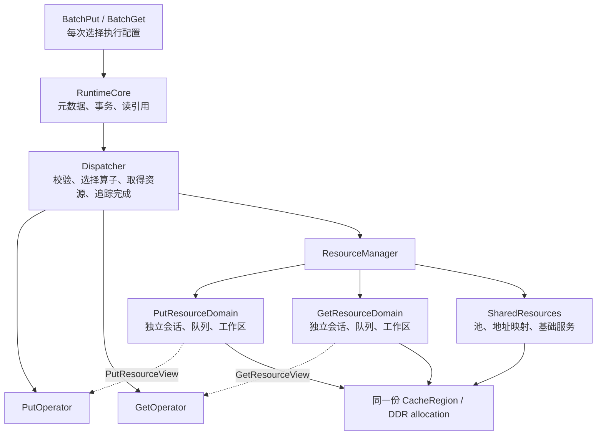

# KVAF 缓存访问执行框架设计

状态：设计草案。新增类型、接口和协议属于目标设计，不表示当前分支已经完成集成。

本方案支持 `urma`、`ubmem`、`urma+ubmem` 三种 DDR 缓存访问模式。DDR 池的分配方式在初始化前确定，初始化时完成分配；每次 BatchPut、BatchGet 可以选择执行方式，所需通信资源在首次使用时建立并缓存。资源由独立管理层持有，算子在执行时取得资源视图。

Put 与 Get 分属两个资源域，分别拥有通信会话、队列、控制区、工作区和完成状态，允许两者同时在途。所有方式仍使用同一个 RuntimeCore、MetaManager、DDR allocation 和固定的缓存地址体系。

已验证的设计前提是：通过 UBMEM 分配的 DDR 可以用于 URMA 注册，并通过两种方式读取。混合模式因此只分配一份 UBMEM DDR；跨方式写后读的完成和可见性按本文契约验收。

## 1 模式与初始化边界

`TransportMode` 决定允许使用的传输机制和 DDR 分配方式，生命周期内不变。它不表示所有执行链路在初始化时已经建立。

| 模式 | 初始化时的 DDR 分配 | 可选择的 Put | 可选择的 Get |
|---|---|---|---|
| `urma` | 现有普通 DDR 分配 | URMA AIV、AICPU | URMA AIV Direct/Gather/Scatter、AICPU Gather/Scatter |
| `ubmem` | UBMEM 分配 | UBMEM AIV | UBMEM AIV Direct |
| `urma+ubmem` | UBMEM 分配一次 | 上述全部 | 上述全部 |

混合模式即使第一次操作选择 URMA，也使用初始化时已经分配的 UBMEM DDR。后续首次使用 UBMEM 只补齐映射和执行资源，不更换池、不搬迁数据、不改变已有 AccessTable。

初始化和首次调用的职责分开：

| 阶段 | 完成的工作 |
|---|---|
| 配置阶段 | 固定模式、默认执行配置、允许的组合和各方向资源预算 |
| DDR 初始化 | 校验能力，确定分配器，创建 CacheRegion，分配 DDR，固定逻辑地址基准，初始化 MetaManager |
| 首次使用某资源组合 | 建立对应方向的注册/导入、会话、队列、CPU worker、映射或工作区，完成必要探测 |
| 后续调用 | 取得已有资源租约，准备本次请求参数并提交 |
| 可选预热 | 提前执行相同的资源准备流程，避免首调建链延迟 |

DDR 初始化成功表示池可用（PoolReady），并不保证每种执行资源均已就绪（ExecutionReady）。初始化阶段能发现的构建、配置和对端能力缺失应立即报错；实际建链失败在首次 Acquire 或预热时返回，不静默改用其他方式。

## 2 公开接口

### 2.1 执行维度

沿用三个正交维度，不把组合展开成大量 `method` 枚举项。Put 不携带读取算法。

```cpp
enum class TransportMode { Urma, Ubmem, UrmaAndUbmem };
enum class Transport { Urma, Ubmem };
enum class Executor { Aiv, Aicpu };
enum class GetAlgorithm { Direct, Gather, Scatter };

struct PutExecutionConfig {
    Transport transport;
    Executor executor;
};

struct GetExecutionConfig {
    Transport transport;
    Executor executor;
    GetAlgorithm algorithm;
};
```

`UrmaAndUbmem` 是初始化模式。单次操作只选择一种 Transport，不自动拆成两种机制。`Aicpu` 指设备上的 AICPU，不是 Host CPU Pull。`Direct` 表示不经过 CPU Gather 或 PushScatter，具体搬运机制由 Transport 决定。

| 操作 | Transport | Executor | GetAlgorithm | 数据路径 |
|---|---|---|---|---|
| Put | Urma | Aiv | — | AIV WRITE，HBM → DDR |
| Put | Urma | Aicpu | — | AICPU WRITE，HBM → DDR |
| Put | Ubmem | Aiv | — | AIV 向映射 DDR 搬运 |
| Get | Urma | Aiv | Direct | AIV READ，DDR → output |
| Get | Urma | Aiv | Gather | CPU 聚合到 DDR staging，AIV READ 到 output |
| Get | Urma | Aiv | Scatter | CPU SGL WRITE 到 HBM staging，AIV scatter 到 output |
| Get | Urma | Aicpu | Gather | CPU 聚合到 DDR staging，AICPU READ 到 output |
| Get | Urma | Aicpu | Scatter | CPU SGL WRITE 到 HBM staging，AICPU scatter 到 output |
| Get | Ubmem | Aiv | Direct | AIV 从映射 DDR 搬运到 output |

组合检查由统一注册表完成。`Ubmem + Aicpu`、`Ubmem + Gather/Scatter`、`Urma + Aicpu + Direct` 不在本设计的支持集合中。表中描述目标能力；参考实现尚未通过完整验证的路径不能提前宣称可用。

### 2.2 Runtime 配置与调用参数

在现有 NpuRuntimeOptions 中扩展：

```cpp
TransportMode transport_mode{TransportMode::Urma};
std::optional<PutExecutionConfig> default_put;
std::optional<GetExecutionConfig> default_get;
std::optional<std::vector<PutExecutionConfig>> enabled_put_configs;
std::optional<std::vector<GetExecutionConfig>> enabled_get_configs;
```

未提供 enabled 集合时，使用模式对应的完整目标集合；显式集合用于裁剪，空集合关闭该类操作。启用某类操作时，其默认配置必须属于 enabled 集合；关闭时不生成默认值，并拒绝调用。采用旧构造入口时，兼容层根据原 kernel 配置生成 enabled 集合，避免原有 AIV 应用突然依赖其他 kernel。

| 模式 | 默认 Put | 默认 Get |
|---|---|---|
| Urma | Urma + Aiv | Urma + Aiv + Direct |
| Ubmem | Ubmem + Aiv | Ubmem + Aiv + Direct |
| UrmaAndUbmem | Urma + Aiv | Urma + Aiv + Direct |

enabled 表示允许调用，不表示已经分配资源。Put/Get 的队列数、worker 数、在途预算、工作区容量分别配置；不同后端也不强制共用一套调优参数。

每次调用保留现有 stream 和 Get 同步参数，并在 ExecutionOptions 尾部增加配置：

```cpp
struct BatchPutExecutionOptions {
    void* stream{nullptr};
    std::optional<PutExecutionConfig> config;
};

struct BatchGetExecutionOptions {
    void* stream{nullptr};
    bool synchronize{false};
    std::optional<GetExecutionConfig> config;
};
```

config 为空时使用完整默认值；非空时完整替换本次配置，不按字段合并，不增加 Default/Auto 枚举。提交时按值保存，后续调用不能改变在途请求的配置。

BatchPut 第一版保持同步返回：成功表示数据写入、可见性处理和元数据提交均已完成。BatchGet 保持可异步返回。首次调用即使 `synchronize=false`，也可能因准备资源阻塞 Host；该参数只控制提交后的完成等待。

## 3 总体结构与所有权



| 组件 | 核心成员 | 职责 |
|---|---|---|
| RuntimeCore | MetaManager、AccessTable 注册表、Put 事务表、生命周期状态 | 槽位管理、读引用、事务提交和缓存一致性 |
| ExecutionDispatcher | 算子注册表、默认配置、Put/Get 各自的调度状态 | 配置解析、能力检查、资源申请、提交和完成处理 |
| CacheRegion | region_id、epoch、allocation、canonical_base、logical_bytes | 持有实际 DDR，固定逻辑范围和释放方式 |
| SharedResources | Region 引用、Fabric 映射缓存、基础服务和只读 kernel 模块 | 管理可共享的稳定基础资源 |
| PutResourceDomain | Put 会话缓存、注册引用、执行槽位和初始化状态 | 只向 Put 发放通信和执行资源 |
| GetResourceDomain | Get 会话缓存、注册引用、执行槽位和初始化状态 | 只向 Get 发放通信和执行资源 |
| ExecutionSession | 方向、context、队列、远端会话、序号和持久队列状态 | 管理某组兼容通信资源的完整生命周期 |
| PutOperator / GetOperator | 算法配置、ABI 描述、kernel 引用 | 声明资源需求、组织参数、启动执行、解析结果 |
| ExecutionContext | 本次配置、资源租约、buffer 引用、表/事务引用、完成对象 | 保留一次请求的状态直到完成或恢复结束 |

资源从算子中剥离后，算子不再拥有 Jetty、远端会话、staging 或共享 pending 状态，也不在析构时关闭通信资源。算子可以复用，但每次调用的参数和状态必须放在独立 ExecutionContext 中。

持久的 SQ/CQ 位置、PSN/请求序号等属于 ExecutionSession，不能每次创建 ExecutionContext 时清零。本次 kernel args、status、event 和结果属于执行槽位及 ExecutionContext。

第一阶段可保留现有 AccessOperator 作为适配门面，内部转给 Dispatcher。无需一次改完所有公开接口；长期将缓存算子接口与 CPU Pull 协调接口拆开。

## 4 Put 与 Get 的资源隔离

### 4.1 隔离边界

Put/Get 不借用对方的通信资源，即使执行单元、对端、协议和队列布局完全相同。方向是资源身份的必选字段，不由资源管理器为了省资源而忽略。

| 资源 | Put/Get 之间的规则 |
|---|---|
| DDR allocation、固定地址基准 | 共享同一份数据和地址体系 |
| MetaManager、AccessTable 元数据 | 统一管理；短临界区同步，读引用保护在途数据 |
| RA/HDC bootstrap、已加载的只读 kernel 模块 | 可以共享，单独管理引用和初始化同步 |
| Fabric 导出/映射 | 作为稳定的地址访问绑定，可由两个方向持有引用；并发访问不同数据范围 |
| URMA context、token、MR/远端导入绑定 | 本版按方向管理，不设计跨方向 URMA 注册复用；同一 allocation 按各 context 需要注册 |
| Jetty、SQ、CQ、端点导入、应用管理的 TP/连接状态 | 分别持有，不能跨方向借用 |
| CPU Gather/Push 会话、worker、notify/ACK、序号 | 独立会话所有权，不附着在整个 Region 的唯一状态上 |
| DDR/HBM staging、metadata、status、event | 按方向和执行槽位分配，内存范围不重叠 |
| pending、故障状态、profiling 状态 | 分别记录到会话或本次 ExecutionContext |
| 应用 stream | 调用方选择；同一 stream 保持顺序，不同 stream 允许重叠 |

Fabric 映射共享不等于 UBMEM Put/Get 共用执行状态。映射保持稳定，Put/Get 分别持有 metadata、状态区、event 和租约；关闭一个方向不能解除另一个方向仍在使用的映射。

上述隔离约束的是 KVAF 管理的资源和可变状态，不要求网络提供方为两者分配不同物理链路。多个方向仍可能共享设备带宽，KVAF 不依赖跨方向共享可变传输状态来实现复用。

CPU Service 必须允许同一 Region 的 Put/Get 会话同时存在。若旧服务只能返回唯一可变会话或唯一方向绑定，应扩展协议后再声明并发能力，不能在 Host 上分成两个对象却继续指向同一个远端执行状态。

### 4.2 同方向内部的复用

资源域是所有权和调度边界，不表示整个 Put 或 Get 只有一条物理链路。一个域可缓存多组会话，每组可有多 worker、多 Jetty。

同方向内按资源兼容性复用，不按“算子名字相同”判断：

- 可优先复用该方向的设备上下文、兼容的注册绑定和已加载模块。
- 只有 provider、设备/EID、对端、协议、队列角色、布局、权限、容量、完成方式和序号管理均兼容，才可借用同一通信会话。
- 复用会话必须取得独占租约；前一批完成并回收 CQ、工作区后再交给下一批。
- AIV/AICPU 或 Direct/Gather/Scatter 的相似建链步骤不代表队列 ABI 兼容。第一版保留独立会话，先复用建链代码及兼容基础资源。
- Get Scatter 中的 CPU WRITE 仍属于 GetResourceDomain：资源归属依据应用操作语义，不依据底层使用 READ 还是 WRITE。

例如 AIV Direct Get 与 AIV Gather Get 可以共享 Get 域内兼容的内存绑定；其队列布局、控制区不同，则保留两组会话。AICPU Put 与 AICPU Gather Get 必须拆成两组 UmdkSession，取消 Put 之前的 DrainGet。

## 5 资源需求与算子接口

### 5.1 需求声明和类型化视图

资源管理器接收“需要什么”，算子接收“已经准备好的资源”。不把所有后端句柄塞进一个带大量空字段的通用结构。

```cpp
// 目标接口示意，具体容量和 ABI 字段按各实现定义。
struct PutResourceRequirements {
    PutResourceProfile profile;
    Capacity capacity;
};

struct GetResourceRequirements {
    GetResourceProfile profile;
    Capacity capacity;
};

Result<PutResourceLease> AcquirePut(
    const CacheRegionRef&, const PutResourceRequirements&);

Result<GetResourceLease> AcquireGet(
    const CacheRegionRef&, const GetResourceRequirements&);

// 具体算子通过类型化视图取得资源；视图不拥有底层资源。
Status UrmaAivPutOperator::Launch(
    const PutInvocation&, const UrmaAivPutView&, ExecutionContext&);

Status UrmaAicpuGatherOperator::Launch(
    const GetInvocation&, const UrmaAicpuGatherView&, ExecutionContext&);
```

资源类型由注册表中的 adapter 校验，不能强转不匹配的句柄。Put/Get 的 Acquire、Lease 和 View 类型分开，使跨方向传错资源能在接口边界被拒绝。算子提供 DescribeRequirements；Dispatcher 负责 Acquire 和完成后的租约归还。

每个 provider 的创建器只负责其资源，例如 UrmaSessionFactory、FabricMappingFactory、GatherSessionFactory。建链步骤可复用，创建出的 Put/Get 资源实例仍然独立。

### 5.2 资源身份和生命周期

会话缓存键至少表达：

```text
direction
+ region_id / region_epoch
+ provider / device / context compatibility
+ local EID / peer identity / route
+ protocol / queue roles / ABI layout / permissions
+ resource profile and capacity
```

容量可按“已有容量满足要求”匹配，不必为每个请求数量创建一条链路。执行算法通过资源 profile 表达需求；是否共享由完整兼容性决定。

内存注册缓存还必须包含 allocation/storage identity、generation、范围、设备、context 和权限，不能只以裸指针为键。地址被新 buffer 重用时，旧注册不可误命中。无 storage 所有权信息的 C++ buffer 由调用方保证生命周期；缓存持有注册不代表持有底层内存。缺少 identity/generation 时，注册仅保留到本次执行结束并安全注销，不跨调用缓存；需要缓存时，调用方必须提供显式注册句柄和失效/注销契约。

资源有三层生命周期：

| 层次 | 示例 | 结束条件 |
|---|---|---|
| Region | DDR allocation、固定基准、共享映射 | 所有会话、映射、事务和读引用结束 |
| Session | context、Jetty/CQ、远端 worker、注册绑定、持久队列状态 | 无执行租约且通信已停止 |
| Execution | 参数、状态区、buffer 引用、事件、槽位租约 | 数据面和远端工作均完成，结果检查结束 |

不能在 Launch 返回时归还执行租约。异步返回只改变 Host 调用状态，不改变设备和远端仍在使用资源的事实。

## 6 DDR 分配与按需建链

### 6.1 先分配固定的池

CPU Service 的 CreateCacheRegion 只按已确定的策略创建池和稳定描述，不强制创建所有通信会话：

```cpp
struct CacheRegionDesc {
    RegionId region_id;
    uint64_t epoch;
    Address canonical_base;
    uint64_t logical_bytes;
    uint64_t slot_size;
    TransportCapabilities capabilities;
};
```

URMA MR 描述、Fabric handle 和会话描述通过后续 PrepareBinding/OpenSession 获得，并携带同一 region_id/epoch。静态 Region 描述不把“允许使用”误写成“绑定已建立”。

所有权由 allocation 对象记录。普通分配使用对应普通释放流程，UBMEM 分配使用对应 HAL 释放流程。不能对所有池无条件 free。

缓存逻辑范围在初始化后固定。延迟创建的 staging/控制区使用独立辅助 allocation，或使用初始化时已预留且不进入 MetaManager 的范围；不能扩容、移动原 DDR 池，不能占用已经发布的缓存槽位。

### 6.2 统一地址基准

canonical_base 在 DDR 分配阶段固定，采用稳定的 Region 地址基准，例如 CPU allocation 基址；不依赖尚未执行的 URMA 注册返回值。

```text
offset        = canonical_address - canonical_base
CPU address   = cpu.base + offset
URMA address  = urma_binding.remote_base + offset
UBMEM address = fabric_mapping.local_base + offset
```

地址转换先校验逻辑范围和溢出。实际映射长度、注册长度和缓存逻辑长度分别保存，对齐填充不属于缓存数据。

AccessTable 只保存固定基准下的地址，所有 Put/Get adapter 负责转换。当前依赖“表地址直接等于 URMA 地址”的 kernel/参数准备需要相应调整；不得等首次 URMA 注册后再修改已经创建的表。

### 6.3 第一次调用的流程

```text
解析本次执行配置，校验请求
    → 选择 PutOperator 或 GetOperator
    → DescribeRequirements
    → Acquire 对应方向的资源
        → 复用 Ready 资源，或由唯一创建者准备缺失资源
        → CPU 准备该方向绑定/会话，NPU 注册与导入
        → 准备控制区、staging、kernel 和执行槽位
        → 完成握手与必要探测，发布 Ready
    → 完成本次 buffer 绑定和参数准备
    → Launch
    → ExecutionContext 持有租约直至实际完成
```

建链的具体先后关系由 provider 的依赖决定，例如先交换端点再导入、先注册目标区再启动 push。ResourceManager 统一生命周期，不强制所有后端采用同一套握手步骤。

同一资源键的多个首次调用共享一次初始化结果；不同方向可分别准备。资源管理器的索引锁不能跨远端 RPC 或设备等待持有，避免 Get 建链长期阻塞 Put。

```text
Empty → Creating → Ready
           ├─ 确认清理完成的失败 → Failed（可显式重试）
           └─ 远端结果/清理未决 → Recovering（保留资源，恢复原操作）
Ready → Closing → Closed
```

远端 Create/Open 请求带 client instance 和唯一 create_request_id，并关联完整资源键，包括 region_id/epoch、direction、路由、resource profile、容量和创建代次。同一幂等 ID 必须对应相同参数，参数不一致时拒绝。回复丢失时保留原 ID 查询/恢复同一次创建，不能盲目创建第二个 worker 或会话。Recovering 状态不能作为可用资源发放；恢复确认旧实例已停止后才能新建。

预热接口可按 PutExecutionConfig/GetExecutionConfig 和容量调用同一 Acquire 路径，成功后归还租约、保留缓存资源。预热不写数据、不提交 key，也不自动注册应用尚未提供的源或输出 buffer。成功预热是应用要求启动前验证具体链路的方式。

## 7 CPU 服务与控制协议

CPU Service 按 Region、方向和执行会话分层：

```text
CacheRegion
  ├─ allocation / canonical address / metadata
  ├─ Put bindings
  │    ├─ AIV URMA Put session
  │    └─ AICPU URMA Put session
  ├─ Get bindings
  │    ├─ AIV Direct session
  │    ├─ AIV Gather / Scatter sessions
  │    └─ AICPU Gather / Scatter sessions
  └─ shared Fabric export
       ├─ Put mapping lease
       └─ Get mapping lease
```

这是逻辑所有权结构，各 provider 可以使用不同控制命令。统一协议身份至少包含 region_id/epoch、direction、execution_session_id；缓存 Region 的 ID 不再兼任所有 Get/Put 的会话 ID。

参考 Gather、gather lanes、push worker 绑定在 Region 上并互斥的实现，应改为按 execution_session_id 保存 worker、控制区、staging、序号和状态。即使按需创建，多种 Get 会话先后缓存下来也需要共存，不能继续沿用 Region 级模式互斥。

建议提供 OpenExecutionSession、QueryExecutionSession、CloseExecutionSession 的统一生命周期语义，实际 wire 格式显式编码和版本化。关闭会话只关闭该实例，不释放共享 Region。能力协商检查具体命令和特性，不能仅凭参考分支相同的 KVCP 主版本判断兼容。

Region 管理和能力协商可以使用公共控制连接，按请求 ID 关联回复，并只在发送或更新索引时短暂加锁。Put/Get 的执行控制与持续进度使用各方向独立通道；数据完成等待不能占用公共控制连接的锁，不能让控制面成为 Put/Get 的隐式全局串行点。

## 8 Put 与 Get 并发规则

### 8.1 两个独立调度方向

第一版每个 Runtime 允许一批 Put 与一批 Get 同时在途；各方向内部先串行。切换同方向执行配置可以等待该方向前一批完成，不等待另一方向。

| 调用场景 | 调度行为 |
|---|---|
| Get 在途，再调用 Put | 使用 Put 资源直接推进，不执行 DrainGet |
| Put 在途，另一 Host 线程调用 Get | 使用 Get 资源推进，不执行 DrainPut |
| Get 在途，再调用另一个 Get | 等待前一批 Get 完成、检查结果，再借用 Get 执行槽位 |
| Put 在途，再调用另一个 Put | 等待前一批 Put 完成，再进入 Put 执行槽位 |
| 同一 ACL stream 的 Put/Get | 遵循 stream 顺序；资源独立也不会改变 stream 依赖 |
| 不同 stream、无数据冲突的 Put/Get | 允许重叠执行，不插入跨方向排空 |

“同时在途”是接口与调度能力；实际 kernel 重叠和吞吐受设备调度、核数及带宽影响。AIV 的核数预算应分别配置，不能将两个方向各占满设备等同于已实现性能收益。

保持同步 Put 不妨碍与异步 Get 重叠：先提交异步 Get，再在另一 stream 调用 Put 即可。多 Host 线程调用还要求 Runtime 表/事务注册表、资源缓存和 Python 绑定具备同步保护；仅拆两个 mutex 不足以完成改造。

### 8.2 共享 DDR 的数据约束

通信资源独立不意味着可以无序访问同一段数据。沿用当前 MetaManager 的语义：

- Get 使用已经提交且被 AccessTable 引用的 key；稳定读允许后续追加其他 key。
- Put 先预留槽位，写入完成并处理可见性后提交；提交前的新 key 不对 Get 发布。
- 现有 key 或 pending key 的重复 Put 返回 AlreadyExists，不在本方案中隐式引入覆盖写。
- Put 写不同空闲槽位、Get 读已提交槽位可以并发；BatchFree 遇到仍被读取固定的槽位返回 Busy。
- 要读取刚写入的新 key，应用先等待该 Put 成功，再准备包含新 key 的表。不能把并发 Get 当作自动等待未提交 Put 的机制。
- 共享的 input/output、DeviceAccessTable 或请求数组也不能冲突修改；跨 stream 的生产消费依赖由调用方显式建立。

MetaManager 的锁只覆盖预留、提交、查询和引用计数等元数据操作，不跨 kernel、网络或 stream 等待持有。

### 8.3 AccessTable 与异步完成

Get 在校验 handle 时原子取得表及 Region 的执行引用，再进入可能等待的资源准备流程；准备失败则释放本次引用。ReleaseAccessTable 可以让公共 handle 失效，但只有表所有权和全部在途执行引用都释放后才能 UnlockKeys、回收表存储。不能先删 Host 表、释放槽位，再等待异步 Get。

直接传入 NPU addresses/valid 的裸地址接口没有可自动关联的 MetaManager handle。该接口继续由调用方保证源范围、Region 和请求 buffer 在完成前有效，并避免写入/释放冲突；需要 Runtime 自动保护时，应提供表句柄或显式范围租约。不能声称 Host 已自动检查设备数组中的每个冲突地址。

Python 绑定保存每次请求自己的 Tensor/storage 引用；C++ 非拥有型视图仍由调用方保证生命周期。引用保留与 stream/event 依赖是两件事，两者都需要正确处理。

## 9 完成、事务与错误处理

Put 的目标执行流程为：

```text
校验配置/请求 → AcquirePut 并准备资源
    → MetaManager::PreparePut
    → LaunchPut
    → 确认数据面完成
    → 完成跨 URMA/UBMEM 的可见性处理
    → MetaManager::CommitPut
    → 释放本次执行租约，返回成功
```

先准备通信资源再预留槽位，避免首次建链长时间占用缓存事务。PreparePut 之后的每个失败出口均由事务协调器处理。确定没有 DMA 在途时才可 Abort；DMA 未决时保留预留槽位、buffer 和资源，恢复原执行。已提交的 DMA 不自动换后端重放。

Put 成功后，后续任意已启用 Get 方式都应读到同一份数据。provider adapter 完成其要求的 fence/cache/远端完成处理，不让应用根据下一次 Get 选择维护一致性。控制 ACK 或仅本地入队完成不能替代该契约。

Get 的完成覆盖全部阶段：Direct 数据搬运，或 CPU Gather/Push、网络搬运及本地 scatter。异步返回成功只表示提交成功；`synchronize=true` 或新增的方向级 `DrainGet()` 成功表示执行完成并检查结果。只同步应用 stream 不自动等于已收集所有 KVAF/远端错误。

第一版 DrainGet 等待调用时该方向已接收的操作，不等待无关 Put。若后续支持同方向多批并发，可增加单次 completion handle，无需更改执行配置。

故障归属相应 session 和执行请求。可以证明隔离的 Get 失败不自动销毁 Put 资源；影响设备、共享映射或整个 Region 安全的故障才上升到共同依赖层。关闭资源失败时保留所有权并允许继续恢复，不丢弃句柄。

## 10 使用示例

以下是目标 Python 接口；initialize/link/DDR 生命周期沿用现有结构，新增 execution、模式配置和 drain_get 语义。

```python
runtime = kvaf.NpuRuntime(
    transport="urma+ubmem",
    default_put=kvaf.PutExecutionConfig(
        transport="urma", executor="aiv",
    ),
    default_get=kvaf.GetExecutionConfig(
        transport="urma", executor="aiv", algorithm="direct",
    ),
    # 设备、布局、kernel 和各方向资源预算略。
)
runtime.initialize()
runtime.link_to(cpu_address)
runtime.initialize_ddr(ddr_bytes, slot_size)  # 现在就分配 UBMEM DDR。

# table 已包含之前成功写入并固定的 key。
# 首次调用只准备这条 Get 路径和必要的共享基础资源。
runtime.batch_get(
    table, indices, offsets, miss_count, output_indices, output,
    stream=read_stream,
    synchronize=False,
    execution=kvaf.GetExecutionConfig(
        transport="urma", executor="aicpu", algorithm="gather",
    ),
)

# 写入不同的空闲槽位，使用另一条 stream，与上面的 Get 允许重叠。
# 首次 UBMEM Put 准备映射及 Put 工作区，不排空 Get。
runtime.batch_put(
    other_keys, input, input_offsets, lengths,
    stream=write_stream,
    execution=kvaf.PutExecutionConfig(
        transport="ubmem", executor="aiv",
    ),
)

runtime.drain_get()  # 新增方向级完成入口，收集该方向的执行结果。
```

所有 Get 方式遵守同一 token 布局、字节 offset、有效请求前缀、缺失项和 output_indices 语义。显式配置不能满足容量、对齐或布局要求时直接报错，不自动换方式。同一张有效 AccessTable 可连续切换读取方式。

## 11 Graph、关闭与 Pull 模块

Graph capture 前必须固定执行配置并完成资源预热，包括实际 buffer 的注册。捕获和重放期间不发生首次建链、动态注册/分配、Host Drain 或隐式切换配置。graph 持有自己的资源租约，与同方向 eager 操作协调；不能把 graph 使用中的队列交给其他请求。

保留已有 Direct 路径的 graph 能力，逐项声明其他后端能力。AIV 执行本身不代表支持 capture，Gather/Scatter 的 Host 控制和序号更新、UBMEM 的事件管理需要各自满足捕获条件。

ShutdownDdr 是需要汇合两个方向的生命周期操作：

1. 停止接受新请求和新资源创建，等待或恢复 Creating 状态。
2. 完成/恢复所有 Put、Get 和涉及该 DDR 的 CPU Pull，停止远端 DMA producer。
3. 释放执行引用、事务和表引用，关闭各方向会话、worker、队列及工作区。
4. 释放注册/导入和 Fabric 映射，确认所有使用方均不再访问 Region。
5. 关闭 CPU 侧绑定/导出，由原 allocation 所有者释放 DDR。

清理按实际依赖逆序执行；未决操作保留其依赖，不提前 UnlockKeys 或释放池。关闭一个执行配置或一个方向不影响另一个方向仍持有的共享基础资源。

| 模块 | 与本设计的边界 |
|---|---|
| CPU Pull | Host CPU 通过 URMA READ 写入同一 DDR，保持独立注册、连接和事务生命周期 |
| HBM Pull | 独立 HBM → HBM 模块，不经过 DDR 缓存池和 MetaManager |

两类 Pull 的源注册与连接继续由应用显式发起。普通 BatchPut/Get 的首次 Acquire 不自动注册未知的远端源。

CPU Pull 可在 Urma 或混合模式显式开启，混合模式使用同一 UBMEM allocation；不复用普通 Put/Get 的队列。Ubmem 模式不隐式创建它需要的 URMA 资源。当前 pending_offload 对 DDR 访问的保守约束可在第一阶段保留；CPU Pull 与普通访问进一步并发，需要单独接入槽位/范围租约和事务恢复，不包含在本版普通 Put/Get 的并发承诺中。

HBM Pull 独立配置和关闭，ShutdownDdr 不自动关闭 HBM reader。

## 12 当前实现到目标设计

| 现有结构或行为 | 改造方向 |
|---|---|
| DefaultAccessOperator 持有 Get/Put transport 和执行状态 | 保留现有两个方向的隔离，将 transport 所有权迁入各自资源域，将单批状态迁入 ExecutionContext |
| DirectHccpSession 共享 RA/HDC bootstrap | 保留这种基础服务共享；该对象原本就不拥有 RaCtx、token、MR、CQ、Jetty、TP |
| AICPU 参考实现 Get/Put 共用 UmdkSession，Put 前 DrainGet | 拆成 Put/Get 两个 session；只处理本方向的排空和故障 |
| AIV Gather/Scatter 算子内部持有通信/控制资源 | 拆出 session factory 和资源视图，算子保留参数组织及执行逻辑 |
| UBMEM 按 stream 保存 StreamState | 映射独立管理；执行状态按方向和 slot 管理，不能只按 stream 区分 Put/Get |
| CPU Region 上固定一个 Gather/Push 状态 | 改为独立 execution_session_id，可同时保留不同会话 |
| Runtime BatchPut 执行失败立即 AbortPut | 区分确定失败与 DMA 未决，后者保留事务等待恢复 |
| Runtime ReleaseAccessTable 直接解锁、删除表 | 公共 handle 与在途引用分开，最后一个引用释放后才解锁 |
| Runtime 表注册表和 Python 共享 batch_put_request_ | 增加短时同步保护；改为每次调用独立请求，阻塞等待时按需释放 GIL |

实施顺序：

1. 增加配置类型、能力注册表和固定分配策略，明确 Region 地址转换。
2. 提取 ResourceManager、Put/Get 两个资源域及 ExecutionContext，先迁移当前 AIV Direct Put/Get。
3. 实现单次初始化、方向隔离、异步引用保留和事务恢复，使普通 Put/Get 并发成立。
4. 拆 CPU Region/执行会话协议，接入 AICPU、Gather、Scatter；保持显式组合校验。
5. 接入 UBMEM 分配/映射和独立 Put/Get 状态，完成跨机制可见性。
6. 增加预热、方向级完成查询、graph 租约，再按实测优化同方向资源复用。

### 12.1 验收范围

| 验收项 | 要求 |
|---|---|
| 固定分配 | 三种模式按表分配；混合模式首调 URMA 后再用 UBMEM，allocation 和 canonical_base 不变 |
| 首调初始化 | 未调用配置不建链；同一资源并发首次申请只创建一次；Put/Get 各自可准备 |
| 初始化恢复 | 丢失创建回复、部分创建失败可查询和恢复，无重复远端 worker |
| 资源隔离 | Put/Get 的 session、Jetty/CQ、控制区、workspace、status 独立；不因 Get 在途而 DrainGet 后才 Put |
| 顺序交叉写读 | 3 种 Put × 6 种 Get，共 18 种目标组合内容一致 |
| 并发交叉组合 | 对上述 18 对分别执行“Get 已提交旧 key + Put 不同新 key”，验证同时在途、数据正确、状态互不覆盖 |
| 冲突与引用 | 重复 Put、pending key、在途读时 Free/ReleaseAccessTable 的行为符合约定；裸地址遵守显式生命周期契约 |
| 同表切换 | 已有 AccessTable 在不同读取配置间切换，地址和数据保持一致 |
| 完成和可见性 | URMA 写后 UBMEM 读及反向均正确；scatter 完成覆盖远端搬运与本地散布 |
| 错误隔离 | 单会话故障只阻断受影响域；公共依赖故障正确传播；未决 DMA 不复用槽位 |
| 资源回收 | Creating/Ready/Recovering 状态下关闭均保留正确所有权，最后使用方退出才释放共享池和映射 |
| graph 与性能 | 已支持 Direct capture 不退化；无未声明的 capture 能力；分离冷启动成本与稳定态并发性能 |

参考 AIV Scatter 分支的 done 探针会跳过 payload 搬运，不能作为完整 Scatter 验收。声明该组合可用前，应通过实际 payload 正确性、并发及退出测试。

## 13 实现依据

- [公共请求与执行选项](../common/include/requests.h)：同步 Put、可异步 Get、调用方 buffer 和 DeviceAccessTable 语义。
- [NpuRuntime](../runtime/include/npu_runtime.h)：DDR、CPU Pull 与独立 HBM Pull 的接口边界。
- [RuntimeCore](../runtime/src/runtime.cc)：PreparePut/Execute/CommitPut、AccessTable 生命周期和 pending_offload 约束。
- [MetaManager 实现](../meta_manager/src/in_memory_meta_manager.cc)：短时元数据锁、重复 key 拒绝、稳定读与 pinned 槽位释放规则。
- [Direct HCCP 基础会话](../access_operator/include/direct_hccp/direct_hccp_session.h)：RA/HDC 基础服务与各 transport 资源的现有所有权边界。
- [Connector 事务实现](../runtime/src/connector_runtime.cc)：未决状态、事务决定及恢复语义。
- [当前建链流程](connection_handshake_flows.md)：当前资源与控制消息关系。
- [AICPU URMA adapter](https://gitcode.com/CacheOS/KVAF/blob/8bc5a2a3a1840b40f0e5fc80ee4f361cb62ffcba/access_operator/src/aicpu_access_operator.cc)：参考分支共享 UmdkSession 和 Put 前 DrainGet 的实现。
- [UBMEM adapter](https://gitcode.com/CacheOS/KVAF/blob/7d0177189e86c6bde2ac74e38767a85cffd28929/access_operator/src/ubmem/access_operator.cc)：映射访问、StreamState、Put/Get 和事件生命周期。
- [AIV Gather 与 Scatter 实现说明](https://gitcode.com/CacheOS/KVAF/blob/7d3aaf7cab08e44b5171fd9eba2d499a3f9ed1d6/docs/aiv_batch_get_stage1.md)：读取后端、CPU 服务依赖和验证边界。
