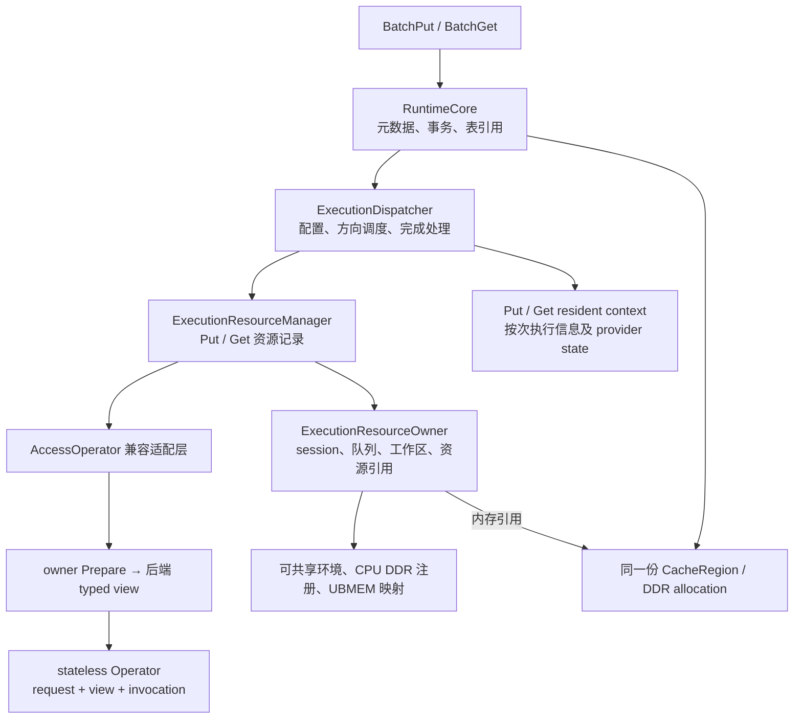

# KVAF 缓存访问执行框架设计

实现基线：`codex/cache-transport-execution` 的 `5cce05e7`。该版本已统一执行路径、移除 legacy 模式及旧构造配置，算法资源按构建能力注册并在首次使用时准备；支持同 stream 多图及多个 Get 节点。第 1–13 节说明当前设计、实现边界和剩余工作；“已实现”不等于目标硬件上的数据正确性、跨 transport 可见性或性能已经验收。公开 API 与后端细节见[实现与使用](cache_transport_execution_implementation.md)，当前性能入口及验证覆盖边界见[验证步骤](cache_transport_execution_validation.md)。

第 14、15 节保留原有历史设计草稿及后续目标；第 15 节开头补充了已落地能力的状态说明。阅读时以[第 12 节状态对照](#12-已实现范围与后续工作)区分现状与后续目标，草稿的历史基线不代表当前工作区的整体状态。

## 1 模式与当前支持范围

`TransportMode` 固定 DDR 分配方式和允许的传输机制，生命周期内不变。每次 BatchPut、BatchGet 选择一种执行配置；所需 session、队列及工作区在首次使用时准备并缓存。混合模式从初始化起只分配一份 UBMEM DDR，第一次选择 URMA 也不改用普通 allocation。

| 模式 | 初始化时的 DDR 分配 | 已接入的 Put | 已接入的 Get |
|---|---|---|---|
| `urma` | 普通 DDR | URMA AIV、URMA AICPU | URMA AIV Direct、AICPU Gather、AICPU Scatter |
| `ubmem` | UBMEM DDR | UBMEM AIV | UBMEM AIV Direct |
| `urma+ubmem` | UBMEM DDR，一次分配 | 上述三种 | 上述四种 |

当前共有 **3 种 Put × 4 种 Get，即 12 对普通访问组合**。URMA AIV Gather/Scatter 仍只预留配置，首次请求时返回 provider 不可用；原设计的 6 种 Get、18 对组合属于后续目标。`Ubmem + Aicpu`、`Ubmem + Gather/Scatter`、`Urma + Aicpu + Direct` 不属于支持集合。

| 阶段 | 当前职责 |
|---|---|
| 配置 | 固定模式、默认配置及各配置的资源预算；按当前构建注册允许 transport 的 provider 工厂 |
| DDR 初始化 | 分配 CacheRegion，固定 canonical 基址和逻辑范围，初始化 MetaManager；不预留 Gather 辅助空间 |
| 首次使用某配置 | 校验该算法的资源预算和 kernel；初始化对应 owner、CPU execution session、注册/导入、队列、worker、映射和工作区 |
| 后续调用 | 复用对应 Put/Get 驻留实例及稳定资源；取得短期执行占用并准备本次参数 |
| 显式预热 | 按容量和 stream 提前完成相应准备，不写缓存、不提交 key |

PoolReady 表示池已建立，不表示所有配置均已 ExecutionReady。URMA 路由发现可以提前枚举候选，但不会因此创建所有普通访问的 context 和队列。请求级入口不通过初始化写入探测自动更换后端或路由；首次建链失败返回原配置的错误，需显式恢复。

## 2 公开接口与配置

### 2.1 执行维度

三个维度分别表达传输、执行单元和读取算法。Put 不携带读取算法：

```cpp
enum class TransportMode { Urma, Ubmem, UrmaAndUbmem };
enum class Transport { Urma, Ubmem };
enum class Executor { Aiv, Aicpu };
enum class GetAlgorithm { Direct, Gather, Scatter };

struct PutExecutionConfig { Transport transport; Executor executor; };
struct GetExecutionConfig {
    Transport transport;
    Executor executor;
    GetAlgorithm algorithm;
};
```

`UrmaAndUbmem` 是初始化模式，单次操作不拆成两种 transport。`Aicpu` 指设备上的 AICPU；`Direct` 表示不经过 CPU Gather 或 PushScatter。

| 操作 | 配置 | 数据路径 |
|---|---|---|
| Put | URMA AIV | AIV WRITE，HBM → DDR |
| Put | URMA AICPU | AICPU WRITE，HBM → DDR |
| Put | UBMEM AIV | AIV 向映射 DDR 搬运 |
| Get | URMA AIV Direct | AIV READ，DDR → output |
| Get | URMA AICPU Gather | CPU 聚合到 DDR staging，AICPU READ 到 output |
| Get | URMA AICPU Scatter | CPU SGL WRITE 到 HBM staging，AICPU scatter 到 output |
| Get | UBMEM AIV Direct | AIV 从映射 DDR 搬运到 output |

### 2.2 构建能力、默认值与调用选项

`NpuRuntimeOptions` 支持 `transport_mode`、`default_put/default_get` 及各配置的 `ExecutionResources`。C++ 和 Python 均移除 `enabled_put_configs/enabled_get_configs`；当前构建支持、且符合 transport 模式的算法自动可选。工厂注册不分配资源，也不要求未使用算法的 kernel 或具体资源预算有效。重复预算、非法 transport/算法组合仍在配置阶段拒绝；核数、容量、kernel 文件及设备包等在该算法首次准备时检查。

| 模式 | 标准默认 Put | 标准默认 Get |
|---|---|---|
| Urma | URMA AIV | URMA AIV Direct |
| Ubmem | UBMEM AIV | UBMEM AIV Direct |
| UrmaAndUbmem | URMA AIV | URMA AIV Direct |

上表为完整构建的标准默认值。省略默认配置时，NpuRuntime 优先选已构建的 URMA AIV，随后是 AICPU，混合模式再考虑 UBMEM。显式默认配置不会静默回退；对应 provider 未构建时在使用时返回错误。AIV Gather/Scatter 尚未注册。所有调用统一经过 Dispatcher，不再提供旧后端构造参数或执行模式开关。URMA AIV Get 默认 4 核、每核 1 个 Jetty，在途上限为 2048。URMA AIV Put 默认 2 核、每核 2 个 Jetty。UBMEM AIV Put/Get 默认 16 核，AICPU Put 默认 1 个 worker，AICPU Gather/Scatter Get 默认 5 个。资源项可以逐配置覆盖。

AIV/UBMEM 的空 `kernel_path` 使用构建时记录的绝对路径：Get 为 `<build-dir>/bin/kvaf_execute_batch_get_kernels.o`，Put 为 `<build-dir>/bin/kvaf_execute_batch_put_kernels.o`。标准 `./build.sh npu` 使用 `build-npu`，自定义 `--build-dir` 自动生效，不依赖应用当前目录。非空路径严格覆盖默认值；默认或显式文件均在首次准备时检查，缺失时返回错误。移动构建产物后需显式覆盖路径或重新构建。AICPU 保持首次使用时从 CANN 安装目录解析包。

C++ 以 `NpuRuntimeOptions(token_bytes, tokens_per_block)` 描述布局；Python 以 `NpuRuntime(batch_get_token_bytes, batch_get_tokens_per_block, *, ...)` 构造，设备、transport 模式、默认配置和资源预算使用关键字参数。旧 `aicpu_batch_get_mode`、`per_call_execution` 及全局核数/队列/kernel 配置不再接受。`default_put/default_get` 只决定省略本次配置时选哪个算法，不启用资源，也不限制其他已构建算法的调用。

AICPU 公共包在首次 AICPU provider 准备时解析并加载，按 Put/Gather/Scatter 分别解析所需入口，后续复用。Gather 此时通过控制命令申请独立 CPU 工作区，与主池同一 session/context 下注册；描述符、控制字及 staging 使用工作区地址，CPU 的数据源仍是主池 canonical 地址。关闭 session 时释放工作区；图租约在 capture 前完成准备，捕获与回放不触发分配或加载。

调用选项保留 stream、Get 同步控制和完整配置选择，并提供显式绑定租约：

| 调用 | 主要选项 | 语义 |
|---|---|---|
| BatchPut | `stream`、`config`、`input_lease` | 同步事务；可使用 URMA 输入绑定 |
| BatchGet | `stream`、`synchronize`、`config`、`graph_lease`、`output_lease` | 默认异步提交；可使用 Get graph 或 eager 输出绑定 |

`config` 为空时采用完整默认值，非空时完整替换，不按字段合并、不隐式回退。Get 的同步阶段 `profile` 输出与设备 kernel profiling 是不同接口；图捕获不携带逐调用同步 profile 输出，kernel profiling 在捕获前配置。

首次异步 Get 仍可能因建链、注册或准备而阻塞 Host；`synchronize=false` 只控制提交后的完成等待。调用方负责跨 stream 依赖，资源隔离不会自动建立输入生产和输出消费顺序。

## 3 执行结构与所有权



| 组件 | 当前职责与所有权 |
|---|---|
| RuntimeCore | MetaManager、AccessTable 引用、Put 事务及安全完成后的引用释放 |
| ExecutionDispatcher | 配置解析、方向锁、Put/Get 实例表、准备中的 Put、活动请求及绑定/graph 租约路由 |
| ExecutionResourceManager | 按方向和配置保留资源记录、factory、owner、兼容 operation、失败与占用状态 |
| ExecutionResourceOwner | 初始化、预热、关闭物理资源；保存 session、队列、注册引用、workspace 等稳定依赖 |
| PeerExecutionResources | CPU execution session、本地 owner 与适配门面；不执行 kernel 算法 |
| ExecutionContext / provider Invocation | 调用绑定、pending、完成信息；Put/Get 对象驻留，执行占用及请求引用按次清理 |
| typed Operator | 使用已准备的具体 view 与 Invocation，组织参数并执行对应算法 |

管理器通过 `TakeResources()` 接管 owner；兼容 `AccessOperator` 仍保留在记录中。当前不是“Dispatcher 完全绕过 AccessOperator 直接调用 typed Operator”：外层方向视图继续转发兼容接口，后端 adapter 调用 owner 的准备阶段，再调用具体无状态算子。

“无状态”指算法类不持有 session/Jetty 等资源，也不靠成员保存跨调用状态；不表示整个执行过程是纯函数或天然支持并发。owner、workspace、session 序号和 Invocation 仍有可变状态，必须遵守租约与方向调度。

## 4 资源共享与执行隔离

### 4.1 当前共享范围

| 资源 | 当前共享边界 | 仍独立的资源 |
|---|---|---|
| DDR allocation、canonical 地址、MetaManager | 同一 Runtime/Region 的 Put/Get 共用 | 各次事务与读引用 |
| HCCP transport API 表 | 进程首次完整加载成功的 provider，库引用保留至退出 | RaCtx、Jetty/CQ、entity、注册与执行状态 |
| AICPU `ApiEnvironment` | 实际加载的 liburma 对象，多 session 共享初始化与函数表 | 各 session 的 context、MR、远端导入、队列 |
| CPU `CpuUrmaMemoryPool` | 一次 allocation 代次内，兼容 candidate/EID/context 与注册身份共享 DDR MR | session 通道、Gather/Scatter worker、控制区与序号 |
| UBMEM HAL / device mapping | 进程级 HAL；Runtime 内按设备、完整 Fabric handle 和长度缓存映射引用 | Put/Get 的 metadata、status、event 和执行槽位 |

CPU DDR 注册共享已经落地，不再要求每个 Put/Get session 单独注册相同兼容 DDR。缓存身份包括 allocation/context 代次、candidate/EID、地址范围、权限和凭据；同址新分配不会命中旧注册。CPU session 关闭只归还共享注册引用，Region 关闭才在引用安全退出后注销 MR/token，再关闭 context、释放 DDR。

这不意味着 NPU/AICPU 的 context、HBM 注册或远端导入已跨算法共享。不同本地 context 仍独立导入；AIV 的绑定缓存各 transport 独立持有，AICPU 同一 session 内复用远端导入。CPU wire 协议尚未增加草稿第 14 节的独立 `binding_id/generation`，execution session ID 不充当公共内存绑定 ID。

### 4.2 执行隔离

Put/Get 分别持有 Jetty、SQ/CQ、端点导入、应用管理的连接状态、CPU worker、staging、控制区、完成状态与协议序号。共享环境或内存绑定不共享这些可变执行对象；关闭一个方向不能释放另一方向仍持有的共享依赖。

AICPU 使用显式 `UmdkQueueProfile`：当前 Put 创建 **1 条 control、0 条 data** 队列，Gather 创建 **N 条 control、N 条 data** 队列，CPU 端通道与之对应。Put 裁剪无用队列不改变 WRITE、完成和事务语义。AIV Direct 继续使用其 cores × jettys 布局；Scatter 保持自己的 push 通道和 workspace。

同方向的不同配置保留独立执行 session，不因 AIV/AICPU 或算法之间建链步骤相似而共用队列。Get Scatter 的 CPU WRITE 仍属于 Get 方向，归属依据应用操作而不是底层 READ/WRITE。共享设备带宽也不表示可以借用另一方向的执行槽位。

## 5 资源视图、身份与生命周期

### 5.1 两层 View

| 层次 | 类型示例 | 用途 |
|---|---|---|
| Runtime 方向适配视图 | `PutResourceView` / `GetResourceView` | 持有兼容 operation 与 owner 的借用指针，转发 Prepare/Launch/Drain 等接口 |
| 后端具体视图 | `UrmaAivPutView`、`UrmaAicpuGatherView`、`UbmemGetView` | 只提供该算法需要的地址、队列、workspace 与调用绑定信息 |

外层视图不是装有所有硬件句柄的通用资源结构。其 Warmup 优先直接调用 owner，并保留兼容回退；Get 驻留路径使用 `LaunchPrepared`，不在该转发入口重复 Describe/Warmup。后端 `ExecutionViewCommon` 校验方向、Region、资源代次、调用绑定和准备代次，不能把另一调用的完整 view 长期缓存后无条件复用。

物理注册、映射和分配归 owner 的准备阶段。typed Operator 借用 view 与 Invocation；view 本身不延长底层资源或调用方 buffer 的生命周期。

### 5.2 当前缓存身份

`ExecutionResourceManager` 的索引按 Put/Get 方向和完整 ExecutionConfig 区分；管理器限定在一个 Runtime 和不可变 Region 代次内。设备、EID、对端、ABI、资源预算及队列布局固定在对应 factory 中。当前不是一个在所有 Runtime 间搜索“兼容 session”的全局缓存；kernel profiling 开关仍可在允许的准备阶段配置。

容量不足按预算检查和准备规则处理，不能因为上下文驻留跳过本次请求边界校验。URMA 注册/导入缓存还检查 context、allocation 或远端身份、范围、权限、凭据及代次，不能只以裸地址判断同一内存。普通请求的临时应用 buffer 与显式输入/输出绑定采用不同保留期限；C++ 非拥有型 buffer 始终要求调用方履行存活契约。

### 5.3 驻留引用与执行占用

| 生命周期 | 保存内容 | 结束条件 |
|---|---|---|
| Region / allocation | DDR、canonical 基址、共享 CPU 注册和映射依赖 | session、事务、读引用及映射安全退出 |
| owner / session | context、队列、worker、workspace、注册引用、持久序号 | 停止通信并按依赖顺序关闭成功 |
| Put / Get resident instance | 长期资源引用、绑定的 ExecutionState、容量/stream 准备缓存及可选 buffer 绑定 | 对应恢复重建或关闭成功 |
| 单次执行 | 短期租约、请求/表引用、完成信息 | Get 确认完成；Put 还须完成事务及确认 |
| graph / 显式 buffer 绑定 | 固定 buffer、资源引用及必要调用方引用 | 对应 End 成功，或允许的安全关闭流程 |

长期 `PutResourceReference` / `GetResourceReference` 固定 owner 与绑定状态，不设置执行占用；普通请求取得对应的 `PutResourceLease` / `GetResourceLease`。Put 的执行租约从准备请求保留至数据面完成、元数据事务及 Acknowledge 成功；普通 Get 在安全完成后归还。graph 节点复用驻留 owner，并由 `GetGraphNode` 单独保存状态；准备结束即归还普通 Get 执行租约，图租约只固定依赖，普通 Get 可与图由调用方串行交叉执行。图节点依赖不能按单次 replay 归还。归还执行租约保留驻留实例。关闭失败保留 owner、状态和依赖，不能用相同身份静默创建另一份资源。

“释放本次租约”表示取消执行占用，允许后续调用使用这套资源，不等于销毁上下文、关闭队列或注销显式 buffer 绑定。Get 的 `ClearRequest()` 清空 request、借用 table、options 和短期 lease，保留长期资源引用、provider ExecutionState、准备缓存及输出绑定。具体临时注册是否需要在完成阶段注销，由 provider 和绑定方式决定，不能由“释放引用”一词推断。

## 6 延迟准备与上下文复用

### 6.1 固定地址与首次准备

MetaManager 和 AccessTable 使用 DDR 初始化时固定的 canonical 地址，不依赖首次 URMA 注册返回的地址。混合模式切换 transport 不换池、不搬数据、不修改已有表：

```text
offset        = canonical_address - canonical_base
CPU address   = cpu.base + offset
URMA address  = registered_base + offset
UBMEM address = mapped_base + offset
```

逻辑缓存长度与注册/映射长度分开；辅助空间和对齐填充不属于可分配缓存槽位。Region、注册和映射描述准备时校验范围及溢出，设备侧沿用各算法的地址转换与检查，不追加逐 token 全量预扫描。Gather staging 位于逻辑缓存范围之外。

```text
首次使用配置
  → 解析配置、校验请求与容量
  → 创建/初始化对应资源 owner 与 CPU session
  → 准备注册、队列、工作区及调用状态
  → 取得执行占用，准备本次参数并提交
```

同一记录首次初始化受记录锁保护，失败保存状态并要求显式恢复。管理器当前状态为 Empty、Creating、Ready、Recovering、Closed；CPU 协议记录另有 Failed 状态，两者不混为一个枚举。释放普通执行租约不会销毁 Ready owner。

### 6.2 Get 驻留与输出绑定

每个已使用 Get 配置建立一个驻留 `GetExecutionContext`，保留 `GetResourceReference`、provider ExecutionState 和准备缓存。同步完成或成功 Drain 后清理本次 request、借用 table、options 及短期 lease，保留实例。`A → B → A` 切换不重新创建已准备的 A 状态。

同一 stream 且请求容量未增长时跳过重复 Describe/Warmup；换 stream 或容量增长重新检查准备。热路径仍取得轻量执行占用，并验证本次请求/绑定。provider 可以缓存多个 stream slot，但当前 Dispatcher 准备缓存只记录最近准备的 stream；不能据此承诺任意 stream 切换都不进入准备路径。

显式 eager 输出绑定归所属实例。URMA AIV Direct 与 AICPU Gather 可各持有一个绑定并交替使用；UBMEM/Scatter 不提供这一输出注册接口。解除空闲实例的绑定不 Drain 另一实例，也不释放另一请求的 Tensor 或 AccessTable 引用。输出绑定不额外永久 pin 每次读取的源表。

### 6.3 Put 驻留、准备与输入绑定

普通 Put 现已按完整配置建立驻留 `PutExecutionContext`，保留 `PutResourceReference`、绑定的 provider ExecutionState 和准备容量/stream。首次使用或 Warmup 创建并绑定状态；相同 stream、请求容量未增长时复用准备结果，切换 stream 或增容重新 Describe/Warmup。每次仍校验输入、请求及绑定，取得短期执行租约；`A → B → A` 不重新创建已准备的 A 状态。

`PreparePut(request, options)` 选定并准备实例，将其暂存为 prepared Put。Runtime 随后准备元数据；`ExecuteBatchPut` 消费同一实例及租约，不再次创建状态、Describe 或 Warmup。元数据准备拒绝或提交前异常时，Runtime 用 `CancelPreparedPut` 归还准备占用。此取消入口不清除已提交的 pending Put。直接调用 Dispatcher Execute 的兼容路径仍可在内部完成首次准备。

Commit/Abort 与 Acknowledge 成功后只清本次完成记录并归还租约，状态和准备结果继续驻留；完成未知或确认失败仍保留原次状态。请求 keys/offsets/lengths 和目标 `PutAccessDesc` 仅在 Launch 中借用，恢复不依赖保存整份请求向量；provider 自行暂存异步阶段所需 metadata。

URMA AIV/AICPU 显式输入绑定使用同一驻留实例，解除绑定后实例继续保留。整个 Put 方向仍只有一个活动输入绑定，切换其他 Put 配置前须结束原绑定；UBMEM 不支持此输入注册接口。普通 Put 的上下文驻留不自动长期保留应用输入注册，也不表示 NPU/AICPU context、HBM MR 或远端导入已跨算法共享。进一步减少 provider 内的准备查找仍需分别实现和验证。

## 7 CPU 服务与控制协议

`CacheRegionService` 分别持有 allocation 与 execution session；多个 Put/Get session 可挂在同一 Region 下共存，Gather 与 Scatter 不再依赖 Region 级唯一可变工作状态。

```text
CacheRegion / allocation
  ├─ canonical 地址、逻辑范围、epoch
  ├─ CpuUrmaMemoryPool → 兼容 context / DDR 注册
  ├─ Put execution sessions → 各自通道与完成状态
  ├─ Get execution sessions → 各自 Gather/Push worker、控制区与序号
  └─ Fabric export → 独立 Put/Get 映射引用
```

当前控制面提供 Capabilities、CreateRegion、OpenSession、Query、CloseSession、ReleaseRegion、SessionCall 和 Fence；外层命令 20、版本 1 显式编码。client、request、region、epoch、session 共同确定请求及资源身份，Region ID 不再兼任全部执行会话的 ID。

同一幂等创建 ID 必须对应相同参数；回复丢失时保留原 ID 查询或重试原操作，不盲目建立第二个 worker/session。session 关闭只处理自己的 worker、通道与依赖引用，Region 有存活 session 时拒绝释放。远端创建、关闭或 DMA 结果未决时保留资源，恢复确认旧实例安全关闭后才重建。

CPU DDR 注册共享位于服务端内部，当前未新增共享 binding 的 wire 身份。进程内 context、函数指针及 `urma_target_seg_t*` 不通过协议传递；对端获得可序列化的描述，本地导入仍属于本地 context。AICPU QueueProfile 由 V5 control 能力明确检查，不能静默退回旧包；具体 ABI 与部署步骤见实现文档。

## 8 并发与引用保护

### 8.1 方向调度

普通调用中每个 Runtime 最多一批 Put 和一批 Get 同时在途；各方向内部串行。图模式允许多个节点和多张图在同一 stream 排队串行执行，不允许跨 stream 并发回放。Put/Get 多实例驻留不增加同方向并发能力，同算法的多个 stream slot 也不代表能并行借用同一组队列和工作区。

| 场景 | 当前行为 |
|---|---|
| Get 在途后调用 Put | 使用独立 Put 资源，不插入 DrainGet |
| Put 执行时另一 Host 线程调用 Get | 使用 Get 方向调度，不借用 Put 资源 |
| Get 在途后再调用 Get | 先完成该方向前一批，再执行目标配置 |
| Put 未完成事务确认 | 不接受覆盖原请求的新 Put |
| 同一 ACL stream 的 Put/Get | 遵循 stream 顺序 |
| 不同 stream、无数据冲突的 Put/Get | 允许重叠，实际重叠受核数、调度与带宽影响 |

图模式对 Get 方向的额外约束见第 11 节。并发能力不等于所有组合已取得性能收益；核数、worker、队列和容量按配置预算，内存占用随已使用配置累加。

### 8.2 DDR 数据与表引用

- Get 读取已提交且被 AccessTable 固定的 key。Put 写不同空闲槽位可以与这些读取并行。
- Put 在提交元数据前不发布新 key；重复现有 key 或 pending key 返回 AlreadyExists，不隐式覆盖写。
- BatchFree 不能释放仍被表或在途读取固定的槽位。读取刚写入的新 key，先等待 Put 成功，再准备包含它的表。
- 输入、输出、设备表和请求数组不能冲突修改；跨 stream 的生产消费依赖由调用方建立。

Get 在等待执行资源前取得表引用。公共 handle、普通在途 Get 与 graph 分别持有同一 `AccessTableState` 的共享引用；它包含 Host 地址/长度/有效位和 MetaManager 的 `LockContext`。`ReleaseAccessTable` 使公共 handle 失效，但不会撤销仍在读取或等待图回放的引用。最后一个引用释放时才销毁 Host 表并执行 `UnlockKeys`，解除相应 key 的 slot pin；这不删除 key，也不释放整个 DDR 池，slot 回收仍由后续 `BatchFree` 执行。

同步 Get 成功时释放本次表引用；异步 Get 在成功 Drain 后释放。graph 引用保留至 `EndGetGraph` 成功，不能随单次 replay 完成而解除。驻留实例清理本次借用表，不成为额外永久 pin；调用方未释放的公共 handle 继续保护其表。未确认完成时提前释放会让后续 `BatchFree`/Put 复用设备仍在访问的地址；确认完成后一直保留则会使 `BatchFree` 持续 Busy。

裸 NPU addresses/valid 接口不能自动关联 MetaManager 的逐地址所有权，由调用方保证源范围、Region 和请求 buffer 的存活并避免冲突。保留这些设备 Tensor 不等于固定它们指向的 CPU DDR 缓存块。

### 8.3 Python 对象引用与显式绑定

Python 绑定持有相关 Tensor 和 stream 对象的强引用，防止异步返回后 Python 变量删除或重新赋值导致对象提前析构。Get 请求包括 addresses/valid、indices/offsets/miss_count/output_indices、output 和 stream；引用增加不复制 Tensor 数据。释放框架引用只是减少持有者，调用方仍持有的对象不会因此被强制释放。调用方仍不能在被使用期间 resize、替换存储或冲突修改内容；强引用不替代 allocation 身份、stream/event 顺序或 native 对象的存活契约。

| 持有范围 | 释放时机 | 继续保留的内容 |
|---|---|---|
| 同步 Get 的本次请求引用 | 成功完成并返回 | 驻留实例；有效的显式绑定 |
| 普通异步 Get 的本次请求引用 | 显式 Drain 成功，或后续安全完成处理确认前次已结束 | 驻留实例；有效的显式绑定 |
| eager 输出绑定的 output/stream | `EndGetOutput` 或安全 Shutdown 成功 | 算法实例仍可复用；不解除其他实例的在途引用 |
| Put 输入绑定的 input/stream | 事务已处理且 `EndPutInput` 或安全 Shutdown 成功 | 算法实例仍可复用 |
| graph 的表及请求 Tensor/stream | 停止 replay 并成功 `EndGetGraph` | 算法实例仍可复用；单次 replay 完成不释放 graph 引用 |

未决 Put 保留输入/stream，直到恢复确认不再有 DMA 访问。失败准备、未确认完成或绑定结束失败时也保留必要引用供安全清理。C++ 接口使用非拥有 buffer view，调用方承担对应存活责任。这些保护可以采用其他所有权机制实现，但在保持当前异步和图契约时不能直接省略。

`EndGetOutput` 只解除目标实例的输出绑定及其 Python 绑定引用，不统一清空 Get 方向的 pending 表/Tensor 引用。结束的是空闲实例时，另一实例可能仍在执行；即便结束当前实例，Core/Python 层的 pending 引用也可保守保留到下一次成功的方向 Drain 或安全 Shutdown。

## 9 完成、事务与错误处理

### 9.1 Put 事务

```text
校验配置/请求，准备驻留实例并取得短期租约
  → MetaManager::PreparePut（失败则 CancelPreparedPut，实例恢复空闲）
  → 同一实例 LaunchPut
  → 确认数据面完成及提供方要求的可见性
  → CommitPut / 确定失败时 AbortPut
  → Acknowledge
  → 释放本次执行占用，保留驻留实例并返回
```

同步 Put 成功表示数据写入及元数据提交完成。准备通信资源先于预留槽位；元数据准备失败时取消尚未提交的执行准备，元数据事务建立后的失败由事务协调处理。不能证明 DMA 已结束时保留原事务、槽位、输入引用和资源，通过原配置查询原次 WRITE；不换后端重放，不因 context 重建重复 Commit/Abort。

后续可用 Get 应读取同一份已提交数据，跨 URMA/UBMEM 的可见性仍需目标平台验证。CPU 控制 ACK 或控制面 fence 不冒充数据面完成。

### 9.2 Get 完成与后端状态语义

异步返回成功只表示提交成功；同步 Get 或 `DrainGet()` 完成本方向数据面及相应资源处理。Gather/Scatter 完成范围包含 CPU 聚合或 push、网络搬运和本地 scatter。仅同步应用 stream 不会自动代替 KVAF 的引用清理和后端完成处理。

各后端保留自己的状态契约，不能统一描述为“所有 kernel 错误都由 Drain 返回”：

| 后端 | 当前状态处理边界 |
|---|---|
| URMA AIV Direct | eager 同步/Drain 等待完成并清理请求，不回读或检查设备状态；ACL 提交/同步和注册清理失败仍返回错误，显式 profile 快照另行读取并校验报告 |
| URMA AICPU Gather/Scatter | 完成与显式检查按设备状态/协议结果处理；graph replay 的通信序号由设备 ticket 推进 |
| UBMEM Direct | eager 同步/异步 Get 均不清零、回读或检查状态报告；完成仍等待并处理 ACL 错误，显式 profile 和 graph 结束保留各自的报告检查 |

未确认完成或清理失败时保留必要依赖。恢复限定在受影响配置；共享 context、注册或设备失效不能简单当作独立队列错误。当前共享机制和关闭失败保留规则不代表已提供所有共享故障场景的自动恢复。

## 10 调用方式

构造、完整参数、显式输入/输出绑定、profiling 和 graph API 见[实现与使用](cache_transport_execution_implementation.md)。以下只表达已初始化请求级 Runtime 上的方向与配置选择；`table`、buffers 和 streams 已准备，并满足各自存活及顺序要求：

```python
direct = kvaf.GetExecutionConfig("urma", "aiv", "direct")
gather = kvaf.GetExecutionConfig("urma", "aicpu", "gather")
put = kvaf.PutExecutionConfig("ubmem", "aiv")

runtime.batch_get(
    table, indices, offsets, miss_count, output_indices, output,
    stream=read_stream, synchronize=False, execution=gather,
)
runtime.batch_put(
    other_keys, input, input_offsets, lengths,
    stream=write_stream, execution=put,
)
runtime.drain_get()

# 使用同一张仍有效的表切换 Get 配置；已使用的实例继续驻留。
runtime.batch_get(
    table, indices, offsets, miss_count, output_indices, output,
    stream=read_stream, synchronize=True, execution=direct,
)
```

所有已接入 Get 使用同一 token 布局、字节 offset、有效请求前缀、缺失项和 output_indices 语义。请求超容量、布局或对齐不满足所选后端时明确报错，不自动换算法。性能入口保留 `eager/graph` 与同步/异步完成口径；旧版本基线使用独立 commit 的匹配构建，不通过当前 Runtime 的模式开关选择。

## 11 Graph、关闭与 Pull 边界

### 11.1 四种 Get 的 graph 契约

四种已接入 Get 均可通过 Python `runtime.graph_resources()` 管理图依赖：URMA AIV Direct、UBMEM AIV Direct、URMA AICPU Gather、URMA AICPU Scatter。一个资源对象对应一张外部模型图；内部仍为每次 Get 分配独立节点租约，无需用户提供节点清单。底层显式 `begin_get_graph/end_get_graph` 保留。

```text
resources.prepare(stream)
  → 执行一次真实的模型预热 forward，按实际 batch_get 顺序收集配置、输出和容量
  → 完成预热，在图外准备各节点租约、注册和独立报告
resources.capture(stream) + 外部 torch/ACL capture
  → 相同 forward 中的普通 batch_get 自动使用对应节点
  → 验证顺序、配置、输出存储/范围、容量及节点数量；不匹配即拒绝
原生 graph.replay()
  → 调用方保证与其他图、普通 Get 的执行顺序
停止 replay → 等待完成 → 销毁外部图 → resources.close()
  → 释放该图依赖；其他图和驻留实例继续存在
```

- 只收集 `prepare` scope 中的一次目标 forward；其他预热无需放入该 scope。真实执行，不是只记录调用；相同输出出现两次也产生两个独立节点。未在预热中出现的分支不能在捕获中补注册。miss_count 的值不属于准备契约，可在原存储中更新。
- 单张图的准备、捕获、回放、结束使用固定 stream；不同图允许不同 stream。调用方负责共享队列/工作区不会重叠执行，必要时自行同步或建立依赖；KVAF 不包装 replay、不自动插入跨 stream event、不检测任意外部图的在途状态。
- 捕获前完成模块、注册、workspace 与 slot 准备；捕获/回放不触发首次建链、动态设备注册/分配或 Host Drain。捕获调用须异步且不携带逐调用 Host profile。AICPU 用设备 ticket 推进通信序号。
- 图存活时允许串行普通 Get、Drain 和输出绑定；普通调用使用自己的状态，不能覆盖节点完成报告。图引用固定该实例的已准备容量及资源地址；会破坏这些依赖的扩容、恢复、profiling 切换应拒绝，其他实例不因存在无关图而被全局阻止。Runtime 关闭仍须先结束全部图。
- URMA AIV Direct/Gather 的图与普通 Get 在同一通信上下文中复用匹配范围的输出注册，分别持有引用，最后一个引用释放才注销。UBMEM/Scatter 不因此增加输出 MR。这个共享不扩展到不同算法的不同通信上下文。
- caller 保持图使用的表、输入输出和 stream 有效，不得 resize/替换存储。Python 保留 Tensor 和 storage，RuntimeCore 保留节点的 AccessTable 引用；引用保活不等于允许原地改变 allocation。捕获异常也必须先退出捕获并销毁外部图，再显式 close/discard；不能依靠析构推断外部 replay 已停止。
- 图内可按各次配置使用不同 Get 算法；Put 不进入图。同方向并发回放仍不受支持，代码支持范围与真机验收结果分开记录。

### 11.2 状态、profiling 与释放

AIV Direct graph 不增加逐次 status 清零或结果回拷；UBMEM graph 不在 kernel 前追加 status memset，结束时仍同步并检查结果；AICPU 显式状态检查在 replay 完成后执行。不能用统一的“每次重放先清零并回读状态”描述四种算法。

kernel profiling 在取得 graph lease 前按配置启用，每轮执行完成后读取，结束图与租约后再关闭。状态查询和 profile 路由到指定配置的驻留实例；省略配置使用 Runtime 默认 Get。图报告始终用 `graph_lease=lease` 选择节点（包括只有一个节点时），可由 `resources.leases` 取得；省略租约查询普通实例结果，避免与 eager 共存时产生歧义。单卡性能入口默认报告算子总耗时和带宽，`--kernel-profile` 增加分段明细。具体接口及结束后保留最后 profile 的规则见实现文档。

正常结束和 discard 均须保证回放已停止；同步或注销失败保留资源与租约供重试。AICPU 捕获但未重放的图正常结束会报告未完成，可显式 discard。共享 AICPU 会话失败后，先销毁引用同一算法实例的全部图，再对各租约调用 `end_get_graph(..., discard_result=True)`；尚有同实例租约未进入丢弃流程时返回 Busy。最后一个租约关闭会话后，重试此前收到 Busy 的租约；结束全部图租约后再 `recover(config)`。具体顺序见实现文档，不能复用可能损坏的队列，也不能把 discard 解释为忽略未决 DMA。

### 11.3 关闭与 Pull 模块

Runtime 关闭前先显式结束 graph。关闭在 provider 执行状态仍绑定时进行，先完成或恢复在途工作及事务，再停止远端 worker/producer、关闭 session 队列与工作区，归还共享注册/映射引用，最后释放 Region。CPU 共享 MR/token 先于 context 和 DDR 释放；任一步失败保留后续依赖，允许重试。

恢复 Get 时目标实例不能持有输出/graph 绑定；当前方向的在途工作必须先安全处理。旧资源关闭成功后才重建，新资源/view 使用新的有效性状态。实例驻留不意味着绑定 ID 可以隐式转向新资源。

CPU Pull / NPU Pull 已接入。CPU Pull 写同一 DDR，使用独立源注册、队列、目的 MR 和统一写事务；NPU Pull 属于独立 HBM → HBM 路径。NPU raw Pull 由应用负责正常异步 metadata/storage/stream 保活、同步和销图；KVAF 保留 output 注册及实际 storage 到 Runtime 安全关闭。raw 捕获使用普通调用，无须额外 Begin/End 或图租约；普通缓存 Get 使用既有图资源管理。

当前接口、生命周期及验证入口见 [CPU Pull](cpu_pull_offload_usage.md)、[NPU raw READ](hbm_raw_addr_read.md) 和 [建链流程](connection_handshake_flows.md)。

## 12 已实现范围与后续工作

| 事项 | 当前代码状态（基于 `5cce05e7`） | 原草稿阅读方式 |
|---|---|---|
| 3 Put、4 Get、固定 allocation、方向隔离、事务恢复 | 已接入；硬件覆盖按验证文档单列 | 第 1–13 节使用当前范围，不沿用 18 对目标组合 |
| Get 按配置驻留、长期引用/执行占用分离、输出绑定归实例 | `d95eb64` 已实现 | §15 中相应“改造目标”已落地 |
| 四种 Get graph、设备 ticket、配置路由的 profiling/状态接口 | `52b59de` 已接入；后续修复至 `0d788bd` | 当前契约见第 11 节 |
| 同 stream 多图及多个 Get 节点、独立节点报告和按租约查询 | 已接入；图内混合算法不在本轮验收范围 | 第 11 节及实现文档说明共享会话与节点依赖 |
| HCCP/AICPU provider 环境、CPU context/DDR 注册共享 | `33e6311` 已实现限定范围 | §14 只完成其中一部分，不等同全局公共内存层 |
| AICPU Put 1 control / 0 data QueueProfile | `33e6311` 已实现 | §14.3 不再作为待办 |
| URMA Put 输入绑定复用及 metadata 拷贝优化 | `f27baa8`、`3f60fbf` 已实现；当前接入同一驻留实例 | 输入注册的绑定期限与上下文驻留期限仍不同 |
| 普通 Put 按配置驻留、Prepare/Execute 复用、准备取消与确认后保留状态 | `56d5b4e` 已实现；本地便携回归通过，硬件验收不能从实现状态推定 | §15 对应目标已落地；provider 内进一步减少查找及性能验收仍保留 |
| AICPU 公共包、Gather 工作区延后；按构建支持替代 enabled 集合 | `e35a14d` 已实现 | 初始化与首次使用边界见第 1、2 节 |
| 统一 Dispatcher 路径、移除 legacy/旧构造参数及启动探测 | `ed61a31` 已实现；本地检查通过，本轮真机与性能待验收 | 旧版本性能基线须使用对应提交的构建及脚本 |
| NPU/AICPU 跨算法 context、HBM 注册与远端导入共享 | 尚未实现完整公共模型 | §14 的身份、所有权及协议扩展仍是后续设计 |
| AIV Gather/Scatter；Put graph；同方向并发执行 | 不在当前能力集合 | 需要独立实现和验收，不由资源共享/驻留自动获得 |

生产目录已由 `904d12d` 按 algorithms、providers、transports 及 Runtime 职责重组，库名、kernel 符号和 `build-npu/bin` 产物路径保持原约定。调度器及资源管理器位于 `runtime/execution/`；`runtime/src/runtime.cc` 仍在原处。

设计契约、实现状态、验证证据分开维护：本篇解释所有权和约束，实现篇说明 API/后端/目录，验证篇记录当前性能入口、执行条件与覆盖边界。独立 C++/Python 功能测试及 stub/model、CTest 注册已移除；历史便携结果不能代替当前版本的真实 DMA、graph replay、跨 transport 可见性和性能验收。

## 13 实现依据与文档导航

| 范围 | 当前源码入口 |
|---|---|
| 公共配置与请求 | [execution_config.h](../common/include/execution_config.h)、[requests.h](../common/include/requests.h) |
| Runtime、事务和表引用 | [runtime.cc](../runtime/src/runtime.cc)、[NpuRuntime](../runtime/src/npu_runtime.cc)、[MetaManager](../meta_manager/src/in_memory_meta_manager.cc) |
| 方向调度与驻留状态 | [execution_dispatcher.cc](../runtime/execution/execution_dispatcher.cc)、[execution_context.h](../runtime/include/execution_context.h) |
| 资源管理与外层方向视图 | [execution_resource_manager.h](../runtime/include/execution_resource_manager.h)、[execution_resource_manager.cc](../runtime/execution/execution_resource_manager.cc)、[peer_execution_resources.h](../runtime/include/peer_execution_resources.h) |
| typed view 和 provider owner | [execution_view.h](../access_operator/include/execution_view.h)、[AIV](../access_operator/providers/urma_aiv/execution_resources.cc)、[AICPU](../access_operator/providers/urma_aicpu/execution_resources.cc)、[UBMEM](../access_operator/providers/ubmem_aiv/execution_resources.cc) |
| 算法 | [algorithms](../access_operator/algorithms)：`get/direct`、`get/gather`、`get/scatter`、`put` |
| 传输与映射 | [transports](../access_operator/transports)：`direct_hccp`、`aicpu_urma`、`ubmem` 等 |
| CPU Region 与共享注册 | [cache_region_service.cc](../runtime/memory/cache_region_service.cc)、[cpu_shared_registration.h](../runtime/memory/cpu_shared_registration.h)、[urma_cpu_backend.cc](../runtime/cpu_service/backends/urma_cpu_backend.cc) |
| 控制协议与客户端 | [execution_protocol.h](../runtime/include/execution_protocol.h)、[execution_protocol.cc](../runtime/peer/execution_protocol.cc)、[peer_link.cc](../runtime/peer/peer_link.cc) |
| Python API 与引用保留 | [npu_python_runtime.cc](../bindings/src/npu_python_runtime.cc) |

- [实现与使用](cache_transport_execution_implementation.md)：当前类型、接口、后端约束、部署和目录。
- [验证步骤](cache_transport_execution_validation.md)：当前 Get/Put 性能入口、图回放预检与验证覆盖边界。

以下 §14/§15 保留历史设计草稿及未来目标；§15 开头增加当前落地范围说明。旧基线、路径和实施顺序应结合第 12 节阅读，不作为覆盖当前正文的实现状态声明。

## 14 资源共享与执行隔离的后续设计

本节保留资源共享的整体方案，其中 provider 环境、CPU context/DDR 注册共享及 AICPU QueueProfile 已按第 12 节落地；NPU/AICPU 跨算法 context、HBM 注册、远端导入和独立 binding 协议身份仍是后续工作。目标是将“整套资源按算法隔离”调整为：环境和兼容的内存绑定共享，队列及可变执行状态独立。算子继续使用准备好的具体 view，资源共享不进入逐 token、逐 WQE 的执行循环。

第 4、5 节描述当前共享边界和所有权，本节描述进一步扩大的目标，不能用目标模型反推当前已经实现。完整公共内存层落地后，Put/Get 的执行会话、队列、控制区、工作区和完成状态仍然独立，方向继续属于执行资源身份，但不再直接决定内存注册是否可以复用。

本方案保持当前 canonical 地址转换契约、Put 事务恢复语义及已支持的 graph 行为。独立 Pull 模块不纳入此次共享改造，未合入的算法不因本节而声明可用。

### 14.1 三层所有权

| 层次 | 建议对象 | 持有的资源 | 共享范围 |
|---|---|---|---|
| 环境层 | ProviderEnvironment | 动态库、函数表、初始化状态、RA/HDC bootstrap | 同一进程、兼容的库及设备配置 |
| 内存层 | SharedMemoryResources | context 引用、本地注册、远端导入、Fabric 映射 | 同一 Runtime/Region 内兼容的 Put/Get 和算法 |
| 执行层 | ExecutionSession、ExecutionSlot | Jetty/CQ、对端端点、WR/SGE、序号、控制区、工作区、完成状态 | 按方向和执行配置独立 |

```text
ProviderEnvironment
        ↑ 引用
SharedMemoryResources
  ├─ Context
  ├─ LocalRegistration
  ├─ RemoteBinding
  └─ DeviceMapping
        ↑ 各自持有租约
Put ExecutionSession       Get ExecutionSession
  独立队列、工作区           独立队列、工作区
        ↓                        ↓
    PutView                  GetView
```

共享对象由公共资源层持有，不能由 Put 创建后让 Get 借用；关闭一个方向不能销毁另一个方向仍在使用的公共依赖。执行资源管理器保留 Put/Get 两个资源域，分别发放执行租约。

CPU 服务进程、NPU Host 进程和 AICPU 设备进程分别管理自己的 ProviderEnvironment。函数指针、context 和 `urma_target_seg_t*` 只在其所属进程内使用，不能通过 Host/设备或网络协议传递裸句柄。跨进程传递的是可序列化的资源身份和导出描述。

动态库及 API 表按兼容的库身份加载一次。HAL 和 RA/HDC 等需要进程级生命周期的环境保持现有保留策略，避免每个 transport 重复取得并永久保留加载引用。context 默认在同一 Runtime 的兼容资源间复用；CPU 侧允许同一 Region 的执行 session 引用公共 context，不据此扩大为不同客户端之间无条件共享。

### 14.2 context、注册和导入的身份

采用 HccpContext、UmdkContextOwner 等后端具体 owner，共用管理规则，不把不同 API 的句柄混装进一个通用对象。

| 资源 | 复用身份至少包含 |
|---|---|
| context | 后端/API、设备、EID、运行模式、相关配置、context 代次 |
| 本地注册 | context 身份、allocation/storage 身份及代次、范围、权限、注册参数、凭据 |
| 远端导入 | context 身份、远端进程/Region 身份、binding ID 及代次、范围、权限、key/token |
| Fabric 映射 | 设备、导出 allocation 身份及代次、映射范围 |

Put/Get 方向不再作为内存绑定的强制隔离键。如果实际权限、凭据或注册参数不同，仍创建不同绑定。不能仅删除现有缓存键中的 direction：还需要调整 context、远端注册身份和所有权，才能实现有效共享。

不同 EID、不同 context、HCCP 与 UMDK 的句柄不能直接混用。同一设备/EID 下的 context 共享还须验证对应后端的配置和并发使用契约。创建和注销需要的同步放在资源准备及回收路径，不用一个公共执行锁串行化所有 Put/Get。

token 跟随它保护的注册或端点管理，不提升为整个进程共用的一个 token，也不要求每个 Jetty 为同一块内存另建注册。端点凭据和内存访问凭据分别记录，即使当前后端使用了相同数值，也不将二者的生命周期混为一体。

注册发布后，其地址、权限和句柄保持稳定。变更需要新代次，不能原地改变正在被执行使用的绑定。不同绑定可以覆盖同一 allocation 的兼容或不同范围，但不能通过扩大权限来强行合并注册。

HBM 注册按底层存储的所有权分为三类：

| HBM 来源 | 缓存策略 |
|---|---|
| Runtime 持有的长期 workspace | 注册后复用到 workspace 安全释放 |
| 有明确 storage 所有权和代次的应用 buffer | 持有 storage 引用，可跨调用复用 |
| 只有裸指针、没有可靠存储身份的 buffer | 注册保留到本次执行完成，安全注销后归还；不按地址跨调用长期缓存 |

地址和长度相同不代表同一 allocation。旧 tensor 释放后，新 tensor 复用相同地址时不能命中旧 MR。需要跨调用缓存的 C++ buffer 应提供显式注册句柄或可追踪的 storage 身份、引用和失效契约；注册租约本身不等同于底层存储所有权。

### 14.3 各算法的资源组成与队列需求

| 算法 | 从公共层取得 | 自己持有 |
|---|---|---|
| AIV Direct Put/Get | HCCP API、兼容的 context、DDR 导入、HBM 注册 | 各自 USER_CTL Jetty/CQ、设备队列状态、entity 中的队列字段、完成状态 |
| AICPU Put | UMDK API、context、DDR 导入、输入 HBM 注册 | Put 队列、描述符、完成与事务状态 |
| AICPU Gather | UMDK API、context、DDR 导入、输出及 workspace 注册 | 每 worker 的 data/control 队列、Gather 控制区、staging、序号 |
| CPU Push Scatter | HCCP API、兼容的 context、workspace 注册；CPU 端 DDR 注册 | 双端通道、push worker、staging、ready/done、序号 |
| UBMEM Put/Get | HAL 环境、设备映射、兼容的 kernel 模块 | metadata、status、event、各执行槽位 |

Scatter 的 workspace 属于执行资源，注册由内存层管理。多个通道可以共用该 workspace 的注册，但并发执行必须使用独立内存区域或取得同一执行槽位的独占租约，不能同时覆盖 staging、ready/done 等内容。Scatter 的最终输出由 AICPU 从 staging 拷贝，不照搬 AIV Get 的输出 HBM 注册模型。

队列创建采用显式 QueueProfile，不再统一套用 Gather 的 data/control 布局：

| 路径 | 创建规则 |
|---|---|
| AICPU Put 当前执行方式 | 1 条实际使用的 control 队列，0 条 data 队列；CPU 侧只建立对应通道 |
| AICPU Gather | N 条 data 队列和 N 条 control 队列，以及对应 CPU 通道 |
| AIV Direct | 保持各自 cores × jettys 的布局及 EID 路径分配 |
| Scatter | 保持当前协议要求的通道数量 |
| UBMEM | 无 URMA 队列 |

AICPU Put 的队列裁剪针对当前仅使用 control queue 0 的实现，不将配置的 workers 数直接解释为需要创建相同数量的数据通道。后续若改变 Put 并行算法，应显式更新 QueueProfile 和对应 ABI，而不是隐式恢复整套 Gather 队列。

本次不合并 Put/Get 的 CQ。现有完成处理依赖独立队列及序号；共享 CQ 需要额外完成分发机制，不属于内存绑定共享。应用管理的端点导入、TP/连接状态继续属于执行 session；提供方内部是否复用物理传输路径不作为 KVAF 共享可变状态的依据。

### 14.4 CPU 服务端分离内存绑定与执行 session

CPU 服务端不再为每个执行 session 独立注册同一块兼容的 DDR，而由 Region 的公共资源层管理内存绑定：

```text
CacheRegion
  ├─ DDR allocation、canonical 地址和 epoch
  ├─ MemoryBinding：按兼容 context/权限注册一次
  │    └─ binding_id、generation、注册地址、key/token
  └─ ExecutionSession[]
       ├─ execution_session_id、方向、算法配置
       ├─ MemoryBindingLease
       └─ 独立通道、worker、控制区和状态
```

| 身份 | 职责 |
|---|---|
| binding_id / generation | 标识一份内存注册，可被多个执行 session 引用 |
| execution_session_id | 标识一组独立执行状态，用于建链、启动/停止 worker、关闭会话 |

远端内存导入缓存使用稳定的 binding 身份，不再因为 execution_session_id 不同而必然重新导入。session 仍持有绑定租约，绑定保留 context 和 allocation 的依赖；索引与 owner 的实现应避免循环引用。

OpenSession 可在服务端获取或创建共享 binding，并同时返回执行 session 描述和 binding 描述，不必增加一次独立建链 RPC。关闭 session 只释放其绑定引用；最后一个使用方退出且缓存不再保留该绑定后，才允许注销。固定 DDR 的绑定可缓存至 Region 关闭，未使用的后端绑定仍按需创建。

协议显式增加绑定身份及共享能力协商，不能把旧 session ID 当作 binding ID 复用。新旧实现应在控制面明确识别支持情况，不在不兼容时混用描述。Host、CPU 服务和 AICPU 控制 ABI 涉及的字段及队列 profile 均需同步版本化。

保留现有幂等创建与恢复语义：重试同一个 OpenSession 请求不能重复增加绑定引用，重复 CloseSession 不能重复减引用。创建回复丢失或部分失败时保留原请求身份、部分资源和依赖，直到查询或恢复确认状态。

canonical 地址契约保持当前版本：

```text
registered_address = registered_base + (canonical_address - canonical_base)
```

同一个 binding 存活期间注册基址稳定，不要求不同后端、EID 或 context 的注册地址相同。共享注册不改变已有 AccessTable、PreparePut 输出及 DDR 槽位地址体系。

### 14.5 资源视图与执行路径

保留 ExecutionViewCommon 的方向、Region 和有效性信息。公共内存信息按实际用途拆分，具体名字可在实现时与现有类型合并：

```text
UrmaAddressView
  canonical_base
  registered_base
  bytes

HccpMemoryView
  地址信息
  AIV entity 所需 token/注册字段

UmdkMemoryView
  地址信息
  本进程有效的 local/remote segment 引用

MappedRegionView
  映射地址
  bytes
```

具体算法的 view 组合所需内存信息、队列和 workspace。UBMEM view 不包含 URMA segment；Scatter view 不包含它不使用的 DDR 导入句柄。view 不负责注册、注销或关闭资源，底层 owner 和租约负责保持它有效。包含队列字段的 AIV entity 仍按执行 session 准备，不能因其中的内存字段相同而共享整个可变执行对象。

```text
Prepare
  → 取得共享环境、绑定租约和独立执行槽位
  → 准备具体 view
Launch
  → 使用 view 中的地址、句柄和队列执行
Complete
  → 归还执行租约及本次 buffer 注册引用
```

缓存查询、注册、导入和必要校验放在 Prepare；固定资源命中后直接使用保留的引用。AICPU 在执行入口获取一次 session，后续直接使用已解析资源，不在内部通信步骤重复查询 registry。地址转换保持当前按不变量提前准备的方式，不新增逐 token 检查或重复解析。

kernel 模块缓存按设备/context、模块身份和 ABI 管理，不仅凭文件名或进程全局 loaded 标志判定可复用。不同 Put/Get kernel 的函数入口分别保存。graph 捕获前固定所需模块、注册、view 和执行槽位；graph 租约持有这些依赖直到释放。

### 14.6 并发初始化、关闭和故障边界

同一资源键的并发首次申请由一个创建者执行，其他申请者等待同一结果。缓存索引锁只保护条目状态和引用变化，不跨远端 RPC 或设备等待持有。部分初始化失败的资源保留清理所需状态，未恢复前不作为 Ready 资源发放。

引用保护不等于 DMA 已结束。释放由执行完成或显式关闭流程驱动，按后端实际依赖逆序处理：

1. 停止该 session 的新提交，停止对应远端 producer。
2. 完成或恢复在途通信，确认其不再访问内存。
3. 释放该 session 的队列、工作区相关依赖及绑定租约；释放 backing memory 前先完成必要的注销。
4. 最后使用方退出后，按依赖解除导入、注销注册，再释放 context 和底层内存；远端注册不能先于仍依赖它的导入及通信被释放。

注销或 fence 失败时，资源进入不可复用的恢复状态，保留句柄、内存和依赖，不直接删除缓存项或用同一身份重建另一份资源。正常关闭一个方向不触发另一个方向的 Drain，也不重置共享环境。

| 故障范围 | 处理规则 |
|---|---|
| 队列、worker 或请求 | 隔离对应 session；能证明安全的其他 session 继续使用公共绑定 |
| context、共享绑定或设备 | 停止其所有依赖 session，统一恢复；不能只重建单个方向后继续使用失效绑定 |
| Put DMA 未决 | 保留原事务、槽位、buffer 和资源，恢复原执行，不因更换资源 owner 而重放写入 |

### 14.7 实现顺序与验收

以下保留原实施分层：阶段 1 的环境/QueueProfile 和阶段 2 的 CPU 内部共享已落地；跨算法 kernel/context/注册模型和 wire binding 身份不能据此标为完成。后续验收从尚未落地部分继续，不重做已有共享层。

| 阶段 | 主要改动 | 验收重点 |
|---|---|---|
| 1 | 共享库/API owner；完善 kernel 模块缓存；按 profile 创建队列 | 重复初始化不重复加载；Put 不创建无用通道 |
| 2 | CPU context/DDR 注册共享；区分 binding 与 execution session | 多 session 共用注册；关闭一个不影响其他会话 |
| 3 | AIV、Scatter 获取公共 context/注册租约 | 多 EID 正确隔离；buffer 生命周期及异步关闭正确 |
| 4 | AICPU Put/Gather 接入相同所有权模型 | 独立队列和恢复语义保留；热路径无新增查询 |

每个阶段保持现有全量功能验证，并补充以下针对性检查：

- 兼容条件完全相同时只创建一份注册；不同 EID、权限、凭据或代次不会误复用。
- Put/Get 同时在途时，关闭或恢复一个方向不会释放另一个方向依赖的资源。
- 同一注册可服务多个独立队列，队列序号、CQ、控制区和状态不会互相覆盖。
- 裸地址重用、storage 释放、graph 持有、初始化失败和关闭失败均不会提前注销或误用旧句柄。
- OpenSession/CloseSession 重试不重复增减绑定引用，Region 关闭等待所有未决依赖。
- API、context、MR、导入和队列的创建/释放计数符合预期；计数诊断放在资源生命周期路径，不增加逐 token 开销。
- 用相同构建及运行环境复测 Gather 的 2048、4096、8192 请求规模，分别评估初始化成本和稳定态性能。阶段耗时与总耗时按现有统计口径比较，不以资源数量减少代替性能验收。

## 15 固定算法组合下的上下文驻留设计

本节保留上下文驻留的设计依据和后续优化目标。Get 驻留已在 `d95eb64` 实现；普通 Put 按配置驻留、Prepare/Execute 复用、元数据失败取消准备和确认后保留状态已在 `56d5b4e` 实现；`ed61a31` 已统一执行路径。下文保留当时的状态读取和 graph 描述，当前契约以第 6、9、11、12 节为准；历史回归不能代替当前版本的真机与性能验收。历史分析不表示当前仍按次创建上下文，进一步优化目标也不等于已经实现。

目标使用场景是：一个应用在同一缓存池上混合使用固定的几种 Put/Get 算法，各配置首次使用时准备资源和上下文，之后直接复用。调用仍可选择不同算法，不要求每次调用重新创建执行上下文，也不新增一种执行模式。当前每次执行仍取得轻量租约，Put 不复制请求向量到驻留对象；跨算法内存共享、provider 内重复查找消除和任意 stream 切换免准备仍需独立完成。

本节解释第 3、5、6 节的 ExecutionContext 生命周期：上下文对象驻留，本次请求的引用、完成状态和事务仍按次管理。第 14 节解决不同算法之间兼容资源的共享，本节解决同一算法跨调用的上下文复用；两者可以分别实施，驻留上下文不以完成公共注册层改造为前提。

### 15.1 历史基线与改造目标

以下是提交 `5662df5` 时的历史问题记录，不能据此判断当前 Put/Get 仍按次创建状态。以该提交为实现基线，ExecutionResourceManager 已按方向和 ExecutionConfig 保留 provider 及资源 owner，首次 Acquire 才初始化；一次 ResourceLease 释放只取消 leased 标记，不销毁 Ready 资源。普通执行路径仍有以下重复工作：

- 创建 PutExecutionContext/GetExecutionContext，并通过 Bind 创建新的 provider ExecutionState。
- 每次 Describe、Acquire、Bind，完成后解绑和销毁上下文。
- GetResourceView::Launch 再次查询需求并调用 Warmup。
- Put 在 PreparePut 和 ExecuteBatchPut 两个阶段重复取得和准备同一资源。

该历史基线中的 AIV Direct/Gather 输出绑定路径已经保留上下文，但 output_context_ 是整个 Get 方向的单例，绑定一个配置后会阻止其他配置执行。当前已让输出绑定归属其算法实例，并统一各算法的驻留机制。

### 15.2 驻留实例的身份与结构

每个 Runtime/Region 代次内，Put 和 Get 分别按完整的生效配置建立实例表：

- Put：`transport + executor`。
- Get：`transport + executor + algorithm`。

设备、EID、cores、Jetty 数、kernel/ABI、token 布局和容量预算由当前 Runtime 的 provider 配置固定。不同 Runtime、Region 代次或资源 profile 不复用同一实例。当前接口同一配置对应一份固定资源 profile；以后若允许同一算法同时使用多份 profile，应把 profile 身份加入实例键。

请求行数、输入输出地址不作为算法实例的身份。stream 对应的必要槽位在实例内部管理，不因为换 stream 就复制整套通信 session。

```text
ExecutionDispatcher
  ├─ PutEntries[PutExecutionConfig]
  │    └─ PutExecutionEntry
  ├─ GetEntries[GetExecutionConfig]
  │    └─ GetExecutionEntry
  ├─ active_put → 当前执行或等待事务确认的实例
  └─ active_get → 当前存在在途请求的实例

ExecutionEntry
  ├─ 生效配置、资源 profile 和代次
  ├─ 长期资源引用
  ├─ 驻留 ExecutionContext / provider ExecutionState
  ├─ 已准备容量、stream slot 信息
  ├─ 可选的显式 buffer 绑定
  └─ 可复用的本次请求记录
```

Runtime 初始化时登记当前构建支持且符合 transport 模式的配置工厂。实例首次使用或显式 Warmup 时创建其资源和 ExecutionState，并绑定一次；完成后保留上下文，恢复重建或关闭时才解绑和销毁。

| 内容 | 保留范围 |
|---|---|
| 配置、资源代次、provider ExecutionState | 实例生命周期 |
| session、队列、workspace、模块、设备映射 | 资源 owner 生命周期 |
| 已准备容量、stream slot 和稳定资源引用 | 准备后复用，依赖变化时更新 |
| 显式输入/输出注册及其 storage 引用 | 绑定生命周期 |
| request、AccessTableView、调用选项、profile 输出指针 | 本次请求 |
| Get 在途表引用和临时 Tensor/buffer 引用 | 本次执行确认完成前 |
| Put 目标描述、事务、完成结果 | 数据面完成且事务处理、确认结束前 |

本次请求记录可以嵌在驻留实例中复用，不必逐次分配对象。实际 Put 实现借用调用方的 keys、offsets、lengths 和目标描述，不复制到驻留 Context 再清空容器；异步 metadata 暂存由 provider 管理。Get 的 ClearRequest 只清理已完成请求的 Host 字段和引用，不清空整个 provider 状态，不重置 SQ/CQ 位置、协议序号，也不重新引入 AIV device status 的逐次 memset。

### 15.3 分离驻留引用与执行占用

不能直接让现有 ResourceLease 永久保持 leased=true；当前 Describe、Recover 和 Shutdown 都会把它视为执行仍独占资源。

资源管理拆成两个独立含义：

1. 长期资源引用保持 owner、provider 和已绑定状态的生命周期。
2. 执行占用表示当前正在提交、等待完成、等待 Put 事务确认或被 graph 占用。

空闲实例仍持有长期资源引用，但不处于执行中。active_put/active_get 引用驻留实例；完成处理只清本次请求并解除执行占用。Warmup、恢复和关闭直接操作对应实例，不再通过取得同一份永久占用的旧租约来访问它。

实例创建失败时保留部分资源和失败原因，不发布为可执行状态，也不在下一次调用中无条件重复建链。完成未知或清理失败时沿用现有恢复语义，保留当前请求及依赖。进入恢复状态的条件遵循各 provider 当前错误处理约定，不把 AIV 的诊断式设备状态读取重新改为返回错误。

### 15.4 首次准备与稳定调用路径

```text
首次调用 / 显式 Warmup
  → 定位配置实例
  → 初始化资源 owner
  → 创建并绑定 ExecutionState
  → 准备容量和 stream slot
  → 如有本次请求，填参数并执行

已准备实例上的调用
  → 定位实例，确认前次占用已结束
  → 校验本次请求、容量和 buffer 绑定
  → 更新本次参数及轻量 view
  → 执行
  → 完成后清本次请求，保留实例
```

固定准备条件命中后，跳过重复 CreateState、Bind 和资源初始化准备，仍通过驻留资源引用取得本次执行租约。Dispatcher 跳过其重复 Describe/Warmup；provider 内的准备查找仍按各后端实现执行。当前 GetResourceView 已拆分准备与提交接口，已准备实例的 LaunchPrepared 不再无条件重复 DescribeRequirements/Warmup。不因资源驻留而跳过本次输入、输出、布局和容量检查；跨层校验去重仍须分别评估。

要保证首次准备后不再扩容，沿用 ExecutionResources.request_capacity 声明容量上限，对需要容量的 workspace 在首次使用时按预算准备。若应用选择按需分配，则记录已准备容量，需求增大时仅在没有在途请求的情况下扩容；这种策略允许后续进入准备路径，不能宣称所有规模只初始化一次。超出配置上限仍拒绝。

后续优化目标是：UBMEM 等后端的 stream slot 在首次使用该 stream 时补齐，之后缓存稳定 slot 引用，进一步减少重复 slot 查找。当前 Dispatcher 只缓存最近准备的 stream，不能据此承诺任意切换都不再准备。新 stream 不重建算法 session。缓存 stream 必须有明确的有效期，调用方保持其存活到对应槽位安全释放；短生命周期 stream 需要显式移除槽位或由绑定层管理可靠的对象身份，不能仅以可复用的裸 stream 地址无限缓存。

现有 ExecutionViewCommon 同时校验资源代次、状态绑定和本次 preparation 标记。不能把当前完整 typed view 不加区分地跨调用缓存。首版长期保留稳定资源、slot 和绑定引用，每次刷新轻量调用 view；若进一步缓存 view，应先拆分稳定资源代次与请求准备代次，并在恢复、扩容、stream 或 buffer 绑定变化时更新对应部分。

### 15.5 各算法的改造范围

| 算法 | 驻留和复用内容 | 每次仍更新的内容 |
|---|---|---|
| URMA AIV Direct Get | AivInvocation、队列/workspace 引用、显式输出绑定及对应 entity | 表、请求数组、输出选择、stream、kernel 参数、pending 状态 |
| AICPU Gather Get | AicpuInvocation 及内部 Get 状态、workspace、队列和输出绑定 | 请求描述、WQE 参数、调用序号及本次 profile 输出 |
| AICPU Scatter Get | AicpuInvocation 及 push 状态、staging、控制区和通道 | 请求参数、本次协调状态、完成记录和 profile 输出 |
| UBMEM Get | UbmemInvocation、映射、各 stream slot、当前 slot 引用 | 请求参数、当前 stream、pending/profile 状态 |
| URMA AIV/AICPU Put | provider 状态、队列和元数据暂存容量，可选显式输入绑定 | keys、输入范围、目标 PutAccessDesc、完成与事务记录 |
| UBMEM Put | UbmemInvocation、映射、metadata/status/event slot | 当前输入、目标描述、stream 和本次事务信息 |

物理资源继续由资源 owner 持有，驻留上下文不把注册、队列或映射重新搬回算子。CPU 服务端的协议、canonical 地址转换和 kernel 的数据执行循环不需要因本节而修改。

### 15.6 算法绑定与调用方 buffer

当前 begin_get_output/end_get_output API 已把 output lease 从 Get 方向单例迁到所属配置实例。每个支持此接口的实例可保留一个输出绑定，不同算法的绑定可以同时存在；调用通过 execution 和 output_lease 选择对应实例与绑定。

- 绑定 AIV Direct 输出后，可以执行 Gather、Scatter 或 UBMEM，再返回 AIV Direct 复用原绑定。
- end_get_output 只解除对应绑定，实例和其他准备好的资源继续驻留。
- 解除空闲实例 A 的绑定时，不能清掉实例 B 的在途表引用或 Python Tensor 引用。RuntimeCore 和 Python binding 已按此规则保留方向级 pending 引用，具体边界见第 8.3 节。

固定使用某个算法不代表每次使用同一 allocation。临时输入/输出的注册遵循第 5、6 节当前规则，第 14.2 节的公共缓存模型仍是后续目标；上下文驻留不延长裸指针的有效期。AIV Direct/Gather 可利用显式输出绑定；URMA AIV/AICPU Put 已提供显式输入绑定，但 Put 方向当前只允许一个活动输入绑定，不能据 Get 多实例绑定推定 Put 同样可共存。所有绑定都需保持 backing storage 的所有权或明确存活契约，未知的新输入输出资源仍按需要准备。

### 15.7 请求完成、Put 事务与 graph

Get 完成后释放本次在途 AccessTable 引用和调用方 Tensor 引用，清空上下文中的借用表视图及 profile 指针。公共 AccessTable handle 自身仍按现有生命周期持有引用；驻留实例不能成为额外永久 pin。显式 buffer 绑定只保留绑定需要的 allocation，不保留每次 Get 的源表和 keys。

Put 的 PreparePut 先选定并准备驻留实例，ExecuteBatchPut 使用同一个实例并填入随后产生的 PutAccessDesc，避免再次创建上下文和取得资源。元数据准备失败时取消本次准备并归还临时资源，使实例回到空闲。

```text
准备本次 Put
  → MetaManager PreparePut
  → 提交数据写入
  → CommitPut / AbortPut
  → Acknowledge
  → 清本次请求，驻留实例恢复空闲
```

完成未知时保留原事务、provider 完成状态、资源及必要输入/stream 引用，通过原配置实例恢复；不要求在 Context 内复制整份 Put 请求向量，也不能重新发送 WRITE。metadata_finalized 等防重复确认信息保留到 Acknowledge 成功，不能因为数据面已经完成就提前清理。

graph 使用明确的 graph 租约，捕获前准备并固定资源、slot、buffer 和请求依赖，租约期间保持所需表/Tensor 引用。释放 graph 后回到可复用的驻留实例，不销毁整套算法上下文。首版保持现有 graph 对 Get 方向的执行独占规则，不借本次改造扩大 graph 与 eager Get 的并发承诺。

AIV Direct 普通同步 Get 的状态读取保持诊断用途；其图模式不逐次重置或校验 kernel status。stream 同步、资源释放失败的处理继续保留。UBMEM 和 AICPU 的完成约定不因上下文驻留而改变。

### 15.8 并发、恢复与关闭

首版保持每个方向最多一个在途请求、Put/Get 两方向可独立执行的调度方式。多个算法实例同时驻留，`Gather → Scatter → UBMEM → Gather` 切换只需完成前一个 Get 并选择目标实例，不重建先前实例。

同算法存在多个 stream slot，不代表多个调用可以同时使用同一套队列和工作区。后续若扩展不同算法或同算法多 Get 并发，必须一起改造执行槽位隔离、RuntimeCore 的 pending 表引用、Python 的在途引用及完成分发；本节不把缓存上下文直接解释为新增同方向并发能力。

Recover 定位受影响实例，先处理其未决请求或事务。旧 binding 和资源 view 在重建时失效；新 owner、ExecutionState、准备缓存使用新资源代次。graph 或显式 buffer 绑定存在时，应按现有接口要求先安全结束绑定，不能隐式使调用方仍持有的 lease ID 指向新资源。

Shutdown 停止新提交，结束 graph 使用，完成或恢复在途请求及事务，再解除长期 buffer 绑定。provider 关闭需要的执行状态必须仍然存活；成功关闭后按依赖顺序解绑、释放上下文和资源引用，最后释放 Region。关闭失败则保留该实例的状态和依赖，不能先删除实例表再尝试关闭。

默认保留所有已经使用的配置实例到恢复或关闭，不自动驱逐空闲实例，避免算法切换时出现意外冷启动。内存与通信资源占用随已使用配置及其容量累加，应用通过实际使用的算法和各配置资源预算控制规模。

### 15.9 代码调整与实施顺序

| 位置 | 调整 |
|---|---|
| runtime/include/execution_context.h | 分离驻留内容和可复用的单次请求记录；显式清理请求引用 |
| runtime/include/execution_dispatcher.h、runtime/execution/execution_dispatcher.cc | 建立按配置的实例表；pending owner 改为活动实例引用；输出绑定归属实例 |
| runtime/include/execution_resource_manager.h、runtime/execution/execution_resource_manager.cc | 分离驻留引用与执行占用；增加准备命中路径；避免 Launch 重复 Warmup |
| 各 provider 的 execution_resources 与 Host adapter | 复用 ExecutionState，明确请求清理；按容量、stream、绑定变化更新准备缓存 |
| runtime/src/runtime.cc、bindings/src/npu_python_runtime.cc | 保持请求与事务生命周期；按绑定归属释放表/Tensor 引用 |
| Warmup、Recover、Shutdown | Warmup 准备上下文；恢复重建代次；按依赖顺序关闭驻留实例 |

Get 驻留实例及输出绑定归属、Put 的准备/执行/确认复用均已落地。后续根据分段计时减少 provider 内已准备资源的重复查找；执行配置仍由每次调用传入或使用默认值。旧 legacy 构造与执行模式开关已在独立的统一 API 改动中移除，不再沿用原计划的旧接口兼容承诺。

### 15.10 验收与性能观察

- 未使用配置不创建物理资源；同配置并发首次使用只初始化一次。
- 首次准备后反复执行 `A → B → A`，各配置的资源创建、ExecutionState 创建及绑定计数不再增长；恢复重建后按新代次重新计数。
- 固定容量、stream 和 buffer 绑定命中时，不重复 Warmup、设备分配或注册；新增 stream 和按需扩容仅进入对应准备路径。
- 多算法输出绑定可同时保留；解除其中一个不影响其他绑定或在途请求的引用。
- Get 完成后及时归还在途表/Tensor 引用；Put 元数据准备失败、完成未知和确认失败均不覆盖原事务、不重复 WRITE/Commit/Abort。
- graph、显式绑定、部分初始化失败、恢复及关闭失败时，依赖不会提前释放，旧代次句柄不会命中新实例。
- 继续运行原全量功能验证，以及四种 Get 和各 Put 的性能脚本。冷启动、绑定建立/解除与稳态调用分别统计。
- 既有 trace 中普通路径的 context、acquire、bind、context_release 应体现驻留复用，容量命中时不再执行重复 Warmup；实际提交、完成等待、动态请求准备和必要校验仍单独计时。
- UBMEM/Scatter 是减少上下文创建和绑定开销的重点；AIV Direct/Gather 已使用输出绑定时收益可能较小，以相同环境下的端到端和阶段测量确认，不预设固定节省时延。
