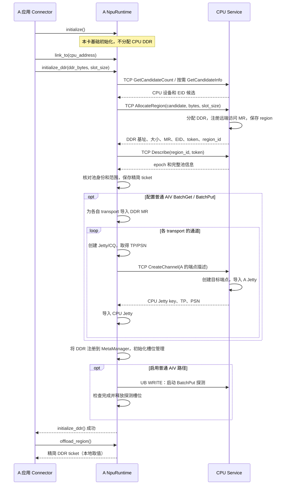
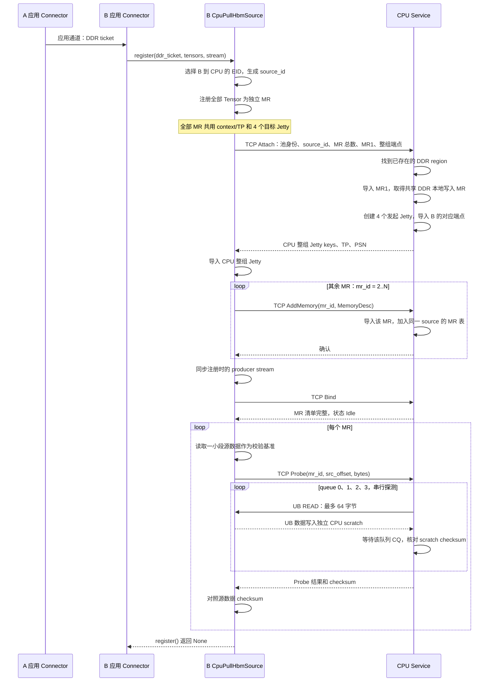
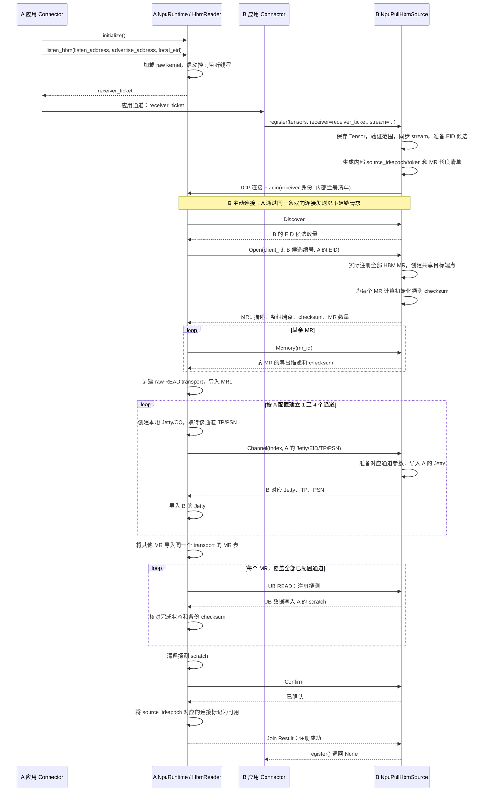
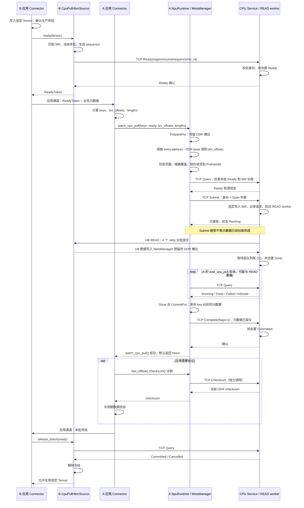
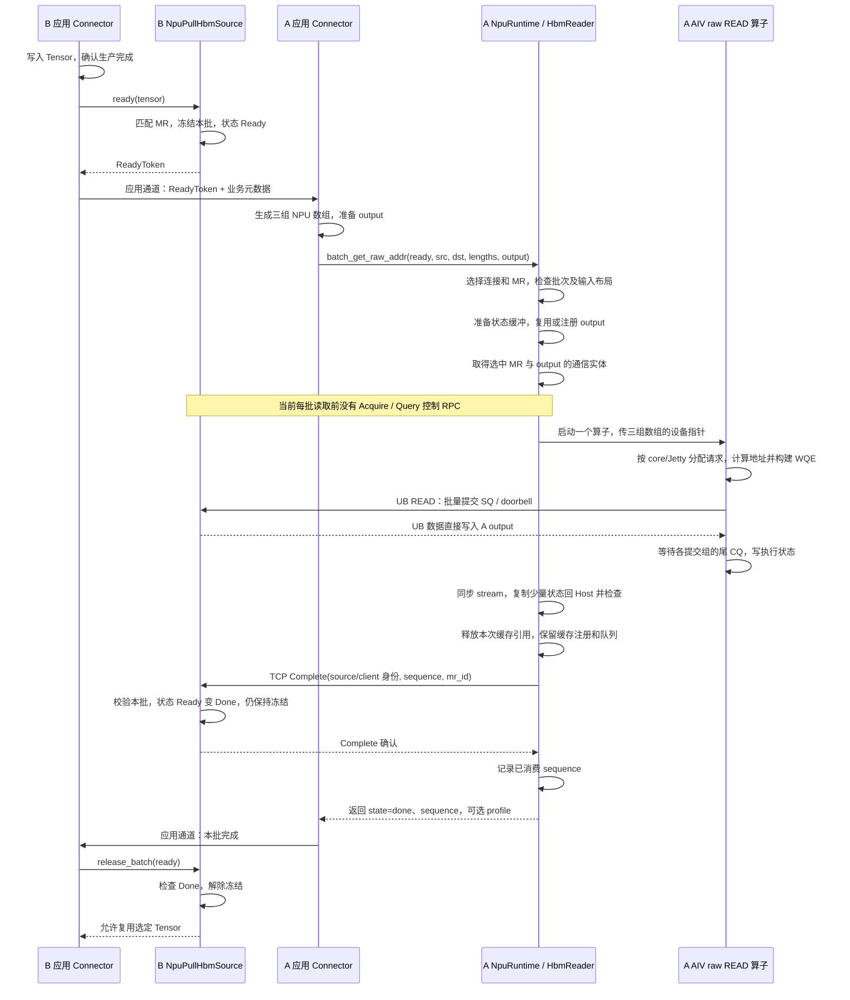
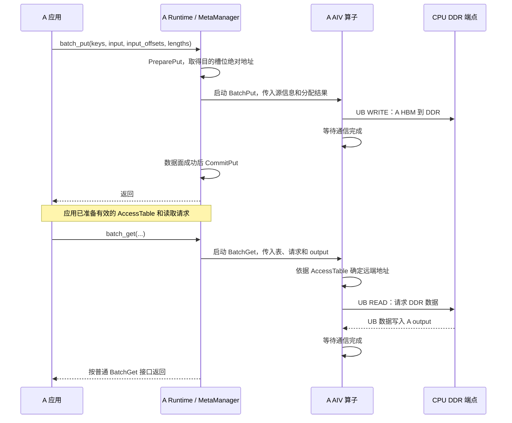

# A、B 与 CPU Service：建链和实际数据拉取交互

更新日期：2026-11-06。核对分支：`codex/cpu-pull-hbm-reference`，代码基线：`74c3fc4`。

本文记录**当前已实现的行为**，包含初始化、源注册、实际传输、完成确认和资源释放。本文档仅保留在本地，不提交。

> 当前 NPU Pull 仍有 KVAF 内部的 TCP `Complete` 握手。对话中讨论的“由应用 Connector 独自负责跨端完成通知、移除这个握手”尚未修改代码，因此下面仍画出此步骤。详见第 8 节。

## 1. 角色、链路和图例

本文固定使用以下角色，避免不同文档中 A/B 命名相反造成歧义：

| 角色 | 应用侧职责 | KVAF 对象或模块 |
|---|---|---|
| A：读取和提交端（D） | 接收 B 的业务元数据，组织源／目的位置，通知 B 批次结束 | `NpuRuntime`、本地 `MetaManager`、NPU READ 算子 |
| B：HBM 生产端（P） | 分配并写入 Tensor，保证生产完成和数据稳定，向 A 发布业务元数据 | `CpuPullHbmSource`、`NpuPullHbmSource` |
| CPU Service：DDR 持有端 | 服务进程持有 DDR | DDR 分配／注册、通信端点、CPU READ worker |

| 数据链路 | 发起端 | 实际数据方向 | 用途 |
|---|---|---|---|
| A NPU ↔ CPU DDR | A NPU | DDR → A HBM；A HBM → DDR | 普通 `batch_get()`、`batch_put()` |
| CPU ↔ B HBM | CPU | B HBM → CPU DDR | `batch_cpu_pull()` 或显式 `submit_cpu_pull()` |
| A NPU ↔ B HBM | A NPU | B HBM → A output HBM | `batch_get_raw_addr()` |

CPU Pull 与 NPU Pull 可以读取 B 上**同一批 Tensor**，也可以读取不同 Tensor。即使底层内存相同，两条路径仍独立注册 MR、建立连接、保存批次状态；应用要等所有消费者结束后再覆盖源数据。

图中区分三类箭头：

- **本地接口调用**：应用 Connector 调用本进程的 KVAF 对象。
- **TCP 控制消息**：KVAF 交换身份、注册信息、任务和完成状态。标注“应用通道”的箭头由应用自己的 Connector 通信实现。
- **UB READ/WRITE**：实际数据面操作。READ 的请求方向与数据返回方向相反；目标应用不需要逐次处理 READ 回调。

MR 是内存注册；Jetty key 是导出的通信端点描述；TP、PSN 是建链参数。UBA／远端地址不是另一进程可直接解引用的本地指针。

## 2. 初始化需要由应用交换什么

当前初始化只需要应用转交以下两类 ticket；不再单独转交生产端 source descriptor 或调用读取端 attach 接口。

| 场景 | A 生成并通过应用通道发给 B | B 的本地调用 | 成功返回 |
|---|---|---|---|
| CPU Pull | `runtime.offload_region()` | `cpu_source.register(ddr_ticket, tensors, stream=...)` | `None`，注册、建链及探测均完成 |
| NPU Pull | `runtime.listen_hbm(...)` | `npu_source.register(tensors, receiver=receiver_ticket, stream=...)` | `None`，注册、建链及探测均完成 |

`tensors` 可以是单个连续 NPU Tensor，也可以是多个连续 Tensor 的列表；列表中的各范围不能重叠。每条路径当前支持 1～4096 个 MR，同一源对象只允许一个冻结中的批次，每个批次只选其中一个 MR。

### 2.1 精简后的 DDR ticket

Python 返回字典包含：

| 字段 | 用途 |
|---|---|
| `version` | 当前为 2，校验 ticket 格式 |
| `address` | CPU Service 的 TCP 地址 |
| `region_id` | 指定已有 DDR 池 |
| `epoch` | 校验该 CPU Service 实例的代次 |
| `token` | 控制请求校验和注册／建链所需的 token value |
| `eid` | CPU 端 EID，16 字节 |

**ticket 不再包含 DDR base、bytes、slot_size，也不携带 DDR MR／Jetty 清单。**这些信息由 A 的 Runtime 和 CPU Service 保存。B 注册 CPU Pull 源时不需要知道 DDR 的槽位布局。

### 2.2 NPU 读取端 ticket

`runtime.listen_hbm(listen_address, advertise_address="", local_eid="")` 返回：

```text
version=1、control_address、receiver_id、receiver_epoch
```

它描述的是 **A 的监听入口和实例身份**。B 主动连接 A 后，B 的 KVAF 自动交换内部 HBM 注册清单。应用不再手工转交 `export_ticket`，也不调用旧的 `source.listen()`、`runtime.attach_hbm()` 或 `runtime.attach_cpu_source()`。

如果监听 `0.0.0.0`，需要通过 `advertise_address` 提供 B 能连接的地址。CPU Pull 的 CPU 服务地址与这个 NPU Pull 监听地址是两个独立入口。

## 3. A 与 CPU DDR：分配池并建立普通读写通道

下图以启用 CPU Pull，并配置普通 BatchGet／BatchPut kernel 的场景为例。纯 CPU Pull 协调端可以跳过 AIV 数据通道；纯 NPU Pull 则完全不需要这一节的 DDR 初始化。



- `initialize()` 与 `initialize_ddr()` 已分离；基础初始化不会访问 CPU Service。
- `link_to()` 保存目标并配置后续 DDR 连接对象，本身不完成数据面建链。
- `initialize_ddr()` 分配池并初始化本地元数据管理。没有普通 BatchGet kernel 时可只建立 CPU Pull 所需的池和控制状态。
- BatchGet 和 BatchPut 访问同一个 DDR 池，但各有自己的 transport、Jetty/CQ 和执行状态。
- 自适应候选带宽选择可能额外执行性能探测；图中省略候选循环和测量。
- `offload_region()` 直接返回已保存 ticket，不再发起分配或注册请求。

## 4. B 与 CPU：多 MR 注册，共用一组 CPU Pull 通道



### 4.1 资源如何复用

- 78 个 Tensor 对应 78 个 HBM MR；每个 MR 有自己的导出范围、segment 和 token ID 等注册信息。
- 同一个 `CpuPullHbmSource` 的全部 MR 共用一组 4 对 Jetty 和 CPU Pull TP 参数，不会为每个 Tensor 重建一组连接。
- CPU 通过 `source_id` 找到源会话，再通过 `mr_id` 找到导入段。每批选一次 MR，该批所有 READ 都使用它。
- CPU Pull 使用第 3 节的同一块 DDR。`Region::pull_destination` 懒创建并共享 CPU 本地写入 MR；该池的多个源后端也可引用它，不会因为 78 个 HBM MR 再注册 78 份 DDR 目的 MR。
- 供 A 远端读写的 DDR MR 与 CPU Pull 使用的本地写入 MR 分别管理；二者指向同一池内存。
- 探测使用独立 scratch，不写业务槽位。当前基线已改为**每个 MR 的每个 Jetty 都探测**，不能只凭某一个队列成功就接纳整组连接。

### 4.2 哪些描述符经过网络

`Attach` 发送第一块 HBM 的 `MemoryDesc` 和一次整组 `ConnectionDesc`；后续 `AddMemory` 只补充 MR，不重复发送整组端点描述。

```text
MemoryDesc：逻辑导出基址 base、bytes、token value、segment_bytes、segment
ConnectionDesc：路由 EID、TP、PSN、token value、Jetty key 长度、4 个 Jetty key
```

MR segment／Jetty key 中的 provider 字段按导出结果保留；它们内部的 EID 不应被当作路由 EID 随意替换。HBM 导出地址在 B 的注册阶段就已得到，CPU 通过这些控制消息接收并保存，绝非只存在 CPU Service 上。

`register()` 成功后，A 不需要额外调用 attach，也不需要先查询一个 source handle。实际提交使用下一节的 `ReadyToken`。

## 5. A 与 B：读取端监听，生产端主动接入 NPU Pull



- **TCP 监听在 A，B 没有监听端口**；B 的源对象运行后台连接／响应线程。TCP 发起方向不改变实际 READ 由 A NPU 发起这一点。
- A 在 `listen_hbm(..., local_eid=...)` 中指定 fullmesh EID；B 在 `NpuPullHbmSource(device_id, npu_eid=...)` 中指定其 fullmesh EID。两者与 CPU Pull EID 独立。
- B 的 `register()` 是完整、阻塞的初始化接口。实际 HCCP 注册发生在内部收到 `Open` 后，但应用只需等 `register()` 返回。
- B 准备 4 个目标 Jetty，A 按 `npu_core_count × jettys_per_core` 使用其中 1～4 个。各通道分别协商 TP 参数，provider 是否返回相同底层 TP 由其实现决定。
- 全部 MR 共用该 source 的 raw READ transport 和队列；切换 MR 更换远端注册信息，不重建通道。
- 纯 NPU Pull 只需要基础 `initialize()`、raw kernel 和上述监听／注册流程，不依赖 CPU DDR、MetaManager 或 AccessTable。

## 6. CPU Pull：实际拉取、提交元数据与源复用

### 6.1 应用发布批次和选择 MR

B 应用先通过自己的生产 stream／event 确认写入完成，再调用：

```python
ready = cpu_source.ready(tensor)   # 多 MR 必须指定已注册的 tensor
# 单 MR 也可以 cpu_source.ready()
```

KVAF 按 Tensor 的设备、基地址、字节数匹配注册清单，得到 `mr_id`。它冻结本批，发送 `Ready` 到 CPU Service，成功后返回：

```text
ReadyToken
  source = CpuPullSourceDesc(source_id, region_id, region_epoch, mr_length)
  sequence
  mr_id
```

`mr_length` 只描述本批选中的 Tensor，完整 MR 表保存在 B 和 CPU。`ready()` 不接收三组地址数组，也不代替应用的生产完成同步。B 应用通过自己的通道把 `ready` 与业务元数据发给 A。

### 6.2 推荐便利入口的完整时序



成功的 `batch_cpu_pull()` 包含 PreparePut、地址提取、Submit、Wait 和 Commit。`profile=True` 时返回阶段计时字典；默认返回 `None`。数据 checksum 不在传输／提交路径中自动计算，图中的验证是独立可选步骤。

### 6.3 显式接口与地址语义

应用需要自行组织目的分段时，使用同一条底层路径：

```python
put = runtime.prepare_put(keys, lengths)
ddr_base = runtime.remote_region["base"]
dst_offsets = [entry.address - ddr_base for entry in put.entries]

runtime.submit_cpu_pull(ready, put, src_offsets, dst_offsets, lengths)
runtime.wait_cpu_pull(put, timeout=30000)  # 只等待 DMA，不提交元数据
runtime.commit_put(put)
# 成功后由应用通知 B，再由 B 调用 cpu_source.release_batch(ready)。
```

- CPU Pull 的三组输入是 Host 序列或连续一维 **CPU `torch.int64` Tensor**；Python 层复制为内部连续 `uint64` 数组。不是 NPU Tensor。
- `put.entries[i].address` 是 DDR 绝对地址；**当前提交接口接受 `dst_offsets`**，减基址发生在提取目的地址时。
- TCP `Submit` 将三组数组组织成 `Span{source, destination, bytes}` 列表；携带池／源身份、批次号、MR ID 和 span 数量。不会传送 Tensor 内容、keys 或整个 PutHandle，也不重新发送 HBM MR 和 Jetty 清单。
- CPU 构造实际地址：`src = selected_memory.base + src_offset`，`dst = CPU_region.memory + dst_offset`。A 使用池的导出基址计算偏移，CPU 使用该池的本地内存基址加偏移；二者描述同一块 DDR，不能把远端地址当成本地指针使用。
- Runtime 检查源范围、DDR 范围和目的分段对本次 Put 预留范围的精确覆盖，并保存请求。相同 Put 的重复提交检查一致性，不重复发起 READ。
- MetaManager 统一管理普通 BatchPut 和 CPU Pull 的槽位；不会为两条路径固定划分两块互不相交的地址空间。不需要 `reserve_raw_ddr()`。

### 6.4 CPU 数据面实际执行

CPU 根据 `source_id → 会话 → mr_id → 已导入 MR` 选源，然后分波次构建 READ：

1. 大 span 按 `min(64 KiB, max_msg_size, 非零的 max_read_size)` 拆分。
2. 每个 WQE 使用一个远端 SGE 和一个本地 SGE；不把多个离散远端地址塞进一个 READ 的远端 SGL。
3. 将 WQE 分布到 4 个 Jetty，先提交本波各队列，再轮询 CQ。
4. 每个非空队列只对尾 WQE 请求完成通知，并使用尾部顺序／fence 约束；该波各队列完成后再继续。

这里没有逐 WQE 等待的 serial 模式。可在单波次内完成的相同传输布局可复用已构建计划，更大的请求按波次复用工作缓冲。当前 CPU Pull 控制客户端 `remote_pull::Exchange()` 每次 RPC 建立 TCP、收发后关闭；UB 通信资源则跨批复用。不要把它与 NPU Pull 的控制长连接混为一谈。

## 7. NPU Pull：实际裸地址 READ 与当前完成握手

### 7.1 应用输入和选源

```python
# B：生产完成并同步后
ready = npu_source.ready(tensor)
# B Connector 将 ready 和业务元数据发给 A Connector。

# A：三组数组均在 A 的 NPU 上；所有偏移和长度单位为字节。
result = runtime.batch_get_raw_addr(
    ready, src_offsets, dst_offsets, lengths, output,
    stream=stream, profile=False, validate_ranges=False,
)
```

NPU 的 `ReadyToken.source` 是 `NpuPullSourceDesc(source_id, source_epoch)`，另有 `sequence`、`mr_id`。`ready()` 只更新 B 本地批次状态，不向 A 发 Ready RPC。应用负责把 token 传给 A，A 根据身份选择已保存连接和 MR，应用不需要查询或传递 `hbm_link`。

三组数组必须是 A 上连续、一维、等长的 NPU `torch.int64` Tensor，数量为 1～4096。`output` 是 A 上的连续 NPU Tensor。它们无需经 TCP 传给 B。

### 7.2 当前成功路径



### 7.3 算子和 Host 各做什么

| 阶段 | 当前行为 |
|---|---|
| Host 输入检查 | 检查源身份、MR、sequence、设备、数组布局／数量及元数据与 output 不重叠，不回读三组数组逐项解析 |
| output 注册 | 以地址／长度缓存本地 MR；按选中 MR 与 output 组合缓存轻量通信实体，首次使用有注册／上传开销 |
| 设备地址计算 | `src = selected_MR_logical_base + src_offsets[i]`；`dst = output.data_ptr() + dst_offsets[i]` |
| WQE 组织 | 独立 raw READ 算子直接消费输入数组，复用 BatchGet 的队列调度思路，无单独准备算子，也不查 AccessTable |
| 分段与完成 | 一段对应一个 WQE，不做 64 KiB 拆分；按 core／Jetty 批量提交、组尾完成，不逐 WQE 等待 |
| 可选诊断 | `validate_ranges=True` 在同一个算子内增加长度／边界检查；应用仍保证目的范围互不重叠、长度符合硬件限制 |
| 同步与检查 | Host 等 stream 完成，回读少量执行状态；数据内容始终直接写入 output |
| 返回前控制步骤 | 当前仍等待 TCP Complete 确认；不是仅 kernel 完成就返回 |

`profile=True` 返回 Host 检查、缓冲准备、注册、launch、同步、状态检查、cleanup、complete 等时间，以及包围算子的 `kernel_event_us`。设备事件区间与 Host launch／等待有重叠，不能相加作为总耗时。输入准备、应用完成通知和 B 的 release 不属于该调用的计时范围。

output 注册不会每批注销；Python 保留其 Tensor 到 Runtime shutdown。应用不得在缓存有效期内 resize 或替换其 storage。三组元数据数组在调用中及未决恢复期间也要保持有效。

## 8. 三种“完成通知”不要混淆

| 步骤 | 当前发送方 → 接收方 | 作用 | 是否由应用显式发消息 |
|---|---|---|---|
| CPU Pull 的 Complete | A KVAF → CPU Service | A 完成 CommitPut／AbortPut 后，通知 CPU 元数据决策，状态变 Committed／Cancelled | 否，commit／abort 内部发送 |
| NPU Pull 的 Complete | A KVAF → B KVAF | READ 已结束，把 B 的批次标为 Done，使当前 release 条件成立 | 否，raw READ 内部发送 |
| 业务批次完成 | A Connector → B Connector | 应用确认可以结束本批，B 再调用对应源的 release | 是，应用自己的通信 |

**当前 NPU Pull 的后两步都存在。**B 收到 KVAF Complete 并不会自行允许写入；还要应用调用 `release_batch()`。如果只删掉读取端 Complete 的发送而不改生产端状态机，当前 release 会报 Busy。

此前讨论的后续调整是：NPU READ 本地确认完成并记录批次后立即返回，由应用发送跨端完成通知；B 的 `release_batch()` 接受该应用确认。这个调整尚未实现，本文没有把它当作当前行为，也不表示 CPU Pull 的元数据决策确认应同时删除。

## 9. 普通 DDR BatchGet／BatchPut 在建链后的交互

它们继续访问第 3 节分配的 DDR 池，不经过 B 的 HBM 源对象。



普通 Get／Put 的每批数据搬运不向 CPU Service 提交 CPU READ 任务，也不走第 6 节的 Ready／Submit／Query／Complete。CPU 作为远端内存端点参与数据面即可。此图不扩展普通 BatchGet／BatchPut 的错误恢复承诺；它们不使用 CPU Pull 的 PutHandle 恢复协议。

CPU Pull 和普通 BatchPut 的 key 都由 A 的 MetaManager 管理。CPU Pull Commit 后，应用按普通接口准备／更新 AccessTable，即可通过 BatchGet 读取对应 DDR 数据。

## 10. 失败、取消与正常关闭

### 10.1 注册探测失败

- 自动候选只能在旧候选资源已确认安全清理后继续尝试。明确指定 EID 时不意味着失败后能切到另一个网络。
- CPU 当前逐队列、单个在途 WR 探测。收到明确终结的错误 CQ 后，会尝试退役该候选整组队列和导入源，再允许回退；若 CQ 状态不明或清理失败，则保留资源并返回未决状态。
- 正式 CPU 多 WQE 传输不能套用上述单 WR 探测处理：一个队列报错时其他队列可能仍有 DMA，当前会隔离整组资源。
- NPU 注册探测失败时同样先尝试静止并清理 transport；无法证明安全结束时保留 B 源和 A scratch。
- TCP 可连、Attach／Channel 成功并不等于 UB 数据路径已验证；要以全部所需 MR／通道的实际探测成功为准。

### 10.2 运行时失败和重试

| 路径／情况 | 当前处理方式 |
|---|---|
| 显式 CPU Pull Submit 回包丢失／等待超时 | 保留原 `put` 和源数据，用 `query_cpu_pull(put)`／`wait_cpu_pull(put)` 查询原任务，不重新 PreparePut 或重发 READ |
| CPU Pull 确认 Done | `commit_put(put)` 发布数据；也可按应用决策撤销，不能将 Running／InDoubt 当作完成 |
| CPU Pull 确认安全失败 | `abort_put(put)` 撤销元数据；源仍处于 Ready 时按需由 B 的 `cancel_batch(ready)` 结束 |
| CPU Pull Commit／Abort 确认丢失 | 重试原决策；内部保存是否已完成元数据操作，避免重复处理槽位 |
| 便利入口 CPU Pull 未决 | 使用 `resolve_cpu_pull()` 完成内部保存的事务；不再次调用 `batch_cpu_pull()` 作为恢复 |
| NPU Pull 的 Complete／Cancel 回包丢失 | 用同一 `ready` 调用 `resolve_raw_addr()` 重试清理／控制确认，不重放 READ |
| NPU Pull 的 DMA 完成不明 | 保留源、output、元数据和通信资源；`resolve_raw_addr()` 不会自动重新执行 READ，也不保证能解除硬件未决状态 |
| NPU 批次已发布但决定不读取 | A 调用 `cancel_raw_addr(ready)`，记录禁止本批迟到 READ 并向 B 发 Cancel；成功后 B 才能 release／cancel 本地批次 |

CPU 的 `release_batch()` 会向 CPU Service Query，只有 Committed／Cancelled 才解除冻结；NPU 的 `release_batch()` 在 B 本地检查 Done，不再发一次网络查询。NPU 的生产端 `cancel_batch()` 同样不能单方面撤销已发布的读取许可。

TCP 重连与重新执行 DMA 是不同的事情。NPU 路径由 B 后台以同一注册身份 Resume，A 校验实例和 MR 清单后继续使用已保存连接状态；不会因重连重建一个新任务并重读。

### 10.3 正常关闭顺序

1. 应用停止新批次，完成／撤销已有任务，通过自己的通知通道协调 B 释放批次。
2. B 的 CPU 源 `shutdown()` 发送 Detach，CPU 关闭该 source 的通道与导入 MR；B 收到确认后关闭本地导出资源。
3. B 的 NPU 源 `shutdown()` 通过 A 的监听入口发送 Leave；A 先关闭读取端资源，再发 Close 让 B 关闭导出资源，并发 Retire 确认退役。
4. CPU 源全部分离后，A 可以 `shutdown_ddr()`；它保留基础 Runtime 和 NPU HBM reader。完整关闭使用 `runtime.shutdown()`。

任何一步仍处于未决状态，都不能因为调用了 shutdown 就认为已无 DMA。当前代码会保留相应资源，并要求继续处理原任务或原关闭流程。

## 11. 连接、MR 和状态分别保存在哪里

| 持有方 | 索引／对象 | 保存内容 |
|---|---|---|
| A 的 DDR 模块 | `NpuRuntime::Impl`、`RuntimeCore`、`PeerLink`、`RemotePullOperator` | DDR 范围、region 身份、精简 ticket、MetaManager、普通 Get／Put transport、当前 CPU Pull 请求 |
| A 的显式 CPU 事务 | `PutHandle → ConnectorPutState` | PreparePut 分配、请求快照、source／MR／sequence、提交与元数据决策状态 |
| A 的便利入口 CPU 事务 | `NpuRuntime::Impl::batch_pull_put` | 内部保存的同类 PutHandle，供 `resolve_cpu_pull()` 恢复 |
| CPU DDR 池 | `CpuService::regions_[region_id]` | 池内存、导出 MR、普通 Get／Put 通道、共享 `pull_destination`；epoch 校验服务代次 |
| CPU Pull 源会话 | `remote_pull::Service::Impl::sources[source_id]` | 关联 region、`memories[mr_id]`、当前批次、worker、后端；后端保存导入段和 4 个队列 |
| B 的 CPU 源对象 | `CpuPullHbmSource::Impl` | Tensor 列表、MR 清单、共享 Exporter、DDR ticket、source_id、选中 MR、sequence 和 frozen |
| A 的 NPU 读取连接 | `HbmReader::Impl::connections[(source_id, source_epoch)]` | 控制长连接、MR 清单、raw transport、缓存 output MR／通信实体、队列状态、未决批次和 last_sequence |
| B 的 NPU 源对象 | `NpuPullHbmSource::Impl` | Tensor 列表、MR／checksum、共享 Exporter、对端 client、连接线程、当前 Ready／Done／frozen 状态 |

应用保存的是 KVAF 返回的 ticket／ReadyToken，以及自己的业务批次和数据映射；不需要维护 source_id 到本地通信 handle 的查找表。

登记多个源不代表可以任意并发提交。同一 Runtime 从 PreparePut 起保留当前 CPU Pull 事务；CPU 同一池已有 Running／InDoubt／尚未确认的 Done 时，会拒绝另一个源的新 Submit。NPU reader 的当前 Read 调用也由 reader 锁串行化，Python 入口发现未决 raw READ 会要求先处理原批次。

## 12. 源码入口

| 内容 | 文件及主要入口 |
|---|---|
| 精简源身份与 ReadyToken | [common/include/connector_types.h](../common/include/connector_types.h) |
| DDR ticket、CPU 源公共接口 | [runtime/include/remote_offload.h](../runtime/include/remote_offload.h)；[bindings/include/remote_offload_python.h](../bindings/include/remote_offload_python.h) |
| NPU receiver ticket、源公共接口 | [runtime/include/hbm_read.h](../runtime/include/hbm_read.h)；[bindings/include/hbm_read_python.h](../bindings/include/hbm_read_python.h) |
| DDR 初始化、CPU 便利入口、监听入口 | [runtime/src/npu_runtime.cc](../runtime/src/npu_runtime.cc)：`InitializeDdr`、`BatchCpuPull`、`ListenHbm` |
| 普通 DDR 分配与端点请求 | [runtime/src/peer_link.cc](../runtime/src/peer_link.cc)；[runtime/src/cpu_runtime.cc](../runtime/src/cpu_runtime.cc) |
| Put 预留、提交校验、Wait／Commit／Abort | [runtime/src/connector_runtime.cc](../runtime/src/connector_runtime.cc) |
| CPU Pull 的 Query／Submit／Complete | [runtime/src/remote_pull_operator.cc](../runtime/src/remote_pull_operator.cc) |
| B 注册 CPU 源、Ready、release、Detach | [runtime/src/remote_offload.cc](../runtime/src/remote_offload.cc) |
| CPU 源会话状态机与后台 READ | [runtime/src/remote_pull_service.cc](../runtime/src/remote_pull_service.cc)：`Service::Dispatch` |
| CPU 多 Jetty READ、逐队列 Probe、共享 DDR MR | [runtime/src/cpu_pull_urma.cc](../runtime/src/cpu_pull_urma.cc)：`UrmaBackend`、`UrmaDestination` |
| CPU Pull TCP 编解码／连接 | [runtime/include/remote_pull_protocol.h](../runtime/include/remote_pull_protocol.h)；[runtime/src/remote_pull_client.cc](../runtime/src/remote_pull_client.cc) |
| B HBM 注册、导出地址和端点 | [runtime/src/hbm_exporter.h](../runtime/src/hbm_exporter.h)：`Exporter` |
| A NPU 接入、探测、READ 和 Complete | [runtime/src/hbm_read_client.cc](../runtime/src/hbm_read_client.cc)：`HbmReader`、`Engine`、`Connection::Resolve` |
| B NPU 控制响应、Ready、release、Leave | [runtime/src/hbm_read_source.cc](../runtime/src/hbm_read_source.cc)：`NpuPullHbmSource` |
| NPU 双向控制连接 | [runtime/src/hbm_read_protocol.h](../runtime/src/hbm_read_protocol.h)；[runtime/src/hbm_read_protocol.cc](../runtime/src/hbm_read_protocol.cc) |
| output 缓存及选 MR 通信实体 | [access_operator/demo/aiv_batch_get/host/batch_get_host.cpp](../access_operator/demo/aiv_batch_get/host/batch_get_host.cpp)：`KvafBatchGetLocalBufferAcquireForRemote` |
| NPU raw READ 算子 | [access_operator/demo/aiv_batch_get/kernel/execute_batch_get_raw_addr_aiv.asc](../access_operator/demo/aiv_batch_get/kernel/execute_batch_get_raw_addr_aiv.asc) |
| Python 接口与输入类型 | [bindings/src/npu_python_runtime.cc](../bindings/src/npu_python_runtime.cc)、[bindings/src/remote_offload_python.cc](../bindings/src/remote_offload_python.cc)、[bindings/src/hbm_read_python.cc](../bindings/src/hbm_read_python.cc) |

关联说明：[共享 DDR](shared_ddr_remote_offload.md)、[NPU HBM 裸地址读取](hbm_raw_addr_read.md)、[Connector 接口设计](connector_pull_api_design.md)。本文的 A 始终是读取端、B 始终是生产端；关联文档若命名不同，以职责为准。
