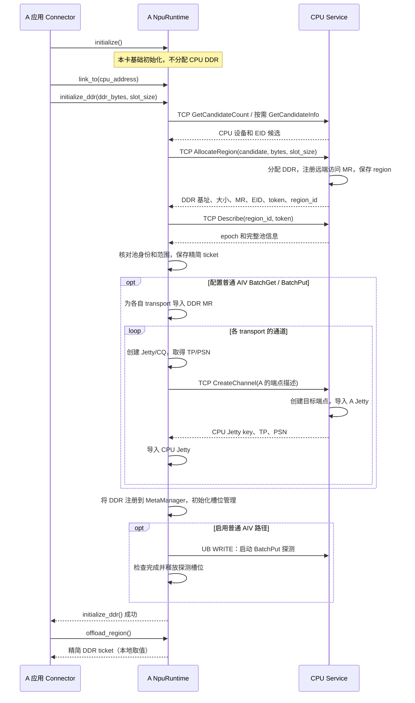
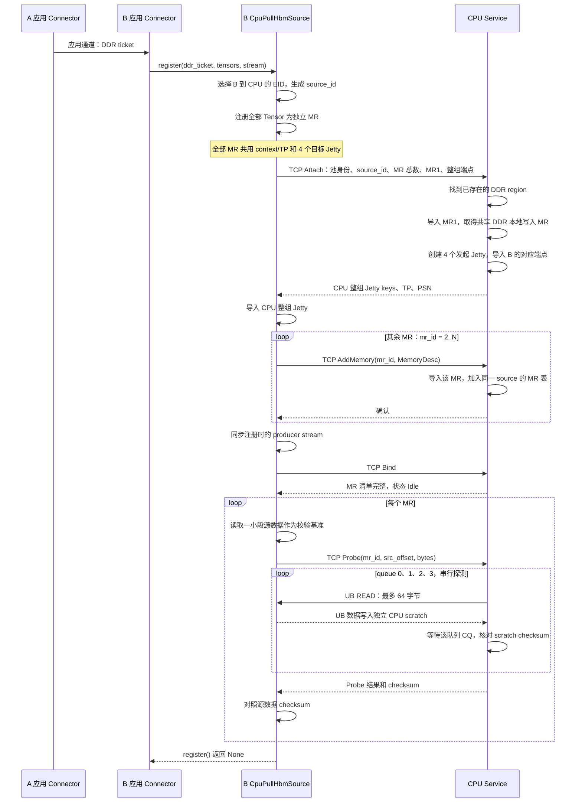
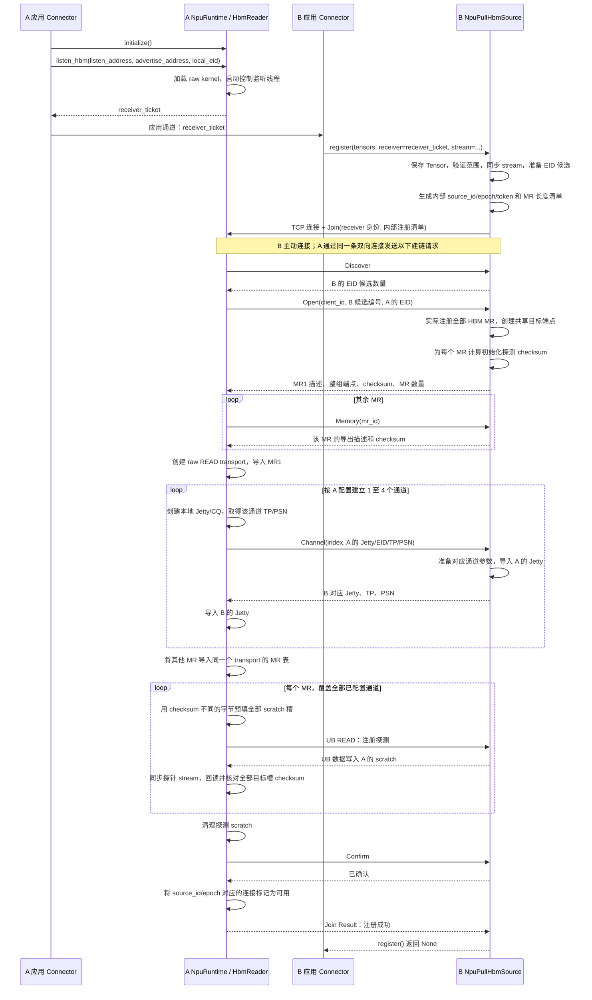
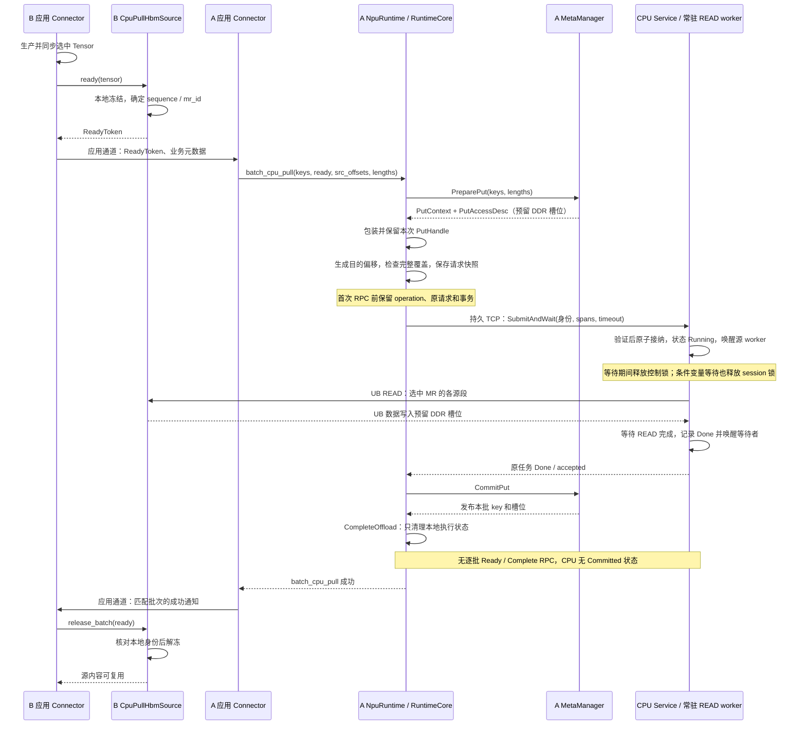
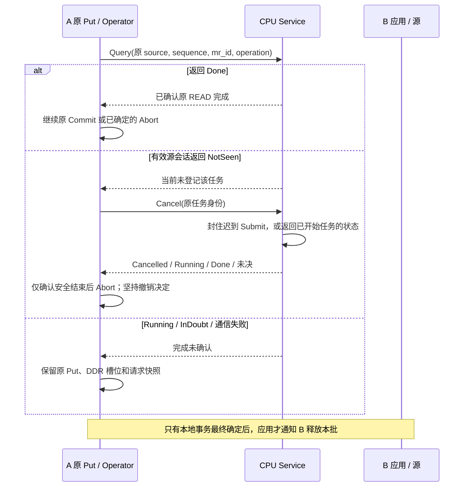
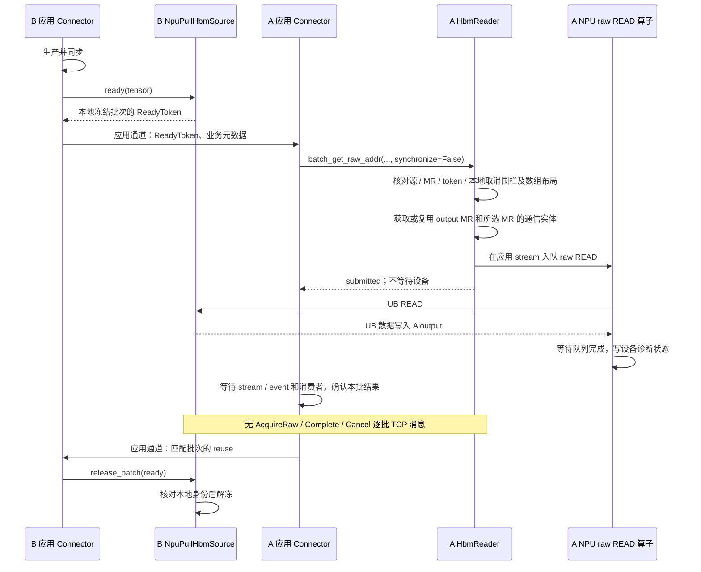
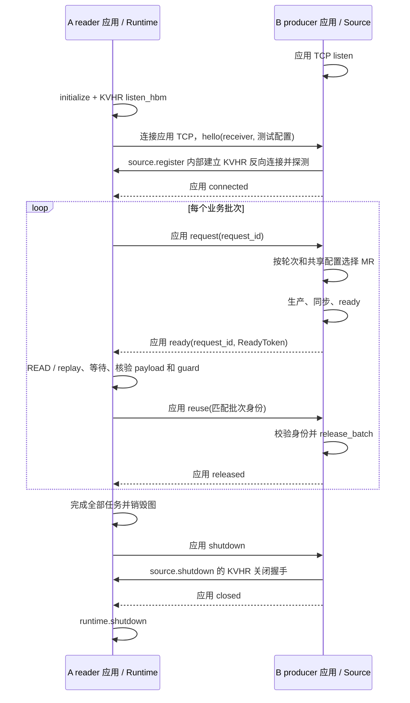
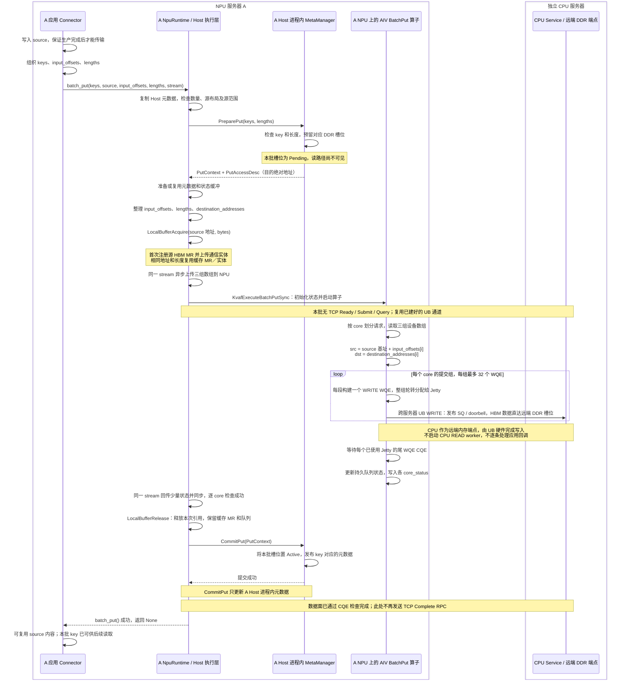
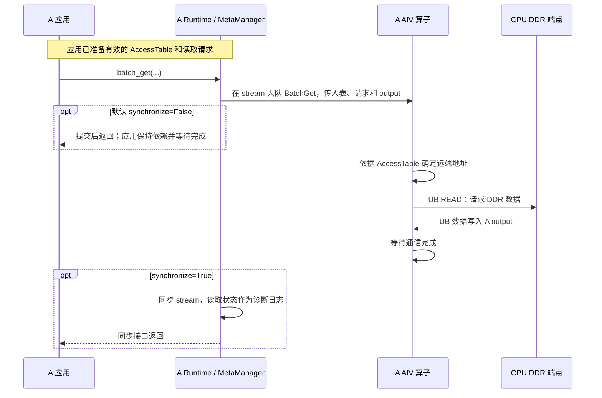

# A、B 与 CPU Service：建链和实际数据拉取交互

更新日期：2026-11-20。核对分支：`cpu-npu-pull-opt`，代码基线：`4e793f89`。

本文记录当前分支的注册、建链、实际传输、应用通知和关闭行为。内容迁自 reference 的 `7912517c`，已将原第 13、14 节的拟议方案按 opt 实现并入正文。

CPU Pull 正常成功批次使用一次 KVRP v8 `SubmitAndWait` RPC；NPU Pull 默认异步入队，支持预热后图捕获。两条路径的源数据复用均由应用通知协调，源端 `ReleaseBatch` 不查询远端完成。KVHR v8 仍承担 NPU 注册、重连和硬件资源关闭，但不承担逐批 Complete／Cancel 通知。

本文描述 opt 的现状，不包含 `cache-transport-execution` 分支的 Dispatcher、按配置首调准备或 graph 资源租约。

## 1. 角色、链路和图例

本文固定使用以下角色，避免不同文档中 A/B 命名相反造成歧义：

| 角色 | 应用侧职责 | KVAF 对象或模块 |
|---|---|---|
| A：读取和提交端（D） | 接收 B 的业务元数据，组织源／目的位置，通知 B 批次结束 | `NpuRuntime`、本地 `MetaManager`、NPU READ 算子 |
| B：HBM 生产端（P） | 分配并写入 Tensor，保证生产完成和数据稳定，向 A 发布业务元数据 | `CpuPullHbmSource`、`NpuPullHbmSource` |
| CPU Service：DDR 持有端 | 服务进程持有 DDR | DDR 分配／注册、通信端点、CPU READ worker |

| 数据链路 | 发起端 | 实际数据方向 | 用途 |
|---|---|---|---|
| A NPU ↔ CPU DDR | A NPU | DDR → A HBM；A HBM → DDR | 普通 `batch_get()`、`batch_put()` |
| CPU ↔ B HBM | CPU | B HBM → CPU DDR | `batch_cpu_pull()` 或显式 `submit_cpu_pull()` |
| A NPU ↔ B HBM | A NPU | B HBM → A output HBM | `batch_get_raw_addr()` |

CPU Pull 与 NPU Pull 可以读取 B 上**同一批 Tensor**，也可以读取不同 Tensor。即使底层内存相同，两条路径仍独立注册 MR、建立连接、保存批次状态；应用要等所有消费者结束后再覆盖源数据。

图中区分三类箭头：

- **本地接口调用**：应用 Connector 调用本进程的 KVAF 对象。
- **TCP 控制消息**：KVAF 交换身份、注册信息、CPU Pull 任务和硬件关闭状态。标注“应用通道”的箭头由应用自己的 Connector 通信实现。
- **UB READ/WRITE**：实际数据面操作。READ 的请求方向与数据返回方向相反；目标应用不需要逐次处理 READ 回调。

MR 是内存注册；Jetty key 是导出的通信端点描述；TP、PSN 是建链参数。UBA／远端地址不是另一进程可直接解引用的本地指针。

## 2. 初始化需要由应用交换什么

当前初始化只需要应用转交以下两类 ticket；不再单独转交生产端 source descriptor 或调用读取端 attach 接口。

| 场景 | A 生成并通过应用通道发给 B | B 的本地调用 | 成功返回 |
|---|---|---|---|
| CPU Pull | `runtime.offload_region()` | `cpu_source.register(ddr_ticket, tensors, stream=...)` | `None`，注册、建链及探测均完成 |
| NPU Pull | `runtime.listen_hbm(...)` | `npu_source.register(tensors, receiver=receiver_ticket, stream=...)` | `None`，注册、建链及探测均完成 |

`tensors` 可以是单个连续 NPU Tensor，也可以是多个连续 Tensor 的列表；列表中的各范围不能重叠。每条路径当前支持 1～4096 个 MR，同一源对象只允许一个冻结中的批次，每个批次只选其中一个 MR。

### 2.1 精简后的 DDR ticket

Python 返回字典包含：

| 字段 | 用途 |
|---|---|
| `version` | 当前为 2，校验 ticket 格式 |
| `address` | CPU Service 的 TCP 地址 |
| `region_id` | 指定已有 DDR 池 |
| `epoch` | 校验该 CPU Service 实例的代次 |
| `token` | 控制请求校验和注册／建链所需的 token value |
| `eid` | CPU 端 EID，16 字节 |

**ticket 不再包含 DDR base、bytes、slot_size，也不携带 DDR MR／Jetty 清单。**这些信息由 A 的 Runtime 和 CPU Service 保存。B 注册 CPU Pull 源时不需要知道 DDR 的槽位布局。

### 2.2 NPU 读取端 ticket

`runtime.listen_hbm(listen_address, advertise_address="", local_eid="")` 返回：

```text
version=1、control_address、receiver_id、receiver_epoch
```

它描述的是 **A 的监听入口和实例身份**。B 主动连接 A 后，B 的 KVAF 自动交换内部 HBM 注册清单。应用不再手工转交 `export_ticket`，也不调用旧的 `source.listen()`、`runtime.attach_hbm()` 或 `runtime.attach_cpu_source()`。

如果监听 `0.0.0.0`，需要通过 `advertise_address` 提供 B 能连接的地址。CPU Pull 的 CPU 服务地址与这个 NPU Pull 监听地址是两个独立入口。

## 3. A 与 CPU DDR：分配池并建立普通读写通道

下图以启用 CPU Pull，并配置普通 BatchGet／BatchPut kernel 的场景为例。纯 CPU Pull 协调端可以跳过 AIV 数据通道；纯 NPU Pull 则完全不需要这一节的 DDR 初始化。



- `initialize()` 与 `initialize_ddr()` 已分离；基础初始化不会访问 CPU Service。
- `link_to()` 保存目标并配置后续 DDR 连接对象，本身不完成数据面建链。
- `initialize_ddr()` 分配池并初始化本地元数据管理。没有普通 BatchGet kernel 时可只建立 CPU Pull 所需的池和控制状态。
- BatchGet 和 BatchPut 访问同一个 DDR 池，但各有自己的 transport、Jetty/CQ 和执行状态。
- 已配置的普通 Get／Put transport 在 `initialize_ddr()` 期间建立；首批调用仍可能追加本地 HBM 注册或执行工作区，不是延迟到首批才建远端通道。
- 自适应候选带宽选择可能额外执行性能探测；图中省略候选循环和测量。
- `offload_region()` 直接返回已保存 ticket，不再发起分配或注册请求。

## 4. B 与 CPU：多 MR 注册，共用一组 CPU Pull 通道



### 4.1 资源如何复用

- 78 个 Tensor 对应 78 个 HBM MR；每个 MR 有自己的导出范围、segment 和 token ID 等注册信息。
- 同一个 `CpuPullHbmSource` 的全部 MR 共用一组 4 对 Jetty 和 CPU Pull TP 参数，不会为每个 Tensor 重建一组连接。
- CPU 通过 `source_id` 找到源会话，再通过 `mr_id` 找到导入段。每批选一次 MR，该批所有 READ 都使用它。
- CPU Pull 使用第 3 节的同一块 DDR。`Region::pull_destination` 懒创建并共享 CPU 本地写入 MR；该池的多个源后端也可引用它，不会因为 78 个 HBM MR 再注册 78 份 DDR 目的 MR。
- 供 A 远端读写的 DDR MR 与 CPU Pull 使用的本地写入 MR 分别管理；二者指向同一池内存。
- 探测使用独立 scratch，不写业务槽位。当前基线已改为**每个 MR 的每个 Jetty 都探测**，不能只凭某一个队列成功就接纳整组连接。

### 4.2 哪些描述符经过网络

`Attach` 发送第一块 HBM 的 `MemoryDesc` 和一次整组 `ConnectionDesc`；后续 `AddMemory` 只补充 MR，不重复发送整组端点描述。

```text
MemoryDesc：逻辑导出基址 base、bytes、token value、segment_bytes、segment
ConnectionDesc：路由 EID、TP、PSN、token value、Jetty key 长度、4 个 Jetty key
```

MR segment／Jetty key 中的 provider 字段按导出结果保留；它们内部的 EID 不应被当作路由 EID 随意替换。HBM 导出地址在 B 的注册阶段就已得到，CPU 通过这些控制消息接收并保存，绝非只存在 CPU Service 上。

`register()` 成功后，A 不需要额外调用 attach，也不需要先查询一个 source handle。实际提交使用下一节的 `ReadyToken`。

## 5. A 与 B：读取端监听，生产端主动接入 NPU Pull



- **KVHR TCP 监听在 A，B 的 KVAF 源对象没有监听端口**；B 的源对象运行后台连接／响应线程。TCP 发起方向不改变实际 READ 由 A NPU 发起这一点。
- A 在 `listen_hbm(..., local_eid=...)` 中指定 fullmesh EID；B 在 `NpuPullHbmSource(device_id, npu_eid=...)` 中指定其 fullmesh EID。两者与 CPU Pull EID 独立。
- B 的 `register()` 是完整、阻塞的初始化接口。实际 HCCP 注册发生在内部收到 `Open` 后，但应用只需等 `register()` 返回。
- B 准备 4 个目标 Jetty，A 按 `npu_core_count × jettys_per_core` 使用其中 1～4 个。各通道分别协商 TP 参数，provider 是否返回相同底层 TP 由其实现决定。
- 全部 MR 共用该 source 的 raw READ transport 和队列；切换 MR 更换远端注册信息，不重建通道。
- 纯 NPU Pull 只需要基础 `initialize()`、raw kernel 和上述监听／注册流程，不依赖 CPU DDR、MetaManager 或 AccessTable。

当前每个 MR 的启动探针都先预填 scratch，填充值的 checksum 与该 MR 的预期不同，再逐槽检查 READ 结果。这样不会把未写入的零值或上个 MR 的相同内容误判为成功。默认探针不通过 Host 回读每核 status 判定成功；显式诊断模式额外检查状态和提交数量。探针仅覆盖 MR 起始处最多 64 字节，不能替代实际随机偏移、包长和每轮 payload 校验。

## 6. CPU Pull：单 RPC 拉取、本地提交与源复用

### 6.1 发布批次和任务身份

B 应用先确认生产完成，再发布本地冻结批次：

```python
producer_stream.synchronize()
ready = cpu_source.ready(tensors[i])
# 应用将 ready 和本批 keys／源偏移／长度发送给 A。
```

`ready()` 不发送 RPC、不重新建链，也不替应用同步生产。冻结期间重复选择同一 MR 返回同一批次；换 MR 被拒绝。ReadyToken 包含源身份、region/epoch、选中 MR 的长度、sequence 和 mr_id；完整 MR 表已在注册时保存。

A 在实际提交时分配每 Put 的 `operation` 身份，保存原 token 和三数组快照。CPU 用 region、source、sequence、mr_id、operation 及请求内容识别任务；同一 token 不能用于提交另一份新 Put。

### 6.2 推荐便利入口的完整时序



正常成功批次从 Ready 到 Release 只有一次 KVAF 控制 RPC；应用消息、注册探测、独立 checksum 诊断和异常恢复不计入这一次。`BatchCpuPull` 成功包含 CPU READ 和本地元数据提交，默认 Python 返回 `None`。

`SubmitAndWait` 使用持久连接；同一连接串行请求，不同连接可并行处理。CPU 源会话复用一个 READ worker，不为每批新建线程。等待超时不会取消 READ：`timeout=None` 使用配置预算，0 只提交并立即检查；收到 Running 或发生通信不确定时保留原事务。

### 6.3 显式接口、覆盖校验和地址语义

```python
put = runtime.prepare_put(keys, lengths)
# dst_offsets 由 put.entries 的绝对地址减 runtime.remote_region["base"] 得到。
runtime.submit_cpu_pull(ready, put, src_offsets, dst_offsets, lengths)
runtime.wait_cpu_pull(put, timeout=30000)
runtime.commit_put(put)
# A 应用发送成功通知，B 再 release_batch(ready)。
```

显式 `submit_cpu_pull` 使用 Submit，首次正常收到成功响应只表示已接受提交；后续 Query／Wait 查询原任务，便利入口才使用 SubmitAndWait。相同请求再次调用 Submit 只核对本地快照并返回，不重新发 RPC；丢回复后的这个返回值不证明远端已接纳，仍须 Query／Wait。二者共用同一 PutHandle、覆盖校验和决定规则。

- `src_offsets` 相对选中源 Tensor，`dst_offsets` 相对 DDR pool base，单位均为字节；普通 BatchPut 的目标描述仍是 DDR 绝对地址。
- 每批最多 4096 个 span。便利入口一 key 对应一个完整目的 entry，采用 O(n) 覆盖检查；显式拆分或重排仍检查排序后的覆盖、缺口、重叠和跨槽位。
- 三数组在首次 RPC 前复制到事务持有的快照；重复提交必须与原 token、MR 和数组完全一致，不再次发起 READ。
- Commit 只允许成功 Done；Abort 可用于未提交 Prepared，或已确认 DMA 停止的 Done／Failed。完成未知时保留原决定及资源。
- `CompleteOffload(commit)` 是本地收尾。CPU 不感知 MetaManager 的 Commit／Abort，应用最终通知不能只依据 CPU 的 Done。

### 6.4 CPU 数据面和恢复

CPU 每批先选定一个已导入 MR，复用该源的四个 Jetty；大源段按后端限制拆为不超过 64 KiB 的 READ，按窗口批量提交并等待完成。payload 不经过 TCP，不经过 A 的 HBM，也不由 CPU 应用逐字节复制。



响应中的 accepted 位表示任务已接纳，不代表 READ 已完成。Query 可能先于原 Submit 到达，NotSeen 不能直接作为释放槽位的依据；读取端必须先建立 Cancel fence。Cancel 不中止已接纳的 DMA。取消与 READ 竞争时等待原任务结束，保留原 Abort 决定；已提交成功的事务不可反向取消。

便利入口的未决状态用 `resolve_cpu_pull()` 恢复；显式接口使用原 PutHandle。主动放弃未使用 token 调 `cancel_cpu_pull(ready)`；若已 Prepare 但尚未 Submit，先 `abort_put(put)`。B 的 `cancel_batch()` 只是本地解冻，不能替代 A 的取消操作。独立 `last_offload_checksum()` 只诊断当前 DDR 数据，须在槽位被释放、覆盖或源进入下一批前使用。

## 7. NPU Pull：默认异步 READ、图回放与诊断

### 7.1 默认成功路径

```python
# B：先完成并同步生产。
ready = npu_source.ready(tensors[i])
# B 应用把 ready 与业务元数据交给 A。
runtime.batch_get_raw_addr(ready, src_offsets, dst_offsets, lengths, output,
                           stream=read_stream)
# 默认返回 state="submitted"，同一 stream 可继续排入消费者算子。
read_stream.synchronize()
# A 确认本批读取和消费者完成后，通过应用通道通知 B。
npu_source.release_batch(ready)  # 在 B 进程调用
```

三个元数据数组均为 A 本卡连续一维 int64 Tensor。源偏移相对 ready 选中的 MR，目的偏移相对 output。每段生成一个 READ WQE，不做 64 KiB 拆分；长度还必须符合设备单次 READ 能力，目的范围不能重叠。



正常模式不会每批清零或回读设备 status；显式 `synchronize=True` 会等待 stream 并返回 `state="done"`，仍不将设备诊断结果转换为 Host 异常。入队成功、stream 完成和数据正确性是不同判据，应用负责合法输入和结果验证。`validate_ranges=True` 仅增加设备端长度／范围检查，不检查目的区间重叠，也不提供 Host 成功证明。

正常异步调用不逐批保留输入三数组或 stream 的 Python 引用，调用方须保持到执行完成。output 注册按地址／大小缓存，Python 保留 output 到 Runtime shutdown，C++ 调用方保持底层存储到连接关闭。缓存期间不得 resize 或更换 storage。一个连接的多 MR 共用队列状态，须在同一 stream 顺序执行，或显式建立跨 stream 依赖；Host 调用锁不保证设备任务不重叠。

### 7.2 预热、捕获和复用图

```python
runtime.batch_get_raw_addr(ready, src_offsets, dst_offsets, lengths, output,
                           stream=read_stream)
read_stream.synchronize()  # 完成首次注册、实体上传和工作区准备。
graph = kvaf.AclGraph()
graph.capture_begin(read_stream)
runtime.batch_get_raw_addr(ready, src_offsets, dst_offsets, lengths, output,
                           stream=read_stream, synchronize=False, profile=False)
graph.capture_end()
graph.replay(read_stream)
read_stream.synchronize()
# 最后一次执行结束后，先停止回放并销毁图，再关闭连接／源。
graph.reset()
```

图固定源 MR、output、元数据地址和请求数量。源数据和三个数组的内容可在上次执行结束后更新；不同 MR 使用对应 MR 的图。应用可以保留图跨批复用，但每批都须匹配收到的源／MR／ReadyToken，并保证源可复用期间没有旧批次 replay。

回放不会经过 Host 入口，因而不再核对 ReadyToken，也不经过本地取消围栏。`cancel_raw_addr()` 不能使旧图失效；调用方停止 replay、等待已排队任务、保持全部输入／output／源注册和通信资源存活，最后销毁图。本分支没有为 RawAddr 提供普通缓存重构分支那样的自动 graph 资源租约。

### 7.3 最新诊断与 WQE 编码

`KVAF_HBM_RAW_READ_DIAGNOSTICS=1` 在 Engine 创建时启用，仅用于 eager 定位。它每次启动前清零诊断状态，强制同步 READ stream，再回读状态、队列和 entity；状态缺失、执行错误、提交不完整或快照失败返回 InDoubt 并保留资源。它不支持 graph，不重放 READ、不重置持久队列，也不授权源复用。关闭环境变量并使用新建 Engine／Runtime 恢复普通路径。

诊断保存 CQE，以及 CQ 错误对应的 WQE 快照，Host 从普通 HBM 状态缓冲读取，避免直接把 provider 的 SQ VA 当成可回读 Tensor。`input_mode=0` 是注册探针，`input_mode=1` 是实际 offsets 批次；初始化探针成功不能替代后者的 payload 校验。

`4e793f89` 修正的是 raw peer-HBM READ 的本地 SGE：`{uint32 length, uint32 zero, uint64 local_va}`，WQE `word[13]` 为零。这个字段不填本地 MR 注册 token；本地 MR 仍须注册、校验和保留，远端 token／EID 编码不变，普通 BatchGet／BatchPut 的已有 WQE 编码不变。raw 入口保持 V2，参数 80 B、状态 1280 B；Host 库和设备 kernel 应配套构建。

详细诊断日志、启动探针和源数据核验方法见 [NPU HBM 裸地址读取](hbm_raw_addr_read.md)。

## 8. 应用通知 TCP 与 KVAF 内部控制 TCP

### 8.1 哪个完成负责什么

| 完成或确认 | 发送／观察位置 | 含义 |
|---|---|---|
| READ／WRITE CQE | 数据面发起端 | 队列完成信息；不自动提交缓存元数据或释放源 |
| CPU Pull Done | CPU → A 的 SubmitAndWait／Query 回复 | 原 READ 已完成；A 仍须执行本地元数据决定 |
| 普通 BatchPut 成功 | A Host 返回 | WRITE 和本地元数据提交成功 |
| RawAddr submitted／done | A Host 返回 | 正常模式为已入队／已同步 stream，不包含设备状态回读和应用通知 |
| 业务 reuse／安全取消 | A 应用 → B 应用 | 应用确认可结束匹配批次，B 才本地 release／cancel |
| Close／Retire、Detach | KVAF 控制连接 | 关闭硬件资源；不能替代每批执行顺序和源内容冻结 |

CPU Pull 和 NPU Pull 的源端 release／cancel 都只核对本地 token。通知丢失、超时或 TCP 断开时，应用继续保留冻结源；仅持有 token 或成功发送一个通知帧不表示对端已处理。CPU Pull 通知须晚于本地事务最终决定，NPU Pull 通知须晚于相关任务完成并阻止迟到读取。

### 8.2 当前 NPU benchmark 的两条 TCP 连接

实际 Connector 可以使用自己的通道。仓库 `TcpControlChannel` 只提供通知帧收发，不搬运 HBM 数据，也不代替业务身份和完成校验。当前 `bench_hbm_read_raw_addr.py` 的连接方向如下：

| 通道 | 建立方向 | 承载内容 |
|---|---|---|
| 应用 KVNT v1 TCP，示例 B:29100 | B producer 监听，A reader 主动连接 B | receiver ticket、配置、request/ready、reuse/released、shutdown/closed、error |
| 内部 KVHR v8 TCP，示例 A:29000 | A `listen_hbm`，B `source.register` 主动连接 A | MR／Jetty／TP、探测、重连和硬件关闭 |
| NPU 数据通道 | A 发起 READ | B HBM → A output；payload 不经过上述 TCP |



应用帧最大 4 MiB，按绝对 deadline 处理拆包／粘包；会话活动后断线不自动重连、重发 READ 或释放批次。B 初始注册失败时先尝试 `source.shutdown()` 回滚，仅完整回滚成功才发送匹配 session 的 `startup_failed(cleanup=done)`；否则保留资源并报告未决。应用通知连接可复用到实际 Connector，但当前 benchmark 的监听方向不是 KVAF 对所有应用的要求。

## 9. 普通 DDR BatchGet／BatchPut 在建链后的交互

它们继续访问第 3 节分配的 DDR 池，不经过 B 的 HBM 源对象。

### 9.1 标准 BatchPut：实际写入、提交元数据与源复用

下图与第 6.2 节采用相同粒度，描述已配置 `batch_put_kernel_object_path` 的标准 AIV Direct-HCCP 成功路径；本节按 opt 当前实现核对。前提是第 3 节的 DDR 分配、MR 导入、Jetty 建链和启动探测已经完成。**本批源 Tensor 位于 A 的 HBM，由 A NPU 主动 WRITE 到 CPU DDR。**

**部署为两台独立服务器**：NPU 服务器 A 的 Host 进程运行 Connector、NpuRuntime 和 MetaManager，其 NPU 执行 BatchPut；远端 CPU 服务器运行 CPU Service 并持有目的 DDR。“A 本地提交”指更新 NPU 服务器 A 进程内的 key／槽位元数据，目的数据仍在远端 CPU 服务器的 DDR 中。

```python
# A：source 是本地连续 NPU Tensor；应用保证生产与本次传输的 stream 顺序。
# keys、input_offsets、lengths 是等长的 Host 整数序列或连续一维 CPU int64 Tensor。
runtime.batch_put(keys, source, input_offsets, lengths, stream=stream)
# 成功返回 None：数据写入完成，且本地 MetaManager 已提交本批 key。
```



- **生产与源复用**：应用保证源数据对传输可见。同一 stream 可依赖执行顺序；跨 stream 需要应用建立 event／同步依赖。成功返回后可覆盖源内容，无需 `ReadyToken`、`release_batch()` 或 B 的完成通知。源 MR 按地址和长度缓存至 transport 销毁；覆盖内容与释放／更换底层 storage 是不同操作。
- **地址语义**：每个 key 对应一段源数据和一个目的槽位，长度单位为字节。`destination_addresses[i] = put_desc.entries[i].address`，直接使用 DDR 绝对地址；此路径不减 DDR base，也不把目的偏移交给 CPU READ worker。
- **Host 与设备的分工**：Python 接收 Host 元数据，Runtime 做源范围检查、`PreparePut` 和 `CommitPut`；执行层把偏移、长度、目的地址打包为三组 `uint64` 数组上传到 NPU。keys／PutContext 留在 Host，源 payload 始终从 HBM 经 UB 直达 DDR；算子不查 AccessTable，也不再次逐项校验范围。
- **提交与完成粒度**：每段对应一个 WQE，不做 CPU Pull 的 64 KiB 拆分。各 core 按整组（最多 32 个 WQE）轮转使用配置的 Jetty；只有每个已使用 Jetty 的最后一个 WQE 请求 CQE。算子等这些尾 CQE 后才报告完成，不逐 WQE 等待，也不每提交一组就等一次 CQ。
- **返回边界**：Host 在同一 stream 中排入算子和状态 D2H 回传，再同步并检查每个 core 的结果及处理数量；数据面成功后才执行本地 `CommitPut`。`batch_put()` 是同步接口，返回 `None`，没有 CPU Pull 的 `profile`／PutHandle 返回。
- **完成确认与服务器边界**：跨服务器 WRITE 仍要等待 UB 数据面的 CQE；“无 TCP Complete”仅指完成后没有额外的 KVAF 控制 RPC。CPU Pull 也在 READ Done 后提交 A 本地元数据，其 CompleteOffload 现为本地收尾；两者均不额外发送 TCP Complete。CPU Pull 的源冻结仍由应用通知 B 后释放。这里的 key 可见性属于 A 的 MetaManager，不代表向其他 Runtime 广播了映射。
- **失败边界**：图中只画成功路径。当前 `RuntimeCore::BatchPut` 在 `ExecuteBatchPut` 失败时调用 `AbortPut` 并返回错误；这不构成 CPU Pull 的未决 DMA 恢复协议，也不能把“元数据已撤销”等同于“所有 DMA 已安全结束”。

### 9.2 普通 BatchGet：读取已提交的 DDR 数据



普通 Get／Put 的每批数据搬运不向 CPU Service 提交 CPU READ 任务，也不走第 6 节的 SubmitAndWait／Query／Cancel 任务协议。CPU 作为远端内存端点参与数据面即可。此图不扩展普通 BatchGet／BatchPut 的错误恢复承诺；它们不使用 CPU Pull 的 PutHandle 恢复协议。

CPU Pull 和普通 BatchPut 的 key 都由 A 的 MetaManager 管理。CPU Pull Commit 后，应用按普通接口准备／更新 AccessTable，即可通过 BatchGet 读取对应 DDR 数据。

普通 BatchGet 默认异步，应用负责等待和跨 stream 顺序。该分支同步 Get 的设备状态读取用于诊断日志，不能据 Host 返回推导所有设备语义检查都已通过。不要套用 `cache-transport-execution` 的首调 provider、方向级恢复或 graph 资源租约。

## 10. 失败、取消与正常关闭

### 10.1 注册和数据面失败

- 自动候选只有在旧候选资源安全清理后才继续；TCP 可连或端点导入成功不代表 READ 可用。
- CPU Probe 每次只有一个在途 WR；明确错误 CQ 后可尝试退役整组队列并回退。正式多队列 READ 错误可能仍有其他 DMA，需要保留未决资源。
- NPU Probe 每 MR 预填 scratch 并校验全部槽；失败后需确认 kernel 退出且 transport 静止，再释放 scratch 或换候选。
- 普通模式 RawAddr 不回读设备状态；诊断模式失败会隔离资源。两种模式都不能把通知 TCP 断开解释为 DMA 已结束。

### 10.2 运行时恢复和取消边界

| 情况 | 当前处理 |
|---|---|
| CPU Submit／SubmitAndWait 丢回复或超时 | 原 Put Query／Wait；便利入口用 resolve_cpu_pull，不新建 Put 或重发 READ |
| CPU Query 返回 NotSeen | 用原任务 Cancel fence，确认迟到提交不能启动后才安全撤销 |
| CPU 元数据 Commit／Abort 未决 | 重试原决定，保留 metadata_finished；此处没有远端 Complete ACK |
| 主动放弃未提交 CPU token | A cancel_cpu_pull；若显式 Put 已 Prepare 未 Submit，先 abort_put |
| CPU READ 正在运行时取消 | 不强行终止 DMA，保留资源并查询／重试同一取消；已确定 Abort 不因稍后 Done 改成 Commit |
| NPU cancel_raw_addr | 只更新本地取消围栏，阻止该批及更早批次未来的 Host 提交；不发通知、不撤回队列、不使旧 graph 失效 |
| NPU 提交／同步／诊断失败 | pending_raw_addr 表示失败隔离；resolve_raw_addr 校验原失败 token 并报告未决，不同步、不重放、不发通知 |
| 正常异步 NPU READ 已提交 | pending_raw_addr 可能为 false；它不是完成查询，仍由应用等待执行和消费者 |
| 应用 reuse 通知或 released 回复丢失 | 保留原批次／会话身份处理，不把断连或消息发送成功当作源释放许可 |

同一个冻结 NPU 批次允许重复 READ；成功提交不会推进“已消费 sequence”围栏。旧 Ready 消息和图回放由应用协调，不能按 CPU Pull 的一次任务状态机处理。

### 10.3 正常关闭顺序

1. 应用停止新请求和图回放，等待所有相关 stream／消费者完成，销毁捕获图。
2. A 完成 CPU Put 的原元数据决定及必要取消，并通过应用消息确认两条 Pull 路径的结果。
3. B 收到匹配通知，分别结束 CPU／NPU 源对象的冻结批次；同一 Tensor 被两条路径使用时，两者均结束后才可覆盖。
4. B 关闭 CPU source：Detach → CPU 停止并 join worker、关闭后端 → B 注销 exporter。CPU 的 Running／InDoubt 或 B frozen 会阻止安全关闭。
5. B 关闭 NPU source：通知 A 关闭发起端 transport，再由 Close 请求让 B 注销 exporter，随后 Retire 确认硬件会话退役；B 最后结束控制线程并释放源引用。图和正常排队任务已结束是应用前提，当前代码不自动统计活动 graph。
6. 最后 A `shutdown_ddr()` 关闭 DDR 模块，或 `shutdown()` 关闭整个 Runtime。CPU source 尚未 Detach 时 DDR 不能释放；`shutdown_ddr()` 不关闭独立 NPU Pull 连接。

关闭失败保留对象、内存和必要连接，重试原关闭。NPU 控制重连校验相同 receiver/source 代次及 MR 清单；不因 TCP 重连而重新创建已退役硬件会话。NPU Pull 硬件连接也可以由 A 的全 Runtime shutdown 驱动关闭，但仍须先履行停止任务、销毁图和结束源批次的应用契约。CPU source 则必须先由 B Shutdown／Detach，A 不能替它注销已注册源；仅解冻尚不足以解除 DDR 的 RegionBusy。

## 11. 资源归属、状态和当前并发限制

| 持有方 | 索引／对象 | 保存内容 |
|---|---|---|
| A DDR 模块 | NpuRuntime、RuntimeCore、PeerLink、RemotePullOperator | 唯一 DDR 范围／ticket、MetaManager、普通 Get／Put transport、CPU Pull 控制长连接和原任务 |
| A 显式 CPU 事务 | PutHandle → ConnectorPutState | 预留槽位、原请求快照、源／MR／sequence、提交和元数据决定 |
| A 便利 CPU 事务 | batch_pull_put | 同类内部 PutHandle，供 resolve_cpu_pull 恢复 |
| CPU DDR 池 | regions_[region_id] | allocation、普通远端访问 MR／通道、共享 pull_destination |
| CPU Pull source | sources[source_id] | MR 表、当前 sequence／mr_id／operation／spans、首批启动后复用的 READ worker、四个队列和完成条件变量 |
| B CPU source | CpuPullHbmSource::Impl | Tensor／MR、共享 Exporter、ticket、source_id、选中 MR、sequence、frozen |
| A NPU source connection | connections[(source_id, source_epoch)] | KVHR 连接、MR 表、raw transport、output MR／实体缓存、持久队列、本地取消围栏和失败 token |
| B NPU source | NpuPullHbmSource::Impl | Tensor／MR／checksum、共享 Exporter、对端 client、连接响应线程、本地冻结批次 |
| 应用 Connector | 应用 session／request_id 与 ReadyToken | 业务位置、生产完成、读取／消费者完成、reuse 授权和图回放顺序 |

CPU 服务通过共享控制锁保护池和源状态；SubmitAndWait 等待时释放控制锁，条件变量等待释放 session 锁。当前服务为活动连接建立处理线程、每连接循环处理请求，最多保留 256 个活动连接处理器；READ worker 按源复用。连接关闭不会自动取消已接受任务。

当前 opt 的 CPU Pull 并发边界仍较保守：PreparePut 成功后至事务收尾前，Runtime 的 pending_offload 会阻止 PrepareAccessTable、普通 BatchGet、BatchPut 和 BatchFree；不是只保护本次 key。Operator 的 active／pending_cancel 还会阻止普通 DDR Get／Put。CPU 同一 DDR region 中其他源若为 Running／InDoubt，新 READ 会被拒绝并 fence 对应序列；Done 不再等待 Committed ACK。

NPU Pull 独立于 DDR。Host 调用由 reader 锁串行，但异步提交返回后设备工作仍可能运行；同连接的多 MR／图共用队列，跨 stream 并发不能靠 Host 锁保证。当前契约要求应用顺序化执行、保活并管理源复用。

## 12. 源码入口和配套说明

| 内容 | 文件／主要入口 |
|---|---|
| 源身份、ReadyToken、请求数组 | [connector_types.h](../common/include/connector_types.h) |
| DDR ticket、CPU source API | [remote_offload.h](../runtime/include/remote_offload.h)、[remote_offload.cc](../runtime/src/remote_offload.cc) |
| NPU ticket、source API | [hbm_read.h](../runtime/include/hbm_read.h)、[hbm_read_source.cc](../runtime/src/hbm_read_source.cc) |
| 基础／DDR 生命周期、CPU 便利入口 | [npu_runtime.cc](../runtime/src/npu_runtime.cc)：InitializeDdr、BatchCpuPull、ResolveCpuPull、ListenHbm |
| DDR 分配、普通端点、CPU 协议分发 | [peer_link.cc](../runtime/src/peer_link.cc)、[cpu_runtime.cc](../runtime/src/cpu_runtime.cc) |
| CPU Put 快照、覆盖检查、元数据决定 | [connector_runtime.cc](../runtime/src/connector_runtime.cc) |
| CPU 提交、Query／Cancel、operation 和本地收尾 | [remote_pull_operator.cc](../runtime/src/remote_pull_operator.cc) |
| CPU 任务状态机、常驻 worker、SubmitAndWait | [remote_pull_service.cc](../runtime/src/remote_pull_service.cc) |
| CPU 四 Jetty READ、Probe、共享目的 MR | [cpu_pull_urma.cc](../runtime/src/cpu_pull_urma.cc) |
| KVRP v8 及持久客户端 | [remote_pull_protocol.h](../runtime/include/remote_pull_protocol.h)、[remote_pull_client.cc](../runtime/src/remote_pull_client.cc) |
| CPU 持久连接服务循环 | [runtime_service.cc](../runtime/src/runtime_service.cc)：ServeControlConnections |
| HBM 注册／导出及端点 | [hbm_exporter.h](../runtime/src/hbm_exporter.h) |
| NPU 注册探针、异步 READ、取消和关闭 | [hbm_read_client.cc](../runtime/src/hbm_read_client.cc) |
| KVHR v8 编解码与关闭握手 | [hbm_read_protocol.h](../runtime/src/hbm_read_protocol.h)、[hbm_read_protocol.cc](../runtime/src/hbm_read_protocol.cc) |
| output MR 缓存、选 MR 实体、本地 segment 校验 | [batch_get_host.cpp](../access_operator/demo/aiv_batch_get/host/batch_get_host.cpp)：KvafBatchGetLocalBufferAcquireForRemote |
| raw READ 算子、本地 SGE 与 CQE／WQE 快照 | [execute_batch_get_raw_addr_aiv.asc](../access_operator/demo/aiv_batch_get/kernel/execute_batch_get_raw_addr_aiv.asc)、[hbm_read_diagnostics.h](../runtime/src/hbm_read_diagnostics.h) |
| 标准 BatchPut 事务 | [runtime.cc](../runtime/src/runtime.cc)、[in_memory_meta_manager.cc](../meta_manager/src/in_memory_meta_manager.cc) |
| 普通 Get／Put Host 执行层 | [access_operator.cc](../access_operator/src/access_operator.cc)、[batch_put_host.cpp](../access_operator/demo/aiv_batch_put/host/batch_put_host.cpp) |
| 标准 BatchPut WRITE 和尾 CQ | [execute_batch_put_aiv.asc](../access_operator/demo/aiv_batch_put/kernel/execute_batch_put_aiv.asc) |
| Python 参数、返回状态和引用保留 | [npu_python_runtime.cc](../bindings/src/npu_python_runtime.cc)、[remote_offload_python.cc](../bindings/src/remote_offload_python.cc)、[hbm_read_python.cc](../bindings/src/hbm_read_python.cc) |
| 应用通知与当前 benchmark | [tcp_control.py](../python/kvaf/tcp_control.py)、[bench_hbm_read_raw_addr.py](../tests/python/bench_hbm_read_raw_addr.py) |

配套说明：[CPU Pull 构建与运行](cpu_pull_offload_usage.md)、[共享 DDR](shared_ddr_remote_offload.md)、[NPU HBM 裸地址读取](hbm_raw_addr_read.md)、[Connector 接口设计](connector_pull_api_design.md)。本文 A 始终为读取端、B 为生产端；关联文档若命名相反，以职责为准。
