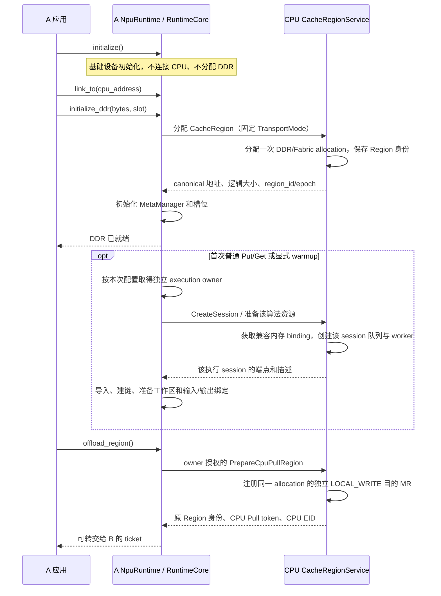
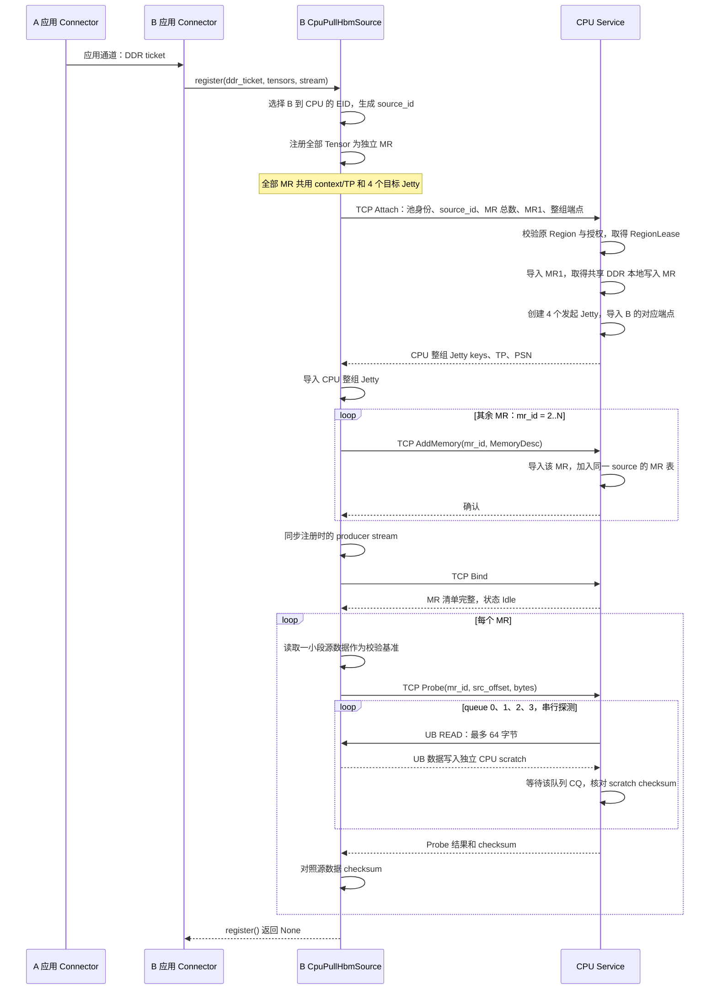
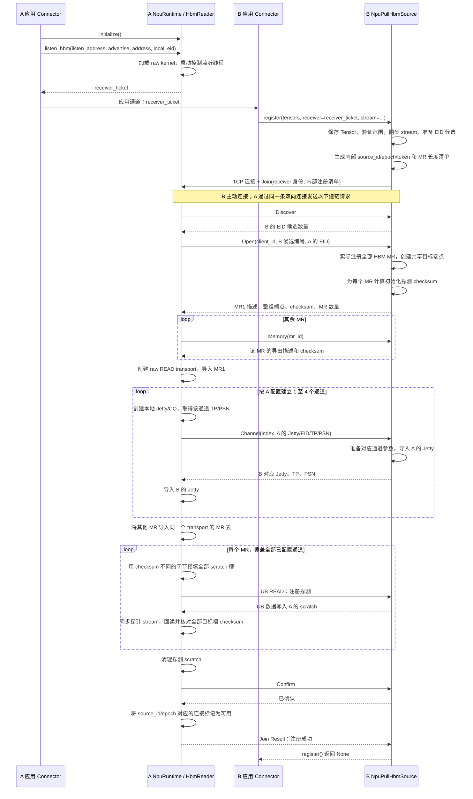
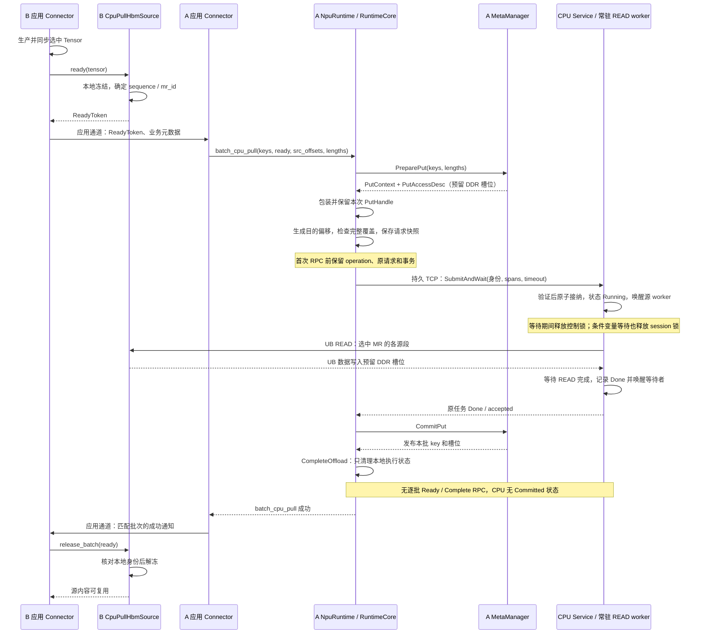
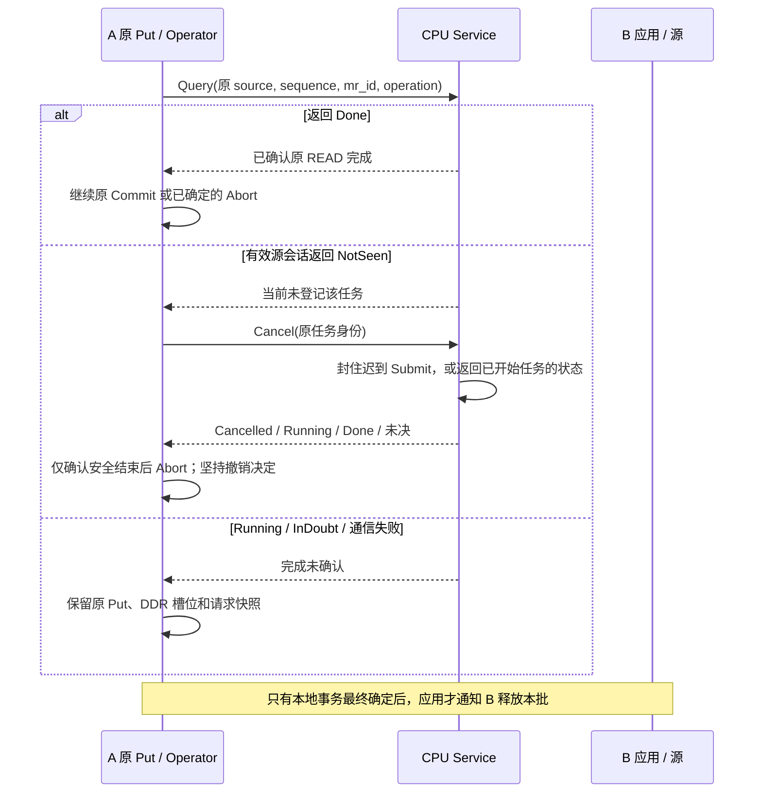
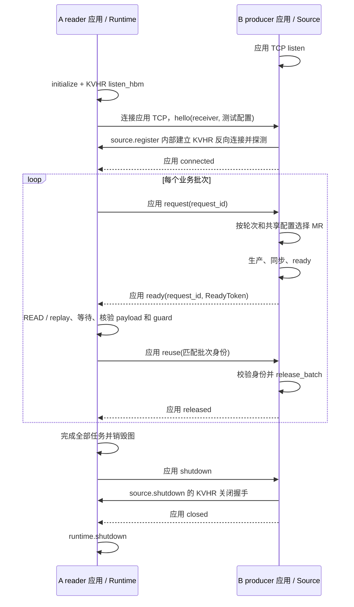

# A、B 与 CPU Service：建链和实际数据拉取交互

更新日期：2026-11-23。本文描述此次合入后的代码：普通缓存保留 main 的按配置执行框架，CPU/NPU Pull 接入独立资源与生命周期。

CPU Pull 正常成功批次使用一次 KVRP v8 `SubmitAndWait` RPC；NPU Pull 默认异步入队，由应用负责正常输入保活、同步和销毁捕获图。两条路径的源复用均由应用通知协调，源端 `ReleaseBatch` 不查询远端 DMA。KVHR v8 负责 NPU 注册、重连和硬件资源关闭，不承担逐批 Complete／Cancel 通知。

下文描述接口和资源合同；可移植测试不能代替目标硬件的 URMA、UBMEM 可见性及吞吐验收。

## 1. 角色、链路和图例

本文固定使用以下角色，避免不同文档中 A/B 命名相反造成歧义：

| 角色 | 应用侧职责 | KVAF 对象或模块 |
|---|---|---|
| A：读取和提交端（D） | 接收 B 的业务元数据，组织源／目的位置，通知 B 批次结束 | `NpuRuntime`、本地 `MetaManager`、NPU READ 算子 |
| B：HBM 生产端（P） | 分配并写入 Tensor，保证生产完成和数据稳定，向 A 发布业务元数据 | `CpuPullHbmSource`、`NpuPullHbmSource` |
| CPU Service：DDR 持有端 | 服务进程持有 DDR | DDR 分配／注册、通信端点、CPU READ worker |

| 数据链路 | 发起端 | 实际数据方向 | 用途 |
|---|---|---|---|
| A NPU ↔ CPU DDR | A NPU | DDR → A HBM；A HBM → DDR | 普通 `batch_get()`、`batch_put()` |
| CPU ↔ B HBM | CPU | B HBM → CPU DDR | `batch_cpu_pull()` 或显式 `submit_cpu_pull()` |
| A NPU ↔ B HBM | A NPU | B HBM → A output HBM | `batch_get_raw_addr()` |

CPU Pull 与 NPU Pull 可以读取 B 上**同一批 Tensor**，也可以读取不同 Tensor。即使底层内存相同，两条路径仍独立注册 MR、建立连接、保存批次状态；应用要等所有消费者结束后再覆盖源数据。

图中区分三类箭头：

- **本地接口调用**：应用 Connector 调用本进程的 KVAF 对象。
- **TCP 控制消息**：KVAF 交换身份、注册信息、CPU Pull 任务和硬件关闭状态。标注“应用通道”的箭头由应用自己的 Connector 通信实现。
- **UB READ/WRITE**：实际数据面操作。READ 的请求方向与数据返回方向相反；目标应用不需要逐次处理 READ 回调。

MR 是内存注册；Jetty key 是导出的通信端点描述；TP、PSN 是建链参数。UBA／远端地址不是另一进程可直接解引用的本地指针。

## 2. 初始化需要由应用交换什么

当前初始化只需要应用转交以下两类 ticket；不再单独转交生产端 source descriptor 或调用读取端 attach 接口。

| 场景 | A 生成并通过应用通道发给 B | B 的本地调用 | 成功返回 |
|---|---|---|---|
| CPU Pull | `runtime.offload_region()` | `cpu_source.register(ddr_ticket, tensors, stream=...)` | `None`，注册、建链及探测均完成 |
| NPU Pull | `runtime.listen_hbm(...)` | `npu_source.register(tensors, receiver=receiver_ticket, stream=...)` | `None`，注册、建链及探测均完成 |

`tensors` 可以是单个连续 NPU Tensor，也可以是多个连续 Tensor 的列表；列表中的各范围不能重叠。每条路径当前支持 1～4096 个 MR，同一源对象只允许一个冻结中的批次，每个批次只选其中一个 MR。

### 2.1 精简后的 DDR ticket

Python 返回字典包含：

| 字段 | 用途 |
|---|---|
| `version` | 当前为 2，校验 ticket 格式 |
| `address` | CPU Service 的 TCP 地址 |
| `region_id` | 指定已有 DDR 池 |
| `epoch` | 校验服务保存的原 Region 代次 |
| `token` | 经 Region owner 授权准备的独立 CPU Pull token；不同于普通缓存 MR token |
| `eid` | CPU 端 EID，16 字节 |

**ticket 不再包含 DDR base、bytes、slot_size，也不携带 DDR MR／Jetty 清单。**这些信息由 A 的 Runtime 和 CPU Service 保存。B 注册 CPU Pull 源时不需要知道 DDR 的槽位布局。

### 2.2 NPU 读取端 ticket

`runtime.listen_hbm(listen_address, advertise_address="", local_eid="")` 返回：

```text
version=1、control_address、receiver_id、receiver_epoch
```

它描述的是 **A 的监听入口和实例身份**。B 主动连接 A 后，B 的 KVAF 自动交换内部 HBM 注册清单。应用不再手工转交 `export_ticket`，也不调用旧的 `source.listen()`、`runtime.attach_hbm()` 或 `runtime.attach_cpu_source()`。

如果监听 `0.0.0.0`，需要通过 `advertise_address` 提供 B 能连接的地址。CPU Pull 的 CPU 服务地址与这个 NPU Pull 监听地址是两个独立入口。

## 3. 固定 DDR allocation，普通 provider 和 CPU Pull 分别准备

`TransportMode` 决定 DDR 池分配和允许的缓存路径：`urma` 使用普通 DDR；`ubmem`、`urma+ubmem` 使用一次 UBMEM allocation。首次选择某个算法不会重新分配池。`ubmem` 模式拒绝 CPU Pull；混合模式的 CPU Pull 目的注册与跨方式可见性仍需硬件验证。



普通 Put 有 URMA AIV、URMA AICPU、UBMEM AIV；普通 Get 有 URMA AIV Direct、AICPU Gather、AICPU Scatter、UBMEM AIV Direct。AIV Gather/Scatter 尚无 provider。普通 provider 首次使用或 warmup 才准备，不恢复 opt 的启动测速、启动 Put 探测和 eager 建链。

Put/Get/Pull 访问同一 DDR，但队列、worker、工作区和完成状态分属不同执行域。兼容的普通缓存 DDR MR 可按 main 的 binding 规则共享；CPU Pull 目的 MR 使用独立 `LOCAL_WRITE, non_pin=0` profile，普通远端访问 MR 保留 `non_pin=1`。

`offload_region()` 首次调用可能阻塞；它不创建普通 Get/Put session。成功后复用票据，失败保留原准备身份以供重试。B Attach 时服务校验 Region、epoch/token，并持有 `RegionLease`；源即使空闲也阻止 allocation 提前释放。源 Detach 成功后才归还该引用。

纯 NPU Pull 不调用本节 DDR 接口。无缓存 layout 的构造可用于 raw-only 或 CPU Pull-only；首次普通缓存 Get 必须提供有效 layout。普通 URMA provider 的本地 EID 发现同样推迟到首次准备。

## 4. B 与 CPU：多 MR 注册，共用一组 CPU Pull 通道



### 4.1 资源如何复用

- 78 个 Tensor 对应 78 个 HBM MR；每个 MR 有自己的导出范围、segment 和 token ID 等注册信息。
- 同一个 `CpuPullHbmSource` 的全部 MR 共用一组 4 对 Jetty 和 CPU Pull TP 参数，不会为每个 Tensor 重建一组连接。
- CPU 通过 `source_id` 找到源会话，再通过 `mr_id` 找到导入段。每批选一次 MR，该批所有 READ 都使用它。
- CPU Pull 使用第 3 节的同一块 DDR。CPU Pull destination binding 懒创建并共享 CPU 本地写入 MR；该池的多个源后端也可引用它，不会因为 78 个 HBM MR 再注册 78 份 DDR 目的 MR。
- 供 A 远端读写的 DDR MR 与 CPU Pull 使用的本地写入 MR 分别管理；二者指向同一池内存。
- 探测使用独立 scratch，不写业务槽位。当前基线已改为**每个 MR 的每个 Jetty 都探测**，不能只凭某一个队列成功就接纳整组连接。

### 4.2 哪些描述符经过网络

`Attach` 发送第一块 HBM 的 `MemoryDesc` 和一次整组 `ConnectionDesc`；后续 `AddMemory` 只补充 MR，不重复发送整组端点描述。

```text
MemoryDesc：逻辑导出基址 base、bytes、token value、segment_bytes、segment
ConnectionDesc：路由 EID、TP、PSN、token value、Jetty key 长度、4 个 Jetty key
```

MR segment／Jetty key 中的 provider 字段按导出结果保留；它们内部的 EID 不应被当作路由 EID 随意替换。HBM 导出地址在 B 的注册阶段就已得到，CPU 通过这些控制消息接收并保存，绝非只存在 CPU Service 上。

`register()` 成功后，A 不需要额外调用 attach，也不需要先查询一个 source handle。实际提交使用下一节的 `ReadyToken`。

## 5. A 与 B：读取端监听，生产端主动接入 NPU Pull



- **KVHR TCP 监听在 A，B 的 KVAF 源对象没有监听端口**；B 的源对象运行后台连接／响应线程。TCP 发起方向不改变实际 READ 由 A NPU 发起这一点。
- A 在 `listen_hbm(..., local_eid=...)` 中指定 fullmesh EID；B 在 `NpuPullHbmSource(device_id, npu_eid=...)` 中指定其 fullmesh EID。两者与 CPU Pull EID 独立。
- B 的 `register()` 是完整、阻塞的初始化接口。实际 HCCP 注册发生在内部收到 `Open` 后，但应用只需等 `register()` 返回。
- B 准备 4 个目标 Jetty，A 按 `npu_pull_options.cores × npu_pull_options.jettys` 使用其中 1～4 个。各通道分别协商 TP 参数，provider 是否返回相同底层 TP 由其实现决定。
- 全部 MR 共用该 source 的 raw READ transport 和队列；切换 MR 更换远端注册信息，不重建通道。
- 纯 NPU Pull 只需要基础 `initialize()`、raw kernel 和上述监听／注册流程，不依赖 CPU DDR、MetaManager 或 AccessTable。

当前每个 MR 的启动探针都先预填 scratch，填充值的 checksum 与该 MR 的预期不同，再逐槽检查 READ 结果。这样不会把未写入的零值或上个 MR 的相同内容误判为成功。默认探针不通过 Host 回读每核 status 判定成功；显式诊断模式额外检查状态和提交数量。探针仅覆盖 MR 起始处最多 64 字节，不能替代实际随机偏移、包长和每轮 payload 校验。

## 6. CPU Pull：单 RPC 拉取、本地提交与源复用

### 6.1 发布批次和任务身份

B 应用先确认生产完成，再发布本地冻结批次：

```python
producer_stream.synchronize()
ready = cpu_source.ready(tensors[i])
# 应用将 ready 和本批 keys／源偏移／长度发送给 A。
```

`ready()` 不发送 RPC、不重新建链，也不替应用同步生产。冻结期间重复选择同一 MR 返回同一批次；换 MR 被拒绝。ReadyToken 包含源身份、region/epoch、选中 MR 的长度、sequence 和 mr_id；完整 MR 表已在注册时保存。

A 在实际提交时分配每 Put 的 `operation` 身份，保存原 token 和三数组快照。CPU 用 region、source、sequence、mr_id、operation 及请求内容识别任务；同一 token 不能用于提交另一份新 Put。

### 6.2 推荐便利入口的完整时序



正常成功批次从 Ready 到 Release 只有一次 KVAF 控制 RPC；应用消息、注册探测、独立 checksum 诊断和异常恢复不计入这一次。`BatchCpuPull` 成功包含 CPU READ 和本地元数据提交，默认 Python 返回 `None`。

`SubmitAndWait` 使用持久连接；同一连接串行请求，不同连接可并行处理。CPU 源会话复用一个 READ worker，不为每批新建线程。等待超时不会取消 READ：`timeout=None` 使用配置预算，0 只提交并立即检查；收到 Running 或发生通信不确定时保留原事务。

### 6.3 显式接口、覆盖校验和地址语义

```python
put = runtime.prepare_put(keys, lengths)
# dst_offsets 由 put.entries 的绝对地址减 runtime.remote_region["base"] 得到。
runtime.submit_cpu_pull(ready, put, src_offsets, dst_offsets, lengths)
runtime.wait_cpu_pull(put, timeout=30000)
runtime.commit_put(put)
# A 应用发送成功通知，B 再 release_batch(ready)。
```

显式 `submit_cpu_pull` 使用 Submit，首次正常收到成功响应只表示已接受提交；后续 Query／Wait 查询原任务，便利入口才使用 SubmitAndWait。相同请求再次调用 Submit 只核对本地快照并返回，不重新发 RPC；丢回复后的这个返回值不证明远端已接纳，仍须 Query／Wait。二者共用同一 PutHandle、覆盖校验和决定规则。

- `src_offsets` 相对选中源 Tensor，`dst_offsets` 相对 DDR pool base，单位均为字节；普通 BatchPut 的目标描述仍是 DDR 绝对地址。
- 每批最多 4096 个 span。便利入口一 key 对应一个完整目的 entry，采用 O(n) 覆盖检查；显式拆分或重排仍检查排序后的覆盖、缺口、重叠和跨槽位。
- 三数组在首次 RPC 前复制到事务持有的快照；重复提交必须与原 token、MR 和数组完全一致，不再次发起 READ。
- Commit 只允许成功 Done；Abort 可用于未提交 Prepared，或已确认 DMA 停止的 Done／Failed。完成未知时保留原决定及资源。
- `CompleteOffload(commit)` 是本地收尾。CPU 不感知 MetaManager 的 Commit／Abort，应用最终通知不能只依据 CPU 的 Done。

### 6.4 CPU 数据面和恢复

CPU 每批先选定一个已导入 MR，复用该源的四个 Jetty；大源段按后端限制拆为不超过 64 KiB 的 READ，按窗口批量提交并等待完成。payload 不经过 TCP，不经过 A 的 HBM，也不由 CPU 应用逐字节复制。



响应中的 accepted 位表示任务已接纳，不代表 READ 已完成。Query 可能先于原 Submit 到达，NotSeen 不能直接作为释放槽位的依据；读取端必须先建立 Cancel fence。Cancel 不中止已接纳的 DMA。取消与 READ 竞争时等待原任务结束，保留原 Abort 决定；已提交成功的事务不可反向取消。

便利入口的未决状态用 `resolve_cpu_pull()` 恢复；显式接口使用原 PutHandle。主动放弃未使用 token 调 `cancel_cpu_pull(ready)`；若已 Prepare 但尚未 Submit，先 `abort_put(put)`。B 的 `cancel_batch()` 只是本地解冻，不能替代 A 的取消操作。独立 `last_offload_checksum()` 只诊断当前 DDR 数据，须在槽位被释放、覆盖或源进入下一批前使用。

## 7. NPU Pull：默认异步、应用负责保活和同步

### 7.1 正常读取和引用

```python
# B 先生产并同步，应用把本轮 ReadyToken 交给 A。
ready = source.ready(tensor)
runtime.batch_get_raw_addr(ready, src, dst, lengths, output, stream=read_stream)
# 默认 state="submitted"；同一 stream 可以继续排入消费者。
read_stream.synchronize()
# 等待其他消费者，禁止迟到提交/replay，再发送匹配批次的 reuse。
source.release_batch(ready)  # B 收到应用通知后执行
```

A 校验源身份、MR、取消围栏、数组布局，然后直接启动 raw kernel；设备三数组不经 Host 回读。每段一个 READ WQE，不拆成 64 KiB 子段。默认无逐批 KVAF RPC、无 Host status D2H、无内部 stream 同步。`synchronize=True` 显式等待 stream 完成，不增加完整 payload 正确性检查承诺。

每个 source connection 的多 MR 共用持久队列。Host 提交使用该连接的锁，同 stream 可连续入队；切换 stream 时，应用先等待旧任务完成或建立使共享队列串行执行的依赖。正常成功调用不保留按次输入，应用须保持三数组 Tensor/storage 和 stream 有效到执行结束。output 的 MR 缓存到连接安全关闭，Python output Tensor/storage 引用保守保留到 Runtime shutdown 成功。C++ 非拥有 view 仍由调用方保活；执行期间不得 resize、换 storage 或改写正在使用的元数据。

`NpuPullOptions` 独立配置 raw kernel、核数、Jetty 数、设备在途窗口、output 注册缓存上限和 diagnostics。`max_output_bindings` 默认 64，达到缓存上限时拒绝新注册并保留旧缓存；`max_inflight_total` 控制设备 READ 窗口，不是 Host 调用计数。正常异步调用不登记 invocation，排队数量和完成由应用管理。提交或显式同步失败且执行未决时，绑定额外保留输入和 stream；`pending_raw_addr` 只描述失败隔离，false 不是完成证明。

### 7.2 图预热、捕获和跨批次复用

先取得有效 ReadyToken，保持该批源冻结；相同 MR/output 的 eager 预热和同步发生在 capture 外：

```python
runtime.batch_get_raw_addr(ready, src, dst, lengths, output, stream=read_stream)
read_stream.synchronize()  # 完成资源预热后才开始捕获
graph = kvaf.AclGraph()
graph.capture_begin(read_stream)
runtime.batch_get_raw_addr(ready, src, dst, lengths, output,
                           stream=read_stream, synchronize=False, profile=False)
graph.capture_end()
graph.replay(read_stream)
read_stream.synchronize()
# 应用完成消费者并发送本轮 reuse；B release，之后可发布下一轮 Ready。
# 所有轮次结束：停止 replay、完成全部 stream，在 source/runtime 关闭前销毁所有图。
graph.reset()
```

应用固定 source 代次、MR、output、三数组地址和数量以及通信资源，并保留图引用的 Tensor/storage 和 stream 到图销毁。相同 MR 可跨生产批次复用，应用每轮核对新 Ready、等待上一轮完成后更新数组内容，并保证更新对 replay 可见。每次读取和消费者结束后才通知源复用。同一连接的 eager、多个图与 MR 共享队列，由应用串行调度。

外部框架 replay 不经过 KVAF Host API，取消不能拦截它。应用必须停止 replay、同步全部执行并销毁所有框架图，之后才能关闭 source/runtime 或释放图引用的存储；KVAF 不检测外部图寿命，也不在关闭时隐式等待正常 raw 任务。raw 不提供图租约；普通缓存 Get 的 Drain、图资源租约和 AccessTable 引用机制保持不变。

### 7.3 诊断与 ABI

`KVAF_HBM_RAW_READ_DIAGNOSTICS=1` 或 `npu_pull_options.diagnostics=True` 只用于显式 eager 定位：清零诊断状态、同步、回读状态/队列/entity，并核对提交和完成。失败返回 `CompletionUnknown` 并保留资源。图捕获与回放必须关闭诊断，并使用 `synchronize=False, profile=False`。正常性能采样关闭诊断，payload/guard 校验另计。

raw kernel 入口仍为 `KvafExecuteBatchGetRawAddrAivKernelV2`，参数 80 B、每核 status 1280 B；与 main Host 共用版本 2 的 DirectUrmaEntity。多 MR view 更新完整 MR 身份及 registered_base，保持相同 SQ/CQ。原来的 local SGE `word[13]=0` 修复保留，MR 注册 token 仍有效；普通 Get/Put WQE 不随此修改。CQE/WQE 快照由设备写入普通 HBM status，Host 不直接读取 provider SQ 地址。

## 8. 应用通知 TCP 与 KVAF 内部控制 TCP

### 8.1 哪个完成负责什么

| 完成或确认 | 发送／观察位置 | 含义 |
|---|---|---|
| READ／WRITE CQE | 数据面发起端 | 队列完成信息；不自动提交缓存元数据或释放源 |
| CPU Pull Done | CPU → A 的 SubmitAndWait／Query 回复 | 原 READ 已完成；A 仍须执行本地元数据决定 |
| 普通 BatchPut 成功 | A Host 返回 | WRITE 和本地元数据提交成功 |
| RawAddr submitted／done | A Host 返回 | 正常模式为已入队／已同步 stream，不包含设备状态回读和应用通知 |
| 业务 reuse／安全取消 | A 应用 → B 应用 | 应用确认可结束匹配批次，B 才本地 release／cancel |
| Close／Retire、Detach | KVAF 控制连接 | 关闭硬件资源；不能替代每批执行顺序和源内容冻结 |

CPU Pull 和 NPU Pull 的源端 release／cancel 都只核对本地 token。通知丢失、超时或 TCP 断开时，应用继续保留冻结源；仅持有 token 或成功发送一个通知帧不表示对端已处理。CPU Pull 通知须晚于本地事务最终决定，NPU Pull 通知须晚于相关任务完成并阻止迟到读取。

### 8.2 当前 NPU benchmark 的两条 TCP 连接

实际 Connector 可以使用自己的通道。仓库 `TcpControlChannel` 只提供通知帧收发，不搬运 HBM 数据，也不代替业务身份和完成校验。当前 `bench_hbm_read_raw_addr.py` 的连接方向如下：

| 通道 | 建立方向 | 承载内容 |
|---|---|---|
| 应用 KVNT v1 TCP，示例 B:29100 | B producer 监听，A reader 主动连接 B | receiver ticket、配置、request/ready、reuse/released、shutdown/closed、error |
| 内部 KVHR v8 TCP，示例 A:29000 | A `listen_hbm`，B `source.register` 主动连接 A | MR／Jetty／TP、探测、重连和硬件关闭 |
| NPU 数据通道 | A 发起 READ | B HBM → A output；payload 不经过上述 TCP |



应用帧最大 4 MiB，按绝对 deadline 处理拆包／粘包；会话活动后断线不自动重连、重发 READ 或释放批次。B 初始注册失败时先尝试 `source.shutdown()` 回滚，仅完整回滚成功才发送匹配 session 的 `startup_failed(cleanup=done)`；否则保留资源并报告未决。应用通知连接可复用到实际 Connector，但当前 benchmark 的监听方向不是 KVAF 对所有应用的要求。

## 9. 普通缓存路径继续使用 main 执行框架

普通 `batch_put` / `batch_get` 按本次 execution 配置选择 provider，并复用其 owner。初始化只固定 DDR；首次请求准备远端执行 session、通信资源和所需 buffer binding。Put 与 Get 各自拥有执行域，不共享 Jetty/CQ 或完成记录。

普通 Put 与 CPU Pull 共用 RuntimeCore 的一个活动写事务，包含 Prepared、未知完成、已确定 Commit/Abort 及尚未结束的收尾。普通 Put 在数据完成后提交 MetaManager，并完成 provider Acknowledge；CPU Pull 使用自身执行器，本地收尾不增加 Complete RPC。恢复沿用原配置、请求和决定。

普通 Get 可以读取其他已经提交并 pin 的槽位，不因 CPU Pull pending 全局停用。Pending 槽位不能读；Free 拒绝 Pending 或仍被 AccessTable/图引用的记录。调用方直接使用裸地址时必须自行保护所指数据范围。

普通 Get 的异步 drain、方向恢复、graph_resources 多节点及 lease 生命周期保留 main 行为。raw graph 直接捕获 `batch_get_raw_addr()`，不复用依赖 CacheRegion/AccessTable 的普通 Get 图类型。准确参数与例子见[缓存执行框架使用说明](cache_transport_execution_implementation.md)。

## 10. 失败、取消与正常关闭

### 10.1 注册和数据面失败

- 自动候选只有在旧候选资源安全清理后才继续；TCP 可连或端点导入成功不代表 READ 可用。
- CPU Probe 每次只有一个在途 WR；明确错误 CQ 后可尝试退役整组队列并回退。正式多队列 READ 错误可能仍有其他 DMA，需要保留未决资源。
- NPU Probe 每 MR 预填 scratch 并校验全部槽；失败后需确认 kernel 退出且 transport 静止，再释放 scratch 或换候选。
- 普通模式 RawAddr 不回读设备状态；诊断模式失败会隔离资源。两种模式都不能把通知 TCP 断开解释为 DMA 已结束。

### 10.2 运行时恢复和取消边界

| 情况 | 当前处理 |
|---|---|
| CPU Submit／SubmitAndWait 丢回复或超时 | 原 Put Query／Wait；便利入口用 resolve_cpu_pull，不新建 Put 或重发 READ |
| CPU Query 返回 NotSeen | 用原任务 Cancel fence，确认迟到提交不能启动后才安全撤销 |
| CPU 元数据 Commit／Abort 未决 | 重试原决定，保留 metadata_finished；此处没有远端 Complete ACK |
| 主动放弃未提交 CPU token | A cancel_cpu_pull；若显式 Put 已 Prepare 未 Submit，先 abort_put |
| CPU READ 正在运行时取消 | 不强行终止 DMA，保留资源并查询／重试同一取消；已确定 Abort 不因稍后 Done 改成 Commit |
| NPU cancel_raw_addr | 只更新本地取消围栏，阻止该批及更早批次未来的 Host 提交；不发通知、不撤回队列、不使旧 graph 失效 |
| NPU 提交／同步／诊断失败 | pending_raw_addr 表示失败隔离；resolve_raw_addr 校验原失败 token 并报告未决，不同步、不重放、不发通知 |
| 正常异步 NPU READ 已提交 | 应用保持输入和 stream 有效并等待执行／消费者完成；pending_raw_addr=false 不是完成证明 |
| 应用 reuse 通知或 released 回复丢失 | 保留原批次／会话身份处理，不把断连或消息发送成功当作源释放许可 |

同一个冻结 NPU 批次允许重复 READ；成功提交不会推进“已消费 sequence”围栏。旧 Ready 消息和图回放由应用协调，不能按 CPU Pull 的一次任务状态机处理。

### 10.3 正常关闭顺序

1. 停止新业务请求和图回放。应用等待全部 raw 请求及消费者完成，并销毁全部 raw 捕获图；普通缓存 Get 继续按其 Drain 和图租约规则收尾。
2. 完成普通 Put/CPU Pull 原事务，继续已确定的 Commit/Abort 和收尾；未知 DMA 不自动转为 Abort。
3. 等待读取及必要消费者完成、禁止迟到读取，然后通知 B 结束匹配的冻结批次。共享源 Tensor 的所有消费者都须结束。
4. B CPU source Shutdown/Detach：CPU 停 worker、退役队列和 imports，归还目的 binding/RegionLease；B 才关闭 exporter。
5. B NPU source Shutdown，或 A 全 Shutdown：应用完成第 1 步后，A 检查失败未决状态并退役 initiator，Close 请求关闭 B exporter，最后 Retire；B 结束控制线程和源引用。KVAF 不跟踪正常 raw 工作或外部图寿命，不能以 Shutdown 代替应用同步／销图；失败未决或注销失败继续保留资源。
6. A `shutdown_ddr()` 在全部 DDR 事务、session、Pull child 和映射退出后释放池。失败保留原记录以供重试；它不关闭独立 NPU Pull。全 `shutdown()` 另关闭 raw 和基础设备。

控制 TCP 断开、`pending_raw_addr=false`、仅本地解冻或消息发送成功都不能单独证明资源可释放。NPU 重连保持原 receiver/source/MR 身份；已退役会话不能自动重新建链。CPU source 由 B 注销，A 不能把活跃 Region 的 child 当作可遗忘对象。

## 11. 资源归属、服务容量与并发

| 持有方 | 保存内容与结束边界 |
|---|---|
| A DDR RuntimeCore | MetaManager、统一写事务、普通 execution dispatcher 和 CPU Pull executor |
| CPU CacheRegionService | 固定 allocation、普通注册及独立 Pull 目的 profile、Region 代次和 child lease |
| CPU Pull source session | 多 MR imports、4 Jetty、首批启动后常驻的 READ worker、原 operation/请求/取消围栏；成功 Detach 归还 RegionLease |
| A raw connection | 导入 MR、队列、output 注册、取消围栏和失败身份；Python 保留 output storage 及执行未决时的输入引用 |
| B CPU/NPU source | 各自的源存储、MR/Exporter/端点及本地冻结批次；成功 Shutdown 后释放 |
| 应用 Connector | Ready 与 request 身份、正常 raw 输入／stream 保活、生产／消费完成、reuse/released、外部图调度和销毁 |

CPU 服务使用有界持久连接处理循环；默认普通连接预算 256，额外恢复连接预算 32。接纳前有界读取并分类首帧，恢复预留仅供 Query/Cancel/Detach、相关描述及普通执行关闭/查询，不允许长 SubmitAndWait 占用。连接达到上限不会丢弃已接受的 DMA 任务。

SubmitAndWait 等待不占全局 Region/index 锁，条件变量等待释放源状态锁；恢复请求可从另一条连接查询原任务。普通 Put 与 CPU Pull 使用同一写槽位，Get 方向独立。CPU 同 Region 中 Running/InDoubt 的其他源仍采用保守接纳规则，不在本次增加并行写任务。

NPU READ 的 Host 提交和关闭按 source connection 协调；长 stream 等待或控制往返不持全部连接的索引锁。每个连接的多 MR 仍共享队列，不承诺同连接跨 stream 并发。应用负责使正常任务、图回放和关闭有序；执行失败未决或注销失败时，KVAF 保留相应依赖。

## 12. 源码入口和配套说明

| 内容 | 文件／主要入口 |
|---|---|
| 源身份、ReadyToken、请求数组 | [connector_types.h](../common/include/connector_types.h) |
| DDR ticket、CPU source API | [remote_offload.h](../runtime/include/remote_offload.h)、[remote_offload.cc](../runtime/src/remote_offload.cc) |
| NPU ticket、source API | [hbm_read.h](../runtime/include/hbm_read.h)、[hbm_read_source.cc](../runtime/src/hbm_read_source.cc) |
| 基础／DDR 生命周期、CPU 便利入口 | [npu_runtime.cc](../runtime/src/npu_runtime.cc)：InitializeDdr、BatchCpuPull、ResolveCpuPull、ListenHbm |
| DDR 分配、普通端点、CPU 协议分发 | [peer_link.cc](../runtime/peer/peer_link.cc)、[cpu_runtime.cc](../runtime/cpu_service/cpu_runtime.cc) |
| CPU Put 快照、覆盖检查、元数据决定 | [connector_runtime.cc](../runtime/src/connector_runtime.cc) |
| CPU 提交、Query／Cancel、operation 和本地收尾 | [remote_pull_operator.cc](../runtime/src/remote_pull_operator.cc) |
| CPU 任务状态机、常驻 worker、SubmitAndWait | [remote_pull_service.cc](../runtime/src/remote_pull_service.cc) |
| CPU 四 Jetty READ、Probe、共享目的 MR | [cpu_pull_urma.cc](../runtime/src/cpu_pull_urma.cc) |
| KVRP v8 及持久客户端 | [remote_pull_protocol.h](../runtime/include/remote_pull_protocol.h)、[remote_pull_client.cc](../runtime/src/remote_pull_client.cc) |
| CPU 持久连接服务循环 | [runtime_service.cc](../runtime/cpu_service/runtime_service.cc)：ServeControlConnections |
| HBM 注册／导出及端点 | [hbm_exporter.h](../runtime/src/hbm_exporter.h) |
| NPU 注册探针、异步 READ、取消和关闭 | [hbm_read_client.cc](../runtime/src/hbm_read_client.cc) |
| KVHR v8 编解码与关闭握手 | [hbm_read_protocol.h](../runtime/src/hbm_read_protocol.h)、[hbm_read_protocol.cc](../runtime/src/hbm_read_protocol.cc) |
| output MR 缓存、选 MR 实体、本地 segment 校验 | [batch_get_host.cpp](../access_operator/algorithms/get/direct/urma_aiv/host/batch_get_host.cpp)：KvafBatchGetLocalBufferAcquireForRemote |
| raw READ 算子、本地 SGE 与 CQE／WQE 快照 | [execute_batch_get_raw_addr_aiv.asc](../access_operator/algorithms/get/raw_addr/urma_aiv/kernel/execute_batch_get_raw_addr_aiv.asc)、[hbm_read_diagnostics.h](../runtime/src/hbm_read_diagnostics.h) |
| 标准 BatchPut 事务 | [runtime.cc](../runtime/src/runtime.cc)、[in_memory_meta_manager.cc](../meta_manager/src/in_memory_meta_manager.cc) |
| 普通 Get／Put Host 执行层 | [access_operator.cc](../access_operator/providers/urma_aiv/access_operator.cc)、[batch_put_host.cpp](../access_operator/algorithms/put/urma_aiv/host/batch_put_host.cpp) |
| 标准 BatchPut WRITE 和尾 CQ | [execute_batch_put_aiv.asc](../access_operator/algorithms/put/urma_aiv/kernel/execute_batch_put_aiv.asc) |
| Python 参数、返回状态和引用保留 | [npu_python_runtime.cc](../bindings/src/npu_python_runtime.cc)、[remote_offload_python.cc](../bindings/src/remote_offload_python.cc)、[hbm_read_python.cc](../bindings/src/hbm_read_python.cc) |
| 应用通知与当前 benchmark | [tcp_control.py](../python/kvaf/tcp_control.py)、[bench_hbm_read_raw_addr.py](../tests/python/bench_hbm_read_raw_addr.py) |

配套说明：[CPU Pull 构建与运行](cpu_pull_offload_usage.md)、[共享 DDR](shared_ddr_remote_offload.md)、[NPU HBM 裸地址读取](hbm_raw_addr_read.md)、[Connector 接口设计](connector_pull_api_design.md)。本文 A 始终为读取端、B 为生产端；关联文档若命名相反，以职责为准。
