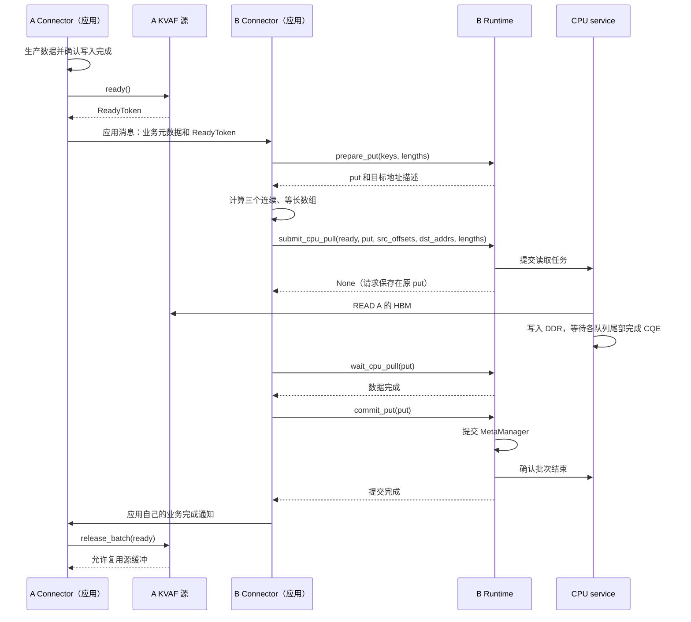
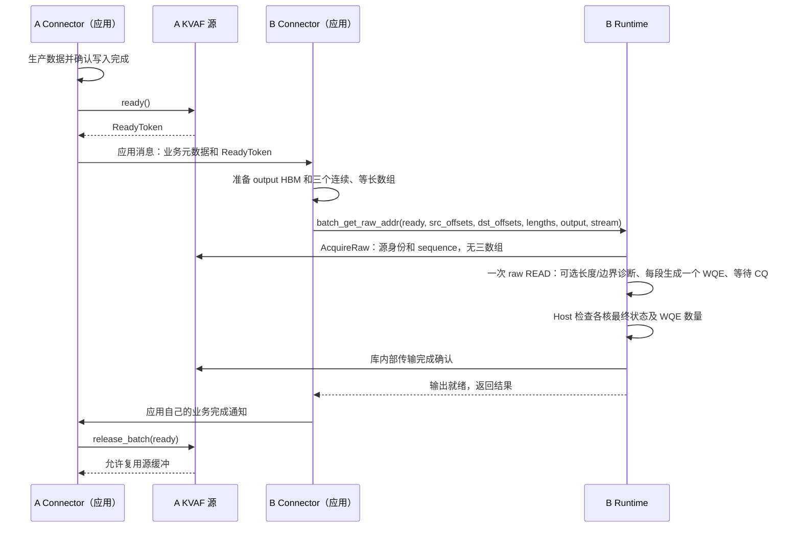

# 面向应用 Connector 的 CPU Pull 与 NPU Pull 接口设计

状态：第一版已实现，待双卡硬件验收。本文记录当前接口边界、命名和调用流程；Python 接口与恢复方法见第 13 节。

应用在 A、B 两台机器上分别运行 Connector。A 生产 HBM 数据并发送业务元数据，B 根据元数据组织源和目的地址，调用 KVAF 拉取。KVAF 向 B 返回结果，后续业务通知由两个 Connector 自行处理。

本文统一使用 **A 为源端、B 为拉取发起端**。现有 [共享 DDR 文档](shared_ddr_remote_offload.md) 和 [HBM 裸地址读取文档](hbm_raw_addr_read.md) 描述已实现接口，使用的 A/B 角色名称与本文相反；实际数据方向以本文定义为准。

## 1. 已确认的设计约束

- CPU Pull 的目的槽位通过 `PreparePut` 分配，与普通 BatchPut 共用同一个 MetaManager、DDR 池和写事务机制。
- 应用在 PreparePut 返回的预留范围内计算目的 offset，不设置独立的应用 DDR 分区，不提供 `reserve_raw_ddr()`。
- 数据是否已准备好、读取期间是否保持不变，由应用保证。`ReadyToken` 不包含 `readable_ranges`，A 不再向 KVAF 发布一份读取范围。
- 保留 `source_id`、`region_id`、`region_epoch` 等身份信息，由 KVAF 生成、保存和校验。
- 保留两种源对象，将 `HbmSource` 更名为 `CpuPullHbmSource`，将 `HbmReadSource` 更名为 `NpuPullHbmSource`。
- B Connector 自己选择 CPU Pull 或 NPU Pull，并计算源 offset、目的 offset、长度。
- 两条读取接口接收三个连续、等长数组，相同下标表示同一段传输。CPU Pull 使用 `src_offsets`、`dst_addrs`、`lengths`；NPU Pull 使用 `src_offsets`、`dst_offsets`、`lengths`。
- KVAF 的传输完成结果返回 B Connector。A/B Connector 的业务元数据和业务完成消息使用应用自己的通信通道。
- 保留现有已验证的数据面：CPU 四 Jetty 批量 READ，以及独立的 `batch_get_raw_addr` 算子。

## 2. 组件与职责

| 组件 | 负责的事情 |
|---|---|
| A Connector | 调用注册和建链接口、交换描述符、生产数据、保证源数据就绪和稳定、发送业务元数据、接收完成通知 |
| A 的 `CpuPullHbmSource` | 管理供 CPU 拉取的 HBM 注册、CPU 对端绑定、批次身份及源生命周期 |
| A 的 `NpuPullHbmSource` | 管理供 B NPU 拉取的 HBM 注册、NPU 对端绑定、控制监听及批次状态 |
| B Connector | 解析业务元数据、确定 key 和长度、调用 PreparePut、组织三个连续数组、发起拉取、处理结果并通知 A |
| B 的 `NpuRuntime` | 管理共享 DDR、MetaManager、源绑定和任务，提供两条读取路径及写事务接口 |
| CPU service | 分配并注册 DDR，保存 CPU Pull 源连接，执行 READ，提供任务状态和完成确认 |

B 的普通 BatchPut、BatchGet、本卡 Offload 和跨卡 CPU Pull 共用一个 RuntimeCore、MetaManager 和 DDR Region。NPU 直接拉取 A HBM 的目的地是 B 的输出 HBM，不经过 DDR 元数据管理。

本设计不增加第二个 OffloadRuntime，也不为应用计算的地址另外分配一块 DDR。

## 3. 两种源对象

| 对比 | `CpuPullHbmSource` | `NpuPullHbmSource` |
|---|---|---|
| 原类名 | `HbmSource` | `HbmReadSource` |
| 所在位置 | A 源端进程 | A 源端进程 |
| 主动读取方 | CPU service | B 的 NPU |
| 数据路径 | A HBM → CPU DDR | A HBM → B HBM |
| 初始化关联 | 指定的 CPU DDR region | NPU reader 连接 |
| 目的内存确定时机 | 初始化时确定 DDR 池，每批通过 PreparePut 确定槽位 | 每次读取时由 B 提供 output 缓冲 |
| 完成条件 | READ 完成后，B 提交或撤销写事务并完成 CPU 确认 | NPU READ 结束并完成传输确认 |
| 路由 | CPU↔NPU 路由 EID | NPU↔NPU fullmesh EID |

两个对象共用底层 `Exporter` 的 HBM 注册、地址对齐、资源创建和清理代码，但分别持有注册、连接和状态。CPU 与 NPU 对端的描述符格式、TP 绑定和控制协议仍分别处理，不合并资源实例。

按当前场景，A 的两块 HBM 分别由这两个对象管理。对象本身留在 A 进程内，不能通过 Connector 序列化发送。

## 4. 描述符、批次和地址结构

以下为应用可见的逻辑结构。Connector 传递 KVAF 返回的描述符，不自行组装 MR、Jetty 或 TP 数据。Python 的两个源描述符及 ReadyToken 为只读对象，支持 pickle 跨进程交换；本地 PutHandle 不支持跨进程传递。

### 4.1 长期源身份

```cpp
struct CpuPullSourceDesc {
    uint64_t source_id;
    uint64_t source_bytes;
    uint64_t region_id;
    uint64_t region_epoch;
    vector<uint64_t> mr_bytes; // 多 MR 时逐个记录长度；单 MR 可以为空
};

struct NpuPullSourceDesc {
    uint64_t source_id;
    uint64_t source_bytes;
    uint64_t source_epoch;
};
```

| 字段 | 含义与用途 |
|---|---|
| `source_id` | 一组 HBM 源注册和连接的编号；CPU Pull 可包含多个 MR，不是物理卡号 |
| `source_bytes` | 单 MR 的逻辑长度；CPU 多 MR 时保留首个 tensor 的长度，不是跨 tensor 的地址范围 |
| `mr_bytes` / `mr_count` | CPU 源的只读 MR 长度列表和数量；多 MR 按本批 mr_id 取长度做范围检查，应用不需解析 |
| `region_id` | CPU service 分配的整个 DDR 池编号，不是 key 或 slot 编号 |
| `region_epoch` | CPU service 实例代次，拒绝重启前遗留的旧请求；当前实现由服务创建时生成，同一实例的 region 共用 |
| `source_epoch` | NPU 直读源身份的代次，用于拒绝旧的源描述符 |

CPU Pull 的源在初始化时绑定指定 DDR 池，因此包含 region 身份。NPU Pull 源描述的是 A 上被读取的 HBM，不绑定 B 的某块输出 HBM。

上面的结构只列身份信息。NPU 的 `export_ticket` 还携带必要的访问凭据；B 的 `attach_hbm()` 仍需通过建链交换取得 A HBM 的基址、长度、segment 和通道描述，并保存在连接对象中。源基址及导入信息不会因为简化公开结构而省略。

B 在初始化阶段调用 attach，KVAF 内部保存源绑定和通信资源。每批读取根据 `ReadyToken.source` 查找已绑定的源，应用不再保存或传入 `cpu_source_handle` / `hbm_link`。CPU 绑定校验 source_id、source_bytes、mr_bytes、region_id、region_epoch；NPU 连接按 source_id、source_epoch 查找并核对 source_bytes。

### 4.2 ReadyToken

```text
ReadyToken {
    source: CpuPullSourceDesc 或 NpuPullSourceDesc
    sequence: 本次生产的数据批次编号
    mr_id: CPU Pull 本批选择的 MR，由 ready(tensor) 自动填写
}
```

`ReadyToken` 不包含 `readable_ranges`、源/目的地址列表、业务 key 或实际数据。这里的 Token 是批次身份描述，不是 URMA 内存访问 token。

单 MR 使用 `source.ready()`，CPU 多 MR 使用 `source.ready(tensor)` 选择已注册的 tensor。接口登记批次并返回身份信息。应用应在确认生产写入完成后调用它；该接口不再接收 offset/length 列表，也不承担业务层的数据可读性判断。

CPU Pull 的 Ready 状态登记在 CPU service；NPU Pull 的 Ready 状态登记在 A 的源对象中。批次身份用于将读取、完成、取消和释放关联起来。源未完成/未释放时不能发布新批次；Ready 控制请求响应丢失时，重试必须沿用原 sequence，不能另建批次。

A Connector 向 B 发送的是：

```text
应用业务元数据：逻辑块、数据布局、业务请求标识等
KVAF ReadyToken：源身份和 sequence；CPU Pull 还包含本批 MR 身份
```

业务元数据由应用解释，KVAF 只校验资源和批次身份。

### 4.3 三个连续、等长数组

对外接口直接接收三个数组，不再传入逐段结构体列表，也不要求额外构造批次包装对象：

```text
src_offsets[N]
dst_addrs[N]（CPU Pull）或 dst_offsets[N]（NPU Pull）
lengths[N]

第 i 段：从源偏移 src_offsets[i] 读取 lengths[i] 字节，写入对应目的位置
```

所有偏移和长度均以字节为单位。连续指 Tensor 输入及内部三个元数据数组各自在内存中连续，不要求它们相邻，也不要求其描述的源或目的数据区间连续。

| 数组元素 | CPU Pull | NPU Pull |
|---|---|---|
| `src_offsets[i]` | 相对 A 注册 HBM 的逻辑起点 | 相对 A 注册 HBM 的逻辑起点 |
| 目的位置 | `dst_addrs[i]`：PreparePut 返回的 DDR 绝对地址，可加槽内偏移 | `dst_offsets[i]`：相对 B 的 output 缓冲起点 |
| `lengths[i]` | 本段实际传输长度 | 本段实际传输长度 |

两条入口分别采用与执行位置一致的元数据形式：

| 接口 | Python 三数组类型 | C++ 三数组类型 |
|---|---|---|
| `submit_cpu_pull()` | 一维、连续 CPU `torch.int64` Tensor；也接受 list、tuple、一维整数 NumPy 数组，与 `batch_put()` 共用转换规则 | Host `Uint64ArrayView` |
| `batch_get_raw_addr()`（ReadyToken 新入口） | Runtime 当前 NPU 上的一维、连续 `torch.int64` Tensor；不隐式转换 CPU Tensor、list 或 NumPy | `NpuInt64ArrayView`，Host 不解引用其中的设备指针 |

三个数组的元素数量必须相同，范围为 1～4096，偏移非负，每个 `lengths[i]` 大于零。CPU Pull 在 Host 检查数值并保存连续 `uint64_t` 快照，然后通过控制协议发送到 CPU service；接口返回或抛出异常后，应用可以复用这三组 CPU 元数据。

NPU Pull 在 Python 入口检查类型、形状、连续性、设备及元素数量，Host 另检查元数据存储不与整个 output 分配范围重叠。随后只启动一次 raw READ V2 算子，每个输入段直接生成一个 WQE，填写时计算基址加偏移并读取对应长度。默认不预扫描长度，由应用保证每条长度为 1..UINT32_MAX 且符合设备单次 READ 上限、源/目的范围合法、目的段不重叠；`validate_ranges=True` 可开启正长度、32 位长度字段及源/目的边界诊断，不检查目的重叠或查询设备能力。最多 4096 个输入段，对应最多 4096 个 WQE，无 64 KiB 拆分或前缀表。

各核直接按输入请求数量划分任务，单个请求完整交给一个核处理；双 bank、多 Jetty、inflight 窗口和 CQ 调度沿用原实现。没有独立准备算子、中间状态回传或展开描述符的 HBM 缓冲，三数组不经 Host 中转。Host 在同一次算子完成后读取最终状态，检查各核总 WQE 数等于输入请求数，以及各自已提交/处理数量。该实现的真实性能仍需硬件验证。

NPU 三数组不得与整个 output 分配范围重叠，且必须与 output 一起在传入 stream 上就绪；如果应用在其他 stream 生成它们，应先建立事件依赖。接口执行期间不得修改或释放它们。Python 绑定保留三数组和 stream 到正常完成或恢复确认安全；output 注册缓存及其 Tensor 引用保留到对应源 detach 或 Runtime shutdown 成功。如果 `pending_raw_addr` 为真，应用仍不得修改或复用本批存储。C++ 调用者自行保持存储有效。已启用的设备内容检查失败时不会发 READ，KVAF 取消已获取的批次；生产端释放该批次后才能发布新的 ReadyToken 重试。

应用不再逐段创建对象，原 READ 的 WQE 编码、多 Jetty 调度及 CQ 处理规则保持不变。公开入口只保留 NPU Tensor 三数组形式；建链探测内部保留专用 Host 描述符路径。

CPU Pull 的地址转换为：

```text
应用计算 dst_addrs[i]   = PreparePut 返回的 address + 槽内偏移
CPU READ 源地址          = 源描述符中的 HBM 基址 + src_offsets[i]
CPU READ 目的地址        = dst_addrs[i]
```

Runtime 检查绝对地址属于本次 Put 的有效范围，在内部快照中减去 DDR base，保持 CPU 控制协议的相对偏移格式。应用不需要读取 DDR ticket.base，也不修改应用传入的数组。既有范围、溢出、精确覆盖和重复提交一致性检查保留；这属于 CPU Pull 显式事务的检查，不表示普通 BatchPut 已提供相同检查。

NPU Pull 的地址转换为：

```text
源地址   = KVAF 根据 ReadyToken.source 找到的 A HBM 导出基址 + src_offsets[i]
目的地址 = B output 本地地址 + dst_offsets[i]
```

B 不解引用 A 的本地指针。注册对齐、导出地址转换和必要的本地内存注册仍由 KVAF 处理。

## 5. 控制服务地址

控制服务地址是 KVAF 用于交换建链信息、查询任务和确认传输状态的 `IP:端口`，与数据面的 EID 和 HBM 地址分别管理。

| 地址 | 用途 |
|---|---|
| `cpu_address` | CPU service 的控制地址，用于分配 DDR、注册 CPU Pull 源、提交/查询任务和完成确认 |
| A 的 NPU 源控制地址 | `NpuPullHbmSource.listen()` 建立的监听，用于发现、建链、Acquire、Complete 和 Detach |
| Connector 业务地址 | 应用自己的消息通道，由应用选择和管理 |

例如，A 在当前进程内启动控制线程：

```python
npu_source.listen("0.0.0.0:29001")
```

A Connector 把可从 B 到达的地址和 export ticket 发给 B，随后 B 调用：

```python
runtime.attach_hbm(
    "10.0.0.1:29001", export_ticket, local_eid=b_fullmesh_eid,
)
```

这里的地址仅为示例。监听地址 `0.0.0.0` 不作为对端连接地址发送。该监听不要求额外启动一个进程；HBM 数据通过 READ 数据面传输，不经过这个 TCP 控制端点。

NPU 源不提前绑定 B 的目标 HBM，是因为 `batch_get_raw_addr()` 每次接收 `output`。B Runtime 对该缓冲执行范围检查和必要的本地注册，并保持它的生命周期。CPU Pull 当前则在初始化时借用并注册指定 DDR 池；这是两条路径的资源组织差异。

## 6. 初始化接口

下表列出当前接口。旧类名、带范围的 Ready 以及旧 raw READ 重载已删除。

| 调用方 | 接口 | 返回与作用 | 变更 |
|---|---|---|---|
| B Connector | `runtime.initialize()` | 选择本卡设备、校验配置；不访问 CPU 或申请 DDR | 基础初始化 |
| B Connector | `runtime.link_to(cpu_address)` | 配置 CPU service 目标；可在基础初始化前后调用 | DDR 可选依赖 |
| B Connector | `runtime.initialize_ddr(ddr_bytes, slot_size)` | 在基础初始化后分配共享 DDR、初始化 MetaManager 和启用的 DDR 路径 | 独立 DDR 初始化 |
| B Connector | `runtime.initialize(ddr_bytes, slot_size)` | 依次执行基础和 DDR 初始化，需要先 link_to | 保留组合入口 |
| B Connector | `runtime.shutdown_ddr()` | 安全释放 DDR 相关资源，保留 NPU Pull 连接及 CPU 目标 | 独立 DDR 清理 |
| B Connector | `runtime.offload_region()` | 返回 DDR ticket，由应用发送给 A | 保留 |
| A Connector | `CpuPullHbmSource(device_id, npu_eid)` | 创建 CPU Pull 源对象 | 原 `HbmSource` 更名 |
| A Connector | `cpu_source.register(ddr_ticket, hbm_cpu, stream)` | 注册源、建立 CPU→A 链路并探测，返回 CpuPullSourceDesc | 扩展返回描述符 |
| B Connector | `runtime.attach_cpu_source(source_desc)` | 校验源与本 Runtime 的 DDR 关联并保存绑定；成功返回 None | Runtime 内部管理 |
| A Connector | `NpuPullHbmSource(device_id, npu_eid)` | 创建 NPU Pull 源对象 | 原 `HbmReadSource` 更名 |
| A Connector | `npu_source.register(hbm_npu, stream)` | 登记源缓冲，返回 export_ticket | 保留能力 |
| A Connector | `npu_source.listen(address)` | 启动当前进程内的 KVAF 控制监听 | 保留 |
| B Connector | `runtime.attach_hbm(address, export_ticket, local_eid)` | 建立并保存 B NPU→A HBM 链路；成功返回 None | Runtime 内部管理 |

`attach_cpu_source()` 是 B 侧逻辑绑定，不重复建立 CPU→A 的通信资源。`NpuPullHbmSource.register()` 可以保留现有延迟注册方式，在 B attach、对端参数确定后完成实际 HCCP 注册和绑定。

纯 NPU Pull 使用 `initialize() → attach_hbm()`，只需 raw kernel，不需 CPU service、DDR、普通 BatchGet token 参数或启用 CPU Pull。
`initialized` 表示基础就绪，`ddr_initialized` 表示 DDR 就绪；组合初始化的 DDR 阶段失败时可以出现前者为真、后者为假。
普通 BatchGet/BatchPut、MetaManager 操作和 CPU Pull 均要求 DDR 就绪。HBM attach 与 DDR 初始化顺序独立；DDR 候选回退、失败清理和 shutdown_ddr 不销毁 HbmReader 连接或输出 MR 缓存。
DDR 清理不确定时须重试 shutdown_ddr，不能覆盖未释放的分配；新的 DDR core 拒绝旧 PutHandle。

相同身份的重复 attach 不创建第二份资源；同一身份的元数据或 NPU 路由配置冲突会被拒绝。`export_ticket` 保持原字典格式，Connector 只需原样转发和保留，关闭时传给 `detach_hbm(export_ticket)`，无需读取其中的字段。attach 失败后若清理未完成，也用原 ticket 重试 detach；未决 DMA 仍需保留资源，不能强行关闭。

源注册/attach 包含实际 READ 探测，因此应用在注册/attach 完成前应保持探测数据稳定。无参数 initialize 只做基础初始化。注册所用的 `stream` 同步与运行阶段不带范围的 `ready()` 是不同阶段。

CPU Pull 使用其独立的 CPU↔NPU EID 配置。NPU↔NPU 链路在 A 的源对象和 B 的 `attach_hbm(local_eid=...)` 上分别配置 fullmesh EID，不能假定 CPU 路由 EID 可以替代。

初始化时应用交换的内容：

```text
B Connector → A Connector：DDR ticket
A Connector → B Connector：CPU Pull source_desc
A Connector → B Connector：NPU Pull export_ticket、控制服务地址、应用数据布局
```

源对象、MR、Jetty 和 TP 保存在 KVAF 内部；应用交换的只是票据与业务元数据。

### 6.1 CPU Pull：多个 tensor 注册，共用连接

```python
# 生产端：每个 tensor 各自连续，tensor 之间可以不连续。
source = kvaf.CpuPullHbmSource(device_id=producer_device)
desc = source.register(ddr_ticket, tensors, stream=producer_stream)
# Connector 将 desc 发送给读取端；读取端仅初始化时调用一次：
runtime.attach_cpu_source(desc)

# 每批只读一个 tensor；源偏移都相对此 tensor 的起点。
selected = tensors[layer_id]
# 应用在 selected 上生产数据，并确保写入完成。
producer_stream.synchronize()
ready = source.ready(selected)
# Connector 转发 ready 和业务元数据；读取端计算三数组后：
put = runtime.prepare_put(keys, lengths)
dst_addrs = [entry.address for entry in put.entries]
runtime.submit_cpu_pull(ready, put, src_offsets, dst_addrs, lengths)
runtime.wait_cpu_pull(put)
runtime.commit_put(put)
# 应用通知生产端可以复用；生产端：
source.release_batch(ready)
```

- `register()` 接收一个 tensor 或 1～4096 个 tensor 的 list/tuple。每个 tensor 必须在同一张 NPU 上连续且非空；列表中范围不能重叠。注册列表固定到 `shutdown()`，更换列表需先关闭。
- 每个 tensor 保留独立的注册范围、导出 segment 和 token ID。列表共用一个 HCCP context、一组 4 Jetty 及其 TP。CPU service 在一个 source_id 下导入全部 MR；DDR 的 pinned 接收 MR 由同一 Region 统一持有，不随 MR 数量增加。
- 建链时对每个 MR 做最多 64 字节的 scratch READ 校验，全部成功后才返回描述符；探测期间应用保持所有源数据稳定，不覆盖业务 DDR。候选失败时清理整组注册和连接后再回退。
- `ready(tensor)` 按注册时相同的基址、长度和设备查找 MR；子视图或未注册的 tensor 被拒绝。单 tensor 注册仍支持无参数 `ready()`。应用不需要查找或传入 MR 句柄。
- CPU 从 `source_id + mr_id` 选取本批的导入段、导出基址和长度。每批选择一次，所有分段共享它；不跨 MR。切换 MR 清除旧 WQE 计划缓存，队列和完成序号继续复用。
- 同一源一次只有一个冻结批次。重复 `ready()` 必须选择同一个 tensor；重复 Submit 必须保持 MR、sequence 和三个数组一致。Read 未决时保留整组 MR、连接和 DDR lease，禁止换 MR 或销毁源。
- 注册期间所有 tensor 的分配必须存活、地址和长度不能变化。正常运行只要求当前冻结 tensor 不被改写，其余 tensor 可由应用生产。Python 绑定保存独立的 tensor 引用列表，不依赖应用保留原 list 对象。
- NPU Pull 本次仍保持单 MR；不改变 `NpuPullHbmSource`、raw READ 算子或其控制协议。

## 7. A 端批次接口

两个源对象提供一致形式的接口：

| 接口 | 语义 |
|---|---|
| `source.ready() → ready_token` | 在应用保证生产完成后登记本批身份；不接收地址范围，不发起 READ |
| `source.release_batch(ready_token)` | 检查对应批次已经安全结束，解除本批占用；不注销长期 HBM 注册 |
| `source.cancel_batch(ready_token)` | 仅取消尚未被读取方获取或提交的批次 |
| `source.shutdown()` | 在无未决批次和对端引用后释放连接与注册 |

`release_batch()` 和 `cancel_batch()` 显式匹配源及 sequence，避免旧的应用通知作用于新批次。

```python
# A Connector；应用自行实现生产和业务通知。
produce(hbm)
wait_until_production_complete()  # 应用保证生产写入已经完成
ready = source.ready()
connector.send_to_b(business_metadata, ready)

# 等待应用通道的对应批次完成消息。
completion = connector.receive_completion()
source.release_batch(completion.ready)
# 成功后可以覆写下一批；释放底层缓冲还需要 shutdown 成功。
```

应用负责从数据就绪到读取结束期间不覆写、不释放源。KVAF 可以拒绝提前注销、错误取消和释放错误批次，但不能阻止应用直接通过 Tensor/指针修改内存。

## 8. B 端 CPU Pull 接口

### 8.1 接口与完成边界

| 接口 | 返回与作用 |
|---|---|
| `prepare_put(keys, lengths) → put` | 包装现有 MetaManager 的 PreparePut，预留槽位并返回目标地址，此时本批新数据尚未发布为可读 |
| `submit_cpu_pull(ready, put, src_offsets, dst_addrs, lengths) → None` | 按 ready 查找源，校验并提交 CPU READ，记录在原 put 中；不代表数据完成 |
| `query_cpu_pull(put) → status` | 查询原 put 的状态，不重发 READ；未提交时返回 PREPARED |
| `wait_cpu_pull(put, timeout) → result` | 成功返回 DONE 或 COMMITTED；只等待数据完成，不自动 Commit；尚未提交时立即报错 |
| `commit_put(put) → result` | 检查关联传输完成，提交 MetaManager，并完成 CPU 侧批次确认 |
| `abort_put(put)` | 在元数据未提交且确认无在途 DMA 时撤销事务 |

`put` 是应用调用 `runtime.prepare_put(keys, lengths)` 得到的 **PutHandle 写事务句柄**。它代表本次为这些 key 预留的 DDR 槽位及后续提交责任，不包含待搬运的数据，也不是一次已经执行完毕的 BatchPut。传入 `submit_cpu_pull()` 不会再次分配槽位。

Runtime 保存真实事务记录，应用得到该记录的本地句柄和只读分配描述：

```text
PutHandle
    事务编号
    所属 Runtime
    DDR region 身份
    entries：每个 key 的 address 和有效数据长度 length
    state：最近一次已知事务状态
    submitted：是否已记录本次提交请求
```

目标槽位仍采用当前 MetaManager 的 DSA 规则；接口公开不改变 key 到槽位的分配策略。应用不能自行构造一个 put 句柄来绕过预留。

三个数组只说明“从哪里搬到哪里、搬多少字节”，`put` 还提供目的槽位的归属和提交上下文。提交时 KVAF 根据它确认 `dst_addrs` 指向本次预留的有效范围，将请求快照与传输状态保存在同一事务中，防止其他任务覆盖槽位或在 DMA 未完成时释放槽位。读取成功后 `commit_put(put)` 发布这批 key 的新数据；安全撤销时 `abort_put(put)` 回收本次预留。

`put` 只在创建它的 B Runtime 中使用，不作为对象发给 A 或 CPU service；CPU service 通过控制协议中的 region、源和任务身份执行读取。NPU 直接读取路径的目的地由 `output` 指定，因此不需要 put。

提交请求在首次 RPC 前记录到原 put，并设置 `submitted=True`。它只表示本地已有请求记录，不代表 CPU 已接受或 DMA 已完成。提交响应丢失时直接用原 put 查询、等待及恢复，不另取 task，也不能重新 PreparePut 替代未决操作。

### 8.2 地址组织和检查

B Connector 根据业务元数据确定 key、有效长度以及源位置，在 PreparePut 返回的范围内组织传输：

```python
import torch

metadata, ready = connector.receive_from_a()
keys, key_lengths, source_offsets = organize_data(metadata)

put = runtime.prepare_put(keys, key_lengths)
src_offsets = torch.tensor(source_offsets, dtype=torch.int64, device="cpu")
dst_addrs = torch.tensor(
    [entry.address for entry in put.entries],
    dtype=torch.int64, device="cpu",
)
lengths = torch.tensor(key_lengths, dtype=torch.int64, device="cpu")

runtime.submit_cpu_pull(
    ready, put, src_offsets, dst_addrs, lengths,
)
result = runtime.wait_cpu_pull(put, timeout)
runtime.commit_put(put)

# 传输和提交已完成；此后的业务处理及通知由应用决定。
connector.send_completion_to_a(ready, result)
```

示例展示成功路径；失败时按第 10 节保留或撤销资源，不能在任意异常后无条件 Abort。

示例中一个 key 对应一段传输，因此 `lengths` 与 `key_lengths` 相同。应用也可以把一个 key 拆成多段：PreparePut 的 lengths 按 key 定义有效数据长度，提交接口的 lengths 按传输段定义长度，两者数量不必相同；提交接口的三个数组之间必须等长。

KVAF 检查源身份和 sequence，检查源区间位于已注册 HBM 中，检查长度非零及地址加法不溢出。它不判断业务元数据所描述的数据是否已经生产完成。

B Runtime 根据 MetaManager 的真实预留记录检查目的范围：

- 所有目的区间属于本次 put，不能只检查它们位于整个 DDR 池内。
- 目的区间不能相互重叠。
- 三个数组描述的全部目的区间合起来完整覆盖本次准备提交的有效数据长度，不能留下未写入的空洞。
- 一个 key 可以拆成多段，源区间可以重排；槽内偏移也必须满足上述检查。

CPU service 保留 region 身份、注册范围、目的不重叠和任务一致性检查。MetaManager 在 B 端，事务归属和覆盖检查在 B Runtime 中完成，不在 CPU 端创建第二套 MetaManager。

### 8.3 CPU Pull 时序



`commit_put()` 包含库内部 CPU 批次确认，不再要求应用调用额外的 `finish_cpu_pull()`。

## 9. B 端 NPU Pull 接口

保留 `batch_get_raw_addr` 名称，调整为由 B 显式提供三个连续、等长数组：

```python
result = runtime.batch_get_raw_addr(
    ready, src_offsets, dst_offsets, lengths, output, stream,
)
```

| 接口 | 作用 |
|---|---|
| `batch_get_raw_addr(...) → result` | 按三个数组描述的区间读取 A HBM 到 B output，第一版同步完成 |
| `resolve_raw_addr(ready)` | 校验源身份及批次号后恢复控制确认或资源清理，不重发 READ |
| `detach_hbm(export_ticket)` | 用初始化时的原 ticket 解除连接，并确认对端资源释放；无未决读取时可调用 |

KVAF 在 Host 检查数组布局、元数据/output 不重叠和批次身份；NPU raw READ V2 直接从三个 Tensor 为每条请求生成一个 WQE；完整批次的长度/边界诊断仅在显式启用时执行。不会先生成展开的设备描述符数组。

该路径不需要 PreparePut、CommitPut 或 AccessTable。A 的源描述符无需绑定 B 的目标 HBM；B 每次传入 output，KVAF 管理读取所需的本地注册和缓冲引用。第一版成功返回时，输出已完成且传输控制确认已结束。

### 9.1 output 的含义

`output` 是 **B 应用分配的本地接收 HBM 缓冲**，Python 接口中为位于 B 卡、内存连续的 NPU Tensor。它是输入参数中的目标缓冲，调用会直接写入它；接口返回的 `result` 表示完成状态，数据本身位于 output 中。读取按字节搬运，不进行 Tensor dtype 转换。

每一段的目的地址为 `output.data_ptr() + dst_offsets[i]`，目的范围必须位于 `output.numel() * output.element_size()` 字节以内。偏移相对本次传入 Tensor 的逻辑起点，KVAF 在注册时处理底层对齐。多个目的区间可以有间隔，未覆盖的字节不属于本次读取结果。

例如，B 将 A 上两段不连续的 4 KiB 数据读入一个连续的 8 KiB 缓冲：

```python
import torch

with torch.npu.stream(stream):
    output = torch.empty(8192, dtype=torch.uint8, device=b_device)
    src_offsets = torch.tensor([4096, 12288], dtype=torch.int64, device=b_device)
    dst_offsets = torch.tensor([0, 4096], dtype=torch.int64, device=b_device)
    lengths = torch.tensor([4096, 4096], dtype=torch.int64, device=b_device)

result = runtime.batch_get_raw_addr(
    ready, src_offsets, dst_offsets, lengths, output, stream,
)
# 成功返回后，output[0:4096] 和 output[4096:8192] 分别包含上述两段数据。
```

output 在读取完成前不得并发覆写。其注册与 BatchGet 一样按地址/长度缓存到 detach/shutdown，Python 同期保留 Tensor 引用，C++ 调用方负责保活；缓存期间不得调整大小或替换底层 storage。若接口因未决传输而失败，应用不得复用该缓冲，直到恢复流程确认可以安全使用。调用方负责范围合法、目的区间不重叠以及长度为 1..UINT32_MAX 且符合设备单次 READ 上限；默认关闭长度/边界诊断，可用 `validate_ranges=True` 显式开启，目的区间两两重叠检查已删除。

| 参数 | 表示什么 | 数据最终写入哪里 |
|---|---|---|
| CPU Pull 的 `put` | PreparePut 返回的写事务及槽位归属 | CPU DDR 中本次预留的槽位，由绝对地址 dst_addrs 定位 |
| NPU Pull 的 `output` | B 应用提供的本地 NPU Tensor | 该 Tensor 的 HBM 范围，由 dst_offsets 定位 |

### 9.2 NPU Pull 时序



NPU 的 AcquireRaw 控制消息只携带源/连接身份和 sequence，作用是让源端维持本批 HBM 的生命周期；三数组只供读取方本地 NPU 使用，真实地址和长度写入数据面的 WQE。CPU Pull 则仍通过 Submit 控制消息将三数组发送给执行 READ 的 CPU service。

两条路径中的 A/B Connector 消息都由应用实现。KVAF 内部的 Acquire、Complete 等控制消息维护传输状态，不代替业务完成通知。第一版使用调用返回值及任务查询交付结果，Connector 可自行转成应用事件。

## 10. 事务、重试和资源生命周期

| 情况 | 允许的处理 |
|---|---|
| PreparePut 后尚未提交 READ | 可以 AbortPut |
| READ 全部完成、尚未 CommitPut | 可以 Commit，或在确认 DMA 结束后撤销写事务 |
| 提交响应丢失、超时或 DMA 状态不确定 | 保留原 put、目标槽位和源缓冲，用原 put 查询；不能释放并复用地址 |
| Meta 已提交，但 CPU 确认响应丢失 | 重试 commit_put 的确认阶段，不重复 Commit，不改为 Abort |
| NPU READ 完成但控制确认未完成 | 用 resolve_raw_addr 恢复确认，不重读数据 |
| A 收到延迟或重复的业务完成消息 | 按源和 sequence 匹配；不能释放另一个批次 |

重复提交必须关联原任务且参数一致。已完成请求返回原结果或明确的已完成状态，不能再次产生 READ；冲突参数必须拒绝。未知 DMA 状态不自动重建链路或重放请求。

公开的 put 状态与现有 Offload 的 pending 保护共用，避免拆出接口后普通 BatchPut、BatchFree 或 Shutdown 绕过未决资源保护。句柄超时、退出作用域或异常都不代表 DMA 已结束。

生产端注册持有底层缓冲直到 shutdown 成功。批次 release 只允许覆写下一批，不代表已经可以释放整块注册内存。

正常关闭顺序为：停止新任务并处理完已有批次，A 释放对应批次；NPU Pull 由 B detach_hbm 后再由 A 关闭 NPU 源；CPU Pull 由 A 关闭 CPU 源以释放 CPU service 上的源连接和 DDR lease；最后 B 关闭 Runtime 和共享 DDR。业务协调仍由 Connector 执行。

数据 checksum 保持独立诊断，不纳入传输计时。若应用需要校验，应在目的数据释放/覆写、下一次 Ready 或源注销前完成；校验结束后再通知 A 复用可直接沿用当前验收流程。

## 11. 现有代码的调整范围

已完成 CPU Pull 改用 `src_offsets + dst_addrs`，以及 Runtime 内部按源身份管理绑定、读取、恢复和关闭。CPU Pull 的公开事务进一步统一为 PutHandle：Submit 成功返回 None，Query/Wait/Commit/Abort 均使用原 put，已删除 CpuPullTask 和 put.task。基础初始化与 DDR 初始化现已分离，纯 NPU Pull 不再依赖 DDR。此次初始化拆分未更改 Raw READ 算子、批次同步/恢复协议、ticket 字典格式或 KVRP/KVHR 线协议；应用需重新编译 NPU 运行库和 Python 绑定。

| 当前实现 | 目标调整 |
|---|---|
| `HbmSource` | 更名为 CpuPullHbmSource，返回长期源描述符 |
| `HbmReadSource` | 更名为 NpuPullHbmSource，保留独立 NPU 控制协议与绑定实现 |
| `ready(offsets, lengths, stream)` | 新接口 ready() 只登记批次；应用负责生产完成和数据稳定 |
| Ready 携带最终源范围，Submit/Acquire 必须逐项匹配 | 具体范围来自 B 的三个数组；CPU Pull 保存 Host 请求快照，NPU Pull 在同一次 READ 算子中按需诊断并直接生成 WQE，控制面只获取批次读取权 |
| PreparePut/CommitPut 隐藏在 RuntimeCore 的完整 Offload 中 | 增加受 Runtime 状态管理的公开事务接口 |
| CPU Submit 隐藏在 RemotePullOperator | 增加 submit/query/wait 接口，由同一 put 管理预留、传输与提交 |
| CPU 目的地址必须落在 slot 起点 | 支持本次预留有效范围内的拆分和槽内偏移，保持覆盖、归属及不重叠检查 |
| batch_get_raw_addr 的源地址列表来自 Ready batch | 扩展入口由 B 提供三个连续、等长数组，保留原算子和通信实现 |

CPU Pull 控制协议 KVRP 使用 v5，NPU 直读控制协议 KVHR 仍为 v4。CPU service 和使用 CPU Pull 的两个 NPU 应用需要同时重新编译、重启；协议版本不符时拒绝通信。Ready 发布源身份、批次号，以及 CPU Pull 本批选择的 MR 身份。

已删除：旧类名别名、`ready(offsets, lengths, stream)`、无 token 的 release/cancel、`offload_from()`、`offload()`、`resolve_offload()`、`release_offload_source()`、旧 raw READ 重载、独立 OffloadRuntime 及 KVOF 服务。

本卡便利入口为：

```python
runtime.batch_cpu_pull(keys, source, input_offsets, lengths, stream=None)
```

该接口与 `batch_put()` 一样同步调用，成功返回 `None`，表示数据搬运及元数据提交完成；失败抛异常，不返回任务句柄。内部使用同一组新事务接口：

```text
PreparePut → 注册/复用本卡 HBM → 等待生产 stream → Ready
→ 组织 DDR 目的绝对地址 → SubmitCpuPull → WaitCpuPull → CommitPut → ReleaseBatch
```

参数契约与 BatchPut 一致：source 为 Runtime 所在卡的连续 Tensor；keys、input_offsets、lengths 是 Host 整数序列或连续一维 CPU int64 Tensor，偏移和长度以字节计。源和每个目标槽位必须容纳对应数据。HBM 注册缓存到切换 source 或 shutdown；Python 保留 Tensor 引用。手动配置 `npu_eids` 时，本卡便利入口使用首个 EID；为空时自动探测 CPU↔本卡路由。

同参数再次调用表示新批次，不表示恢复。若 key 尚未释放，会像 BatchPut 一样拒绝重复分配。明确失败时内部 Abort；若 DMA 状态不确定，保留源/槽位、拒绝新操作，`shutdown()` 查询原任务并在确认完成后清理，绝不重发 READ。若元数据已 Commit 但 CPU 确认丢失，保持原 Commit 决定并补确认；不能反向 Abort。shutdown 未成功前继续保留相关存储。

跨卡 Connector 继续使用显式 PreparePut/Submit/Wait/Commit/Abort；恢复直接使用原 put，重复提交仍核对原请求且不重发 READ。CPU 四 Jetty READ 调度和 raw READ V2 算子保持原有数据面实现，各条路径仍持有各自的 MR、Jetty、TP。

## 12. 第一版范围

- 一个源同时一个活动批次；一个 Ready 批次对应一次读取消费。
- 一个 Put 事务对应一个 CPU Pull 任务，不引入多任务拼接提交。
- 同一 DDR 池一次只有一个未完成或未确认的 CPU Pull。
- 同一 Runtime 的这些控制接口按顺序调用，不新增并发调用保证。
- 保留现有单个 NPU 源绑定一个 reader 的范围；同一 Runtime 可绑定多个源，通过 ReadyToken 的源身份区分，连接由 KVAF 内部保存。
- 应用负责 A/B 的业务元数据交换、业务完成通知、生产同步和源数据稳定。
- KVAF 负责注册、建链、地址与事务检查、数据搬运、完成状态和安全清理。

## 13. 实现对接与验收

### 13.1 Python 返回值与恢复入口

- `cpu_source.register(...)` 返回 `CpuPullSourceDesc`，由源端 Connector 发给读取端。
- `source.ready()` 返回 `ReadyToken`；应用调用前同步生产 stream。
- `prepare_put(...)` 返回 `PutHandle`：`entries` 提供只读的 `key/address/length`，`state` 为最近一次已知状态，`submitted` 表示是否已记录提交请求。`state` 不会自动轮询远端。
- `submit_cpu_pull(...)` 成功返回 `None`，失败抛异常。响应丢失时请求仍保存在原 put 上，继续通过它 Query/Wait；不得重新 PreparePut 替代未决任务。`submitted=True` 不表示 CPU 已接受或完成读取。
- `query_cpu_pull(put)` 返回 `CpuPullState`，需要时查询远端并更新 put.state；尚未提交时返回 `PREPARED`。`wait_cpu_pull(put, timeout=30000)` 的 timeout 单位为毫秒，成功返回 `DONE` 或已提交的 `COMMITTED`，不会自动 Commit；未提交即调用 Wait 会立即报错。
- `commit_put(put)` 返回 `COMMITTED`，`abort_put(put)` 返回 `ABORTED`。提交响应丢失后重试原 commit，不能反向 Abort。PreparePut 后尚未提交任务时，可以直接 Abort。
- 新 `batch_get_raw_addr(...)` 成功返回 `{"state": "done", "sequence": ready.sequence}`，实际数据直接写入 output。其未决恢复使用原批次的 `resolve_raw_addr(ready)`，不会重发 READ，也不能用其他批次的 ReadyToken 完成确认。
- 可选 `profile=True` 会在成功返回值中增加 `profile` 字典，提供 Host 大阶段和设备事件测得的算子区间；默认关闭，详见 [raw READ 计时与基准](hbm_raw_addr_read.md)。

显式事务使用 `query_cpu_pull`、`wait_cpu_pull`、`commit_put`、`abort_put` 恢复。本卡 `batch_cpu_pull()` 内部管理事务，异常清理由 `shutdown()` 处理。当前版本从 PreparePut 起保护这笔事务，完成或撤销前会拒绝同一 Runtime 的其他 DDR 访问操作。

如果提交前的参数校验失败，`put.submitted` 为 false，可以修正数组后继续提交，或撤销 put。请求记录后即使 CPU 尚未接受也保持 submitted 为 true，使用原 put 查询：`DONE` 可提交或撤销，`FAILED` 可撤销，`RUNNING` / `IN_DOUBT` 保留资源。已记录请求的参数不能更换；重复提交只确认与原请求一致，不重发 READ。未成功通知 CPU 的失败可能仍让生产批次处于 Ready，应用协调源端调用 `cancel_batch(ready)`；源端会拒绝取消已被获取的批次。

C++ 的共享类型与数组视图在 `common/include/connector_types.h`，事务句柄与 RuntimeCore 接口在 `runtime/include/runtime.h`，NPU 包装接口在 `runtime/include/npu_runtime.h`。CPU 源仍通过 `runtime/include/remote_offload.h` 引入，NPU 源通过 `runtime/include/hbm_read.h` 引入。C++ 调用者在未决期间自行保持源和输出内存有效，Python 绑定保留对应 Tensor 引用。

### 13.2 硬件验收入口

继续使用现有构建选项，重新构建并重启两端程序。脚本现在默认只使用新接口，已移除 `--connector-api` 开关：

```bash
python tests/python/test_remote_cpu_offload.py \
  --cpu 127.0.0.1:28999 --device-a 6 --device-b 7

python tests/python/test_hbm_read_raw_addr.py \
  --cpu 127.0.0.1:28999 --device-a 6 --device-b 7 \
  --npu-eid-a-raw 000000000047050000100000df00d806 \
  --npu-eid-b-raw 000000000047050000100000df00f807 \
  --batch-get-kernel build-shared-ddr/bin/kvaf_execute_batch_get_kernels.o \
  --batch-put-kernel build-shared-ddr/bin/kvaf_execute_batch_put_kernels.o \
  --raw-kernel build-shared-ddr/bin/kvaf_execute_batch_get_raw_addr_kernels.o
```

上述 EID/设备对应此前同机验收配置，构建目录按实际路径替换。两个旧测试脚本的参数名称继续沿用 **device-a 为读取端、device-b 为生产端**，与本文设计中的 A/B 角色命名相反。

CPU 验收覆盖显式 PreparePut/Submit/Wait/Commit、重复提交、DDR checksum 和批次复用确认。组合验收同时覆盖共享 DDR 的普通 BatchPut/BatchGet、CPU Pull 和三数组 NPU 直读，包括非页对齐源、输出间隔及 NPU 消费者校验。本卡便利入口另外通过 `python tests/python/test_cpu_offload.py --cpu 127.0.0.1:28999 --device 7` 验证；该脚本无需 AIV 算子。

需要同时重新编译 NPU 运行库和 raw-address kernel object。当前入口为 `KvafExecuteBatchGetRawAddrAivKernelV2`，使用扩展的参数与最终状态 ABI；旧 V1 object 会拒绝加载。已删除独立准备算子及其状态 ABI。

### 13.3 性能入口

- `tests/python/bench_remote_cpu_offload.py`：显式 CPU Pull，分别统计 PreparePut、地址组织、Submit、Wait、Commit 及计时外校验/释放。CPU 服务通过 `KVAF_CPU_PULL_PROFILE=1` 汇总每个源的 READ 阶段。命令与统计口径见 [CPU Pull 使用说明](cpu_pull_offload_usage.md)。
- `tests/python/bench_hbm_read_raw_addr.py`：两卡 NPU Pull，可配置等大包数量、包大小及随机散布的源空间大小。分别执行完整调用带宽轮次和开启内部阶段/设备事件的诊断轮次，校验均在传输计时外。命令见 [NPU raw READ](hbm_raw_addr_read.md)。
