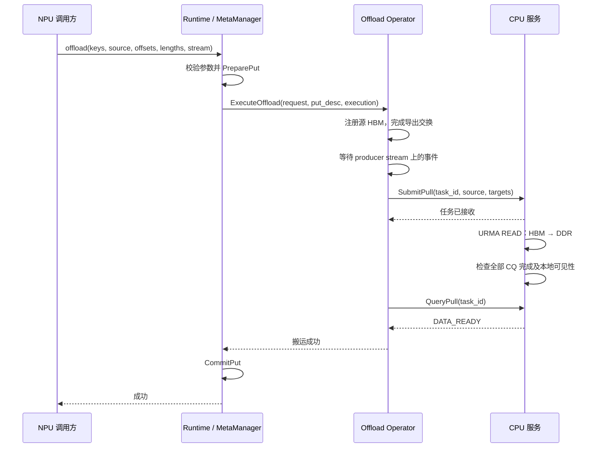

# CPU Pull / Offload 设计

- 日期：2026-10-28
- 开发分支：`codex/cpu-pull-hbm`
- 基线：`main@c4375e13d7a9519d907ab6a5d11227795f207286`
- 状态：设计基准；首版实现已加入当前工作区，硬件验收待执行。实际构建与接口见 [构建与运行](cpu_pull_offload_usage.md)。

实现采用独立 `OffloadRuntime` 提供仅启用 Offload 的入口，复用 `RuntimeCore::Offload` 和 MetaManager。控制通信封装在 `offload_client`，与现有 PeerLink 的 v6 协议并列，避免让 Offload 依赖原有 AIV 初始化。下文的拟议命名用于说明职责，实际入口以运行文档和头文件为准。

## 1. 目标与范围

首版实现两端之间的 HBM 卸载：持有源 HBM 的 NPU 进程调用 `offload()`，CPU 服务主动发起 URMA READ，将数据读入自己持有的 DDR 池。

Offload 沿用当前 BatchPut 的事务结构：

```text
PreparePut → 通知 CPU Pull → 确认搬运完成 → CommitPut
```

调用端维护 MetaManager 和本次写事务，CPU 端负责目标 DDR 与实际搬运。CPU 不再执行一次 PreparePut，也不负责 CommitPut。

本阶段只验证 CPU Pull 和写入事务，不包含 Decode 读取、NPU Pull、三方卸载协调，以及同一 DDR 同时供 Pull 和 BatchGet 使用的注册兼容性。对外采用同步调用，首版不支持图捕获。

| 阶段 | 当前 BatchPut | 新增 Offload |
|---|---|---|
| 预留目标 | `PreparePut(keys, lengths)` | 相同 |
| 搬运 | AIV BatchPut kernel 发起 WRITE | 通知 CPU，由 CPU 发起 READ |
| 发布结果 | 搬运成功后 `CommitPut` | CPU 确认完成后 `CommitPut` |

## 2. 现有能力与改造边界

main 已有 DDR 分配、MetaManager 预留/提交、PeerLink 控制通信，以及 CPU/NPU 两侧的建链基础。当前 CPU 服务主要为 NPU 提供 DDR 访问目标，尚无通用 CPU Pull 接口。

参考分支 `aicpu-urma@8bc5a2a` 包含 HBM 导入、CPU READ 和 CQ 处理，但 READ 访问的是内部控制缓冲区及固定 HBM workspace。新实现参考其建链和传输方式，增加独立的源地址、目标地址和长度描述。

首版保留 Runtime / MetaManager / AccessOperator 的职责划分。`ExecuteOffload` 与 `ExecuteBatchPut` 并列，按需提取参数校验和通信资源管理代码，不先引入通用的多节点通信框架。

## 3. 对外接口

Python 调用形式与当前 BatchPut 保持一致：

```python
runtime.offload(
    keys,
    source,
    input_offsets,
    lengths,
    stream=None,
)
```

- `source`：调用方持有的连续 NPU Tensor；KVAF 不重新打包 payload。
- `keys`、`input_offsets`、`lengths`：CPU 整数序列或符合现有绑定要求的 CPU Tensor，三者长度相同。
- `input_offsets[i]` 和 `lengths[i]`：按字节描述 `keys[i]` 对应的源范围。
- `stream=None`：使用当前 NPU stream。其他 stream 上的生产依赖由调用方先建立。
- 成功返回：全部数据已写入 CPU DDR，且本批次元数据已提交。

内部复用 `BatchPutRequest` 的输入布局，增加单独的执行选项。以下为拟议签名：

```cpp
struct OffloadExecutionOptions {
  void* stream{nullptr};
};

Status RuntimeCore::Offload(
    const BatchPutRequest& request,
    OffloadExecutionOptions execution);
```

首版只接受 NPU 源内存，沿用 MetaManager 当前的约束：key 是区域内的 slot ID；同批次 key 不重复；每项长度不超过 slot_size；已经存在或处于 pending 的 key 不覆盖写入。

上述签名表达正常同步路径。错误结果还必须区分安全失败和状态未决；若实现允许未决状态返回，须提供可识别的任务 ID 及对应的资源保留约定，不能仅返回一个普通错误后允许调用方释放源内存。

## 4. 模块职责

| 模块 | 部署位置 | 职责 |
|---|---|---|
| `RuntimeCore::Offload` | NPU 调用端 | 校验请求、PreparePut、调用搬运、CommitPut/AbortPut、管理未决事务 |
| `AccessOperator::ExecuteOffload` | NPU Host | 导出 HBM、等待源数据就绪、提交并等待 CPU Pull |
| `HbmExporter` | NPU Host，Operator 内部组件 | 注册已有 Tensor HBM，持有导出 MR 和目标通道 |
| `PeerLink` | 调用端控制客户端 | 交换建链信息、提交任务、查询任务状态、关闭连接 |
| `CpuPullTransport` | CPU 服务 | 导入 HBM、提交 READ、轮询 CQ、管理在途传输资源 |
| CPU Pull worker | CPU 服务 | 执行排队任务、更新结果，避免长传输占用控制请求处理线程 |
| CPU `Region` | CPU 服务 | 持有 DDR allocation、本地接收 MR、地址映射和在途引用 |

`ExecuteOffload` 在 NPU Host 上运行，不启动 AIV 搬运 kernel。CPU 侧继续只依赖 UMDK；NPU 导出侧依赖 CANN/HCCP。现有 BatchPut 的数据面选择和默认行为保持兼容。

## 5. 初始化与建链

### 5.1 仅启用 Offload 的初始化路径

当前 `NpuRuntime::LinkTo()` 要求提供 AIV BatchPut kernel，初始化时还会实际调用 BatchPut 做连通性探测。独立 Offload 必须解除这条路径对 AIV kernel 的依赖。

新增仅启用 Offload 的配置路径，具体配置名称在实现时确定：

1. 创建 PeerLink，连接 CPU 服务。
2. 请求分配 Offload 用途的 DDR 池，获得区域 ID、基址、长度和 generation。
3. 向调用端 MetaManager 注册该池，继续使用现有 PreparePut 地址模型。
4. 初始化 NPU HBM 导出端与 CPU READ 通道。
5. 使用小规模 CPU Pull 校验连接和数据内容，随后释放探测资源。

该模式不要求 BatchGet/BatchPut kernel，不执行 BatchGet 带宽探测；构建与 Python 构造入口也不能继续强制要求 AIV kernel 参数。

### 5.2 通道与内存注册

双方交换 EID、Jetty key、TP、PSN 及必要的 token 信息，各自在本进程创建或导入通信资源。完成双向建链确认后，通道才能提交 READ。

源 HBM 由持有 Tensor 的 NPU 进程注册并导出。CPU 取得 segment、token、可读范围及导出 generation 后，在自己的 context 中导入。CPU READ 只需获得源区域的读取权限。

通道生命周期与源内存注册生命周期分开：通道可以长期复用；首版可按调用注册源 HBM、在 DMA 安全结束后注销。后续再增加具备 allocation 生命周期保证的注册缓存。

不需要独立的 HBM service 进程。NPU 调用端通过已有控制连接完成资源交换，但导出资源必须一直保留到相应 CPU 访问结束。

## 6. 一次 Offload 的执行流程

完成初始化后，校验参数是调用前置检查，第一步事务操作仍是 PreparePut。



CPU 主动 READ 不会自动排在 NPU producer stream 后面。Operator 必须在指定 stream 上记录并等待事件，确认前序生产操作完成后再提交 Pull。跨机器传递就绪后的任务描述，不传 ACL stream/event 指针。

对外同步不要求 CPU 控制处理线程同步搬运。CPU 通过 worker 执行任务，调用端内部提交并查询即可完成同步封装。控制消息不携带 KV payload。

## 7. Pull 任务与地址映射

CPU 任务描述至少包含：

```text
task_id（在会话 epoch 内唯一）
source_export_id / generation
destination_region_id / generation
entries[] = {source_offset, destination_offset, bytes}
```

源导出描述和目标 Region 分别保存自身的基址、长度及注册信息。每次提交不重新发送完整的底层资源对象。

目标地址由 PreparePut 产生，转换关系为：

```text
destination_offset = put_allocation.address - pool.logical_base
CPU 本地目标地址 = pool.local_base + destination_offset
远端 HBM 地址 = source.exported_base + source_offset
```

不默认远端 UB 地址与进程内指针相等。CPU 校验区域/generation、范围、长度、整数溢出及目标重叠后再提交 READ；初版同时限制任务条目数和排队容量。

同一 task_id 的相同请求返回已有任务状态；同一 task_id 携带不同参数则拒绝。结果记录至少保留到调用端确认，避免响应丢失后盲目重传数据。

## 8. DDR 注册与 READ 执行

### 8.1 DDR 注册

Offload 模式使用 Runtime 管理的 DDR 池，按 CPU READ 的本地接收用途注册。优先在部署环境验证包含 `LOCAL_WRITE` 的本地目标 MR 配置，pin 模式按硬件结果确定。

本阶段不要求该 MR 同时具备远端 BatchGet 的访问权限，不强制沿用现有 DDR 导出路径的 READ/WRITE/ATOMIC 权限组合。分配协议必须区分 Offload 用途，不能静默改变原有 BatchPut/BatchGet 的注册方式。

同一池的 ID、逻辑基址和 slot 布局仍由 Runtime 管理；后续扩展读取能力时，可独立增加注册视图和可见性验证。

### 8.2 READ 引擎

首版采用单 Jetty、单个在途 READ，每个 WR 请求 CQE，先建立明确的正确性基线：

1. 在提交前校验整批描述。
2. 按设备能力和已验证的部署限制拆分每个 span。
3. READ 的远端源使用导入的 HBM segment，本地目标使用 DDR 接收 MR。
4. 检查每个 CQE 的状态与 user_ctx，全部成功后才报告 DATA_READY。
5. 按平台要求处理 DMA 到 CPU 本地读取的可见性，不把普通 C++ 内存屏障等同于设备缓存维护。

WR/SGE 存储、MR、通道及底层内存在 DMA 完成前保持有效。目标直接是预留的 DDR slot，不增加 payload staging 或 memcpy 补拷贝。

参考分支使用部署扩展 SGE、设备属性和 CTP ABI。实现时集中封装并校验头文件、加载库与 provider 的配套关系，不直接假定结构布局相同。多在途窗口和多 Jetty 放在正确性验证之后。

## 9. 完成、错误与生命周期

正常事务状态为：

```text
PREPARED → PULLING → DATA_READY → COMMITTED
```

CPU 任务成功只表示数据已经到达并满足约定的本地可用状态。调用端 CommitPut 成功后，公开 offload 调用才成功。

| 情况 | 处理 |
|---|---|
| 参数校验或 PreparePut 失败 | 不提交 CPU Pull |
| 已 PreparePut，但尚未提交 DMA 就失败 | AbortPut，并清理已创建的导出资源 |
| 部分传输失败，但确认全部 DMA 已停止 | AbortPut；部分写入内容保持未发布，slot 可重新预留 |
| 全部 READ 成功 | 调用端 CommitPut |
| RPC 超时、断连或 DMA 状态未知 | 保留预留 slot、源内存、MR 和任务记录，按原 task_id 查询或完成停机确认 |
| 数据已完成但 CommitPut 失败 | 保留可识别的事务状态，解决提交或安全回滚；不盲目重新执行 Pull |

超时不等于 DMA 已停止，不能照搬当前 BatchPut 中“搬运返回错误立即 AbortPut”的所有分支。没有确认 DMA 停止时，不允许复用 slot、注销源 MR 或释放源 Tensor。

Python 侧由运行时保留未决任务的源 Tensor 强引用；C++ 侧需要明确源 buffer 的持有契约，MR 注册本身不能代替 allocation 所有权。若错误路径允许提前返回，必须暴露任务标识和恢复方式。首版不提供可立即释放资源的强制取消。

Shutdown/Region 释放也必须先处理在途与未决任务。无法确认停止时应返回忙或未决状态并保留资源，不能继续释放 DDR。

## 10. 拟改动位置

以下为实现规划，不表示这些改动已落地。

| 位置 | 改动方向 |
|---|---|
| `common/include/requests.h` | 增加 Offload 执行选项及必要的结果描述 |
| `runtime/include/runtime.h`、`runtime/src/runtime.cc` | 增加 Offload 事务入口及未决事务管理 |
| `access_operator/include/access_operator.h` 及对应实现 | 增加 ExecuteOffload，组合 HBM 导出与控制客户端 |
| `runtime/include/peer_protocol.h`、`peer_link.h`、`runtime/src/peer_link.cc` | 增加 Offload 区域用途、建链、源导出关联、提交/查询/关闭消息 |
| `runtime/src/cpu_runtime.cc` | 接入目标 Region、Pull worker 和任务生命周期 |
| 新增 CPU Pull transport 文件 | 独立实现 URMA READ 与完成跟踪 |
| `runtime/include/npu_runtime.h`、`runtime/src/npu_runtime.cc` | 增加不依赖 AIV kernel 的 Offload 初始化路径 |
| `bindings/src/npu_python_runtime.cc` | 暴露 offload、适配输入和源 Tensor 持有 |
| 相关 CMake 与测试 | 解耦 AIV 构建依赖，加入 CPU Pull 验证 |

控制协议需显式识别 Pull 能力和版本，同时保持已有 v6 消息格式与使用方式兼容。具体命令编号、wire layout 和未决错误 ABI 在实现前固定。

## 11. 实施顺序与验收

1. **底层验证**：导出已有 HBM，CPU READ 到本地注册 DDR；确认部署 ABI、注册方式和本地可见性。
2. **独立初始化**：在不提供 AIV BatchGet/BatchPut kernel 的情况下，完成 DDR 分配、建链和 Pull 探测。
3. **事务接入**：实现 offload，将 PreparePut 返回的 slot 作为 READ 目标，完成后 CommitPut。
4. **错误与生命周期**：覆盖重复提交、部分失败、响应丢失、超时、未决任务和 Shutdown。
5. **性能优化**：在正确性基线通过后，再加入注册缓存、提交窗口和多队列。

验收由 CPU 测试端读取目标 DDR 并校验内容，不引入 Decode BatchGet：

- 多 key、变长块、非零 source offset、跨 WR 拆分，结果逐字节正确，边界未被覆盖。
- 同一 producer stream 上先更新 source，再 offload，CPU 获得更新后的内容。
- 成功后元数据已提交；搬运未完成时不提交。
- 安全失败后可重新预留；未决状态下源和目标均保持有效、slot 不被复用。
- 重复 task_id 不触发重复搬运，冲突参数被拒绝。
- 默认 BatchPut 的接口和初始化行为保持兼容。

主机 mock 测试可验证任务与事务逻辑，但不能代替真实 UB/NPU 硬件上的注册、READ 和可见性验证。

## 12. 参考

- [原始需求与 CPU Pull 讨论](codex://threads/01a167ca-41c5-79c2-bae5-dedbae607953)
- [KVAF 架构设计](kvaf_architecture_design.md)
- [MetaManager 地址管理设计](meta_manager_address_management_design.md)
- 基线代码：`main@c4375e1` 的 BatchPut、MetaManager、CpuRuntime 和 PeerLink。
- 传输参考：`aicpu-urma@8bc5a2a` 的 CPU HBM 导入、控制区 READ 和 CQ 处理；仅参考必要能力。
