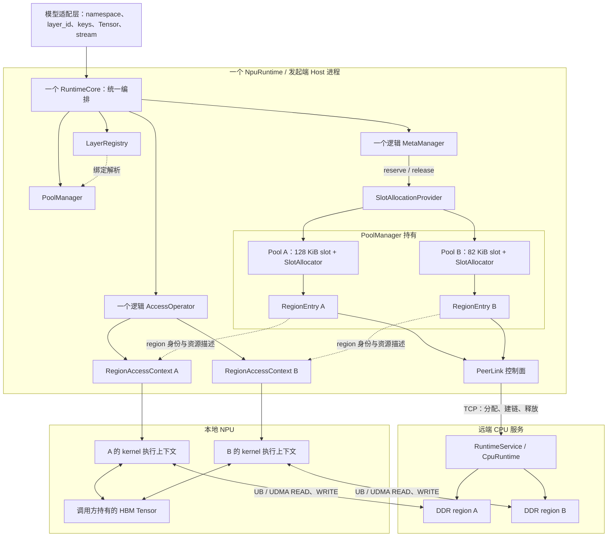
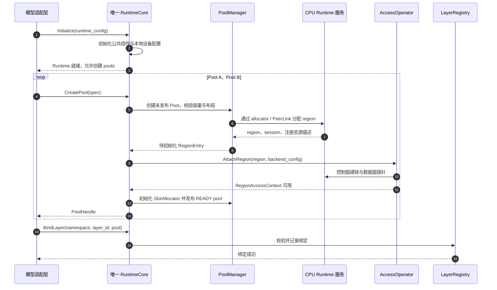
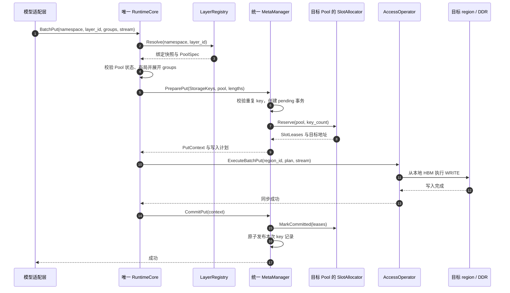
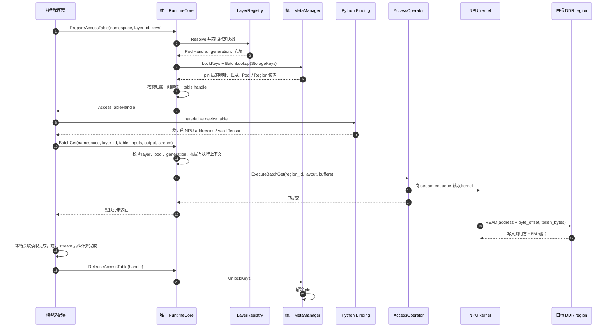
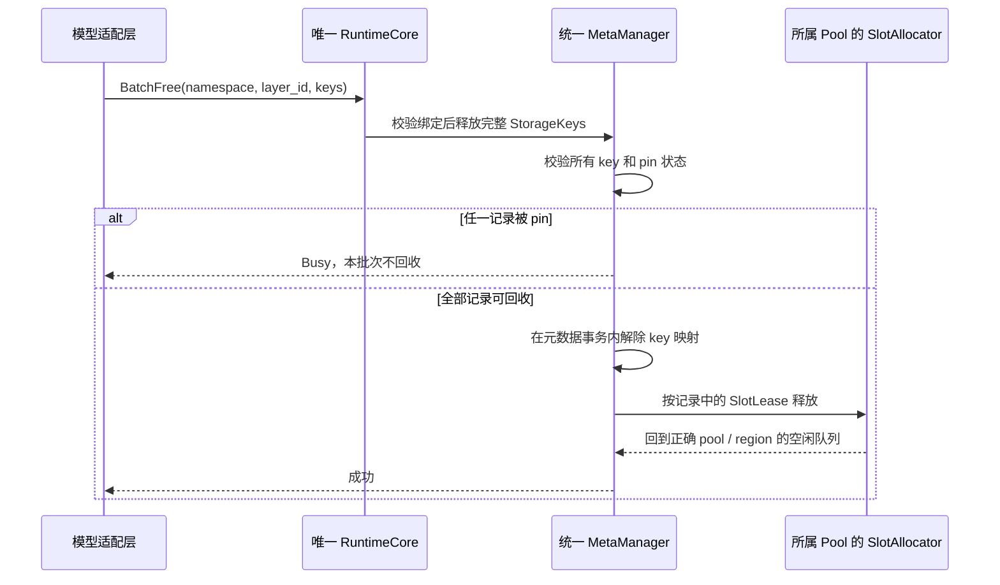
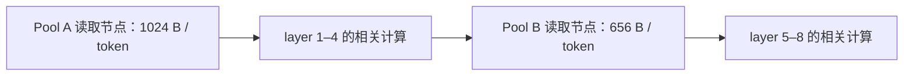
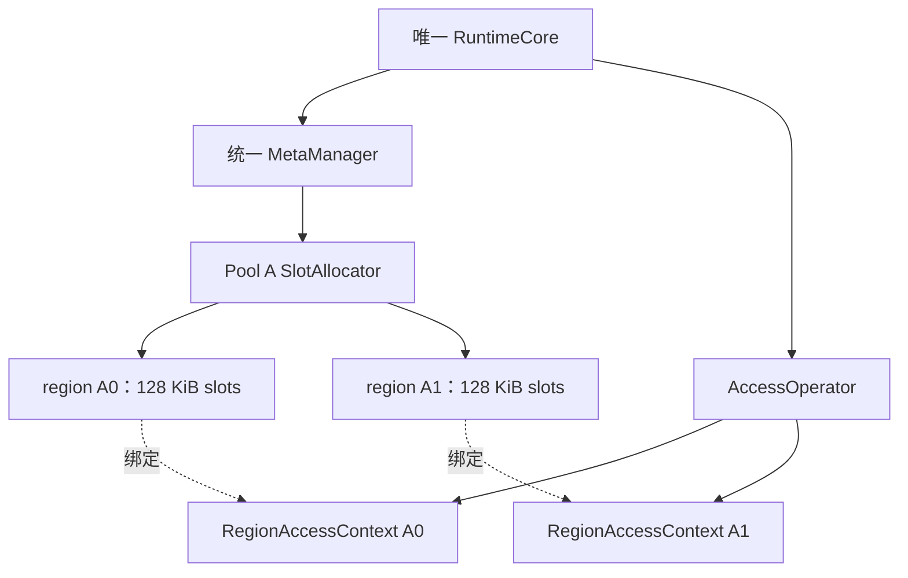

# KVAF DDR Pool 补充方案：一个 RuntimeCore 管理多个 Pools

> 方案 B：单 Core、多独立 DDR Pool。当前分支已加入最小实现；实际 API、范围和测试见[最小实现与测试](ddr_pool_minimal_implementation.md)。本文中的扩展接口和未覆盖能力仍为设计提案。
>
> 方案 A 是较早讨论的多个 RuntimeCore 分别管理 Pool；本方案只保留一个 Core。
>
> 适用场景：同一个模型推理实例按 layer 访问不同规格的 KV blocks，希望统一管理元数据、AccessTable 和资源生命周期。

## 1. 设计目标与基本选择

采用 **一个 NpuRuntime、一个 RuntimeCore、多个 Pool** 的结构。RuntimeCore 统一编排请求，通过 layer 绑定选择 Pool；每个 Pool 使用固定 slot 规格，并管理自己的 slot 分配器和 DDR region。

首版每个 Pool 对应一个 region。后续支持一个 Pool 管理多个相同规格的 regions；这不改变 RuntimeCore 的数量。

关键边界如下：

| 对象 | 表示什么 | 首版数量 |
| --- | --- | --- |
| NpuRuntime | 角色入口、本地设备与组件所有者 | 1 |
| RuntimeCore | Put/Get/Free、事务与 AccessTable 的统一编排 | 1 |
| LayerRegistry | 模型命名空间内的 `layer_id → PoolHandle` 绑定 | 1 |
| PoolManager | Pool 配置、状态和资源管理 | 1 |
| Pool | 一种明确的存储布局与独立容量域 | 本例 2 |
| SlotAllocator | 某个 Pool 的 slot 预留与回收 | 每 Pool 1 个 |
| MetaManager | 全部 layers 的逻辑 key 索引、事务、pin | 1 个逻辑实例 |
| Region | 实际分配、注册的远端内存范围 | 本例 2 |
| AccessOperator | 统一数据面入口，按 region 选择资源 | 1 个逻辑入口 |
| RegionAccessContext | 某个 region 的 transport、注册缓存与执行资源 | 每 region 1 组 |

一个 Core 不意味着一个 region、一个 transport 或一套执行队列。不同规格仍使用独立的 Pool/region，数据面是否共享硬件队列是另一个设计问题。

本文首版不提供跨 Pool 原子事务、单次异构 BatchGet、自动扩容或任意跨 Pool 迁移。

## 2. 示例：两种 slot 规格

以下按每层的一个 KV block 占用一个 slot 计算。`token_bytes` 应包含该 key 实际存储的全部数据；若四层打包为一个 key，需按打包后的大小重新配置。

| 配置 | Pool A | Pool B |
| --- | --- | --- |
| 名称 | `kv_1024` | `kv_656` |
| layers | 1–4 | 5–8 |
| `token_bytes` | 1024 B | 656 B |
| `tokens_per_block` | 128 | 128 |
| `payload_bytes` | 131,072 B | 83,968 B |
| `slot_size` | 128 KiB | 82 KiB |
| 每层保存 N 个 blocks 时的 slots | 4N | 4N |
| N = 1024 时的数据容量 | 512 MiB | 328 MiB |

```text
payload_bytes = token_bytes × tokens_per_block
slot_size >= payload_bytes
data_bytes = slot_count × slot_size
slot_address = region.base + slot_id × slot_size
总数据容量 = 512 MiB + 328 MiB = 840 MiB
```

默认 `slot_size = payload_bytes`。如后端需要 padding，padding 影响分配步长，不改变有效数据长度。描述符、队列、元数据及控制/暂存区域单独计入系统资源，不与用户 slots 重叠。

## 3. 完整层级与对象所有权

### 3.1 逻辑层级树

```text
模型推理框架 / vLLM
└─ 模型适配层（可直接或经 KVIP 接入）
   ├─ 提供 namespace、layer_id、block keys
   ├─ 持有输入输出 HBM Tensor 与 stream
   └─ 一个 NpuRuntime
      ├─ 一个 RuntimeCore
      │  ├─ 统一 Put/Get/Free 编排
      │  └─ 统一 AccessTable 注册表
      ├─ LayerRegistry
      │  ├─ model_x / layer 1–4 → Pool A
      │  └─ model_x / layer 5–8 → Pool B
      ├─ PoolManager
      │  ├─ Pool A：128 KiB / slot
      │  │  ├─ 不可变 PoolSpec、状态、generation、指标
      │  │  ├─ SlotAllocator A：free / reserved / committed / quarantine
      │  │  └─ RegionEntry A
      │  │     ├─ RegionId、RemoteRegionDesc、PeerRegion/session 信息
      │  │     ├─ 一个远端 region allocation 的生命周期
      │  │     └─ 对 RegionAccessContext A 的关联
      │  └─ Pool B：82 KiB / slot
      │     ├─ PoolSpec、SlotAllocator B
      │     └─ RegionEntry B → RegionAccessContext B
      ├─ 一个逻辑 MetaManager
      │  ├─ (namespace, layer_id, key) → AddressRecord
      │  ├─ pending_puts / pending_keys
      │  ├─ lock_contexts / pin 状态
      │  └─ 通过 SlotAllocationProvider 访问 Pool 的分配器
      ├─ 一个逻辑 AccessOperator
      │  └─ RegionId → RegionAccessContext
      │     ├─ 远端 region 绑定的 BatchPut / BatchGet transport
      │     ├─ 本地 HBM 注册缓存与描述符
      │     └─ ExecutionContext：stream、队列状态、工作区
      └─ PeerLink 管理
         └─ endpoint / 本地设备 / 路由配置 → 控制面 PeerLink

本地 NPU
├─ 调用方持有的 HBM 输入 / 输出 / device table
└─ region 对应的 kernel 参数、描述符与队列状态

远端 CPU 服务
└─ RuntimeService → CpuRuntime
   ├─ session A → DDR region A + URMA 注册资源
   └─ session B → DDR region B + URMA 注册资源
```

NpuRuntime 的实现对象持有 Core、MetaManager、PoolManager、LayerRegistry 和 AccessOperator；Core 通过引用调用它们。树中的同级组件不是被 Core 重复拥有。

PoolManager/RegionEntry 控制 allocation 的生命周期，CPU 服务持有实际 DDR 和远端注册资源。AccessOperator 持有传输上下文，通过 RegionId 与 RegionEntry 关联；同一个资源只保留一个明确的销毁责任方。

**Pool 中不再包含 NpuRuntime 或 RuntimeCore。** 对比方案 A，这一点是本方案的结构性变化。

### 3.2 控制面与数据面总图



图中的 PeerLink 是逻辑控制面。可以复用当前内部多 region 映射，但共享对象的路由选择与销毁边界需要重构；不假定一个 endpoint 的所有资源天然可共用一组队列。

## 4. LayerRegistry：通过 layer_id 访问 Pool

### 4.1 绑定语义

绑定以模型实例命名空间为边界：

```text
(namespace_id, layer_id) → {
    binding_generation,
    pool_handle
}
```

`namespace_id` 区分模型实例、版本或其他上层隔离域，避免多个模型的 layer 1 冲突。单模型调用方可以配置默认 namespace，但内部身份仍保留这一维度。

RuntimeCore 通过常数时间查找解析 layer，取得 PoolSpec 和可用状态。layer_id 是通用绑定标识，Core 不解释“第几层对应什么模型结构”。

### 4.2 初始化和访问约束

- 先创建 READY pool，再绑定 layer；未绑定的 layer 返回 NotFound，不回退到默认 pool。
- 多个 layers 可以绑定相同 Pool，同一 layer 在同一时刻只绑定一个 Pool。
- pool 决定布局和容量；一个 layer 不得单独覆盖与 pool 冲突的 token/block 参数。
- 已存在数据、pending Put、AccessTable pin 或 graph 使用引用时，首版禁止重绑定 layer。
- DestroyPool 前先解除全部 layer 绑定；不允许留下指向失效 pool 的绑定。
- 重新绑定或重建资源后增加相应 generation，使旧 table、绑定快照和执行计划失效。

这些约束确保 Get 查到的实际位置不会因为 layer 映射被修改而与 transport 选择不一致。后续若支持在线迁移，需要额外的数据复制、切换和版本管理协议。

## 5. 元数据与 slot 分配的边界

### 5.1 一份逻辑 key 索引

本方案建议由统一 MetaManager 维护复合身份，不再要求调用方把 layer 编进一个 uint64：

```cpp
// 以下均为建议类型，不是当前已有定义。
struct StorageKey {
  NamespaceId namespace_id;
  LayerId layer_id;
  KeyId block_key;  // 继续复用当前 KeyId，表示上层缓存数据身份。
};

struct SlotLease {
  PoolId pool_id;
  uint64_t pool_generation;
  RegionId region_id;
  uint64_t slot_id;
  Address address;
  uint64_t capacity;
};

struct AddressRecord {
  RecordId record_id;
  SlotLease location;
  uint64_t valid_length;
  uint32_t pin_count;
};
```

实际哈希表应同时实现完整字段相等比较，不能把哈希值本身当作无碰撞的 StorageKey。block_key 应表示缓存数据身份，避免仅使用会被复用的物理 HBM block 编号。

pool_id 存在地址记录中，不作为 layer 数据身份的一部分。重复 Put、pending key 冲突、Lock/Lookup/Free 都针对完整 StorageKey 检查。

### 5.2 Pool 是空闲 slot 的唯一管理者

建议给 MetaManager 注入一个窄接口 `SlotAllocationProvider`：

```text
Reserve(pool_handle, count) → SlotLease[]
MarkCommitted(leases)
Release(leases)
Quarantine(leases)
```

以上操作应支持租约状态检查、错误返回和恢复，不能在跨模块提交过程中静默丢失租约。一次 Put 的 key 预留、slot 预留与发布由 MetaManager 的事务上下文串联；容量不足等失败必须回滚已完成的预留。

RuntimeCore 不另行领取一份 slot，MetaManager 不重复管理空闲队列。当前最小实现中，PoolManager 通过 SlotAllocationProvider 管理 slot；同一个 MetaManager 内的 PoolMetadata 管理分层 key 和 pin，旧 DSA 路径继续兼容。

统一 MetaManager 表示统一逻辑接口和身份规则，不要求所有操作共用一把长时间持有的全局锁。元数据锁不能跨越 DMA 等待；后续可按 Pool 或 key 分片优化。

### 5.3 AccessTable 身份

统一 Core 的 AccessTable 注册表保存：

```text
runtime_id + table_id
namespace_id + layer_id + binding_generation
pool_id + pool_generation
addresses / lengths / valid
LockContext 与关联的 region 引用
```

首版一次 PrepareAccessTable 只接收一个 layer，因此天然只有一组布局和一个所属 Pool。Get 同时校验 layer、pool、generation 和有效长度；不能仅凭绝对地址落在某段内存内就允许跨池读取。

## 6. AccessOperator 与远端资源管理

一个逻辑 AccessOperator 维护 `RegionId → RegionAccessContext`。每个上下文保留当前单 region 数据面所需的资源：

- 远端 region/session 描述与传输绑定。
- BatchPut/BatchGet transport，包括各后端需要的队列和状态。
- 本地输入输出 HBM 注册缓存、描述符和工作区。
- 明确的 stream/ExecutionContext 使用约束。

Core 向数据面传入已解析的 Pool 布局和 region 身份。传输上下文验证地址、长度、region 归属后提交 DMA，不能从请求字节数推测应该使用哪个 Pool。

首版仍是两个 regions、两组 region 资源。共享一份 Core 不会自动减少 DDR、segment 或 Jetty 数量，也不承诺更高吞吐；其主要收益是统一编排、身份规则和生命周期。

当前分支的远端分配器是 NpuRuntime 内部的 PeerDdrAllocator。最小实现让同一个 allocator 保存多个 allocations；PoolManager 分别持有每个 region 的生命周期。已有 EID/候选探针用于启动路由选择，用户 pools 各自执行 operator 初始化，实际读写由硬件集成测试验证。

## 7. 初始化与创建 Pool 的交互



Initialize 完成只表示公共 Runtime 可用，不表示某个 Pool 已经分配。创建 Pool 失败时，不发布 handle，按已创建资源逆序清理；清理某个 region 不得顺带关闭其他 Pool 仍在使用的共享 PeerLink。

同一批模型配置需要整体初始化时，可以由模型适配层或单独的初始化事务包装器执行回滚。单个 CreatePool 不隐含跨 Pool 原子性。

## 8. BatchPut 交互



首版固定布局 Pool API 建议要求 `length == payload_bytes`，使后续 NPU Get 的表项有效长度一致。底层已有变长 Put 可以继续保留，但不能让不匹配布局的数据进入受管理的固定块读取路径；尾 block 的补齐由上层完成。

Commit 是本次单 Pool Put 的事务边界，租约状态转换与记录发布必须有一致性保证。不能在部分 key 已可见后因 MarkCommitted 失败而把地址归还空闲队列。

失败处理：

- 未提交传输，或确认传输已停止：撤销 pending 状态并释放预留 leases。
- 部分提交、超时或完成状态不确定：停止相关执行上下文的新提交，隔离 leases；完成排空或 teardown 后再回收。
- Commit 出错：保留可恢复的事务与租约状态，不发布部分结果或直接复用地址。

当前 Core 的失败路径是 ExecuteBatchPut 返回错误后 AbortPut。新增 slot provider 和故障隔离需要修改其内部契约，不能只替换单个 region 成一个数组。

## 9. AccessTable 与 BatchGet 交互



Host 返回与设备执行可以重叠，图中展示 Host 先返回的一种顺序。API 返回不等于 DMA 完成。

Pool A 以 1024 B 为输出行宽，Pool B 以 656 B 为输出行宽：

```text
Pool A：src = table[index] + token_index × 1024，读取 1024 B
Pool B：src = table[index] + token_index × 656，读取  656 B
```

当前 NPU Get 的统一有效长度校验应保留，但布局来源改为目标 PoolSpec，而不是 NpuRuntime 的唯一全局 token/block 配置。每次 Get 只处理一个 layer/布局；若将来支持混合请求，先按 Pool 和 region 分组，再提交多个执行计划。

## 10. Free 与销毁

### 10.1 释放 key



Free 使用记录中的实际位置回收，不能仅凭当前 layer 绑定推算地址。映射删除和租约释放应受一致的事务/锁规则保护，避免新 Put 与旧 slot 的释放产生竞争；底层 release 异常时保留恢复信息。

BatchFree 只回收 slots，不释放远端 DDR region，不按 key 向 CPU 服务发送释放 region 的请求。

### 10.2 销毁单个 Pool

建议 `DestroyPool` 默认返回 Busy，只允许销毁没有 layer 绑定、存活 key、pending Put、AccessTable、graph 使用引用和在途任务的 Pool。模型适配层按以下顺序完成显式回收：

1. 停止该 Pool 相关 layer 的新请求与 graph replay。
2. 等待其设备访问完成，释放 AccessTable，解除 pin。
3. Free 对应数据，并解除 layer 绑定。
4. Core 将 Pool 转为 Draining，再次确认资源使用计数为零。
5. AccessOperator DetachRegion，释放本地注册缓存、描述符、队列与 transport。
6. allocator/PeerLink 请求 CPU 服务释放该 region/session，再移除 Pool 并更新 generation。

RuntimeCore、另一个 Pool 和仍在使用的共享 PeerLink 保持有效。故障隔离 Pool 必须先排空或完成 teardown，不能通过强制删记录跳过在途 DMA。

Runtime Shutdown 停止全部请求、处理全部 Pools 后，最后释放公共组件。异常进程退出后的远端 session 回收需要额外的租约或管理流程，不由统一 Core 自动保证。

## 11. 图模式与并发

### 11.1 一个模型 graph 可以访问多个 Pools



上图示意两种布局可以出现在同一模型 graph 中，不表示四层的全部读取必须合并为一个节点。实际依赖按模型逐层计算组织。

- Host 的 layer 解析、Pool 路由、table 准备和输出注册在 capture 外完成；replay 使用预先绑定的执行上下文。
- 固定 device table 的地址值、valid、indices、offsets、mask 等可按后端契约更新，更新与读取要满足 stream 顺序和正确的 key pin 规则。
- table Tensor、输入输出、region、transport、执行状态必须覆盖最后一次使用它们的 replay。
- binding、Pool generation、布局或固定资源地址改变后，相关旧图失效，需要重新准备和 capture。
- 首版使用带 Host table 身份的受管理入口。裸 addresses/valid 入口无法自动验证 Host pin，不应绕过同等生命周期契约。

### 11.2 一个 Core 不等于所有设备访问串行

Core 统一编排，但不应持有元数据锁等待 DMA。首版每个 region 的 ExecutionContext 串行使用，绑定单一 stream；不同 Pools 的执行状态独立。

同一 Pool 多 stream 并发需要独立 ExecutionContext、队列状态与工作区，Host mutex 不能替代设备完成顺序。不同 Pool 若写入同一输出 Tensor，也需要调用方建立依赖。

当前 loader 有进程级 kernel 状态。首版限定同一 local device 和兼容的 kernel 配置；跨设备上下文和真正并行的硬件效果需要另行验证。

## 12. 建议接口示意

以下是新增方案的 API 草案，不是可直接运行的现有 Python 接口：

```python
# 仅创建一个 NpuRuntime，内部仅一个 RuntimeCore。
  runtime = kvaf.NpuRuntime(
    device_id=0,
    batch_get_kernel_object_path=batch_get_kernel,
    batch_put_kernel_object_path=batch_put_kernel,
)
runtime.initialize()  # 新语义：初始化公共 Runtime，不隐含分配单一 region。

n = 1024
pool_a = runtime.create_pool(
    name="kv_1024", peer="CPU_IP:28999",
    token_bytes=1024, tokens_per_block=128,
    slot_size=128 * 1024, slot_count=4 * n,
    layout_tag="model_x_kv_1024",
)
pool_b = runtime.create_pool(
    name="kv_656", peer="CPU_IP:28999",
    token_bytes=656, tokens_per_block=128,
    slot_size=128 * 656, slot_count=4 * n,
    layout_tag="model_x_kv_656",
)

for layer_id in range(1, 9):
    runtime.bind_layer(
        namespace="model_x", layer_id=layer_id,
        pool=pool_a if layer_id <= 4 else pool_b,
    )

# groups、keys 和 Get 输入输出由模型适配层准备。
# 调用方传 layer_id；实际 Pool 由 RuntimeCore 内部解析。
runtime.batch_put(
    namespace="model_x", layer_id=layer_id,
    groups=groups, stream=stream,
)
table = runtime.prepare_access_table(
    namespace="model_x", layer_id=layer_id, keys=keys,
)
device_table = runtime.access_table_view(table, device="npu")
runtime.batch_get(
    namespace="model_x", layer_id=layer_id, table=device_table,
    indices=indices, offsets=offsets, mask=mask,
    output_indices=output_indices, output=output,
    stream=stream, synchronize=True,
)
runtime.release_access_table(table)
runtime.batch_free(namespace="model_x", layer_id=layer_id, keys=keys)
```

示例展示同步成功路径。异常时按实际提交阶段清理；完成状态不确定时不得直接解 pin 或回收 slots。异步推理可以先 enqueue 同 stream 后续计算，再在安全回收点等待和释放。

为兼容现有调用，可增加一个适配入口：把旧 `Initialize(ddr_bytes, slot_size)` 映射为默认 namespace/layer/default Pool，显式传入或沿用旧 token/block 配置。旧的 `remote_region` 查询只对默认单 region Pool 保留明确语义；新增 `GetPoolInfo / ListRegions(pool)`，避免静默返回任意一个 region。

## 13. 当前代码的改造范围

| 模块 | 改造前状态 | 本方案需要的改动 |
| --- | --- | --- |
| common types/requests | 单 region 初始化，KeyId 不带 layer 上下文 | 新增 Pool/Region/Namespace/Layer 身份与绑定快照；请求增加 layer 上下文 |
| RuntimeCore | 一个 `remote_region_`，一次 Initialize 申请 region | 初始化与 CreatePool 分离；统一 table 注册表和多 Pool 路由 |
| NpuRuntime | 全局唯一 token/block 配置，持有一组单 region 组件 | 保留唯一 Core；布局放入 PoolSpec；公共设备/后端配置保留在 Runtime |
| MetaManager | 内部单 region 与 DSA records | 多池路径增加共享分层索引；事务记录带 SlotLease；分配/回收委托 provider |
| PoolManager / SlotAllocator | 尚不存在 | 新增规格、状态、regions、容量队列和租约状态 |
| PeerDdrAllocator | 一个实例只保存一次 allocation | 最小实现保存多个 allocations，分别协调其生命周期 |
| PeerLink | 已有多 region 映射 | 明确共享对象的路由、引用和按 region 清理规则 |
| AccessOperator | 一个远端 region 和对应 transports | 增加 RegionAccessContext 注册表与 region 路由；执行参数携带布局 |
| Python Binding | 从 NpuRuntime 全局读取 token 大小 | 从已解析 Pool/table 获取布局；新增 create/bind/query/destroy 接口 |
| CPU 服务 | 已能持有多个 regions/sessions | 可先复用现有分配协议；仍需验证多池并存、清理和故障行为 |

这不是仅修改 MetaManager 的 RegisterRemoteRegion：Core、NpuRuntime 的配置、数据面 region 绑定和句柄检查都要一起调整。

建议先保持 kernel 的单布局、单 region 执行 ABI，由 Host 选择正确参数与上下文；每次传输的行为可以延续现有实现。

## 14. 与方案 A 的比较及迁移

| 比较项 | 方案 A：每 Pool 一个 Core | 方案 B：一个 Core 管多个 Pools |
| --- | --- | --- |
| RuntimeCore | 多个 | 一个 |
| Pool 内部结构 | 可封装现有 NpuRuntime | 规格、分配器、region，不再包含 Core |
| 元数据 | 每 Core 一份索引与事务状态 | 一份逻辑 MetaManager，按 namespace/layer 区分身份 |
| AccessTable | 外层需包装各 Core 的局部句柄 | 统一注册表，显式记录所属 layer/pool |
| layer 路由 | 上层或外层 wrapper 路由到子 Runtime | 唯一 Core 通过 LayerRegistry 解析 |
| region transport | 每 region 独立资源 | 首版仍每 region 独立资源 |
| 复用当前代码 | 改造较少 | 需要改造单 region 假设 |
| 容量节省 | 来自按规格分池 | 同样来自按规格分池，单 Core 不额外节省 DDR |
| 适用方向 | 快速验证、独立访问实例 | 同一模型按层访问、统一管理 |

迁移应保留原有单 region 的行为验证：

1. 先在新 Core 中接入一个 default Pool，使原有单池读写通过统一路径运行。
2. 抽出 SlotAllocator/provider，保持 reserve/commit/abort 与 pin/free 语义。
3. 把数据面资源改为 RegionAccessContext 注册表，保留单 region kernel ABI。
4. 接入第二个规格的 Pool，新增 LayerRegistry 和完整身份校验。
5. 更新 Binding 和模型适配层，再验证两池及图模式。

首版通过重启实例迁移：停止旧请求，等待在途工作完成，释放旧 table 和资源，再启动新结构并按需要重新填充缓存。本文不承诺把两个旧 Core 的存活 key、table 或远端 session 无停机合并到新 Core。

## 15. 扩展一个 Pool 多个 regions



SlotLease 从首版起就保存 RegionId，为扩容预留身份。一个 Pool 增加同规格 region 后，SlotAllocator 可以从多个 region 分配；MetaManager 仍是统一索引。

跨 region 的 Put/Get 需要拆分执行计划。一张地址表包含多个 regions 时，不能直接交给当前只绑定一个 region 的 transport；需要 region 分组表/描述符、输出位置保持和完成聚合。

因此首版继续限制一个 Pool 一个 region，不因为数据结构已有 RegionId 就宣称支持跨 region 单次读取或旧图透明扩容。

## 16. 容量、故障隔离与验证

建议按 Pool 暴露 total/free/reserved/committed/quarantined slots、pinned slots、存活 tables、在途操作、data/registered/auxiliary bytes，以及按 region 的传输错误。

```text
total_slots = free_slots + reserved_slots + committed_slots + quarantined_slots
pinned_slots 是 committed_slots 的子集
```

单 Pool 容量不足只影响该 Pool；故障影响范围由实际共享资源决定。若共享设备、PeerLink 或公共后端失败，可能需要同时隔离依赖它们的多个 Pools，不能仅凭 Pool 的逻辑分离承诺完全故障隔离。

| 验证场景 | 预期 |
| --- | --- |
| layers 1–4 与 5–8 交替读写 | 唯一 Core 正确路由，地址步长与 token 长度正确 |
| 不同 layer 使用相同 block_key | StorageKey 不冲突，不覆盖、不串读 |
| 多 namespace 使用相同 layer/key | 身份隔离正确 |
| 未绑定 layer 或失效 generation | 在 DMA 提交前拒绝 |
| 错误 layer 使用另一池的 table | 在 DMA 提交前拒绝 |
| 一个 Pool 耗尽 | 返回容量不足，另一 Pool 可继续使用 |
| table pin 期间 Free | Busy，读取完成并释放 table 后可回收 |
| 存活数据或图仍引用时重新绑定/销毁 | Busy，不改变已发布绑定和资源 |
| Put 预留失败或提交失败 | key 与 slot 状态一致，不泄漏或提前复用 |
| 完成状态不确定 | 隔离相关执行上下文，排空后才允许回收 |
| 销毁一个 Pool | 唯一 Core 与另一池可继续工作 |
| 两种布局进入同一模型 graph | 固定资源、pin、stream 顺序与输出均正确 |
| 单池兼容入口 | 保持现有单 region 用例的行为 |

## 17. 代码与相关设计索引

当前最小实现与后续设计的查阅入口：

- [多 Pool 最小实现与测试](ddr_pool_minimal_implementation.md)
- [KVAF 总体架构](kvaf_architecture_design.md)
- [MetaManager 地址管理设计](meta_manager_address_management_design.md)
- [common/include/types.h](../common/include/types.h)：KeyId、RemoteRegionDesc、AccessTableHandle。
- [common/include/requests.h](../common/include/requests.h)：当前初始化、Put/Get 与 AccessTable 请求。
- [runtime/include/runtime.h](../runtime/include/runtime.h)：Core 组件引用、单 region 成员、table 注册表。
- [runtime/src/runtime.cc](../runtime/src/runtime.cc)：初始化、Put 事务、Get 校验、pin/free 编排。
- [runtime/include/npu_runtime.h](../runtime/include/npu_runtime.h)：全局 token/block 配置和唯一 Core 入口。
- [runtime/src/npu_runtime.cc](../runtime/src/npu_runtime.cc)：远端分配、EID 验证与生命周期。
- [runtime/src/pool_manager.cc](../runtime/src/pool_manager.cc)：多个 region、slot 分配和 layer 绑定。
- [runtime/include/peer_link.h](../runtime/include/peer_link.h)：已有多 region 映射和控制接口。
- [runtime/src/cpu_runtime.cc](../runtime/src/cpu_runtime.cc)：远端 DDR 与 region/session 管理。
- [meta_manager/src/in_memory_meta_manager.cc](../meta_manager/src/in_memory_meta_manager.cc)：兼容旧 DSA 索引、事务与 pin。
- [meta_manager/src/pool_metadata.cc](../meta_manager/src/pool_metadata.cc)：多 Pool 的统一分层 key 索引与 pin。
- [access_operator/src/access_operator.cc](../access_operator/src/access_operator.cc)：按单 region 创建 transport 和提交读写。
- [bindings/src/npu_python_runtime.cc](../bindings/src/npu_python_runtime.cc)：当前布局参数来源和 table/Tensor/stream 适配。
- [AIV BatchGet](../access_operator/demo/aiv_batch_get/README.md)、[AIV BatchPut](../access_operator/demo/aiv_batch_put/README.md)：当前数据面契约。
