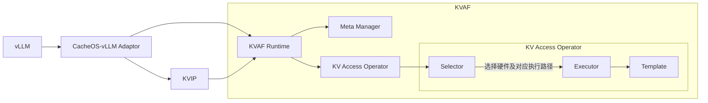

# KVAF 架构设计

## 1. 背景

在 Agent 场景下，随着大模型推理序列长度不断增长，KV 数据规模持续扩大，带来了日益突出的存储压力。由于 HBM 容量有限，无法容纳全部 KV 数据，因此需要将部分 KV 数据从当前设备卸载到远端设备的 DDR 中保存，并在后续计算需要时恢复到本地 HBM。

本文面向当前的 POC 场景，主要关注 Decode 阶段的 KV 卸载与加载操作。这类操作本质上是围绕 KV 数据进行的远端写入和高频读取，访问路径中的控制面开销会直接影响 Decode 的端到端性能。

现有 KV 引擎（如 MemCache/MemFabric）主要依赖中心化 Meta Service。在加载或卸载 KV 时，需要通过中心服务完成 Key 到数据地址的查询。已有测量表明，该路径的单次 Meta 访问延迟达到约 10ms 量级，难以满足 Decode 场景 10–100 μs 级端到端 Get 操作的性能目标。因此，KV 访问路径不能依赖每次请求都访问中心化 Meta Service，而需要将地址映射和数据搬运路径下沉到更接近数据访问的位置。


KVAF（KV Access Fabric）用于提供统一的 KV 访问基础能力。其整体目标是构建一个可运行在不同硬件（如 CPU、NPU）上的软硬件协同 Runtime，为上层提供统一、高性能的 KV 访问能力。KVAF 的核心设计方向包括：

- 分布式 Meta 管理协议：减少对中心化 Meta Service 的依赖，避免集中式查询带来的访问开销；
- Pooling 与 Offloading 的统一内存访问语义：同时提供共享访问能力和快速访问能力，避免上层分别维护两套 KV 管理与访问逻辑；
- 高性能 BatchGet/BatchPut 及硬件卸载能力：支持面向连续或离散 KV Block 的批量加载，并允许相关操作在不同硬件上执行，例如 CPU、AICPU、AIV 和 CCU。

以上是 KVAF 的整体设计目标。对于当前 POC 的 Decode 场景，重点在于实现 Offloading 和高性能 BatchGet/BatchPut 两项能力。由于 POC 中每张卡均独立运行一个完整的 KVAF 实例，因此当前暂不涉及分布式 Meta 管理协议。

## 2. POC 总体架构与模块边界

本单元主要确定 KVAF 的模块划分、模块职责和基本依赖关系，不展开各模块的详细接口、数据结构和具体实现算法。具体接口规范和模块内部能力将在后续单元中分别定义。

### 2.1 模块关系

POC 阶段，KVAF 由 `KVAF Runtime`、`Meta Manager` 和 `KV Access Operator` 三部分组成。其中，`KV Access Operator` 内部按照 Selector、Executor 和 Template 进行组织。

KVAF Runtime 支持两类来自 vLLM 的接入路径：一类是 vLLM 通过 CacheOS-vLLM Adaptor 直接接入 KVAF；另一类是 vLLM 通过 CacheOS-vLLM Adaptor 接入 KVIP（KV Intelligence Plane），再由 KVIP 接入 KVAF。



### 2.2 模块职责

#### KVAF Runtime

`KVAF Runtime` 是 KVAF 对外提供能力的统一入口，提供统一、高性能的 KV 访问接口，例如 BatchPut 和 BatchGet。Runtime 负责协调 `Meta Manager` 与 `KV Access Operator` 之间的调用和结果传递，完成一次完整的 KV 访问操作。具体的 Key 映射由 Meta Manager 管理，数据访问和搬运由 KV Access Operator 完成。


#### Meta Manager

`Meta Manager` 负责维护 KV 数据的元信息，为 KVAF 提供 Key 到数据地址 UBA（UB Address）的查询和管理能力。在当前 POC 中，Meta Manager 的管理边界限定在本卡的 KVAF 实例内；跨卡同步和中心化 Meta Service 属于后续扩展方向。

Meta Manager 的内部数据结构、地址管理方式和具体操作接口暂在本单元中不展开，后续单独定义。

#### KV Access Operator

`KV Access Operator` 是 KV 数据访问的完整执行单元，负责根据 Runtime 传入的操作信息完成 BatchPut 或 BatchGet。连续或离散 KV Block 的处理、批量操作组织以及具体执行路径的展开，均在算子内部完成。

KV Access Operator 内部包含以下三个层次：

- `Selector`：根据上层指定的执行路径或运行时条件，确定目标硬件及对应的执行路径；
- `Executor`：围绕已选定的执行路径，负责操作编排和执行过程管理；
- `Template`：承载具体硬件或算法路径下的操作构造与执行实现，后续可针对不同硬件或算法提供不同的 Template。

### 2.3 设计约束

#### 图模式设计约束

#### 1. 总体要求与 POC 范围

- Decode 阶段采用整图下发（如 CUDA Graph / ACL Graph）优化时，KVAF 的关键访问路径必须能够被完整捕获到图中并可靠回放。
- POC 至少需要打通一条完整的可入图 KV 访问路径。以 **BatchGet** 为例，图内路径须覆盖输入 Key、Meta 查询、地址解析、批量操作组织、实际 KV 数据搬运以及完成通知的端到端流程。
- 图回放过程中，**禁止依赖 Host 端执行 Meta 查询或动态编排任务**；所有必要决策与数据组织均需要在图内完成。

#### 2. 数据与资源约束

- 参与图执行的输入 Key、Meta 查询所需数据、输出 Buffer Descriptor 及相关操作参数，均须以 **NPU 可直接访问** 的形式存在。
- **Meta Manager** 须提供图模式下可访问的低延迟地址查询能力。Meta 表可以直接驻留在 NPU 可访问的内存中，也可以由 CPU 更新后同步至 NPU 可访问区域，具体方案在后续实现中确定。
- **KV Access Operator** 的输入/输出地址、Descriptor 区域以及完成通知所依赖的资源，在图捕获与回放的全生命周期内必须保持有效且地址固定。

#### 3. 静态结构与动态数据约束

- **图捕获阶段固定**：Batch Size、Descriptor 容量、输出 Buffer 容量及算子执行路径。
- **图回放阶段允许变化**：Key 内容、Key 映射结果中的地址值、数据长度、本地命中/远端 Miss 状态、有效 Entry 数量等动态信息。
- 所有动态数据必须通过**固定容量的设备侧 Buffer + Valid 标志 / Mask / Count 等参数**表达，避免在图回放过程中改变图的结构或 Shape。

#### 4. 执行路径管理

- **Selector** 在图捕获前完成硬件选择与执行路径决策，图回放时沿用已确定的执行路径。
- 若执行路径发生变化，需要重新捕获对应的图实例，或切换到其他已就绪的图实例。

#### 5. 完成通知机制

- 图内 Batch 操作完成后，须通过**图兼容的 Flag 或 Event**向上层反馈完成状态，完成通知需要纳入图执行流程。

#### 6. BatchPut 预留约束

- **BatchPut** 同样需要预留完整的图执行能力，其图内流程遵循与 BatchGet 一致的设计约束。POC 阶段优先验证 BatchGet 的完整图路径，BatchPut 后续复用相同的约束框架。

#### 编程语言
KVAF 核心执行路径建议采用 C++ 实现，Python 主要承担 vLLM 集成侧的调用入口，通过 Native Extension 调用 C++ Runtime。

### 2.4 集成与扩展

KVAF 的整体能力由 `KVAF Runtime`、`Meta Manager` 和 `KV Access Operator` 共同承载。当前 POC 以 Decode 场景下的 KV Offloading 为切入点，优先实现高性能 BatchGet/BatchPut，并验证 BatchGet 完整路径在图模式下的执行能力。后续完整方案在保持顶层模块关系稳定的基础上，逐步扩展 KVAF 的其他核心特性。

#### Offloading 与高性能 BatchGet/BatchPut

当前 POC 中，`Meta Manager` 负责维护本卡 KVAF 实例的 Key 与远端 DDR 地址之间的映射，`KV Access Operator` 负责组织连续或离散 KV Block 的批量访问，并通过选定的执行路径完成数据搬运。`KVAF Runtime` 负责将上层请求、Meta 信息和算子执行过程串联起来。

图模式约束是 BatchGet/BatchPut 集成到 Decode 流程时的运行前提。后续可以在相同的模块和接口基础上扩展其他执行场景，例如在 Prefill 阶段使用 CPU 执行，或进一步支持 Megakernel 算子融合等高级执行模式。

#### 分布式 Meta 管理

POC 阶段，Meta Manager 以单卡 KVAF 实例为管理边界。后续支持跨卡或跨节点 KV 访问时，Meta Manager 可以扩展多设备地址管理、元数据发布与查询、数据归属和访问协同等能力，逐步形成分布式 Meta 管理协议。Runtime 与 KV Access Operator 通过统一的地址描述与访问信息承接这一变化。

#### Pooling 与 Offloading 的统一访问语义

POC 阶段只实现 Offloading，数据访问对象对应远端设备 DDR 中的 KV 数据。后续引入 Pooling 后，Meta Manager 需要支持不同存储域和地址空间的管理，KV Access Operator 则基于统一的访问描述完成数据读取和写入，从而使上层能够使用一致的 KV 访问接口适配 Pooling 与 Offloading。

#### 上层接入路径

vLLM 通过 CacheOS-vLLM Adaptor 直接接入 KVAF，或者经由 KVIP 接入 KVAF。两条路径最终都通过 KVAF Runtime 使用统一的 KV 访问能力，具体的上层编排逻辑由 Adaptor 或 KVIP 承担，KVAF 内部保持统一的模块关系和执行模型。

## 3. KVAF Runtime 设计

### 3.1 模块定位

`KVAF Runtime` 是 KVAF 对外提供能力的统一入口，负责承接 vLLM 经 CacheOS-vLLM Adaptor 的调用，以及 KVIP 的调用。Runtime 为上层提供统一的 KV 访问接口，并协调 `Meta Manager` 与 `KV Access Operator` 完成一次完整的 KV 操作。

Runtime 负责请求组织、模块调用和结果返回。Key 映射由 Meta Manager 管理，数据访问和搬运由 KV Access Operator 完成。

### 3.2 对外接口

POC 阶段，KVAF Runtime 对上层提供以下核心能力：

| 接口 | 输入 | 输出 | 主要能力 | 限制 |
| --- | --- | --- | --- | --- |
| `PrepareAccessTable` | `AccessTablePrepareRequest` | `AccessTableHandle` | 根据上层提供的 KV Block Keys，解析地址和长度并准备可供 BatchGet 使用的 AccessTable | 输入 Key 位于 CPU；输出支持 `device="cpu"` 或 `device="npu"`；输入的前 N-1 维长度一致，最后一维可变；本接口不支持入图 |
| `ReleaseAccessTable` | `AccessTableHandle` | 完成状态 | 结束 AccessTable 使用周期，释放 KVAF 持有的资源并解除 KV Block Key 的稳定性锁定 | 调用方必须确保关联的 BatchGet 已完成；释放后 Handle 不可继续使用 |
| `BatchGet` | `BatchGetRequest` | 完成标志 | 根据 `AccessTableHandle` 和 Index Tensor 查表，并将对应 KV 数据 In-place Copy 到输出 Buffer | Batch Size、Index Tensor、AccessTable 容量以及输出 Buffer 的布局和容量需要满足图模式约束 |
| `BatchPut` | `BatchPutRequest` | 完成状态 | 将一批 KV 数据写入远端 DDR，并在写入成功后建立 Key 到远端地址的映射 | Key 数量必须与数据块数量一致；单条数据长度可以不同 |
| `BatchFree` | `BatchFreeRequest` | 完成状态 | 删除 Key 映射 | Key 必须位于 CPU；调用前必须确保不存在关联的 AccessTable 或 BatchGet 操作 |


由于单条数据长度不固定，AccessTable 中的访问描述需要表达每个 KV Block 的地址和实际长度。`BatchGet` 和 `BatchGetAsync` 的输出 Tensor 及其生命周期由上层服务管理，KVAF 根据 Tensor 的地址、布局和容量将数据写入对应位置；内部需要的执行 Descriptor 由 Runtime 或 Operator 根据 Tensor 元信息生成。

异步接口提交操作后立即返回 Event。对于 `BatchPutAsync`，Event.wait() 完成表示数据写入和对应 Meta 映射均已完成；对于 `BatchGetAsync`，Event.wait() 完成表示输出 Buffer 已完成数据写入。调用方需要保证相关输入、输出 Buffer 在 Event 完成前持续有效。

### 3.3 Runtime 内部状态与数据

本节暂作占位。Runtime 需要保存的状态和数据项，待 3.4 节梳理 Runtime 与内部模块的交互流程后，再根据实际调用关系和生命周期逐项确定。

### 3.4 Runtime 接口详情

Runtime 通过 Meta Manager 准备通用的 AccessTable；上层随后将 AccessTableHandle、Index Tensor 和输出 Buffer Descriptor 交给 KV Access Operator，由算子完成设备侧查表和数据搬运。Runtime 不感知上层调用属于 Forward、Prefill 还是其他业务流程。

```text
上层调用方
    ↓
KVAF Runtime
    ├── Meta Manager
    │       └── 根据 KV Block Keys 准备 AccessTable
    │
    └── KV Access Operator
            └── 根据 Index Tensor 查表并完成数据搬运
```

#### 3.4.1 PrepareAccessTable、ReleaseAccessTable

##### 接口定义

```cpp
PrepareAccessTable(
    const AccessTablePrepareRequest& request
) -> AccessTableHandle

ReleaseAccessTable(
    const AccessTableHandle& handle
) -> Status
```

##### PrepareAccessTable

`PrepareAccessTable` 是一个通用的 AccessTable 准备接口，不包含 Prefix Key、Forward 或其他上层流程语义。上层负责将业务数据整理为 KV Block Keys，并决定这些 Key 在 AccessTable 中的逻辑组织方式。

`AccessTablePrepareRequest` 定义为：

```text
AccessTablePrepareRequest
├── keys: KVBlockKeyView
├── output: AccessTableOutputSpec
└── lock_mode: AccessTableLockMode
```

其中：

- `KVBlockKeyView` 描述位于 CPU 的输入 Key、逻辑形状和可变最后一维的长度信息；
- `AccessTableOutputSpec` 描述 AccessTable 的输出 `device`、布局、容量和内存所有权；
- `AccessTableLockMode` 描述本次准备期间对 Key 映射的稳定性要求。

`AccessTableOutputSpec` 可以抽象为：

```text
AccessTableOutputSpec
├── device: "cpu" | "npu"
├── buffer: optional caller-provided Tensor
└── ownership: RuntimeOwned | CallerOwned
```

如果 `ownership=CallerOwned`，Runtime 只保存对调用方 Tensor 的引用或 View，不负责释放其底层内存；如果 `ownership=RuntimeOwned`，Runtime 负责申请并在 `ReleaseAccessTable` 时释放或归还对应资源。

##### KVBlockKeyView 与输入形状

`KVBlockKeyView` 支持嵌套的 KV Block Key 组织形式，例如：

```text
[
    [a, b, c],
    [d, e]
]
```

输入要求是前 N-1 维的长度一致，最后一维允许长度不同。Runtime 将输入规范化为扁平 Key Buffer 和行信息，再调用 Meta Manager 的批量接口进行锁定和查询：

```text
KVBlockKeyView
├── flat_keys: [a, b, c, d, e]
├── row_offsets / row_lengths
├── logical_shape
└── device: "cpu"
```

例如，上述输入会被展平为：

```text
flat_keys   = [a, b, c, d, e]
row_offsets = [0, 3, 5]
```

当前设计假设输入 Key 位于 CPU。输出可以指定为 `device="cpu"` 或 `device="npu"`；当输出位于 NPU 时，Runtime 将准备好的 AccessTable 写入调用方提供或 Runtime 在图外申请的 Device 内存。图模式场景下，AccessTable 的输出地址需要在 Graph Capture 前提前指定。由于 `PrepareAccessTable` 本身不支持入图，因此该过程不要求在 Graph Replay 阶段执行。

##### Key 锁定与 Meta 查询

在查询地址之前，Runtime 先调用 Meta Manager 对扁平化后的 KV Block Keys 加锁：

```text
MetaManager.LockKeys(
    flat_keys,
    AccessTableLockMode
) -> LockContext
```

POC 场景 `AccessTableLockMode` 采用 `StableReadAllowAppend` 语义：

- 已存在的 Key 映射在锁持有期间不得修改、迁移或释放；
- 允许对已锁定的 Key 追加新的地址映射，例如执行 Copy 后为同一个 Key 增加一条新地址记录；
- 已有地址记录不会被修改或替换，当前 AccessTable 继续使用创建时查询到的原地址；
- 新增的地址不会自动刷新已经生成的 AccessTable，后续请求需要重新查询或更新 AccessTable 才能使用新地址；


加锁完成后，Runtime 调用 Meta Manager 查询扁平 Key 对应的访问描述：

```text
MetaManager.BatchLookup(
    flat_keys,
    lock_context
)
    -> flat_access_desc
```

Meta Manager 可以在内部使用 Host Tensor、Device Tensor 或其他数组结构，但这些形式不作为 Runtime 对外接口的一部分。Runtime 将查询结果统一整理为 AccessTable，并将本次锁定的 Keys 及内部锁上下文封装到 `AccessTableHandle` 中。

##### AccessTable 输出格式

AccessTable 的逻辑形状由输入 Key 的形状决定。对于输入：

```text
[
    [a, b, c],
    [d, e]
]
```

输出采用最后一维 Padding 的方式对齐为：

```text
address_table = [
    [addr_a, addr_b, addr_c],
    [addr_d, addr_e, pad]
]
valid_mask = [
    [1, 1, 1],
    [1, 1, 0]
]
```

```text
AccessTableHandle
├── address_table: Tensor
├── size_table: Tensor
├── valid_mask: Tensor
├── kv_format: KVFormat
├── device: "cpu" | "npu"
├── ownership: RuntimeOwned | CallerOwned
└── locked_keys: KVBlockKeyView
```

其中：

- `address_table`：每个 KV Block 对应的远端 DDR 地址表；
- `size_table`：每个 KV Block 对应的实际数据长度，和 `address_table` 逐项对应；
- `valid_mask`：标识 Padding 后的每个位置是否有效；
- `kv_format`：AccessTable 中地址对应的 KV 数据格式，包括 KV 的数据类型、布局和单条数据的组织方式；POC 假设所有 KV Block 使用同一种格式；
- `device`：取值为 `"cpu"` 或 `"npu"`，代表输出数据在哪个存储介质，仅影响`address_table`、`size_table`、`valid_mask`；
- `ownership`：标识 AccessTable Tensor 由 Runtime 申请，还是由调用方提供；
- `locked_keys`：本次 AccessTable 持有稳定性锁的 KV Block Keys。

`locked_keys` 是被锁定的对象，不等同于锁的所有权信息。Meta Manager 内部仍需要维护一个与本次 AccessTable 关联的锁上下文，用于在 `ReleaseAccessTable` 时安全解除锁；该内部上下文不作为上层接口暴露。

`pad` 仅表示无效占位项（对应的key不存在或者用于补全长度亦），不能作为有效地址访问。Runtime 和后续 Operator 都必须依据 `valid_mask` 或等价的有效长度信息屏蔽无效项，不能把避免访问无效地址的责任完全交给上层调用方。

##### Host 与 Device 路径

`PrepareAccessTable` 支持以下输入输出组合：

| 输入 Key | AccessTable 输出 | 处理方式 |
| --- | --- | --- |
| Host | `device="cpu"` | CPU 侧展平、加锁、查询和重新组织 |
| Host | `device="npu"` | CPU 侧查询后，将 AccessTable 准备到 NPU |

该接口本身是 Host 控制的准备操作，不支持进入图。图模式要求的是：在 Graph Capture 前通过 `PrepareAccessTable` 得到一个位于 Device 且地址稳定的 `AccessTableHandle`，随后由 `BatchGet` 在图内使用该 Handle。


##### ReleaseAccessTable

`AccessTableHandle` 输入是 `PrepareAccessTable` 返回的 `AccessTableHandle`，输出是释放操作的完成状态。该接口用于结束一次 AccessTable 的使用周期。Runtime 执行以下操作：

1. 根据 `handle.ownership` 释放 Runtime 自己申请的 AccessTable 资源，或解除对调用方提供 Tensor 的引用；
2. 调用 Meta Manager 解除 `locked_keys` 对应的稳定性锁；
3. 将 Handle 标记为无效并向上层返回完成状态。

调用方必须保证调用 `ReleaseAccessTable` 时已经不存在关联的同步或异步 BatchGet 操作。当前 Runtime 不负责检查或等待这些操作；如果调用方违反该约束，行为不作保证。

当 `ownership=CallerOwned` 时，Runtime 只在 Handle 中保存调用方 Tensor 的引用或 View。`ReleaseAccessTable` 释放的是 KVAF 对该 Tensor 的引用和相关 Key 锁，不释放 Tensor 的底层内存；调用方仍负责 Tensor 的生命周期，并且在 Release 前不能释放、复用或改变其存储。

当 `ownership=RuntimeOwned` 时，Runtime 在 Release 时释放或归还自己申请的 AccessTable 资源。

##### Handle 生命周期

`AccessTableHandle` 不仅代表地址表，还代表本次查询期间持有的 Key 锁。调用方必须保证：

- 关联的所有同步或异步 BatchGet 操作完成后，才能调用 `ReleaseAccessTable`；
- `ReleaseAccessTable` 完成后，Handle 不可继续使用；
- 如果加锁或查询过程中发生错误，Runtime 必须在返回错误前释放已经获得的锁；
- 如果需要在同一块 Device 内存上更新 AccessTable，必须先完成所有依赖旧表的操作，具体更新接口后续再细化。

#### 3.4.2 BatchGet、BatchGetAsync

`BatchGet` 不接收原始 Key，也不负责 Key 到地址的查询。调用方必须先通过 `PrepareAccessTable` 获得 `AccessTableHandle`，再使用相对索引 Tensor 指定本次需要访问的 KV Block。

##### 接口定义

```cpp
BatchGet(
    const BatchGetRequest& request
) -> Status

BatchGetAsync(
    const BatchGetRequest& request
) -> Event
```

`BatchGetRequest` 定义为：

```text
BatchGetRequest
├── access_table: AccessTableHandle
├── indices: Tensor
├── mask: optional Tensor
├── output_buffers: List[Tensor]
├── output_indices: Tensor
└── options: optional BatchGetOptions
```

其中：

- `access_table`：由 `PrepareAccessTable` 返回的 AccessTable，包含 KV Block 的地址、实际长度和有效性信息；
- `indices`：描述本次访问使用的 AccessTable 相对索引。POC 采用固定形状的 `int32` Tensor，`indices[b][i]` 表示第 `b` 个请求的第 `i` 个 KV Block 在 AccessTable 中的索引，Prefix Key 到 indices 的展开、索引生成以及 Batch 组织由 CacheOS-vLLM Adaptor 或 KVIP 完成；
- `mask`：可选的 Tensor，与 `indices` 形状一致，用于标识本次请求中实际需要执行的访问。`mask[b][i] = 1` 表示加载 `indices[b][i]`，`mask[b][i] = 0` 表示跳过该位置；
- `output_buffers`：由调用方准备的目标 Tensor 列表，KVAF 将 KV 数据直接写入这些 Tensor。当前允许 Tensor 为多维结构，具体的输出布局和组织方式后续结合 vLLM Adaptor 再确定；
- `output_indices`：描述每个输入索引对应的输出相对位置，形状与 `indices` 一致。当前约定 `output_buffers[b]` 与 `indices[b]` 对应，`output_indices[b][i][c1,c2,c3]` 指定 `indices[b][i]` 对应的数据应写入 `output_buffers[c1][c2][c3]` 中的哪个位置，其取值必须位于对应输出 Tensor 的有效范围内。多维输出 Tensor 下的具体索引展开规则后续确定；
- `options`：可选的执行配置，例如硬件算法展开位置，具体字段和语义在 KV Access Operator 设计中确定。。

Runtime 不根据 Python 对象类型猜测 CPU 或 NPU 执行路径。`access_table`、`indices`、`mask`、`output_indices` 和 `output_buffers` 应位于同一设备上，具体设备由各 Tensor 的 `device` 属性表达；只有 NPU Tensor 路径支持图模式。未提供 `mask` 时，默认所有 `indices` 位置均有效。

##### Runtime 与 KV Access Operator 的交互

Runtime 在提交 BatchGet 前，负责校验请求中 Tensor 的基本类型、形状和相互关系：

1. `indices` 使用 POC 约定的 `int32` 类型；
2. `mask`（如果提供）与 `indices` 形状一致，并使用布尔或等价的有效性类型；
3. `output_indices` 与 `indices` 形状一致，并使用 POC 约定的 `int32` 相对位置索引类型；
4. `output_buffers` 中的 Tensor 位于同一设备，目标容量能够容纳 `size_table` 指定的实际数据长度；
5. `output_indices` 指向的输出位置在对应 `output_buffers` 的有效范围内，output_indices.shape[:-1] == indices.shape, output_indices.shape[-1] == len(output_buffers.shape)。

Runtime 不在此处单独校验 `indices` 是否访问了 AccessTable 的 Padding 项。该情况由 KV Access Operator 在执行时结合 `mask` 处理：被屏蔽的位置跳过数据搬运；有效位置如果对应无效的 AccessTable 项，则返回执行错误。

校验通过后，Runtime 将请求转换为 KV Access Operator 使用的执行描述：

```text
BatchGetExecRequest
├── access_table: AccessTableView
├── indices: TensorView
├── mask: optional TensorView
├── output_buffers: TensorListView
├── output_indices: TensorView
└── options: optional BatchGetOptions
```

并调用：

```cpp
ExecuteBatchGet(
    const BatchGetExecRequest& request
) -> Status
```

##### 不同执行路径

BatchGet 的输入和输出需要与目标执行路径匹配，POC 暂不隐式完成 CPU/NPU 之间的动态搬运：

| 执行路径 | AccessTable | 输入 Tensor | 输出 Buffer | 处理方式 |
| --- | --- | --- | --- | --- |
| Host CPU 路径 | `device="cpu"` | CPU Tensor | CPU Tensor | CPU 侧完成索引处理和数据搬运，主要用于功能验证 |
| 非图 NPU 路径 | `device="npu"` | NPU Tensor | NPU Tensor | NPU Tensor 和输出 Buffer 可以在提交请求前按需申请，Device 侧完成索引处理和数据搬运 |
| 图 NPU 路径 | Capture 前准备且地址稳定的 NPU AccessTable | 图内 NPU Tensor | 图内地址稳定的 NPU Tensor | 索引处理和 KV 数据搬运均作为图内执行路径 |

图模式下，`BatchGet` 使用的 AccessTable、`indices` 和 `mask` 的 Shape、`output_buffers` 的布局和容量以及具体执行路径需要在 Graph Capture 阶段确定。Graph Replay 阶段只更新设备侧 Tensor 中的索引和有效范围等数据，不执行 Host 侧 Key 解析、Meta 查询或动态内存申请。

##### 返回语义

- `BatchGet` 在索引处理和 KV 数据搬运完成、输出 Tensor 已经写入后返回 `Status`；
- POC 采用整批成功或整批失败的语义，不返回单个 KV Block 的部分成功结果；
- `BatchGet` 不改变 Meta 映射，也不更新或刷新 `AccessTableHandle` 中已经准备好的地址表。
 
#### 3.4.3 BatchPut

`BatchPut` 接收一批 KV Block Key 和对应的数据块，将数据写入 Meta Manager 管理的远端 DDR。与 `BatchGet` 不同，`BatchPut` 不使用已有的 AccessTable，而是先由 Meta Manager 为本批数据准备远端地址，数据搬运成功后再提交 Key 到地址的映射。

##### 接口定义

```cpp
BatchPut(
    const BatchPutRequest& request
) -> Status

BatchPutAsync(
    const BatchPutRequest& request
) -> Event
```

`BatchPutRequest` 定义为：

```text
BatchPutRequest
├── keys: KVBlockKeyView
├── blocks: BlockBufferView
└── options: optional BatchPutOptions
```

其中：

- `keys`：本批待写入数据对应的 KV Block Keys。与 `PrepareAccessTable` 一致，POC 中 Key 位于 CPU；Key 的具体业务组织和生成由 CacheOS-vLLM Adaptor 或 KVIP 完成；
- `blocks`：描述待写入的 KV 数据块，可以由一个带 Batch 维度的 Tensor 或多个 Tensor 组成。每个数据块必须与一个 Key 一一对应，数据块的设备位置、类型、形状和步长由 Tensor 元信息表达；
- `options`：可选的执行配置，例如硬件算法展开位置，具体字段和语义在 KV Access Operator 设计中确定。`options` 不用于表达同步/异步模式。

`BlockBufferView` 可以抽象为：

```text
BlockBufferView
├── buffers: Tensor 或 TensorList
├── lengths: optional Tensor[int64][BatchSize]
├── logical_shape / strides
└── device: "cpu" | "npu"
```

当所有数据块大小一致且由一个 Batch Tensor 表示时，数据长度可以根据 Tensor 的 Shape、Stride 和数据类型推导；当数据块存储在 Padding 后的 Tensor 中，或者每个数据块长度不同且需要显式表达时，通过 `lengths` 提供每个数据块的实际字节长度。`lengths` 未提供时，Runtime 按 `BlockBufferView` 中的 Tensor 布局推导实际长度。

Runtime 不根据 Python 对象类型猜测执行路径。Python 侧的单个 Tensor 或 Tensor 列表在进入 C++ Runtime 前统一转换为 `KVBlockKeyView` 和 `BlockBufferView`；数据块所在设备由 Tensor 的 `device` 属性表达。POC 中 Key 始终位于 CPU，数据块可以位于 CPU 或 NPU；同一个请求中的所有数据块必须位于同一设备上。

##### Runtime 与 Meta Manager、KV Access Operator 的交互

Runtime 在提交 BatchPut 前，负责校验请求中 Key 和数据块的基本关系：

1. `keys` 的数量与 `blocks` 中的数据块数量一致；
2. `blocks` 中所有 Tensor 位于同一设备，数据类型和布局与 POC 约定的 `kv_format` 兼容；
3. 如果提供 `lengths`，其长度与 Batch Size 一致，且每个实际长度不超过对应数据块的可用容量；
4. 每个数据块的实际长度大于零，且满足远端 DDR 地址分配和搬运要求；
5. `options` 中的配置与当前数据块所在设备和可用执行路径匹配。

校验通过后，Runtime 按以下顺序完成一次 BatchPut：

1. 调用 Meta Manager 准备本批数据的远端写入地址：

   ```text
   MetaManager.PreparePut(
       keys,
       lengths
   ) -> PutContext
   ```

   `PutContext` 内部包含本批 Key 对应的远端地址、实际长度和后续提交映射所需的操作上下文。此时数据尚未被认为写入成功，Key 到地址的正式映射也尚未提交。

2. Runtime 将 `BlockBufferView` 和 `PutContext` 中的远端访问描述交给 KV Access Operator：

   ```text
   BatchPutExecRequest
   ├── blocks: BlockBufferView
   ├── put_desc: PutAccessDescView
   └── options: optional BatchPutOptions
   ```

   并调用：

   ```cpp
   ExecuteBatchPut(
       const BatchPutExecRequest& request
   ) -> Status
   ```

3. KV Access Operator 完成本批数据从源 Tensor 到远端 DDR 地址的搬运。Operator 负责根据数据块的连续性、长度和目标地址组织执行路径，具体硬件展开方式不作为 Runtime 接口的一部分。

4. 只有当数据搬运成功后，Runtime 才调用 Meta Manager 提交映射：

   ```text
   MetaManager.CommitPut(
       put_context
   ) -> Status
   ```

   `CommitPut` 成功后，后续 `PrepareAccessTable` 才可以查询到本批 Key 的有效地址；在此之前，其他请求不应将本批数据视为可读数据。

如果 `PreparePut` 因远端 DDR 空间不足失败，Runtime 直接返回 Out Of Memory 错误，不提交数据搬运和 Meta 映射。数据搬运失败时不执行 `CommitPut`；POC 不展开小概率硬件故障和复杂恢复流程，此类错误需要按系统故障处理。

##### 不同执行路径

BatchPut 的 Key 处理始终由 Host 完成，数据块的设备位置决定实际的数据搬运路径：

| 执行路径 | Key | 数据块 | 远端地址准备与映射提交 | 数据搬运 |
| --- | --- | --- | --- | --- |
| Host CPU 路径 | CPU Key | CPU Tensor | Host 调用 Meta Manager 完成 | CPU 侧完成数据搬运，主要用于功能验证 |
| 非图 NPU 路径 | CPU Key | NPU Tensor | Host 完成地址准备和映射提交 | Host 提交请求，Device 侧完成数据搬运 |

BatchPut不支持图模式。


##### 返回语义

- `BatchPut` 只有在数据搬运和 Meta 映射提交均成功后才返回成功状态；
- POC 采用整批成功或整批失败的语义，不返回单个 Key 或数据块的部分成功结果；
- `BatchPut` 成功后，新的映射对后续 `PrepareAccessTable` 请求可见；
- `BatchPut` 不修改已经存在的 AccessTable；已经生成的 AccessTable 是否包含本批新增 Key，由调用方重新调用 `PrepareAccessTable` 决定。

#### 3.4.4 Delete / Free

`BatchFree` 用于删除一批 KV Block Key 的 Meta 映射。该操作只涉及 Host 侧的 Meta 管理，不执行 KV 数据搬运，也不支持进入图。

##### 接口定义

```cpp
BatchFree(
    const BatchFreeRequest& request
) -> Status
```

`BatchFreeRequest` 定义为：

```text
BatchFreeRequest
├── keys: KVBlockKeyView
└── options: optional BatchFreeOptions
```

其中：

- `keys`：待删除的 KV Block Keys。POC 中 Key 位于 CPU，具体 Key 的组织和生成由 CacheOS-vLLM Adaptor 或 KVIP 完成；
- `options`：预留的删除策略配置，POC 暂不展开。

##### Runtime 与 Meta Manager 的交互

Runtime 调用 Meta Manager：

```text
MetaManager.BatchFree(
    keys
) -> Status
```

Meta Manager 完成以下操作：

1. 删除 Key 对应的 Meta 映射；
2. 使基于这些映射生成的访问描述失效。

`BatchFree` 不负责等待仍在执行的 BatchGet，也不负责自动解除 AccessTable 持有的 Key 锁。调用方必须在相关 BatchGet 完成并调用 `ReleaseAccessTable` 后，再执行 `BatchFree`。

POC 暂不处理缺失 Key、重复 Key 和复杂的部分失败恢复。

##### 返回语义

- `BatchFree` 只有在 Meta 映射删除完成后才返回成功状态；
- 成功返回后，后续 `PrepareAccessTable` 不应再查询到已删除 Key 的有效映射；
- 已经生成的 AccessTable 不会被 `BatchFree` 自动更新，调用方必须保证其生命周期已经结束；
- POC 采用整批成功或整批失败的语义，不返回单个 Key 的部分成功结果。

### 3.5 POC 范围与扩展方向

POC 阶段，Runtime 重点支持单卡、单实例场景下的 BatchPut、BatchGet 和 Delete/Free，并为 vLLM Adaptor 与 KVIP 提供统一的调用入口。后续可以在保持基础接口和调用关系稳定的基础上，扩展多设备、Pooling、分布式 Meta 以及不同硬件执行路径。

## 4. Meta Manager 设计

### 4.1 模块定位

Meta Manager 是 KVAF 内部提供 Meta Service 能力的模块，负责维护 KV Block Key 与远端 DDR 地址之间的映射关系，并为 KVAF Runtime 提供地址准备、地址查询、映射提交和地址区间归还能力。

Meta Manager 同时负责远端 DDR 区域的注册和内部地址分配。POC 阶段不再拆分独立的 `Remote DDR Memory Manager`，远端 DDR 以一块由 Meta Manager 管理的区域存在；单个 Key 被删除后，对应地址区间归还内部空闲地址池，供其他 Key 复用。远端 DDR 区域本身的生命周期与 KVAF 实例一致。

Meta Manager 不参与 KV Payload 的实际搬运，也不负责 Prefix Key 到 KV Block Key 的业务展开。

### 4.2 对外接口

以下接口由 KVAF Runtime 调用。接口中的 `KVBlockKeyView`、`PutContext`、`LockContext` 和访问描述属于 KVAF 内部 C++ 类型，不向上层业务暴露。

| 接口 | 输入 | 输出 | 功能 | 接口限制 |
| --- | --- | --- | --- | --- |
| `RegisterRemoteRegion` | 远端 DDR 区域描述 | 完成状态 | 注册 KVAF 可管理的远端 DDR 地址区域 | POC 面向本卡、单实例；区域初始化完成后才能执行 `PreparePut`；区域生命周期与 KVAF 实例一致 |
| `PreparePut` | 扁平化的 KV Block Keys、数据长度 | 内部 `PutContext` | 为 BatchPut 预留远端 DDR 地址和后续提交所需的上下文 | Key 数量必须与数据长度数量一致；单条数据长度可以不同；返回成功不代表数据已经写入，也不代表映射已经生效 |
| `CommitPut` | 内部 `PutContext` | 完成状态 | 在数据搬运成功后，将本批 Key 到 UBA、Length 的映射提交为可查询状态 | 只能由 Runtime 在 KV Access Operator 数据搬运成功后调用；同一个 PutContext 只能提交一次 |
| `LockKeys` | 扁平化的 KV Block Keys、`StableReadAllowAppend` | 内部 `LockContext` | 在地址查询前锁定已有 Key 映射，保证已有地址在锁持有期间不被修改、迁移或归还 | POC 默认 Key 已存在；允许对已锁定的 Key 追加新的地址记录，但不会修改或替换已有地址 |
| `BatchLookup` | 扁平化的 KV Block Keys、内部 `LockContext` | 扁平化的访问描述 | 批量查询 Key 对应的 UBA、Length 和 Valid | 必须先成功获得 LockContext；POC 不处理缺失 Key；同一个 Key 存在多个地址时，在本接口内部完成候选地址选择 |
| `UnlockKeys` | 内部 `LockContext` | 完成状态 | 解除 Key 映射的稳定性锁定 | 只能在关联的 BatchGet 操作完成后调用；由 `ReleaseAccessTable` 间接触发 |
| `BatchFree` | `BatchFreeRequest` 中的 KV Block Keys | 完成状态 | 删除 Key 映射，并将对应地址区间归还到 Meta Manager 的空闲地址池 | Key 位于 CPU；调用前必须确保 Key 不再被 AccessTable 或 BatchGet 使用；POC 不处理缺失 Key 和重复 Key |

`PrepareAccessTable` 不作为 Meta Manager 的独立接口。Runtime 通过 `LockKeys`、`BatchLookup` 和 `UnlockKeys` 组合完成该流程，并负责将扁平访问描述重新组织成符合请求形状的 AccessTable。

Meta Manager 的接口整体面向单张卡上的独立 KVAF 实例。POC 主要支持远端 DDR Offloading，不涉及 Pooling、跨卡 Meta 协同和复杂异常恢复。

### 4.3 Meta Manager 内部状态与数据

Meta Manager 需要维护以下几类内部状态：

```text
Meta Manager
├── Remote DDR Region
│   ├── base_uba
│   ├── capacity
│   └── free / allocated ranges
├── Key Meta Index
│   └── KVBlockKey -> AddressRecord[]
├── Put Context
│   └── 临时地址预留及提交状态
└── Lock Context
    └── AccessTable 查询期间的 Key 锁定范围
```

其中：

- `Key Meta Index` 维护 KV Block Key 到地址记录集合的映射，同一个 Key 可以保留多条地址记录，为后续 Copy、迁移和多地址选择预留能力；
- `AddressRecord` 至少包含 `UBA`、`Length`、状态和用于区分不同记录的标识；
- 地址记录至少包含 `Reserved`、`Committed` 和 `Reclaimed` 三种逻辑状态。`Reserved` 不能被查询，`Committed` 才能被 `BatchLookup` 返回，`Reclaimed` 表示记录已从原 Key 映射中移除且地址区间已归还空闲池；
- `PutContext` 用于保证“地址预留—数据搬运—映射提交”的顺序。数据搬运失败或未完成提交时，预留地址需要被内部回收；
- `LockContext` 由 `LockKeys` 创建，由 `UnlockKeys` 释放。`AccessTableHandle` 只记录被锁定的 Key，锁的实际管理信息保存在 Meta Manager 内部。

Meta Manager 不向 Runtime 暴露地址分配器或多地址选择器接口。地址分配、空闲区间维护以及从多个地址记录中选择一条访问记录，均属于 Meta Manager 内部实现。

### 4.4 Meta Manager 接口详情

Meta Manager 的接口调用由 KVAF Runtime 组织。Meta Manager 只负责 Meta 状态和地址描述，不负责 KV 数据的实际搬运。

#### 4.4.1 RegisterRemoteRegion

```cpp
RegisterRemoteRegion(
    const RemoteDdrRegionDesc& region
) -> Status
```

`RemoteDdrRegionDesc` 描述一块由 KVAF 管理的远端 DDR 区域，至少包含起始地址和区域容量。注册成功后，Meta Manager 初始化内部空闲地址池，并允许后续执行 `PreparePut`。

远端 DDR 区域的生命周期与 KVAF 实例一致。POC 不支持运行过程中重复注册、扩展、迁移或销毁该区域；`BatchFree` 只改变区域内地址区间的占用状态，不影响区域本身。

TBD：需要考虑如何获取远端地址，获取的地址是否可用直接传入Operator使用，无需二次转译？

#### 4.4.2 PreparePut 与 CommitPut

##### PreparePut

```text
MetaManager.PreparePut(
    flat_keys,
    lengths
) -> PutContext
```

`PreparePut` 根据每个 Key 的数据长度，从远端 DDR 空闲地址池中预留对应的地址区间，并创建临时的 `PutContext`。

处理约束如下：

- `flat_keys` 位于 CPU，且 Key 数量与 `lengths` 数量一致；
- 单条数据长度可以不同；
- 预留成功不代表数据已经写入；
- 预留地址对应的记录处于 `Reserved` 状态，不会被 `BatchLookup` 返回；
- 如果空间不足，直接返回 Out Of Memory，不进入数据搬运阶段；
- POC 不处理重复 Key 和复杂的地址迁移场景。

##### CommitPut

```text
MetaManager.CommitPut(
    put_context
) -> Status
```

Runtime 只有在 KV Access Operator 报告数据搬运成功后，才能调用 `CommitPut`。Meta Manager 执行以下操作：

1. 校验 `PutContext` 仍处于可提交状态；
2. 将预留的地址记录从 `Reserved` 转换为 `Committed`；
3. 建立 Key 到地址记录的 Meta 映射；
4. 使本批映射对后续 `BatchLookup` 可见。

如果数据搬运失败，Runtime 不调用 `CommitPut`，Meta Manager 需要回收 `PutContext` 中尚未提交的地址预留。该回收属于内部错误处理路径，不单独暴露为 Runtime 公共接口。

#### 4.4.3 LockKeys、BatchLookup 与 UnlockKeys

##### LockKeys

```text
MetaManager.LockKeys(
    flat_keys,
    StableReadAllowAppend
) -> LockContext
```

`LockKeys` 为本次 `PrepareAccessTable` 查询建立稳定性保护。锁持有期间：

- 已有的 `Committed` 地址记录不得被修改、迁移或归还；
- 允许为已锁定的 Key 追加新的地址记录；
- 新追加的地址不会自动替换已有地址，也不会刷新已经生成的 AccessTable；
- POC 默认所有 Key 都已存在，缺失 Key 的处理暂不展开。

##### BatchLookup

```text
MetaManager.BatchLookup(
    flat_keys,
    lock_context
) -> FlatAccessDesc
```

`BatchLookup` 在指定的 `LockContext` 下批量查询 Key 对应的访问描述，并按照 `flat_keys` 的顺序返回：

```text
FlatAccessDesc
├── uba: uint64[N]
├── length: uint64[N]
└── valid: bool[N]
```

同一个 Key 存在多条 `Committed` 地址记录时，`BatchLookup` 在内部选择一条返回；选择规则不作为 Runtime 或上层接口的一部分。

Meta Manager 返回扁平访问描述，不负责 Padding、逻辑形状转换或输出 Tensor 的设备放置。Runtime 根据输入 Key 的 `row_offsets` 和逻辑形状，生成 `address_table`、`size_table` 和 `valid_mask`。

##### UnlockKeys

```text
MetaManager.UnlockKeys(
    lock_context
) -> Status
```

`UnlockKeys` 解除本次 AccessTable 查询建立的稳定性保护。Runtime 只能在关联的同步或异步 BatchGet 完成，并且调用方准备释放 AccessTable 时调用该接口。Meta Manager 不负责等待正在执行的 BatchGet，也不负责强制解除锁。

#### 4.4.4 BatchFree

```cpp
BatchFree(
    const KVBlockKeyView& keys
) -> Status
```

`BatchFree` 只处理 Meta 和地址区间，不执行 KV 数据搬运。调用方必须保证相关 AccessTable 已经释放，且没有正在执行的 BatchGet。

Meta Manager 执行以下操作：

1. 确认待删除 Key 没有处于锁定或使用状态；
2. 删除 Key 对应的 Meta 映射；
3. 将该 Key 关联的全部地址记录从当前映射中移除；
4. 将对应地址区间归还到远端 DDR 空闲地址池，使其可以被其他 Key 重新分配；
5. 使基于旧映射生成的访问描述失效。

POC 不处理缺失 Key、重复 Key 和复杂的部分失败恢复。`BatchFree` 不等待或强制解除 `LockContext`；如果 Key 仍被锁定，Meta Manager 不得处理该 Key。

### 4.5 POC 范围与扩展方向

POC 阶段，Meta Manager 以单卡、单实例为管理边界，只管理一块生命周期与 KVAF 实例一致的远端 DDR 区域，支持 BatchPut 的地址预留与提交、PrepareAccessTable 所需的加锁查询，以及 BatchFree 的地址区间归还复用。

后续可以在保持 Runtime 调用关系稳定的基础上，扩展多远端区域、Pooling、跨卡或跨节点 Meta 管理、更复杂的地址迁移和多地址选择策略。

## 5. KV Access Operator 设计

### 5.1 模块定位

KV Access Operator 是 KVAF Runtime 内部负责实际 KV 数据搬运的算子模块。它不维护 Key 到地址的映射，也不负责 Prefix Key、Forward 或 KV 生命周期管理；它只消费 Runtime 已经准备好的访问描述和数据 Tensor，并将一次 KV 访问请求转换为具体的硬件执行计划。

对于 BatchGet，KV Access Operator 接收 AccessTable、`indices`、`mask`、`output_indices` 和输出 Tensor，在内部完成间接查表、有效性处理、目标地址计算、连续区间合并以及 KV 数据搬运。对于 BatchPut，它接收源数据 Tensor 和 Meta Manager 返回的远端访问描述，完成数据写入。


### 5.2 对外接口

以下接口主要由 KVAF Runtime 调用。Operator 不接收原始 Key，也不直接调用 Meta Manager；地址和长度信息必须由 Runtime 通过请求传入。

| 接口 | 输入 | 输出 | 功能 | 接口限制 |
| --- | --- | --- | --- | --- |
| `ExecuteBatchPut` | `BatchPutExecRequest` | 完成状态 | 根据远端访问描述，将一批源数据搬运到远端 DDR | 支持连续和离散访问；不负责提交 Meta 映射；返回成功仅表示数据搬运完成 |
| `ExecuteBatchGet` | `BatchGetExecRequest` | 完成状态 | 根据 AccessTable、索引、Mask 和输出索引完成查表及 KV 数据搬运 | AccessTable、输入 Tensor 和输出 Tensor 的设备必须与执行路径匹配；无效位置不得发起搬运 |

POC 阶段，Operator 统一支持连续和离散 KV Block 访问，采用整批成功或整批失败的语义，不返回单个 Block 的部分成功结果。Operator 不修改 Meta 映射，也不负责释放远端地址区间。

### 5.3 Operator 内部状态与数据

Operator 的执行状态以一次请求为生命周期，不长期保存 Key 映射。主要内部数据包括：

```text
Operator Request
├── AccessTableView
├── Index / Mask View
├── Output Tensor View
├── TransferPlan
├── SelectedBackend
└── Completion Event
```

其中：

- `AccessTableView`：访问地址、长度和有效性字段的只读视图；
- `Index / Mask View`：本次请求要访问的 AccessTable 索引及有效范围；
- `Output Tensor View`：输出 Tensor 的地址、Shape、Stride、dtype 和目标位置；
- `TransferPlan`：根据输入访问模式生成的内部搬运计划，包括源地址、目标地址、长度、顺序和执行依赖；
- `SelectedBackend`：Selector 选择的 CPU、AICPU、AIV 或 CCU 执行路径；
- `Completion Event`：异步执行时用于表示算子任务完成的事件对象。

TransferPlan 和具体硬件 Descriptor 都是请求级临时数据。Graph Capture 场景下，执行计划、Shape、容量和执行路径需要在捕获阶段固定；Graph Replay 阶段只更新设备侧输入 Tensor 的数值。

### 5.4 Operator 接口详情

#### 5.4.1 BatchGet 执行流程

```text
Runtime.BatchGet
    → ExecuteBatchGet
    → 规范化 Tensor 和 AccessTable View
    → Selector 选择硬件及执行路径
    → Executor 生成 TransferPlan
    → Template 生成硬件执行描述
    → HComm 执行查表和数据搬运
    → 返回 Status
```

Operator 接收到请求后，按照以下逻辑处理：

1. 读取 `indices`，将其解释为 AccessTable 索引，而不是 Key 或远端地址；
2. 将请求 `mask` 与 AccessTable 的 `valid_mask` 共同作为有效性条件；
3. 对有效索引查找对应的 UBA 和 Length；
4. 根据 `output_indices` 计算目标 Tensor 中的写入位置；
5. 根据地址连续性和数据长度生成连续或离散搬运计划；
6. 由选定的硬件路径完成数据搬运。

当 `mask=0` 时，对应位置不发起搬运。当有效位置对应 AccessTable Padding 或无效地址时，Operator 返回执行错误，不产生部分成功结果。

Operator 可以采用 `torch.gather`、自定义 Device Kernel 或硬件专用查表逻辑完成间接查表，但这些实现不改变 Runtime 对外接口。


#### 5.4.2 BatchPut 执行流程

```text
Runtime.BatchPut
    → MetaManager.PreparePut
    → ExecuteBatchPut
    → HComm 执行源数据到远端 DDR 的搬运
    → 返回 Status
    → Runtime 调用 MetaManager.CommitPut
```

`BatchPutExecRequest` 定义为：

```text
BatchPutExecRequest
├── blocks: BlockBufferView
├── put_desc: PutAccessDescView
└── options: optional BatchPutOptions
```

Operator 根据 `blocks` 的 Tensor 地址、长度和布局，以及 `put_desc` 中的远端地址，组织本批搬运。Operator 不负责：

- 分配远端地址；
- 建立或修改 Key 映射；
- 判断数据是否已经提交为可读状态；
- 归还远端地址区间。

只有 Operator 返回搬运成功后，Runtime 才调用 `MetaManager.CommitPut`。

### 5.5 执行路径选择

BatchGet需要支持图模式 + aiv高性能执行路径
BatchPut需要支持aicpu执行路径

### 5.6 POC 范围与扩展方向

POC 阶段，KV Access Operator 重点支持：

- AIV+SIMT / AICPU 侧连续和离散 KV 数据搬运；
- NPU 侧 AccessTable 查表和 KV 数据搬运；
- BatchGet 的图兼容执行路径；
- BatchPut 的远端写入路径；

后续扩展多硬件协同、访问计划编译、动态代价模型、跨设备流水线和更复杂的连续区间合并策略，并且重构当前模块架构：

算子内部按照以下模块组织：

```text
KV Access Operator
├── Selector
│   └── 根据请求特征选择硬件及执行路径
├── Executor
│   └── 组织执行计划并管理同步/异步提交
├── Template
│   └── 为选定硬件生成具体的执行描述
└── HComm
    └── 外部硬件通信与执行模块
```

Selector、Executor 和 Template 属于 KVAF 内部模块，HComm 是外部依赖，不属于 KVAF 工程边界。

## 6. CacheOS-vLLM Adaptor 设计

### 6.1 模块定位

`CacheOS-vLLM Adaptor` 是 vLLM 与 KVAF Runtime 之间的适配层，负责将 vLLM 的 KV Cache、Prefix Cache、Decode Batch 和 Forward 生命周期转换为 KVAF 可以识别的基础请求。

Adaptor 了解 vLLM 的业务语义，但不负责实现 Meta 映射、远端地址分配或硬件数据搬运。它负责：

- 将 vLLM 的 Prefix/Block 信息转换为 KV Block Keys；
- 在 Forward 前准备 AccessTable、Index、Mask 和 Output Index；
- 调用 KVAF Runtime 执行 BatchGet；
- 将新生成的 KV 数据提交给 BatchPut；
- 根据 vLLM 的淘汰结果调用 BatchFree；
- 管理一次 Forward 相关的 AccessTableHandle 和 Event 生命周期。

核心点：需要明确vllm的需要，需要明确 kvaf的能力，需要将两者转译 例如通过kvaf的能力组合 满足vllm的需求，若发现部分需求超过kvaf能力，需要向下提出新能力的具体描述。

vLLM 可以通过两种路径接入：

```text
路径一：vLLM → CacheOS-vLLM Adaptor → KVAF Runtime
路径二：vLLM → CacheOS-vLLM Adaptor → KVIP → KVAF Runtime
```

两种路径下，Adaptor 都不直接操作远端地址。经过 KVIP 时，KVIP 负责进一步的全局编排和路由；直接接入时，Adaptor 直接调用 KVAF Runtime。

### 6.2 Adaptor 对外能力
TBD：需要明确vllm需要的能力，vllm decode路径需要哪些接口？对应哪些能力？

（仅供参考）Adaptor 的接口是面向 vLLM 语义的适配接口，不属于 KVAF Runtime 公共接口。初版提供以下逻辑能力：

| 接口 | 输入 | 输出 | 功能 | 接口限制 |
| --- | --- | --- | --- | --- |
| `Initialize` | vLLM Cache 配置、KVAF 配置 | Adaptor 状态 | 初始化 Key 生成规则、KV Block 布局、目标设备和 KVAF 接入方式 | 必须在使用 KVAF 前完成；具体配置映射由 Adaptor 统一管理 |
| `PrepareDecodeKV` | Decode Batch、Prefix/Block 信息、输出 Tensor | `DecodeKVContext` | 将 vLLM 的 KV 访问需求转换为 KVAF AccessTable 和执行所需的 Tensor | Prefix/Forward 语义只在 Adaptor 内处理；Key 输入在 Host 侧整理 |
| `GetDecodeKV` | `DecodeKVContext` | 完成状态 | 调用 KVAF `BatchGet`，将远端 KV 写入 vLLM 指定的输出 Tensor | 输出 Tensor 由 vLLM 或上层准备；调用方必须保证生命周期有效 |
| `GetDecodeKVAsync` | `DecodeKVContext` | Event | 调用 KVAF `BatchGetAsync` | Event 完成前，Context、Index、Mask 和输出 Tensor 必须保持有效 |
| `PutKV` | 新生成的 KV 数据、KV Block 信息 | 完成状态 | 调用 KVAF `BatchPut` 将 KV 写入远端 DDR | Key 数量和数据块数量必须一致；POC 不处理重复 Key |
| `FreeKV` | 被 vLLM 淘汰的 KV Block 信息 | 完成状态 | 调用 KVAF `BatchFree` 删除映射并归还地址区间 | 必须确保相关 AccessTable 和 BatchGet 已结束 |
| `ReleaseDecodeKV` | `DecodeKVContext` | 完成状态 | 调用 KVAF `ReleaseAccessTable`，结束本次 AccessTable 使用周期 | 只能在关联 BatchGet 完成后调用；不删除 KV 映射 |


### 6.3 Adaptor 内部状态与数据
TBD：需要明确在适配过程中，是否有中间态的状态需要维护

（仅供参考）Adaptor 需要维护 vLLM 语义到 KVAF 访问语义之间的临时转换状态：

```text
DecodeKVContext
├── vllm_batch_info
├── prefix / block metadata
├── kv_block_keys: KVBlockKeyView
├── access_table_handle: AccessTableHandle
├── indices: Tensor
├── mask: Tensor
├── output_indices: Tensor
├── output_buffers: TensorList
└── state: Prepared | Submitted | Completed | Released
```

其中：

- `vllm_batch_info` 保存 Batch、Sequence、Layer 或其他上层组织信息，但这些信息不会传入 KVAF Meta Manager；
- `kv_block_keys` 是由 Adaptor 根据 vLLM 的 Block 标识生成的 KVAF Key；
- `access_table_handle` 由 `PrepareAccessTable` 返回，Adaptor 负责在使用完成后调用 `ReleaseAccessTable`；
- `indices`、`mask` 和 `output_indices` 是面向 KVAF BatchGet 的设备 Tensor；
- `output_buffers` 的底层内存由 vLLM 或上层服务管理，Adaptor 不负责释放这些 Tensor；
- `state` 用于约束 Prepare、Get、Release 的调用顺序。

Adaptor 不保存远端 UBA，也不自行维护 Key 到远端地址的映射。所有地址信息都通过 AccessTableHandle 和 KVAF Runtime 获取。

### 6.4 Adaptor 接口详情
TBD：待6.2明确后重构当前单元，以下内容仅供参考

#### 6.4.1 PrepareDecodeKV

```text
PrepareDecodeKV
    → 读取 vLLM 当前 Decode Batch 的 Prefix/Block 信息
    → 生成 KV Block Keys
    → 组织 Key 的逻辑形状和 row_offsets
    → 调用 KVAF.PrepareAccessTable
    → 准备 indices、mask、output_indices
    → 返回 DecodeKVContext
```

Adaptor 负责将 vLLM 的业务 Key 转换为 KVAF 的 KV Block Keys，但不要求 KVAF 理解 Prefix、Sequence 或 Forward。对于相同的 KV Block，Adaptor 应保持稳定的 Key 表示，避免同一数据在不同请求中生成不同 Key。

`PrepareDecodeKV` 输出的 AccessTable 可以位于 CPU 或 NPU：

- CPU 路径用于功能验证或非图执行；
- NPU 路径用于 Decode 图中的 BatchGet；
- 图模式下，AccessTable 的设备地址、容量和布局必须在 Graph Capture 前准备完成。

#### 6.4.2 GetDecodeKV

Adaptor 将 `DecodeKVContext` 中的字段组装为 KVAF `BatchGetRequest`：

```text
BatchGetRequest
├── access_table: context.access_table_handle
├── indices: context.indices
├── mask: context.mask
├── output_buffers: context.output_buffers
├── output_indices: context.output_indices
└── options
```

然后调用 `KVAF.BatchGet` 或 `KVAF.BatchGetAsync`。Adaptor 不执行查表、地址计算或数据搬运，只负责参数转换和上层生命周期管理。

#### 6.4.3 PutKV

当 vLLM 产生需要下沉到远端 DDR 的新 KV Block 时，Adaptor 执行：

```text
新 KV Block 数据
    → 生成对应 KV Block Keys
    → 组织 BlockBufferView
    → KVAF.BatchPut
    → 数据写入成功后 Meta 映射可见
```

Adaptor 必须保证 Key 和数据块一一对应，并根据 vLLM 的实际 Tensor 布局提供正确的数据长度。BatchPut 成功前，Adaptor 不应将这些 KV Block 视为远端可读。

#### 6.4.4 FreeKV 与 ReleaseDecodeKV

这两个操作的语义不同：

- `ReleaseDecodeKV` 只结束一次 AccessTable 的使用，解除 Key 稳定性锁，不删除 KV 数据；
- `FreeKV` 表示 vLLM 淘汰 KV Block，调用 `BatchFree` 删除 Meta 映射，并将地址区间归还空闲池。

Adaptor 必须先完成相关 BatchGet，再执行 `ReleaseDecodeKV`；只有在 KV Block 不再被任何请求使用后，才能执行 `FreeKV`。

### 6.5 Graph 集成

Adaptor 是 vLLM Graph 与 KVAF Runtime 之间的边界。图模式下采用以下流程：

```text
图外：
    vLLM Batch/Prefix 信息
        → PrepareDecodeKV
        → PrepareAccessTable
        → 准备稳定的 NPU AccessTable、Output Buffer 和输入 Tensor

图内：
    更新 indices / mask / output_indices 的设备侧数值
        → KVAF.BatchGet
        → KV Access Operator 查表和搬运
```

图 Replay 阶段不执行字符串 Key 解析、Host Meta 查询、动态 Tensor 创建或动态地址分配。Adaptor 只更新已经分配的设备 Tensor 内容，Batch Size、Shape、容量和输出布局保持稳定。

如果本轮访问结构超过 Graph Capture 阶段预留容量，Adaptor 不在图内动态扩容，而是在图外重新准备新的 `DecodeKVContext`，具体回退策略由上层 vLLM 集成逻辑决定。

### 6.6 生命周期与错误处理

Adaptor 按以下顺序管理一次 KV 访问：

```text
Initialize
    → PrepareDecodeKV
    → GetDecodeKV / GetDecodeKVAsync
    → 等待完成
    → ReleaseDecodeKV
```

发生以下情况时，Adaptor 不应继续使用当前 Context：

- `PrepareAccessTable` 失败；
- BatchGet 返回错误或 Event 失败；
- 输出 Tensor 的 Shape、dtype 或设备不符合要求；
- vLLM 在 Event 完成前释放或复用输出 Buffer；
- Context 已经执行过 `ReleaseDecodeKV`。

Adaptor 不负责修复 KVAF 的 Meta 错误。对于 BatchPut、BatchGet 和 BatchFree 的失败，Adaptor 向上层返回统一错误，并由上层决定重试、回退或终止当前请求。

### 6.7 POC 范围与扩展方向

POC 阶段，CacheOS-vLLM Adaptor 重点支持：

- 单卡、单 KVAF 实例；
- Decode 场景下的 KV Block Key 转换；
- PrepareAccessTable 与 BatchGet 的串接；
- NPU 图路径下的固定 Shape、Mask 和输出 Buffer；
- 新 KV Block 的 BatchPut；
- vLLM 淘汰 KV Block 后的 BatchFree；
- 直接接入 KVAF Runtime 的调用路径。

后续可以扩展 KVIP 路径、跨卡 KV 访问、Prefill/Decode 协同、动态 Graph Shape、KV 预取和更复杂的 vLLM Cache Policy 适配。
