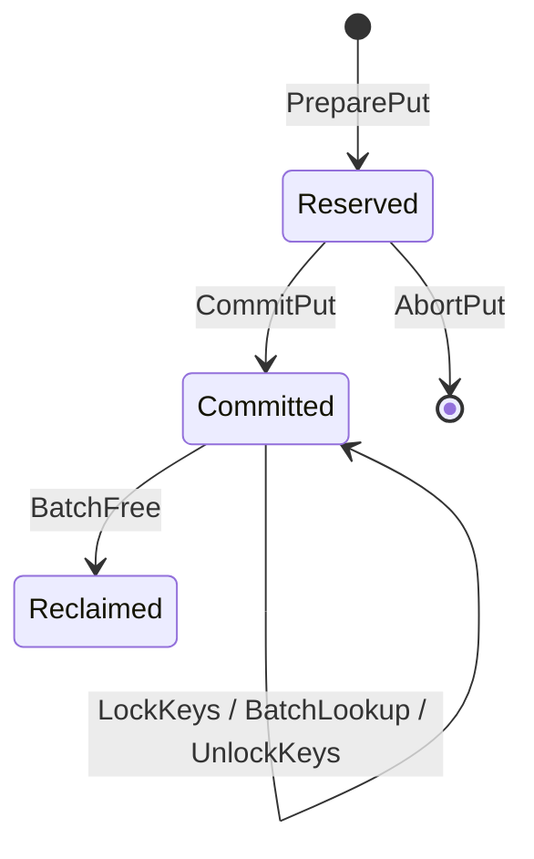
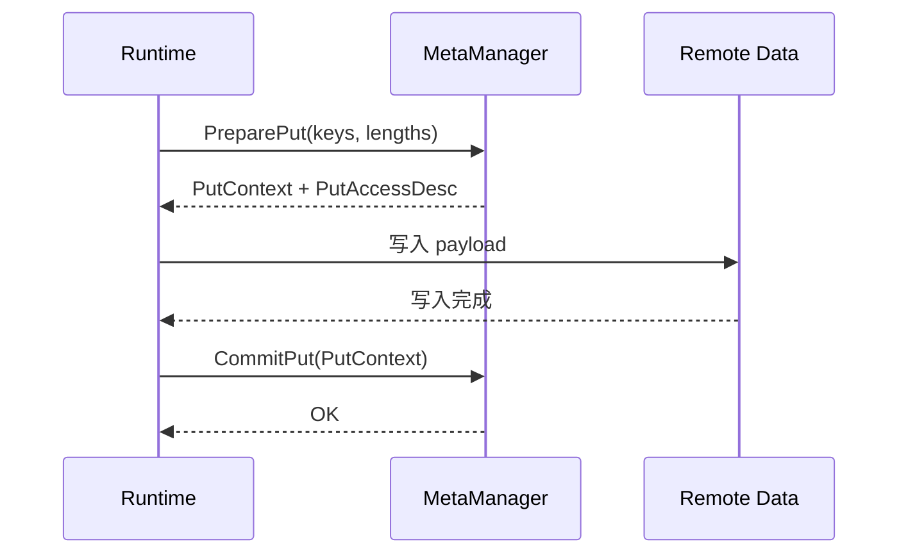
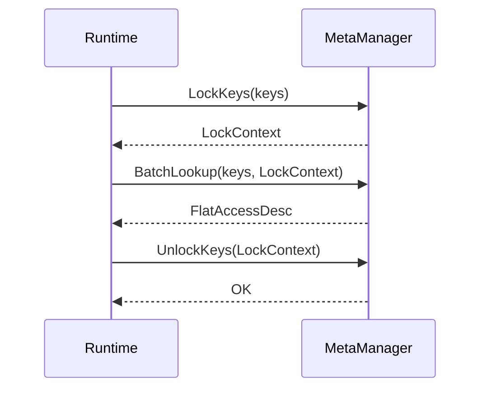

# MetaManager 地址管理设计

## 1. 目标

本文档说明 `MetaManager` 地址管理模块的当前 POC 设计，重点回答三个问题：

- 如何维护 `KeyId -> 远端地址` 映射
- 如何基于 `hashtable + queue` 支持 `put / lock / get / free`
- 如何同时支持短 slot 和长 slot 两类地址分配

## 2. 设计范围

模块负责：

- 注册单个远端 region
- 管理短 slot 与长 slot 的分配和回收
- 维护 key 到地址记录的映射
- 为读路径提供稳定快照

模块不负责：

- payload 数据搬运
- prefix key 转换
- AccessTable 设备侧布局
- 多 region 调度

## 3. POC 假设

当前实现采用以下约束：

1. 只支持单 KVAF 实例、单 region。
2. region 只允许注册一次。
3. region 同时包含两类 slot：
   `short_slot_size` 和 `long_slot_size`。
4. 两类 slot 的数量相同，由 `slot_count_per_class` 指定。
5. `0 < valid_length <= long_slot_size`。
6. 若 `valid_length <= short_slot_size`，优先分配短 slot；
   否则分配长 slot。
7. 一个 key 当前只保留一条 `active_record`。
8. 被锁定的记录不允许 `free`，直接返回 `kBusy`。

## 4. 总体方案

### 4.1 数据组织

- `hashtable`
  维护 `key -> AddressRecord`
- `queue`
  分别维护短 slot 和长 slot 的空闲下标

### 4.2 核心流程

- 写路径：`PreparePut -> 数据写入 -> CommitPut`
- 读路径：`LockKeys -> BatchLookup -> UnlockKeys`
- 回收路径：`BatchFree`

其中：

- `PreparePut` 只分配地址，不对读路径可见
- `CommitPut` 才发布映射
- `LockKeys` 固定一批 key，并增加 `pin_count`
- `BatchFree` 只回收未被锁定的记录

### 4.3 并发粒度

当前实现不是单个全局元数据锁，而是按访问对象拆分锁：

- `key_shards_[0..63]`：每个 shard 保存一部分 `KeyId -> KeyEntry`，使用
  `std::shared_mutex`。读路径获取共享锁，写路径获取独占锁。
- `lock_context_shards_[0..63]`：按 `LockContext.id` 分片保存活动锁上下文，
  每个 context shard 使用一个 `std::mutex`。
- `free_queue_mutex_`：保护 short/long 两个空闲 slot 队列。
- `ActiveLockContext::lifecycle_mutex`：保护单个锁上下文的生命周期，
  允许 `BatchLookup` 与 `UnlockKeys` 安全并发。

接口与锁的关系如下：

| 接口 | 主要锁 | 作用 |
| --- | --- | --- |
| `PreparePut` | 相关 key shard 独占锁、空闲队列锁、`context_mutex_` | 创建 pending 记录并预留 slot |
| `CommitPut` | `context_mutex_`、相关 key shard 独占锁 | 发布 active record |
| `AbortPut` | `context_mutex_`、相关 key shard 独占锁、空闲队列锁 | 回滚 pending 记录并归还 slot |
| `LockKeys` | 相关 key shard 共享锁、目标 context shard 锁 | 查找记录、增加 pin、保存锁上下文 |
| `BatchLookup` | 目标 context shard 锁、context 生命周期共享锁 | 根据锁上下文填充访问结果 |
| `UnlockKeys` | 目标 context shard 锁、context 生命周期独占锁 | 减少 pin 并销毁锁上下文 |
| `BatchFree` | 相关 key shard 独占锁、空闲队列锁 | 清理 active record 并归还 slot |

因此，不同 key shard 之间可以并行执行；真正需要串行化的范围只限于同一
shard、同一个 context shard 或空闲队列。

## 5. 为什么是 `hashtable + queue`

这个组合分别解决两类问题：

- `hashtable`：按 key 快速查地址记录
- `queue`：按 FIFO 复用短 slot 和长 slot

对于当前 POC，这种方案实现直接、状态简单，也便于测试。

## 6. 核心数据结构

```cpp
struct RemoteRegionDesc {
  base;
  length;
  short_slot_size;
  long_slot_size;
  slot_count_per_class;
};

struct AddressRecord {
  slot;
  valid_length;
  pin_count;
};

struct PendingPutContext {
  items;
};

struct ActiveLockContext {
  keys;
};
```

内部关键状态：

- `short_free_slots_`：短 slot 空闲队列
- `long_free_slots_`：长 slot 空闲队列
- `key_shards_`：分片保存当前 key 映射
- `pending_puts_`：未提交 put 上下文
- `lock_context_shards_`：分片保存活动读快照
- `region_`：当前 region 配置

## 7. 地址计算

当前 region 被划分成两段连续地址空间：

1. 前半段存放短 slot
2. 后半段存放长 slot

地址计算规则：

```text
short_address = base + slot_index * short_slot_size

long_base = base + slot_count_per_class * short_slot_size
long_address = long_base + slot_index * long_slot_size
```

因此内部只需要保存 slot 类型和 slot 下标，对外返回时再换算成地址。

## 8. 状态机



状态含义：

- `Reserved`：已分配，未提交，不可见
- `Committed`：已提交，可查询、可锁定
- `Reclaimed`：已回收，不再可见

## 9. 关键流程

### 9.1 Put



语义：

- `PreparePut` 根据长度选择短 slot 或长 slot
- `CommitPut` 前记录对读路径不可见
- 写入失败时通过 `AbortPut` 回滚

### 9.2 Lock/Get



语义：

- `LockKeys` 固定一批 key，并阻止并发回收
- `BatchLookup` 返回这批 key 当前的地址和长度
- `UnlockKeys` 后才允许正常回收

### 9.3 Free

流程：

1. 检查 key 是否存在
2. 检查记录是否仍被锁定
3. 清理 `KeyEntry` 中的 active record
4. 将 slot 归还到对应的短/长空闲队列

若记录仍被使用，则返回 `kBusy`。

## 10. 接口语义

- `RegisterRemoteRegion`
  注册 region，并初始化两类 slot 队列。
- `PreparePut`
  预留地址，返回 `PutContext` 和访问描述。
- `CommitPut`
  提交映射，使记录可见。
- `AbortPut`
  回滚未提交事务。
- `LockKeys`
  建立稳定读快照。
- `BatchLookup`
  按快照返回地址信息。
- `UnlockKeys`
  释放稳定读快照。
- `BatchFree`
  删除映射并回收 slot。

返回结构说明：

- `PutAccessDesc` 和 `FlatAccessDesc` 统一复用 `AccessDesc`
- 两者仍保留原有名字，目的是让调用点一眼看出当前处于 put 结果还是 lookup 结果
- `AccessDesc` 内部只维护一份 `entries`
- 每个 `AccessEntry` 包含 `key / address / length / valid`

## 11. 当前实现特点

当前代码中：

- `MetaManager` 直接在头文件中声明私有状态
- `.cc` 文件只负责方法实现
- 错误消息采用较短的固定标签，如 `invalid_request`、`key_missing`
- 输入校验相比早期版本做了收敛，保留必要的一致性检查

## 12. 当前限制

当前版本仍是 POC，主要限制有：

- 单 region
- 两类固定长度 slot
- 两类 slot 数量必须相同
- 一个 key 只保留一条当前记录
- 不支持覆盖写
- 不支持可变长分配

## 13. 测试与验证

测试已覆盖：

- region 参数校验
- 短 slot 正常分配、提交、查询、回收
- 长 slot 分配与查询
- `AbortPut` 回滚
- 锁定期间 `BatchFree` 返回 `kBusy`
- 重复 key、非法上下文、空闲队列耗尽等边界场景

Ubuntu/WSL 构建与测试已通过：

- `cmake -S . -B build-wsl -DBUILD_TESTING=ON`
- `cmake --build build-wsl -j`
- `ctest --test-dir build-wsl --output-on-failure`
