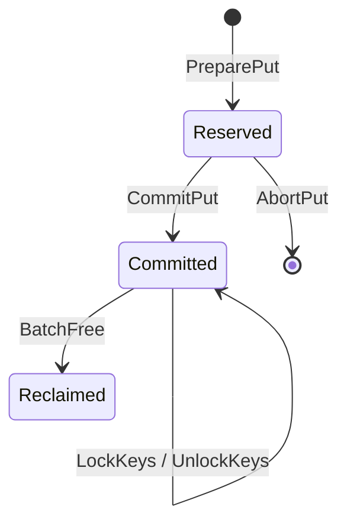
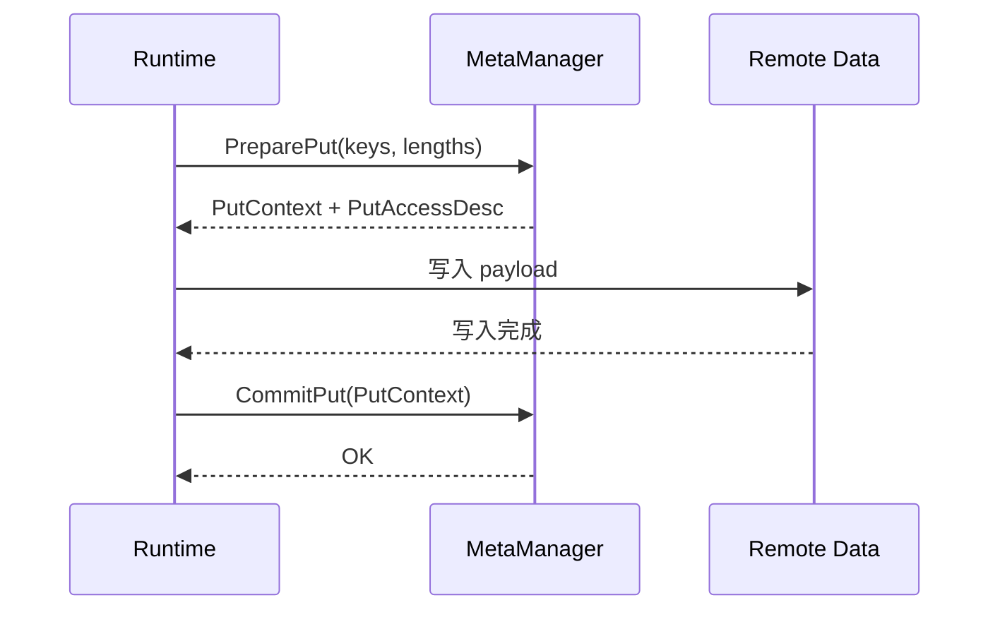
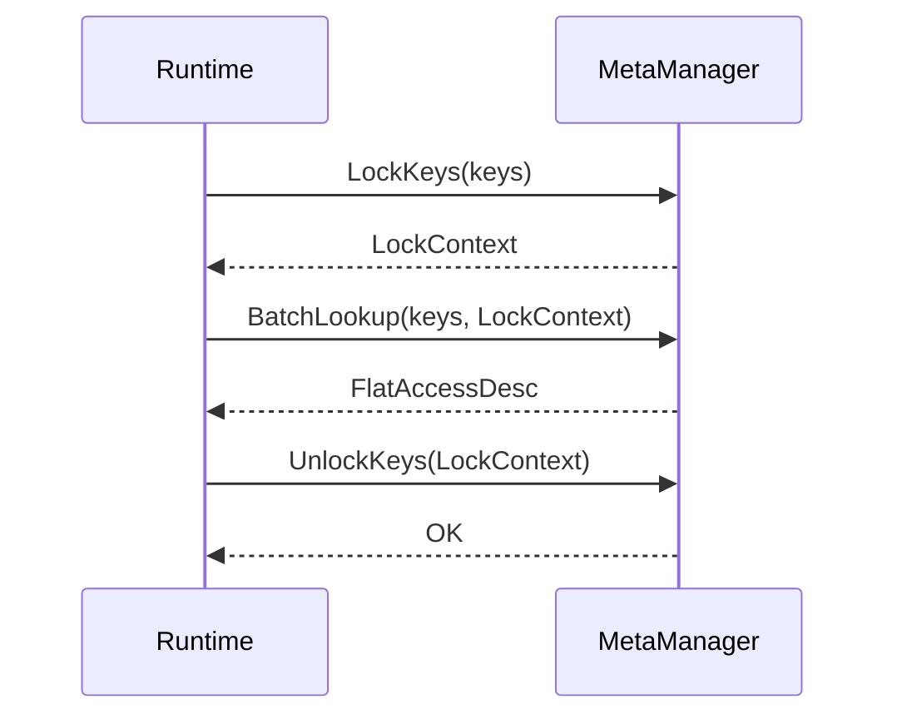

# MetaManager 地址管理设计

## 1. 目标

本文档说明 `MetaManager` 地址管理模块的 POC 设计，重点回答三个问题：

- 如何维护 `KVBlockKey -> 远端地址` 映射
- 如何基于 `hashtable + queue` 支持 `put / lock / get / free`
- 如何保证写路径可见性和读路径稳定性

## 2. 设计范围

模块负责：

- 管理远端 region
- 分配和回收 slot
- 维护 key 到地址记录的映射
- 为读路径提供稳定快照

模块不负责：

- Payload 数据搬运
- Prefix Key 转换
- AccessTable 设备侧布局
- 跨节点协同

## 3. POC 假设

为了先落地一版简单可验证的实现，当前采用以下假设：

1. 只支持单 KVAF 实例、单远端 region。
2. region 在初始化时一次性注册。
3. region 按固定 `slot_size` 切分为多个 slot。
4. `valid_length <= slot_size`。
5. 一个 key 当前只保留一个 `active_record`。
6. 被锁定记录不允许 `free`，直接返回 `kBusy`。
7. `KeyId` 使用字符串表示。

## 4. 总体方案

### 4.1 数据组织

- `hashtable`
  维护 `key -> AddressRecord`
- `queue`
  维护空闲 `slot_id`

### 4.2 核心思路

- 写路径：`PreparePut -> 数据写入 -> CommitPut`
- 读路径：`LockKeys -> BatchLookup -> UnlockKeys`
- 回收路径：`BatchFree`

其中：

- `PreparePut` 只分配地址，不可见
- `CommitPut` 才让新记录可见
- `LockKeys` 为一次读操作固定快照
- `BatchFree` 只回收未被 pin 的记录

## 5. 为什么是 `hashtable + queue`

这个组合分别解决两个问题：

- `hashtable`：按 key 快速查地址
- `queue`：简单管理空闲地址复用

对当前 POC 来说，这种方案实现直接、测试简单，也方便后续演进到底层更复杂的分配器。

## 6. 核心数据结构

```cpp
struct AddressRecord {
  record_id;
  uba;
  valid_length;
  slot_id;
  pin_count;
};

struct KeyEntry {
  active_record;
};

struct PendingPutContext {
  items;
};

struct ActiveLockContext {
  items;
};
```

内部核心容器：

- `free_slots_`：空闲 slot 队列
- `key_index_`：当前 committed key 映射
- `pending_puts_`：未提交 put
- `pending_keys_`：pending key 去重
- `lock_contexts_`：活动读快照
- `region_`：单 region 配置，slot 地址通过 `base + slot_id * slot_size` 计算

## 7. 状态机



状态含义：

- `Reserved`：已分配，未提交，不可见
- `Committed`：已提交，可查询、可锁定
- `Reclaimed`：已回收，不再可见

## 8. 关键流程

### 8.1 Put



语义：

- `PreparePut` 后地址已预留
- `CommitPut` 前读路径不可见
- 写入失败时通过 `AbortPut` 回滚

### 8.2 Lock/Get



语义：

- `LockKeys` 固定一次读快照
- `BatchLookup` 只读这次快照中的记录
- `UnlockKeys` 后才允许后续正常回收

### 8.3 Free

流程：

1. 检查 key 是否存在。
2. 检查记录是否仍被 pin。
3. 删除 `key_index_` 映射。
4. 回收 slot 到 `free_slots_`。

如果记录仍在被使用，返回 `kBusy`。

## 9. 接口语义

- `RegisterRemoteRegion`
  注册 region，初始化 slot 和空闲队列。
- `PreparePut`
  预留地址，返回 put 上下文和访问描述。
- `CommitPut`
  提交映射，使记录可见。
- `AbortPut`
  回滚未提交事务。
- `LockKeys`
  建立稳定读快照。
- `BatchLookup`
  按快照返回地址信息。
- `UnlockKeys`
  释放读快照。
- `BatchFree`
  删除映射并回收 slot。

## 10. 关键设计点

### 10.1 为什么 `CommitPut` 和 `LockKeys` 分开

因为两者职责不同：

- `CommitPut` 处理“写何时可见”
- `LockKeys` 处理“读期间固定哪条记录”

分开后可以：

- 避免每次写完都无意义加锁
- 让不同读请求拥有独立快照

### 10.2 为什么 `BatchLookup` 不直接查最新地址

因为读路径需要稳定性。  
如果每次都直接查 `key_index_`，那么读过程中可能看到变化后的记录，无法保证一次读取的一致视图。

## 11. 当前限制

当前版本仍是 POC，主要限制有：

- 单 region
- 固定 slot
- 单 key 单 active record
- 不支持覆盖写
- 不支持历史记录保留

## 12. 后续演进

建议下一步按以下顺序推进：

1. 接入 Runtime 主流程
2. 支持覆盖写
3. 扩展多 region
4. 评估可变长分配器
5. 补充更贴近真实场景的并发与恢复测试
