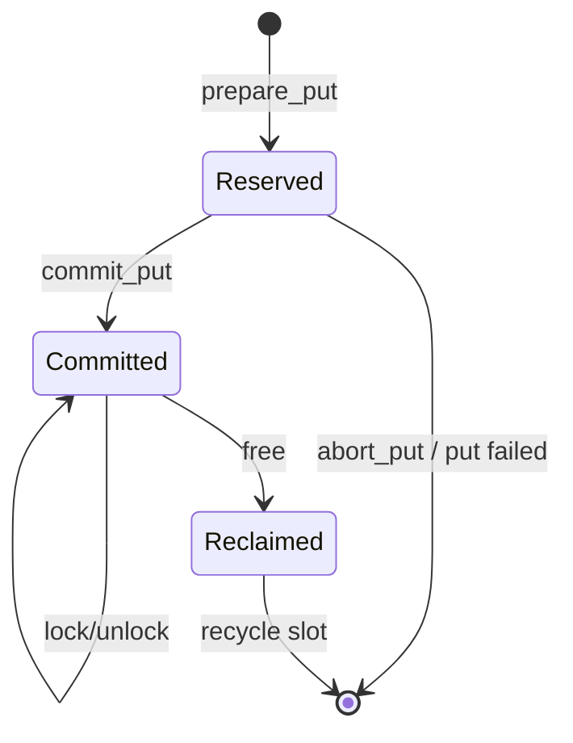

# Meta Manager 地址管理模块设计（Hashtable + Queue）

## 1. 文档目标

本文基于 `kvaf_architecture_design.md` 和 `kvaf_workflow_and_module_analysis.md`，聚焦 `Meta Manager` 中“内存地址管理”这一子模块，给出一份适合 POC 落地的实现设计。

本文只回答四类核心问题：

- 如何维护 `KVBlockKey -> 远端地址` 的映射；
- 如何基于 `hashtable + queue` 支撑 `get / put / lock / free`；
- 如何保证 `PreparePut -> 数据搬运 -> CommitPut` 的可见性顺序；
- 如何保证 `LockKeys -> BatchLookup -> UnlockKeys` 的稳定读语义。

## 2. 模块定位与边界

### 2.1 模块定位

该模块属于 `Meta Manager` 内部控制面，负责：

- 维护 `KVBlockKey -> AddressRecord` 映射；
- 管理远端 DDR 地址的预留、提交、查询和回收；
- 为读路径提供稳定地址视图；
- 为写路径提供可回滚的地址预留上下文。

### 2.2 不负责的内容

该模块不负责：

- KV Payload 的实际数据搬运；
- Prefix Key 到 `KVBlockKey` 的业务转换；
- AccessTable 的设备侧布局组织；
- 跨卡、跨节点 Meta 协同；
- 复杂迁移、复制、多副本一致性策略。

## 3. 设计前提与 POC 假设

为了让 `hashtable + queue` 方案简单可落地，本文采用以下 POC 假设：

1. 当前只支持单卡、单 KVAF 实例、单远端 DDR Region。
2. 远端 DDR 在初始化时一次性注册，生命周期与 KVAF 实例一致。
3. 地址池按固定粒度切分为 `slot`，每个 `slot` 对应一段可复用远端地址。
4. 单个 KV Block 的有效长度 `valid_length` 可以变化，但必须满足 `valid_length <= slot_capacity`。
5. POC 阶段默认一个 Key 对应一个当前有效地址；数据结构保留“一 Key 多记录”的扩展位，但首版实现只启用一个 active record。
6. `free` 不处理仍被锁定的 Key；遇到这类情况直接返回 `Busy`，不做强制回收。

说明：

- 之所以采用固定 `slot`，是因为它最适合用 `queue` 管理空闲地址。
- 如果后续确实需要支持“大块可变长分配”，可以把 `free_queue` 升级为“空闲区间表 / 分级空闲队列”，但 `key_index`、`PutContext`、`LockContext` 的整体接口可以保持不变。

## 4. 核心设计结论

### 4.1 总体思路

- 用 `Hashtable` 维护 `Key -> MetaEntry`，保证查询路径接近 `O(1)`。
- 用 `Queue` 维护空闲 `slot`，保证地址分配和回收简单直接。
- `put` 在内部拆成两阶段：
  - `prepare_put`：只分配地址，不让新地址可见；
  - `commit_put`：仅在数据搬运成功后提交映射。
- `lock` 生成“稳定快照”，`get` 只能读取该快照内选中的地址记录。
- `free` 只回收未被锁定的已提交地址。

### 4.2 为什么是 Hashtable + Queue

`Hashtable` 解决的是“按 Key 快速查地址”的问题，`Queue` 解决的是“空闲地址如何复用”的问题。二者分别对应：

- 控制面索引；
- 地址资源池。

这和 KVAF 当前架构里“Key -> 地址”和“地址 -> 数据”解耦的主线是一致的。

## 5. 核心数据结构

## 5.1 容器总览

```text
MetaAddressManager
├── remote_region
│   ├── base_uba
│   ├── region_size
│   ├── slot_capacity
│   └── slot_count
├── free_slot_queue
│   └── queue<SlotId>
├── slot_table
│   └── vector<SlotMeta>
├── key_index
│   └── unordered_map<KVBlockKey, KeyEntry>
├── pending_puts
│   └── unordered_map<PutContextId, PutContext>
└── lock_contexts
    └── unordered_map<LockContextId, LockContext>
```

## 5.2 关键结构定义

```cpp
struct SlotMeta {
  uint32_t slot_id;
  uint64_t uba;
  uint32_t capacity;
  bool in_free_queue;
};

enum class RecordState {
  kReserved,
  kCommitted,
  kReclaimed,
};

struct AddressRecord {
  uint64_t record_id;
  uint64_t uba;
  uint32_t valid_length;
  uint32_t slot_id;
  uint64_t version;
  RecordState state;
  uint32_t pin_count;
};

struct KeyEntry {
  KVBlockKey key;
  AddressRecord active_record;
  uint64_t latest_version;
  bool exists;
};

struct PutItem {
  KVBlockKey key;
  uint32_t slot_id;
  uint64_t uba;
  uint32_t valid_length;
};

struct PutContext {
  uint64_t ctx_id;
  std::vector<PutItem> items;
  bool committed;
};

struct LockedItem {
  KVBlockKey key;
  uint64_t record_id;
  uint64_t version;
};

struct LockContext {
  uint64_t ctx_id;
  std::vector<LockedItem> items;
  bool released;
};
```

## 5.3 数据结构职责划分

### `free_slot_queue`

- 保存所有当前可分配的 `slot_id`；
- `put` 时从队头取；
- `free` 或 `abort_put` 时从队尾归还；
- FIFO 复用可以避免某几个热地址反复被立即重用。

### `slot_table`

- 通过 `slot_id` 反查 `uba` 和容量；
- 用于调试和一致性校验；
- 例如检测 double free、脏回收、越界长度。

### `key_index`

- 地址查询主索引；
- 读路径只查这里；
- `pending_puts` 中的预留地址在 `commit` 前不进入可见查询结果。

### `pending_puts`

- 保存“已分配但未提交”的地址；
- 解决 `PreparePut` 成功不等于数据已可读的问题；
- 如果搬运失败，这里的地址直接退回 `free_slot_queue`。

### `lock_contexts`

- 保存一次稳定读所选中的记录快照；
- `get` 不再重新做“最新地址选择”，而是消费 `lock` 时固定下来的记录。

## 6. 记录状态机



状态语义：

- `Reserved`：地址已预留，但外部不可见，`get` 不能返回。
- `Committed`：地址已写入完成，可参与查询和加锁。
- `Reclaimed`：映射已删除，地址准备回收到空闲队列。

## 7. 核心操作设计

## 7.1 `put`

### 对外语义

从 KVAF 总体接口看，`put` 对应：

1. `PreparePut`
2. `Operator.ExecuteBatchPut`
3. `CommitPut`

因此地址管理模块内部不能把“拿到地址”和“地址可读”混为一谈。

### 7.1.1 `prepare_put(keys, lengths) -> PutContext`

输入：

- 扁平化 `keys`
- 对应的 `valid_length`

处理流程：

1. 校验 `keys.size == lengths.size`。
2. 校验每个 `valid_length <= slot_capacity`。
3. 检查 `free_slot_queue` 是否有足够空闲 `slot`。
4. 逐个 `pop` 空闲 `slot_id`，生成 `PutItem`。
5. 创建 `PutContext`，写入 `pending_puts`。
6. 返回 `PutContext` 给 Runtime。

此时保证：

- 地址已经被本次写入独占；
- 但 `key_index` 还看不到这些地址；
- 后续 `get` 不会误读未完成搬运的数据。

### 7.1.2 `commit_put(ctx_id)`

处理流程：

1. 从 `pending_puts` 找到 `PutContext`。
2. 校验该上下文尚未提交。
3. 校验本批 Key 没有违反 POC 约束：
   - 首版实现建议直接禁止重复 Key 覆盖；
   - 如果允许覆盖，必须先定义旧记录何时失效。
4. 将每个 `PutItem` 转为 `AddressRecord(state = kCommitted)`。
5. 写入 `key_index`，更新 `active_record` 和 `latest_version`。
6. 从 `pending_puts` 删除该上下文。

失败处理：

- 若数据搬运失败，Runtime 不应调用 `commit_put`；
- 地址管理模块需要提供内部 `abort_put(ctx_id)`，把 `slot_id` 全部退回 `free_slot_queue`。

### 7.1.3 `abort_put(ctx_id)`

触发条件：

- `ExecuteBatchPut` 失败；
- 上层超时取消；
- `PutContext` 失效。

处理流程：

1. 从 `pending_puts` 取出 `PutContext`。
2. 将其中所有 `slot_id` 放回 `free_slot_queue`。
3. 删除该 `PutContext`。

## 7.2 `lock`

### 设计目标

`lock` 的本质不是“给 Key 加一把粗锁”，而是为本次读操作固定一份稳定地址视图，保证：

- 已选中的 `Committed` 地址在使用期间不能被回收；
- 允许后续为同一个 Key 追加新地址；
- 但已经生成的访问视图不会自动切换到新地址。

### `lock(keys) -> LockContext`

处理流程：

1. 遍历 `keys`，在 `key_index` 中找到 `KeyEntry`。
2. 选择当前 `active_record` 作为本次访问记录。
3. 对该 `AddressRecord.pin_count += 1`。
4. 将 `{key, record_id, version}` 记录进 `LockContext`。
5. 将 `LockContext` 写入 `lock_contexts`。

返回后保证：

- 本次读路径看到的是一份稳定快照；
- 后续 `free` 不能回收这些记录；
- `commit_put` 即使为同一 Key 追加新记录，也不能影响当前快照。

## 7.3 `get`

### 语义说明

从 KVAF 设计看，`get` 更接近 `BatchLookup`，它读取的是已经锁定好的稳定快照，而不是“每次查询时重新挑一个最新地址”。

### `get(keys, lock_ctx) -> FlatAccessDesc`

处理流程：

1. 校验 `lock_ctx` 合法且未释放。
2. 按 `keys` 顺序读取 `lock_ctx.items` 中对应的 `record_id`。
3. 从 `key_index` 读取该记录的 `uba`、`valid_length` 和 `valid`。
4. 生成扁平访问描述返回给 Runtime。

返回内容建议为：

```text
FlatAccessDesc
├── uba[N]
├── length[N]
└── valid[N]
```

约束：

- `get` 只返回 `Committed` 且已被当前 `lock_ctx` 固定的记录；
- `Reserved` 记录不可见；
- `Reclaimed` 记录不可见。

## 7.4 `unlock`

虽然你当前聚焦的是 `get / put / lock / free`，但实现里必须把 `unlock` 作为 `lock` 生命周期的一部分一起设计，否则 `free` 无法正确工作。

### `unlock(lock_ctx)`

处理流程：

1. 校验 `lock_ctx` 合法且未释放。
2. 遍历 `lock_ctx.items`。
3. 对对应 `AddressRecord.pin_count -= 1`。
4. 将 `lock_ctx.released = true`，并从 `lock_contexts` 删除。

结果：

- 记录重新变成可回收状态；
- 不再允许该 `lock_ctx` 被重复使用。

## 7.5 `free`

### `free(keys)`

处理流程：

1. 遍历 `keys`，找到 `KeyEntry`。
2. 检查 `active_record.pin_count`：
   - 若 `pin_count > 0`，返回 `Busy`；
   - 若 `pin_count == 0`，继续回收。
3. 从 `key_index` 删除该 Key。
4. 将记录状态改为 `kReclaimed`。
5. 把对应 `slot_id` 归还到 `free_slot_queue`。

保证：

- 已被锁定的地址不会被提前复用；
- 回收后的地址可以被后续 `prepare_put` 重新分配。

## 8. 并发与锁设计

## 8.1 首版建议

POC 首版建议优先保证正确性，使用以下简单并发模型：

- 一个 `meta_mutex` 保护 `key_index`、`pending_puts`、`lock_contexts`；
- 一个 `free_queue_mutex` 保护 `free_slot_queue`；
- 所有需要同时访问两者的路径统一按固定顺序加锁：
  - 先 `meta_mutex`
  - 后 `free_queue_mutex`

这样做的优点是：

- 容易证明不会出现“地址已回收但 Key 仍可见”的一致性问题；
- 便于首版 bring-up 和联调；
- 后续可以按热点再拆成分片锁。

## 8.2 后续可优化方向

如果 Host 侧查询压力明显增大，可以逐步演进为：

- `key_index` 分片锁；
- `free_slot_queue` 改为 ring queue；
- `lock_contexts` / `pending_puts` 使用独立上下文池；
- `KeyEntry` 细化为 per-entry 自旋锁或轻量 mutex。

## 9. 关键不变量

实现时建议始终维护下面几条不变量：

1. 出现在 `free_slot_queue` 的 `slot_id` 绝不能同时被 `key_index` 或 `pending_puts` 引用。
2. `key_index` 中对外可见的记录必须都是 `Committed`。
3. 任意 `pin_count > 0` 的记录都不能进入回收流程。
4. 同一个 `PutContext` 最多只能提交一次或回滚一次。
5. 同一个 `LockContext` 最多只能释放一次。
6. `free` 只能删除当前未锁定的有效记录。

## 10. 复杂度预估

在固定 `slot` 模型下：

- `prepare_put`：单 Key 近似 `O(1)`；
- `commit_put`：单 Key 近似 `O(1)`；
- `lock`：单 Key 近似 `O(1)`；
- `get`：单 Key 近似 `O(1)`；
- `free`：单 Key 近似 `O(1)`。

批量场景下整体复杂度为 `O(N)`，其中 `N` 为本批 Key 数量。

## 11. 异常处理建议

建议统一覆盖以下错误类别：

- `InvalidArgument`：长度越界、参数数量不一致；
- `OutOfMemory`：空闲地址不足；
- `NotFound`：Key 不存在、上下文不存在；
- `AlreadyExists`：禁止覆盖时遇到重复 Key；
- `Busy`：Key 仍被锁定，不能 `free`；
- `InvalidState`：重复提交、重复释放、上下文已失效。

## 12. 与 KVAF 总体流程的对应关系

### 写路径

```text
Runtime.BatchPut
    -> MetaManager.prepare_put
    -> Operator.ExecuteBatchPut
    -> MetaManager.commit_put
```

### 读路径

```text
Runtime.PrepareAccessTable
    -> MetaManager.lock
    -> MetaManager.get
    -> Runtime 组织 AccessTable
    -> Operator.BatchGet
    -> MetaManager.unlock
```

### 回收路径

```text
Runtime.BatchFree
    -> MetaManager.free
```

## 13. POC 结论

对于当前 `Meta Manager` 地址管理模块，我建议把首版实现收敛为下面这句话：

> 用 `hashtable` 管理 `KVBlockKey -> committed address record`，用 `queue` 管理固定粒度空闲地址槽，并通过 `PutContext` 和 `LockContext` 分别保证写入可见性与读路径稳定性。

这样设计的好处是：

- 和现有架构文档完全对齐；
- 能自然覆盖 `get / put / lock / free`；
- 实现复杂度可控；
- 后续从单地址 POC 演进到多地址 / 迁移 / pooling 时，外层接口基本不用推倒重来。

## 14. 建议的实现顺序

1. 先做 `remote_region + free_slot_queue + key_index`。
2. 再做 `prepare_put / commit_put / abort_put`。
3. 然后做 `lock / get / unlock`。
4. 最后做 `free`、错误处理和一致性校验。

如果后面你要继续把这份文档转成头文件接口，我建议优先把 `PutContext`、`LockContext` 和错误码先定下来，因为这三者最容易影响后续 Runtime 对接方式。
