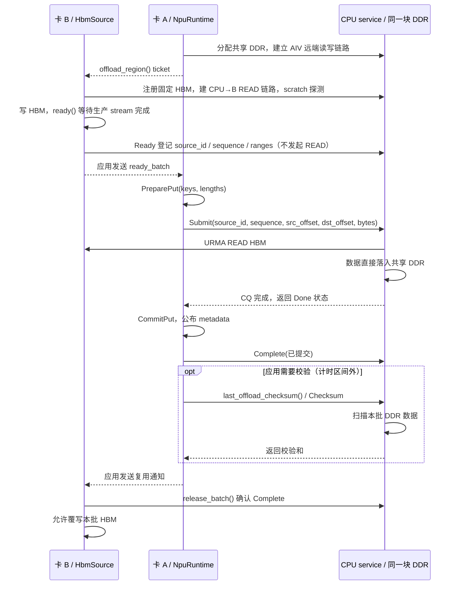

# 共享 DDR：卡 A 提交、CPU 拉取卡 B 的 HBM

实现分支：`codex/cpu-pull-hbm-reference`。A 的 `NpuRuntime` 同时支持 AIV BatchPut、
BatchGet、本卡 `offload()` 和跨卡 `offload_from()`。这四个入口共用一个 RuntimeCore、
MetaManager、PeerDdrAllocator 和 DDR Region。B 的 `HbmSource` 只管理 HBM 注册与冻结批次，
不创建 RuntimeCore、MetaManager 或第二块 DDR。

旧 `OffloadRuntime` / KVOF v2 继续兼容原来的独立用法，仍有独立池；需要整合时请改用
`NpuRuntime(enable_cpu_offload=True)`，不要再额外创建一个 `OffloadRuntime`。

## 角色、地址与时序



A 不解引用 B 的 HBM 地址，不持有 B 的 Tensor。B→A 通知只包含普通整数和列表，适合通过
现有 RPC、队列或其他业务通道传递。库不替应用选择通知通道；硬件测试使用进程间 Pipe。

提交地址由库计算：

- 源：CPU 保存的 **B 注册 HBM 基址 + B 给出的 input_offset**。
- 目的：**PreparePut 得到的 DDR 地址 − 共享 Region 导出基址**，作为 dst_offset 提交。
- CPU 最后使用本地 DDR allocation 基址加 dst_offset，搭配该 allocation 的本地 MR 构造 SGE。

目的地址不由 B 指定，也不使用 A 的 HBM 地址。CPU 校验共享池身份、源代次/批次、源范围、
目标范围、槽位边界和目标区间不重叠。已取消的批次、旧 service epoch、冲突的重复通知不能启动 READ。

## Python 使用

A 初始化一次，保留既有 AIV 配置，只增加 `enable_cpu_offload=True`。若只验收 Pull，
可以省略 AIV kernel 参数：

```python
# 卡 A 进程
runtime = kvaf.NpuRuntime(device_id=device_a, enable_cpu_offload=True)
runtime.link_to(cpu_address)
runtime.initialize(ddr_bytes=8 * 131072, slot_size=131072)
ticket = runtime.offload_region()    # 普通 dict；通过应用通道交给 B
```

```python
# 卡 B 进程：先 torch.npu.set_device(device_b)
source = kvaf.HbmSource(device_id=device_b)  # npu_eid 可显式指定；默认自动候选
source.register(ticket, hbm_tensor, stream=producer_stream)

# 每批：在 producer_stream 上完成所有写入后调用；ready 内部等待其 event。
ready_batch = source.ready([7, 100003], [656, 100001], stream=producer_stream)
# 将 ready_batch 交给 A；此时不可覆写、释放或重新绑定 hbm_tensor。
```

```python
# 卡 A 收到通知：keys 和 lengths 一一对应，keys 仍遵循现有 DSA slot 规则。
runtime.offload_from([1, 3], ready_batch)
# 返回成功表示 CPU READ 完成、Meta 已提交、CPU 已确认该批可复用。
# 可选诊断：另发 RPC 扫描当前 DDR；性能计时应在此调用之前结束。
checksum = runtime.last_offload_checksum()
# 通过应用通道通知 B。重复传入完全相同的 keys / ready_batch 不会再次 READ。
```

```python
# 卡 B 收到 A 的复用通知：再确认 CPU 中记录的提交结果。
source.release_batch()
assert not source.frozen
# 现在可以写下一批，继续使用同一块 HBM 和同一套注册。

# 最终顺序：B release_batch → B shutdown → A shutdown。
source.shutdown()
```

`register()` 持有整个 Tensor 的强引用，直到 `shutdown()` 成功。`ready()` 会保守地冻结整个
注册缓冲；第一版不支持同一 HbmSource 内双缓冲并行。`cancel_batch()` 只允许取消未提交的批次。
选择 B 对应的当前 NPU 再调用注册、Ready 和 Shutdown；CPU-only 的查询/确认不需要切换设备。

本卡卸载也可直接复用 A 的同一池：

```python
runtime.offload(keys, local_npu_tensor, input_offsets, lengths, stream=producer_stream)
runtime.release_offload_source()  # 可选：不用该缓冲时释放缓存的本卡 HBM 注册
```

本卡入口默认缓存同一个 Tensor 的注册；成功返回后可再次写入它。Python 会保留强引用，
直到切换源 Tensor、显式 release 或 shutdown。需要固定本卡 EID 时也可显式创建本卡 HbmSource，
再调用同一个 runtime.offload_from()。

## 池与建链约束

CPU 保存原有供 AIV 远端访问的 DDR MR（access=14、non_pin=1），在同一 allocation 上额外
注册 CPU READ 使用的本地目标 MR（LOCAL_WRITE、non_pin=0）。两者拥有独立 token_id 和注册句柄，
共享 region token 与实际内存；不复制 payload、不经过第二块暂存池。B 的 READ 链路持有原 Region
的 lease，先释放所有 B 的链路和本地 MR，才能释放 A 的 DDR。

B 初始化探测读取至独立 4 KiB scratch 的前 64 字节，并与 HBM 的内容比较；不会覆盖共享池 slot 0。
正式批次直接 READ 到 PreparePut 选定的槽位。HBM、Jetty 原始导出描述符保持 provider 返回值，
路由 EID 单独用于建链，继续使用 aicpu-urma 参考参数和 32 字节 SGE。

A 有 AIV 配置时沿用现有的候选选择与 AIV 实际 RMA 探测；`cpu_candidate` 可固定共享池。
只启用 CPU Pull 时，A 初始化选择能成功分配 DDR 的候选，真实 B→CPU 连通性在 B 注册时验证。
B 对**已经选定的 CPU 池**自动遍历其当前设备的 NPU EID，并校验 scratch READ；它不能静默切换
CPU candidate 或重分配 A 的池。若 B 所有 EID 都失败，需要应用清理后重新选择三方都能访问的
CPU candidate。这一点与旧独立 OffloadRuntime 遍历 CPU×NPU 候选组合不同。

KVRP v2 承载共享池控制消息：Query/Done 只返回传输状态，Checksum 才扫描 DDR。
v1 客户端依赖 Query 中的校验和，因此不混用；CPU 服务及 A、B 的 Python 扩展都需重新编译。
KVCP v6 和旧 KVOF v2 保持原格式。
A/B/CPU 都是同步单调用方控制接口；同一共享池一次只接受一个尚未完成/确认的 Pull，
同一批内部使用四个 Jetty 并行 READ。每次最多 4096 spans；单个 READ 按
provider 消息/READ 上限（最多 64 KiB）切分。每个 WQE 只有一个远端源 SGE 和一个本地目标 SGE。
服务保留已关闭 source 的幂等记录，最多接受 4096 次
source 注册（包含失败候选）；推荐长驻注册并复用，达到上限后应清理并重启 service。

## CPU Pull 性能验证

CPU 数据面参考 `aicpu-urma@8bc5a2a` 的批量 WRITE 提交方式：每次最多链接 32 个 WQE，
先向所有活跃 Jetty 提交，再轮询它们的 CQ。每个 Jetty 每轮最多 1024 个 READ（同时受返回的
SQ depth 限制），只让本轮尾部 WQE 请求 CQE；comp_order 和尾部 READ fence 保证前面的
READ 完成后才能正常确认该尾部。所有活跃 Jetty 尾部均成功才允许 CommitPut 和 B 复用源。
错误 CQE（包括非尾部 WQE 的错误）、部分提交失败、异常 CQE、超时均隔离整个传输，保留
所有队列、MR、SGE/WR 存储和 DDR lease，不重发 READ。

例如 4096 个不超过单条 READ 上限的离散区间：仍需 4096 个 READ WQE，通常为 128 次
post 调用、4 个成功尾部 CQE。更大 span 会拆成更多 WQE，超过本轮容量后分轮执行。
这里不使用 WRITE 的本地多 SGE gather：远端离散地址无法由一个源 SGE 描述。

CPU 服务使用 Release 构建，数据传输固定使用四 Jetty 批量模式。PROFILE 环境变量在 Open
时读取，对共享池及旧 OffloadRuntime 都生效。串行对照模式已移除；启动连通性探测仍保留
queue 0 上的单条 READ，以确认失败候选能安全释放后再回退。

```bash
cmake -S . -B build-cpu-shared-ddr -DCMAKE_BUILD_TYPE=Release
cmake --build build-cpu-shared-ddr -j

# 四个 Jetty，多 WQE 在途、每个 Jetty 每轮一个尾部 CQE。
KVAF_CPU_PULL_PROFILE=1 \
  ./build-cpu-shared-ddr/runtime/kvaf_cpu_service --listen 0.0.0.0 --port 28999
```

上面的 CMake 命令用于已有构建目录，保留其 URMA 等配置。NPU 侧使用当前 Python 扩展：

```bash
python tests/python/bench_remote_cpu_offload.py \
  --cpu 127.0.0.1:28999 --device-a 6 --device-b 7 --cpu-candidate 0 \
  --blocks 4096 --block-bytes 656 --warmup 10 --iterations 100
```

也可用 `--block-bytes 4096`、`65536`、`100001` 比较大小块和拆分后的表现。
B 默认自动选择经过 scratch READ 校验的 EID，也可以用 `--npu-eid-b` 固定已验证的 CPU↔B EID；
此测试不使用 A↔B fullmesh 或 AIV 算子。HBM 长驻注册，每轮改变内容并校验完整有效载荷的
checksum；B 收到提交确认后才写下一轮。

`CPU_PULL_PROFILE` 显示 build/post/cq_wait/total_us、READ WQE 数、post 次数、尾部 CQE 数、
waves、活跃 Jetty 数和 plan_reused。该 total_us 包含描述符准备、提交和等待，**不包含**
服务端 checksum、控制 RPC、线程创建或 Meta 提交。`CPU_PULL_BENCH_PASS` 的 Python 时间
计量 `offload_from()` 至提交完成，包含控制 RPC、线程创建和 Meta 提交；排除数据校验、注册、
生产者写入/Ready 和 Free，输出 `cpu_checksum_included=0`。每轮计时结束后显式调用
`last_offload_checksum()`，服务端此时才计算完整 payload 的校验和；与预期值一致后才 Free
并通知 B 复用。`verification_mean_us` 单独统计校验 RPC 和比较的耗时，不计入带宽分母。

`last_offload_checksum()` 读取当前 DDR，不返回历史缓存。调用方必须保留本批目标槽位且
禁止覆写，直到校验返回；应在 B 的下一次 Ready 或 source detach 之前调用。校验 RPC 丢失
可以重试，但不会重发 READ，也不会撤销已经完成的 Meta 提交。运行中/未决/已取消/已关闭
批次拒绝校验；同一池另有运行中或未决的 CPU Pull 时也拒绝。启动 scratch 探测的校验保留。

两种计时指标应分别比较；不要将 Python effective_GBps 当作纯 READ 带宽。每轮校验仍会
占用实际运行时间，只是与传输计时分开。诊断后将 PROFILE 关闭再测整体性能，可排除日志影响。

### 2026-10-31 记录：1024 个 82 KiB 块

用户硬件实测通过。删除串行对照、拆分校验计时后的版本为
`codex/cpu-pull-hbm-reference` / `7fc988571e5ddf99f7ba4b9fecd38673b6fab900`。
下列日期为记录日期；测试输出未打印运行端 Git SHA 或构建参数。
原始依据保存在 [客户端命令与输出](benchmarks/2026-10-31-cpu-pull-82mib/client.log)
和 [CPU 服务端日志节选](benchmarks/2026-10-31-cpu-pull-82mib/cpu-profile.log)。

```bash
python tests/python/bench_remote_cpu_offload.py \
  --cpu 127.0.0.1:28999 --device-a 6 --device-b 7 \
  --blocks 1024 --block-bytes 83968 --warmup 10 --iterations 100
```

- A 为 device 6，B 为 device 7；CPU 自动选择 candidate 0，EID 为
  `00000000003f020000100000df080b00`。
- B 的 CLOS EID `00000000003f030000100000df00eb00` 探测失败后，回退至
  `000000000000020000100000df00e100`，scratch READ 校验通过。该过程不计入批次传输时间。
- 每轮 1024 个离散源块，每块 83,968 字节（82 KiB），有效载荷合计
  85,983,232 字节（82 MiB）。包含源块间间隔的 HBM 缓冲为 86,051,840 字节。
- 预热 10 轮、计时 100 轮；每轮改变输入，完整校验本批有效数据后才释放 DDR 槽位并通知 B 复用。
  本测试不调用 AIV BatchGet、BatchPut 或 A 直接读 B HBM 的路径。

| 指标 | 结果 | 统计范围 |
|---|---:|---|
| `offload_from()` 至提交完成平均耗时 | 2,607.1 µs | 100 轮，不含校验 |
| P50 / P95 / P99 | 2,580.7 / 2,627.6 / 3,662.3 µs | 100 轮 |
| Python `effective_GBps` | 32.981 GB/s | 有效载荷除以平均调用耗时 |
| `verification_mean_us` | 150,477.4 µs | 100 轮，校验 RPC 与结果比较单独计时 |
| CPU 数据面 `total_us` 平均值 | 1,782.8 µs | 日志节选中的 19 轮，sequence 92–110 |
| CPU 数据面中位数 / 最小值 / 最大值 | 1,726.5 / 1,721.9 / 2,793.7 µs | 同上，包含抖动样本 |
| CPU 数据面有效带宽 | 48.23 GB/s | 85,983,232 / 1,782.8158 / 1000 |
| `build_us` / `post_us` / `cq_wait_us` 平均值 | 4.9 / 77.1 / 1,697.4 µs | 同上 19 轮 |

GB/s 使用十进制单位。CPU 数据面时间包含描述符准备、提交和 CQ 等待；Python 时间另外包含
控制 RPC、工作线程创建和 Meta 提交。CPU 节选不是全部 100 轮，不能将两组均值之差作为精确的
控制流程耗时分解。

19 条 CPU PROFILE 的计数均一致：`status=0`、`read_wrs=2048`、`post_calls=64`、
`tail_cqes=4`、`waves=1`、`active_jettys=4`、`plan_reused=1`、`cpu_threads=1`。
每块拆成 64 KiB 和 18 KiB 两条 READ，每个 Jetty 512 个 WQE；每次 post 最多链接 32 个，
每个 Jetty 仅等待本轮尾部的成功 CQE。

`sequence=101` 的 `total_us=2793.7`、`cq_wait_us=2708.2`，该轮增加的耗时主要出现在 CQ 等待。
其余 18 条 `total_us` 平均 1,726.7 µs；上表均值保留了该抖动样本，日志不足以确定抖动原因。

结论：四 Jetty 批量传输和逐轮完整校验均通过，`cpu_checksum_included=0` 确认校验已分离。
传输调用与校验均值相加为 153.0845 ms，尚不含生产数据、Ready、Free 等阶段；32.981 GB/s
不代表包含逐轮校验的持续吞吐。当前完成查询在未完成时休眠 1 ms，可作为后续控制流程优化点，
但尚未通过独立计时验证其具体占比。

## 未决操作与失败处理

`pending_offload=True` 时保留 A Runtime 和 B 的 HBM，调用 A `resolve_offload()` 查询已有任务。
这个接口不会重发 READ。发生提交回包丢失、CQ 超时或 Complete 回包丢失时，slot 锁、源注册和
共享 DDR lease 均保留；Complete 回包丢失也不会重复 CommitPut。未决期间拒绝新的 Put/Free/
PrepareAccessTable/BatchGet。B 未收到提交确认时，`release_batch()` 和销毁均拒绝释放缓冲。

Ready 回包丢失可以对同一 offsets/lengths 重试 `ready()`，仍使用原序号；或在尚未提交时取消。
A 在 PreparePut 前拒绝非法 key 等请求时，B 仍保持 Ready，调用方可以修正提交或取消。
硬件错误使传输无法证明停止时，不尝试自动重建链路或覆写源数据。当前没有进程重启后的 Meta
持久化恢复；A/B 崩溃后的孤立注册需由应用协调停止传输并重建。应用需先完成已提交的异步
AIV stream，再释放对应槽位、HBM 或 Runtime，沿用现有 BatchGet 约束。

## 构建与双卡验证

CPU 服务按 [原构建说明](cpu_pull_offload_usage.md) 重编并重启。NPU 的纯 Pull 验收仍可使用
`KVAF_ENABLE_CPU_OFFLOAD=ON`、`KVAF_BUILD_PYTHON=ON`、AIV 两项 OFF；现在该构建也导出
`NpuRuntime` 和 `HbmSource`。

```bash
python tests/python/test_remote_cpu_offload.py \
  --cpu 127.0.0.1:28999 --device-a 0 --device-b 7 --cpu-candidate 0
```

如需要固定此前跑通的 B 路由，增加
`--npu-eid-b 000000000000020000100000df00e100`。device/candidate 以实际拓扑为准。

验证 A 的 BatchPut、CPU Pull 和 A 的 BatchGet 共用同一池时，同时启用三个 CMake 开关：

```bash
cmake -S . -B build-shared-ddr \
  -DKVAF_ENABLE_CPU_OFFLOAD=ON -DKVAF_ENABLE_AIV_BATCH_GET=ON \
  -DKVAF_ENABLE_AIV_BATCH_PUT=ON -DKVAF_BUILD_PYTHON=ON -DBUILD_TESTING=OFF
cmake --build build-shared-ddr -j8
export PYTHONPATH="$PWD/build-shared-ddr/python${PYTHONPATH:+:$PYTHONPATH}"
python tests/python/test_remote_cpu_offload.py \
  --cpu 127.0.0.1:28999 --device-a 0 --device-b 7 --cpu-candidate 0 \
  --batch-get-kernel /实际路径/kvaf_execute_batch_get_kernels.o \
  --batch-put-kernel /实际路径/kvaf_execute_batch_put_kernels.o
```

脚本在两个独立 NPU 进程间只传描述符和确认，连续三轮改变 B 输入、验证 CPU DDR 校验和、
重复通知幂等性、地址所属池和 B 复用确认。带 AIV kernel 时，A 在 B 注册前先写 key 0，
随后通过 BatchGet 比较 key 0 和 B 写入 keys 的完整输出，检查探测没有覆盖已有缓存。
成功打印 `REMOTE_OFFLOAD_PASS`。无法确认资源已释放时脚本会停留并保留进程；应先检查 CPU
日志、停止未决传输，再结束相关进程。

本地已覆盖真实 Core/协议/Exporter 编排的模拟测试，以及借用 DDR 的 URMA provider 模型测试。
这些测试不代替硬件验收；尤其是同一 allocation 的两份 MR 注册、A/B 各自路由和实际 NPU
cache 可见性，需要在上述双卡环境中验证。

## A 直接读取 B 的第二块 HBM

独立的裸地址读取路径及接口见 [hbm_raw_addr_read.md](hbm_raw_addr_read.md)。
A 沿用同一个 NpuRuntime；该路径不使用 DDR MetaManager 或 AccessTable。
