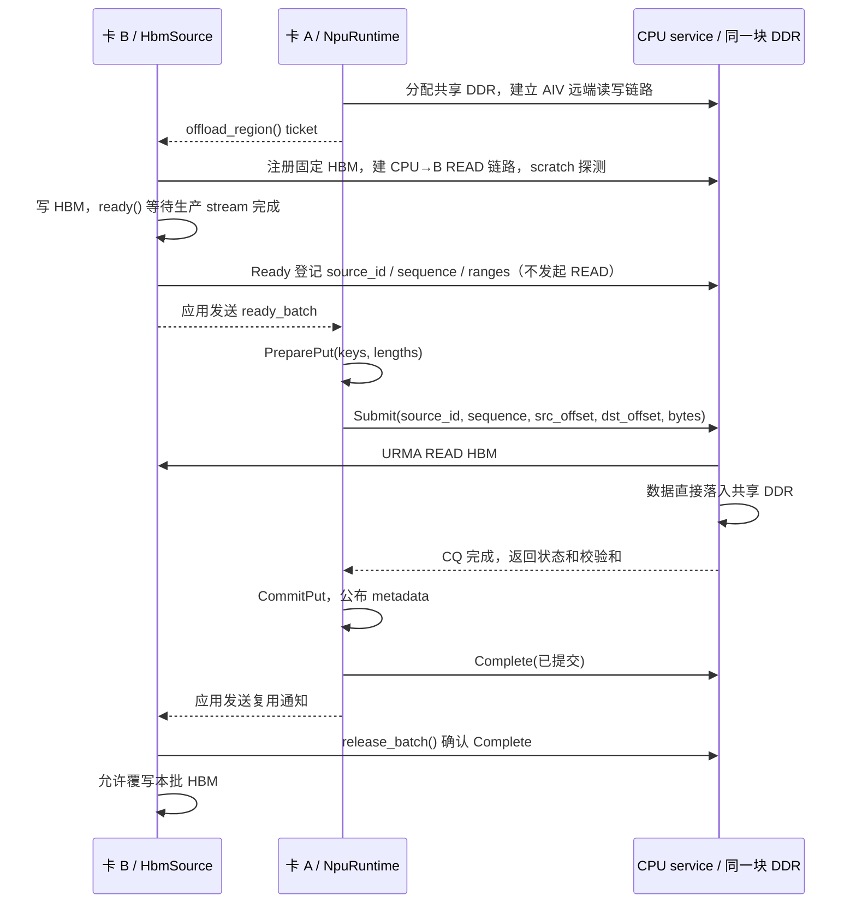

# 共享 DDR：卡 A 提交、CPU 拉取卡 B 的 HBM

实现分支：`codex/cpu-pull-hbm-reference`。A 的 `NpuRuntime` 同时支持 AIV BatchPut、
BatchGet、本卡 `offload()` 和跨卡 `offload_from()`。这四个入口共用一个 RuntimeCore、
MetaManager、PeerDdrAllocator 和 DDR Region。B 的 `HbmSource` 只管理 HBM 注册与冻结批次，
不创建 RuntimeCore、MetaManager 或第二块 DDR。

旧 `OffloadRuntime` / KVOF v2 继续兼容原来的独立用法，仍有独立池；需要整合时请改用
`NpuRuntime(enable_cpu_offload=True)`，不要再额外创建一个 `OffloadRuntime`。

## 角色、地址与时序



A 不解引用 B 的 HBM 地址，不持有 B 的 Tensor。B→A 通知只包含普通整数和列表，适合通过
现有 RPC、队列或其他业务通道传递。库不替应用选择通知通道；硬件测试使用进程间 Pipe。

提交地址由库计算：

- 源：CPU 保存的 **B 注册 HBM 基址 + B 给出的 input_offset**。
- 目的：**PreparePut 得到的 DDR 地址 − 共享 Region 导出基址**，作为 dst_offset 提交。
- CPU 最后使用本地 DDR allocation 基址加 dst_offset，搭配该 allocation 的本地 MR 构造 SGE。

目的地址不由 B 指定，也不使用 A 的 HBM 地址。CPU 校验共享池身份、源代次/批次、源范围、
目标范围、槽位边界和目标区间不重叠。已取消的批次、旧 service epoch、冲突的重复通知不能启动 READ。

## Python 使用

A 初始化一次，保留既有 AIV 配置，只增加 `enable_cpu_offload=True`。若只验收 Pull，
可以省略 AIV kernel 参数：

```python
# 卡 A 进程
runtime = kvaf.NpuRuntime(device_id=device_a, enable_cpu_offload=True)
runtime.link_to(cpu_address)
runtime.initialize(ddr_bytes=8 * 131072, slot_size=131072)
ticket = runtime.offload_region()    # 普通 dict；通过应用通道交给 B
```

```python
# 卡 B 进程：先 torch.npu.set_device(device_b)
source = kvaf.HbmSource(device_id=device_b)  # npu_eid 可显式指定；默认自动候选
source.register(ticket, hbm_tensor, stream=producer_stream)

# 每批：在 producer_stream 上完成所有写入后调用；ready 内部等待其 event。
ready_batch = source.ready([7, 100003], [656, 100001], stream=producer_stream)
# 将 ready_batch 交给 A；此时不可覆写、释放或重新绑定 hbm_tensor。
```

```python
# 卡 A 收到通知：keys 和 lengths 一一对应，keys 仍遵循现有 DSA slot 规则。
runtime.offload_from([1, 3], ready_batch)
# 返回成功表示 CPU READ 完成、Meta 已提交、CPU 已确认该批可复用。
# 通过应用通道通知 B。重复传入完全相同的 keys / ready_batch 不会再次 READ。
```

```python
# 卡 B 收到 A 的复用通知：再确认 CPU 中记录的提交结果。
source.release_batch()
assert not source.frozen
# 现在可以写下一批，继续使用同一块 HBM 和同一套注册。

# 最终顺序：B release_batch → B shutdown → A shutdown。
source.shutdown()
```

`register()` 持有整个 Tensor 的强引用，直到 `shutdown()` 成功。`ready()` 会保守地冻结整个
注册缓冲；第一版不支持同一 HbmSource 内双缓冲并行。`cancel_batch()` 只允许取消未提交的批次。
选择 B 对应的当前 NPU 再调用注册、Ready 和 Shutdown；CPU-only 的查询/确认不需要切换设备。

本卡卸载也可直接复用 A 的同一池：

```python
runtime.offload(keys, local_npu_tensor, input_offsets, lengths, stream=producer_stream)
runtime.release_offload_source()  # 可选：不用该缓冲时释放缓存的本卡 HBM 注册
```

本卡入口默认缓存同一个 Tensor 的注册；成功返回后可再次写入它。Python 会保留强引用，
直到切换源 Tensor、显式 release 或 shutdown。需要固定本卡 EID 时也可显式创建本卡 HbmSource，
再调用同一个 runtime.offload_from()。

## 池与建链约束

CPU 保存原有供 AIV 远端访问的 DDR MR（access=14、non_pin=1），在同一 allocation 上额外
注册 CPU READ 使用的本地目标 MR（LOCAL_WRITE、non_pin=0）。两者拥有独立 token_id 和注册句柄，
共享 region token 与实际内存；不复制 payload、不经过第二块暂存池。B 的 READ 链路持有原 Region
的 lease，先释放所有 B 的链路和本地 MR，才能释放 A 的 DDR。

B 初始化探测读取至独立 4 KiB scratch 的前 64 字节，并与 HBM 的内容比较；不会覆盖共享池 slot 0。
正式批次直接 READ 到 PreparePut 选定的槽位。HBM、Jetty 原始导出描述符保持 provider 返回值，
路由 EID 单独用于建链，继续使用 aicpu-urma 参考参数和 32 字节 SGE。

A 有 AIV 配置时沿用现有的候选选择与 AIV 实际 RMA 探测；`cpu_candidate` 可固定共享池。
只启用 CPU Pull 时，A 初始化选择能成功分配 DDR 的候选，真实 B→CPU 连通性在 B 注册时验证。
B 对**已经选定的 CPU 池**自动遍历其当前设备的 NPU EID，并校验 scratch READ；它不能静默切换
CPU candidate 或重分配 A 的池。若 B 所有 EID 都失败，需要应用清理后重新选择三方都能访问的
CPU candidate。这一点与旧独立 OffloadRuntime 遍历 CPU×NPU 候选组合不同。

KVRP v1 承载共享池控制消息，KVCP v6 和旧 KVOF v2 保持原格式。CPU 和 NPU 均需重新编译。
A/B/CPU 都是同步单调用方控制接口；同一共享池一次只接受一个尚未完成/确认的 Pull，
当前仍为 queue 0 串行 READ，不包含多 Jetty 并行优化。每次最多 4096 spans；单个 READ 按
provider 消息上限（最多 64 KiB）切分。服务保留已关闭 source 的幂等记录，最多接受 4096 次
source 注册（包含失败候选）；推荐长驻注册并复用，达到上限后应清理并重启 service。

## 未决操作与失败处理

`pending_offload=True` 时保留 A Runtime 和 B 的 HBM，调用 A `resolve_offload()` 查询已有任务。
这个接口不会重发 READ。发生提交回包丢失、CQ 超时或 Complete 回包丢失时，slot 锁、源注册和
共享 DDR lease 均保留；Complete 回包丢失也不会重复 CommitPut。未决期间拒绝新的 Put/Free/
PrepareAccessTable/BatchGet。B 未收到提交确认时，`release_batch()` 和销毁均拒绝释放缓冲。

Ready 回包丢失可以对同一 offsets/lengths 重试 `ready()`，仍使用原序号；或在尚未提交时取消。
A 在 PreparePut 前拒绝非法 key 等请求时，B 仍保持 Ready，调用方可以修正提交或取消。
硬件错误使传输无法证明停止时，不尝试自动重建链路或覆写源数据。当前没有进程重启后的 Meta
持久化恢复；A/B 崩溃后的孤立注册需由应用协调停止传输并重建。应用需先完成已提交的异步
AIV stream，再释放对应槽位、HBM 或 Runtime，沿用现有 BatchGet 约束。

## 构建与双卡验证

CPU 服务按 [原构建说明](cpu_pull_offload_usage.md) 重编并重启。NPU 的纯 Pull 验收仍可使用
`KVAF_ENABLE_CPU_OFFLOAD=ON`、`KVAF_BUILD_PYTHON=ON`、AIV 两项 OFF；现在该构建也导出
`NpuRuntime` 和 `HbmSource`。

```bash
python tests/python/test_remote_cpu_offload.py \
  --cpu 127.0.0.1:28999 --device-a 0 --device-b 7 --cpu-candidate 0
```

如需要固定此前跑通的 B 路由，增加
`--npu-eid-b 000000000000020000100000df00e100`。device/candidate 以实际拓扑为准。

验证 A 的 BatchPut、CPU Pull 和 A 的 BatchGet 共用同一池时，同时启用三个 CMake 开关：

```bash
cmake -S . -B build-shared-ddr \
  -DKVAF_ENABLE_CPU_OFFLOAD=ON -DKVAF_ENABLE_AIV_BATCH_GET=ON \
  -DKVAF_ENABLE_AIV_BATCH_PUT=ON -DKVAF_BUILD_PYTHON=ON -DBUILD_TESTING=OFF
cmake --build build-shared-ddr -j8
export PYTHONPATH="$PWD/build-shared-ddr/python${PYTHONPATH:+:$PYTHONPATH}"
python tests/python/test_remote_cpu_offload.py \
  --cpu 127.0.0.1:28999 --device-a 0 --device-b 7 --cpu-candidate 0 \
  --batch-get-kernel /实际路径/kvaf_execute_batch_get_kernels.o \
  --batch-put-kernel /实际路径/kvaf_execute_batch_put_kernels.o
```

脚本在两个独立 NPU 进程间只传描述符和确认，连续三轮改变 B 输入、验证 CPU DDR 校验和、
重复通知幂等性、地址所属池和 B 复用确认。带 AIV kernel 时，A 在 B 注册前先写 key 0，
随后通过 BatchGet 比较 key 0 和 B 写入 keys 的完整输出，检查探测没有覆盖已有缓存。
成功打印 `REMOTE_OFFLOAD_PASS`。无法确认资源已释放时脚本会停留并保留进程；应先检查 CPU
日志、停止未决传输，再结束相关进程。

本地已覆盖真实 Core/协议/Exporter 编排的模拟测试，以及借用 DDR 的 URMA provider 模型测试。
这些测试不代替硬件验收；尤其是同一 allocation 的两份 MR 注册、A/B 各自路由和实际 NPU
cache 可见性，需要在上述双卡环境中验证。
