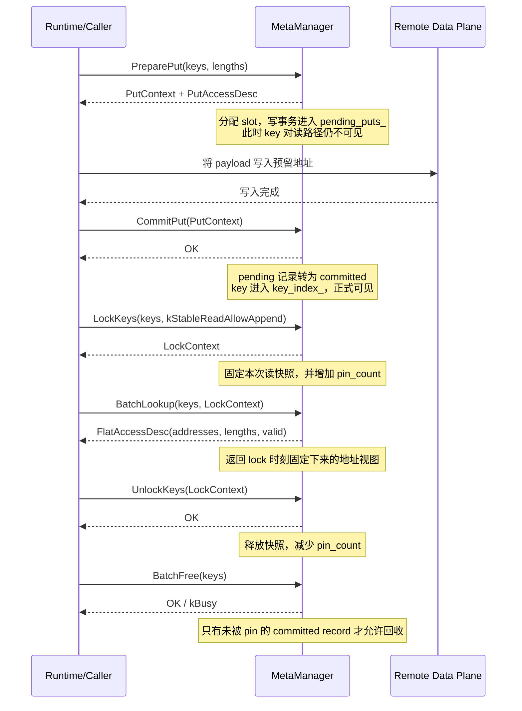
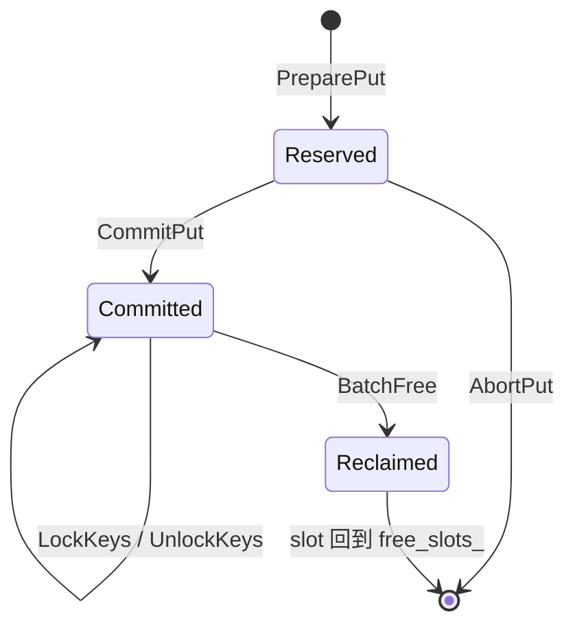

# Meta Manager

## 模块定位

`MetaManager` 是 KVAF 控制面中的元数据管理模块，负责维护 `KVBlockKey -> 远端 DDR 地址` 的映射关系，并为 Runtime 提供地址预留、查询、提交、锁定、解锁和回收能力。

当前这部分工作聚焦于 `MetaManager` 的“内存地址管理子模块”，目标是先实现一版可运行、可测试、可扩展的地址管理 POC。

---

## 主要职责

- 注册和管理远端 DDR region。
- 为写路径预留远端地址，并在数据写入成功后提交映射。
- 为读路径提供稳定的地址快照，避免读到未完成写入或被并发回收的数据。
- 维护空闲地址池，支持 slot 回收和复用。
- 为后续 Runtime 对接提供清晰的控制面接口。

---

## 边界说明

`MetaManager` 不负责以下内容：

- KV Payload 的实际数据搬运；
- Prefix Key 到 `KVBlockKey` 的业务映射；
- AccessTable 的设备侧布局；
- 跨节点、跨卡协同；
- 复杂迁移、多副本一致性、故障恢复策略。

当前 POC 的管理边界是：

- 单 KVAF 实例；
- 单远端 region；
- 固定大小 slot；
- 单 key 仅维护一个当前可见的 `active_record`。

---

## 当前设计思路

当前实现采用 `hashtable + queue`：

- `hashtable`
  负责维护 `key -> address record` 的快速索引。
- `queue`
  负责维护空闲 slot 队列，实现地址分配与回收。

这个方案适合当前 POC，原因是：

- 结构简单，便于快速落地；
- 地址分配和回收逻辑清晰；
- 易于做单元测试覆盖；
- 后续可以在不改变上层接口的前提下，把底层固定 slot allocator 演进为更复杂的分配器。

---

## 关键时序图

下面这张图描述了当前地址管理模块在一次典型写读流程中的职责边界：

从这个时序可以直接看出：

- `PreparePut` 之后地址已经分配，但还不可读；
- `CommitPut` 是写路径可见性边界；
- `LockKeys` 是读路径稳定性边界；
- `UnlockKeys` 之后记录才重新具备被 `BatchFree` 回收的可能。

---

## 对外接口

接口定义位于 [meta_manager.h](C:/Urma/KVAF/meta_manager/include/kvaf/meta_manager/meta_manager.h:1)。

### `RegisterRemoteRegion`

作用：

- 注册一块可管理的远端内存区域；
- 按 `slot_size` 切分 slot；
- 初始化 `slot_table_` 和 `free_slots_`。

### `PreparePut`

作用：

- 为一批 key 预留远端 slot；
- 返回写路径使用的 `PutContext` 和 `PutAccessDesc`。

特点：

- 只分配地址，不建立可见映射；
- 读路径在 `CommitPut` 之前看不到这些 key；
- 重复 key 或 pending key 会被拒绝。

### `CommitPut`

作用：

- 将 `PreparePut` 阶段的预留地址正式提交为可见映射。

特点：

- 这是写路径真正的可见性边界；
- 成功后 key 才进入 `key_index_`；
- 记录状态从“预留”转为“已提交”。

### `AbortPut`

作用：

- 放弃未提交的 put 请求；
- 回收已预留但未生效的 slot。

### `LockKeys`

作用：

- 为一批 key 建立稳定读快照；
- 返回 `LockContext`。

特点：

- 当前 POC 只支持 `kStableReadAllowAppend`；
- 成功后会增加对应 record 的 `pin_count`；
- 被 pin 的记录不能被 `BatchFree`。

### `BatchLookup`

作用：

- 基于 `LockContext` 读取稳定快照中的地址信息。

返回：

- `addresses`
- `lengths`
- `valid`

特点：

- 只能读取与 `LockContext` 一致的 key 集合与顺序；
- 如果上下文不匹配或状态异常，会返回错误。

### `UnlockKeys`

作用：

- 释放稳定读快照；
- 减少对应 record 的 `pin_count`。

### `BatchFree`

作用：

- 删除一批 key 当前的 committed 映射；
- 回收对应 slot 到空闲队列。

特点：

- 遇到仍被 pin 的记录会返回 `kBusy`；
- 当前实现保持 batch 级别 all-or-nothing 语义。

---

## 当前代码实现说明

当前 POC 实现位于 [in_memory_meta_manager.cc](C:/Urma/KVAF/meta_manager/src/in_memory_meta_manager.cc:1)。

### 1. 内存模型

当前实现采用“单 region + 固定 slot”的模型：

- 注册一个远端 region；
- 将 region 按固定 `slot_size` 切成多个 slot；
- 每个 slot 对应一个可复用地址块；
- 每个 key 当前只绑定一个 `active_record`。

本质上可以理解为：

`remote region -> slot array -> key 绑定到某个 slot`

### 2. 核心数据结构

#### `SlotMeta`

描述 slot 的静态信息：

- `slot_id`
- `uba`
- `capacity`

#### `AddressRecord`

描述某个 key 当前绑定的地址记录：

- `record_id`
- `uba`
- `valid_length`
- `slot_id`
- `version`
- `state`
- `pin_count`

#### `KeyEntry`

表示 key 当前可见的记录：

- `active_record`
- `latest_version`

#### `PendingPutContext`

保存 `PreparePut` 到 `CommitPut` 之间的临时写事务。

#### `ActiveLockContext`

保存一次 `LockKeys` 固定下来的稳定读快照。

### 3. 内部容器分工

#### `slot_table_`

保存所有 slot 的元数据，通过 `slot_id` 反查地址和容量。

#### `free_slots_`

保存当前可用 slot 的 FIFO 队列：

- `PreparePut` 从队头取；
- `AbortPut` / `BatchFree` 从队尾归还。

#### `key_index_`

保存当前 committed key 到 `active_record` 的映射，是读路径主索引。

#### `pending_puts_`

保存已经分配地址但尚未提交的 put 事务。

#### `pending_keys_`

防止 key 在 pending 阶段被重复申请。

#### `lock_contexts_`

保存活动中的稳定读上下文。

### 4. 记录状态机

当前实现中记录状态分为三种：

状态含义：

- `Reserved`
  已预留地址，但尚未提交，对读路径不可见。
- `Committed`
  已正式提交，可参与 `LockKeys` 和 `BatchLookup`。
- `Reclaimed`
  已删除映射，对应 slot 已回收。

### 5. 关键实现逻辑

#### `RegisterRemoteRegion`

完成参数校验后：

- 记录 region 配置；
- 清空内部状态；
- 初始化 `slot_table_`；
- 将所有 slot 放入 `free_slots_`。

#### `PreparePut`

做的事情包括：

- 检查输入参数是否合法；
- 检查长度是否超过 `slot_size`；
- 检查 key 是否已存在或正处于 pending；
- 从 `free_slots_` 中取出 slot；
- 生成 `PutContext` 和 `PutAccessDesc`；
- 将事务写入 `pending_puts_`。

这一阶段不会改动 `key_index_`，所以不会对读路径暴露半完成状态。

#### `CommitPut`

做的事情包括：

- 根据 `PutContext` 找到 pending 事务；
- 为每个 key 生成 committed `AddressRecord`；
- 写入 `key_index_`；
- 清理 `pending_keys_` 和 `pending_puts_`。

这里才真正让 key 对读路径变得可见。

#### `AbortPut`

做的事情包括：

- 根据 `PutContext` 找到 pending 事务；
- 将 slot 归还给 `free_slots_`；
- 清理 pending 状态。

#### `LockKeys`

做的事情包括：

- 根据 key 在 `key_index_` 中找到 committed record；
- 固定 `record_id` 和 `version`；
- 增加 `pin_count`；
- 生成 `LockContext` 并放入 `lock_contexts_`。

#### `BatchLookup`

做的事情包括：

- 校验 `LockContext` 是否存在且未释放；
- 校验传入 key 顺序是否与锁定快照一致；
- 再次确认 record 仍与 `record_id/version` 一致；
- 返回地址、长度、有效位组成的扁平访问描述。

#### `UnlockKeys`

做的事情包括：

- 找到活动 `LockContext`；
- 逐项减少 `pin_count`；
- 删除该读上下文。

#### `BatchFree`

做的事情包括：

- 先校验所有 key 是否都存在且未被 pin；
- 将对应记录标记为回收；
- 从 `key_index_` 删除映射；
- 将 slot 放回 `free_slots_`。

---

## 并发与一致性

当前 POC 优先保证正确性，实现上采用较直接的串行化思路：

- `meta_mutex_`
  保护 `key_index_`、`pending_puts_`、`pending_keys_`、`lock_contexts_` 等控制面状态。
- `free_queue_mutex_`
  保护 `free_slots_`。

涉及两类状态同时操作时，代码统一按固定顺序加锁，降低死锁风险。

这一版并发模型足够支撑 POC 验证，但如果进入正式版本，后续还需要根据真实访问模型继续细化。

---

## 测试说明

测试位于 [in_memory_meta_manager_test.cc](C:/Urma/KVAF/meta_manager/tests/in_memory_meta_manager_test.cc:1)。

当前已覆盖的重点场景包括：

- `RegisterRemoteRegion` 参数校验与重复注册；
- `PreparePut -> CommitPut -> LockKeys -> BatchLookup -> UnlockKeys -> BatchFree` 主流程；
- `AbortPut` 后 slot 回收；
- pinned record 上执行 `BatchFree` 返回 `kBusy`；
- 重复 key、非法上下文、未初始化状态；
- slot 耗尽、长度超限；
- double unlock 等边界场景。

---

## 构建与验证

当前代码已经接入 CMake/CTest，并已在 Ubuntu 环境实际验证通过：

- `cmake -S . -B build-wsl -DBUILD_TESTING=ON`
- `cmake --build build-wsl -j`
- `ctest --test-dir build-wsl --output-on-failure`

验证结果：

- 配置成功；
- 编译成功；
- `kvaf_meta_manager_test` 通过。

---

## 后续建议

建议后续按以下方向推进：

1. 将 `MetaManager` 正式接入 Runtime 的 `BatchPut / BatchGet / Delete` 主流程。
2. 支持 key 覆盖写和版本切换。
3. 从单 region 扩展到多 region 管理。
4. 评估是否需要支持可变长分配。
5. 补充更贴近真实并发和异常恢复场景的测试。
