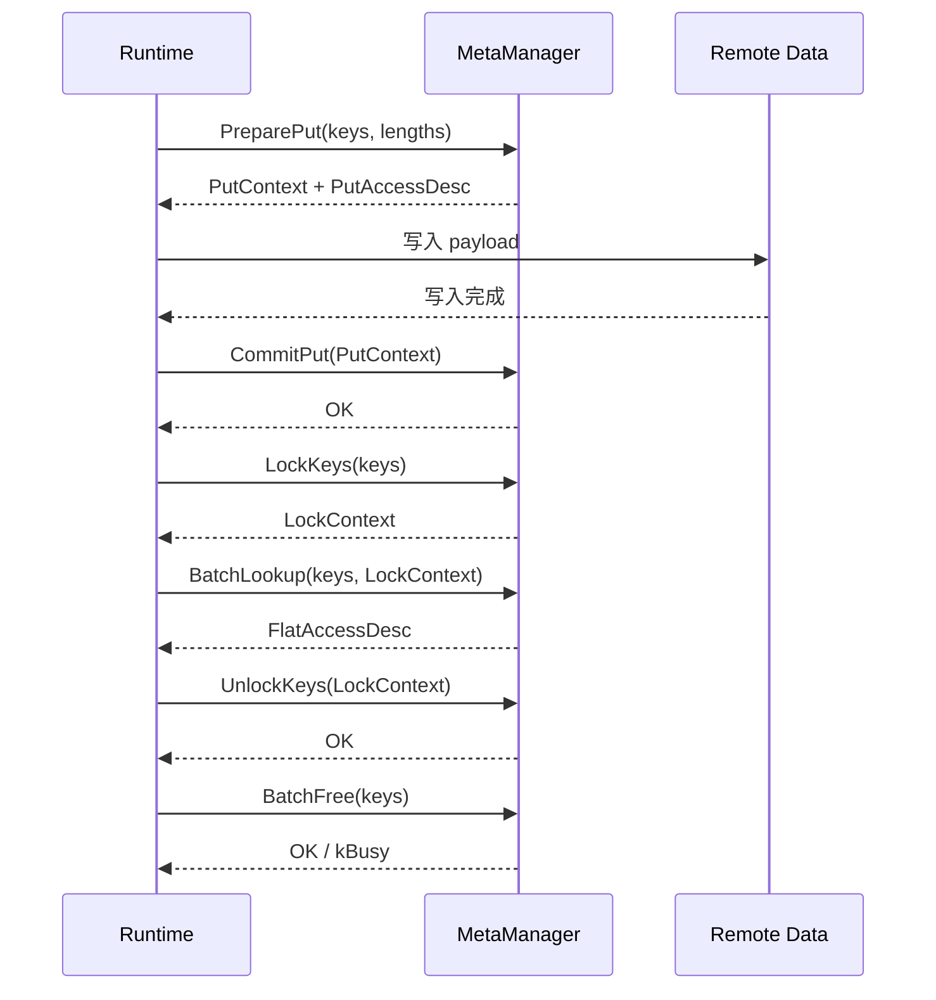
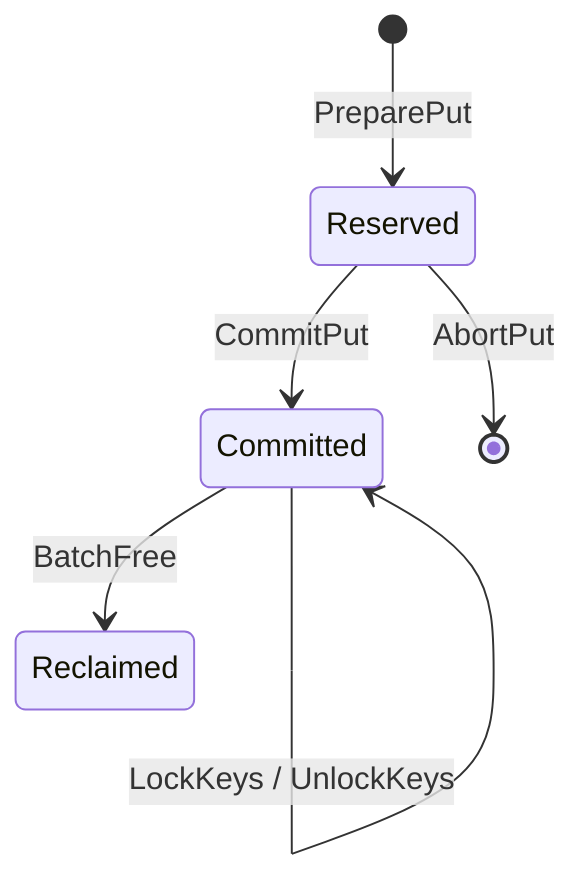

# Meta Manager

## 模块定位

`MetaManager` 负责维护 `KVBlockKey -> 远端地址` 的元数据映射，并提供地址预留、提交、锁定、查询和回收能力。

当前实现聚焦地址管理 POC，目标是先把 `put / lock / get / free` 这条控制面链路打通。

## 主要职责

- 注册远端内存 region，并切分为固定大小 slot。
- 为写路径预留地址，并在写入成功后提交映射。
- 为读路径提供稳定快照，避免读到未提交或已回收的数据。
- 回收空闲 slot，支持后续复用。

## 当前边界

当前 POC 只覆盖：

- 单 KVAF 实例
- 单远端 region
- 固定 slot 分配
- 单 key 单 `active_record`

当前不负责：

- Payload 数据搬运
- Prefix Key 转换
- 多 region 调度
- 多版本和覆盖写

## 核心思路

实现采用 `hashtable + queue`：

- `hashtable`：维护 `key -> record`
- `queue`：维护空闲 slot

写路径采用两阶段：

1. `PreparePut`：分配地址，但对读路径不可见
2. `CommitPut`：写入完成后发布映射

读路径采用快照方式：

1. `LockKeys`：固定当前可见记录
2. `BatchLookup`：读取快照中的地址
3. `UnlockKeys`：释放快照

## 为什么 `CommitPut` 和 `LockKeys` 分开

两者解决的问题不同：

- `CommitPut` 解决“什么时候可见”
- `LockKeys` 解决“这次读读哪一版”

分开后有三个好处：

- 写完成后不必立刻为读请求保留快照，减少无意义 `pin_count`
- 不同读请求可以拥有各自独立的 `LockContext`
- 后续扩展多版本或覆盖写时，接口边界更清楚

## 关键时序

关键点：

- `PreparePut` 后地址已分配，但不可读
- `CommitPut` 后 key 才正式可见
- `LockKeys` 后本次读快照才固定
- `BatchFree` 不能回收仍被 pin 的记录

## 对外接口

接口定义见 [meta_manager.h](C:/Urma/KVAF/meta_manager/include/kvaf/meta_manager/meta_manager.h:1)。

- `RegisterRemoteRegion`
  注册 region，初始化 slot 表和空闲队列。
- `PreparePut`
  为一批 key 预留 slot，返回写路径访问描述。
- `CommitPut`
  提交预留记录，使其进入可见状态。
- `AbortPut`
  放弃未提交 put，并归还 slot。
- `LockKeys`
  固定一批 key 的当前记录，建立读快照。
- `BatchLookup`
  基于快照返回地址、长度和有效位。
- `UnlockKeys`
  释放读快照，减少 `pin_count`。
- `BatchFree`
  删除映射并回收 slot；若记录仍被 pin，则返回 `kBusy`。

## 当前实现

实现文件：[in_memory_meta_manager.cc](C:/Urma/KVAF/meta_manager/src/in_memory_meta_manager.cc:1)

核心数据结构：

- `slot_table_`：slot 元数据表
- `free_slots_`：FIFO 空闲队列
- `key_index_`：committed key 索引
- `pending_puts_`：未提交写事务
- `pending_keys_`：防止 pending 阶段重复申请
- `lock_contexts_`：活动读快照

记录状态：

## 测试与验证

测试文件：[in_memory_meta_manager_test.cc](C:/Urma/KVAF/meta_manager/tests/in_memory_meta_manager_test.cc:1)

已覆盖：

- region 注册与参数校验
- `PreparePut -> CommitPut -> LockKeys -> BatchLookup -> UnlockKeys -> BatchFree`
- `AbortPut` 回滚
- pinned record 的 `kBusy`
- slot 耗尽、非法上下文、重复释放等边界场景

已在 Ubuntu 环境完成构建和测试验证：

- `cmake -S . -B build-wsl -DBUILD_TESTING=ON`
- `cmake --build build-wsl -j`
- `ctest --test-dir build-wsl --output-on-failure`

## 后续建议

1. 接入 Runtime 的 `BatchPut / BatchGet / Delete`
2. 支持覆盖写和版本切换
3. 从单 region 扩展到多 region
4. 评估是否需要可变长分配器
