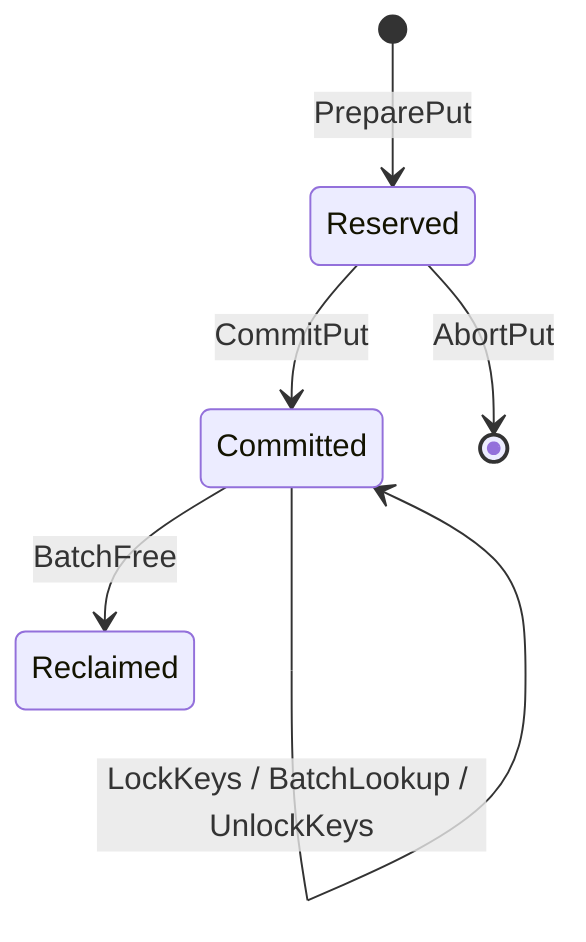

# Meta Manager

## 模块定位

`MetaManager` 负责维护 `KeyId -> 远端地址` 的元数据映射，并提供：

- 写路径地址预留：`PreparePut / CommitPut / AbortPut`
- 读路径稳定快照：`LockKeys / BatchLookup / UnlockKeys`
- 地址回收：`BatchFree`

当前实现是一个地址管理 POC，重点验证 `put / lock / get / free` 这条控制面流程。

## 当前边界

当前版本支持：

- 单 `MetaManager` 实例
- 单远端 region
- 两类 slot：`short_slot_size` 和 `long_slot_size`
- 两类 slot 数量相同，由 `slot_count_per_class` 指定
- `KeyId` 为 `std::string`
- 一个 key 仅保留一条当前可见记录

当前版本不负责：

- payload 实际搬运
- prefix key 转换
- 多 region 调度
- 覆盖写

## 核心思路

实现仍然使用 `hashtable + queue`：

- `hashtable`：维护 `key -> record`
- `queue`：维护短 slot 和长 slot 的空闲队列

写路径分两阶段：

1. `PreparePut` 为每个 key 选择短 slot 或长 slot，并返回写入地址
2. `CommitPut` 在写入完成后发布映射

读路径分三步：

1. `LockKeys` 固定一批 key，并增加 `pin_count`
2. `BatchLookup` 返回这批 key 当前对应的地址和长度
3. `UnlockKeys` 释放快照

## 接口说明

接口定义见 [meta_manager.h](C:/Urma/KVAF/meta_manager/include/kvaf/meta_manager/meta_manager.h:1)。

- `RegisterRemoteRegion`
  注册单个 region，初始化短 slot 和长 slot 的空闲队列。
- `PreparePut`
  根据每个 key 的长度选择 slot 类型，返回 `PutContext` 和 `PutAccessDesc`。
- `CommitPut`
  提交预留结果，使 key 对读路径可见。
- `AbortPut`
  回滚未提交的 put，并归还 slot。
- `LockKeys`
  固定一批 key，阻止它们在读期间被回收。
- `BatchLookup`
  返回锁定 key 的地址、长度和有效位。
- `UnlockKeys`
  释放锁定结果，减少 `pin_count`。
- `BatchFree`
  回收一批 key 占用的 slot；若仍被锁定则返回 `kBusy`。
- `SetTimingLogEnabled`
  打开或关闭接口级计时日志；默认关闭。

## 当前实现

实现文件见 [in_memory_meta_manager.cc](C:/Urma/KVAF/meta_manager/src/in_memory_meta_manager.cc:1)。

当前 `MetaManager` 直接在头文件中声明状态，在 `.cc` 中实现逻辑，不再额外定义独立的 `InMemoryMetaManager` 子类。

核心状态包括：

- `short_free_slots_`：短 slot 空闲队列
- `long_free_slots_`：长 slot 空闲队列
- `key_index_`：当前已提交的 key 映射
- `pending_puts_`：未提交的 put 上下文
- `pending_keys_`：防止 pending 阶段重复申请
- `lock_contexts_`：活动读快照
- `region_`：当前 region 配置
- `timing_log_enabled_`：控制是否输出接口耗时日志

地址计算规则：

- 短 slot 地址：`base + slot_index * short_slot_size`
- 长 slot 地址：`base + slot_count_per_class * short_slot_size + slot_index * long_slot_size`

## 状态流转



## 测试与验证

测试文件见 [in_memory_meta_manager_test.cc](C:/Urma/KVAF/meta_manager/tests/in_memory_meta_manager_test.cc:1)。

已覆盖：

- region 参数校验与重复注册
- 短 slot 正常流程
- 长 slot 分配与查询
- `AbortPut` 回滚
- pinned key 的 `kBusy`
- 重复 key、非法上下文、空闲队列耗尽等边界场景

Ubuntu/WSL 已验证通过：

- `cmake -S . -B build-wsl -DBUILD_TESTING=ON`
- `cmake --build build-wsl -j`
- `ctest --test-dir build-wsl --output-on-failure`

## 计时日志

`MetaManager` 现在支持接口级计时日志，默认关闭。

使用方式：

```cpp
auto manager = kvaf::CreateInMemoryMetaManager();
manager->SetTimingLogEnabled(true);
```

开启后，每次调用核心接口都会输出一行日志，格式类似：

```text
[MetaManagerTiming] method=PreparePut elapsed_ns=812
```

关闭方式：

```cpp
manager->SetTimingLogEnabled(false);
```

说明：

- 日志是按函数调用打印的
- 单位为纳秒 `ns`
- 性能测试时建议关闭日志，避免日志 I/O 干扰结果

## 性能测试

性能测试程序见 [in_memory_meta_manager_perf.cc](C:/Urma/KVAF/meta_manager/tests/in_memory_meta_manager_perf.cc:1)。

构建与执行：

```sh
cmake -S . -B build-wsl-release -DBUILD_TESTING=ON -DCMAKE_BUILD_TYPE=Release
cmake --build build-wsl-release -j
./build-wsl-release/meta_manager/kvaf_meta_manager_perf
```

如果想同时观察接口级计时日志，可以执行：

```sh
./build-wsl-release/meta_manager/kvaf_meta_manager_perf --enable-timing-log
```

本次实测环境：

- 日期：2026-08-03
- 平台：Ubuntu on WSL
- 编译器：GCC 13.3.0
- 构建类型：`Release`
- 日志开关：关闭
- 迭代次数：
  `RegisterRemoteRegion` 5000 次，其余接口 20000 次
- 场景：
  除 `PreparePut(long)` 外，默认测试单 key、短 slot 路径

实测结果：

| 接口 | avg_ns | p50_ns | p95_ns | max_ns |
| --- | ---: | ---: | ---: | ---: |
| `RegisterRemoteRegion` | 98.49 | 98.00 | 101.00 | 1718.00 |
| `PreparePut(short)` | 769.22 | 676.00 | 938.00 | 290556.00 |
| `PreparePut(long)` | 849.34 | 815.00 | 978.00 | 200316.00 |
| `CommitPut` | 402.99 | 268.00 | 428.00 | 430127.00 |
| `AbortPut` | 136.98 | 123.00 | 209.00 | 33739.00 |
| `LockKeys` | 444.17 | 393.00 | 755.00 | 66719.00 |
| `BatchLookup` | 237.25 | 188.00 | 262.00 | 716562.00 |
| `UnlockKeys` | 175.00 | 157.00 | 224.00 | 69429.00 |
| `BatchFree` | 557.69 | 494.00 | 858.00 | 294595.00 |

结果解读：

- 中位数和 `p95` 比较稳定，适合观察函数本身的开销
- `max_ns` 明显高于 `p95`，主要反映 WSL 调度和系统抖动，不建议把它当作常态延迟
- 当前最重的单次接口主要是 `PreparePut` 和 `BatchFree`，因为它们包含更多队列与哈希表状态变更
